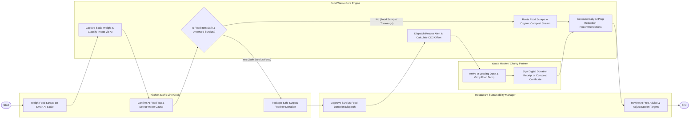

# Swimlane Diagram — Food Waste Management System

## Mermaid Code

## Flow Description | Mo ta luong

| Lane | Actor | Role in Flow |
|------|-------|-------------|
| **Lane 1** | Kitchen Staff / Line Cook | Weighs food waste scraps on smart AI scales, confirms AI food classification tags, selects waste root cause categories, and packages safe surplus food. |
| **Lane 2** | Restaurant Sustainability Manager | Approves surplus food donation dispatches, monitors daily waste monetary loss, and reviews AI prep reduction advice to adjust chef station targets. |
| **Lane 3** | Waste Hauler / Charity Partner | Arrives at kitchen loading docks, verifies food safety temperatures, signs digital donation receipts, and hauls organic compost bins. |
| **Lane 4** | Food Waste Core Engine | Processes AI image recognition, calculates monetary costs and CO2e footprints, dispatches food rescue alerts, and generates machine learning prep recommendations. |

### Process Execution Steps | Cac buoc thuc hien quy trinh

1. **Weigh-In & AI Recognition**: Kitchen Cook weighs food scraps on smart AI scale (`C1`). Core Engine captures weight and classifies food image via AI (`S1`). Cook confirms item tag and waste cause (`C2`). Core Engine checks donation eligibility (`S2`).
   - If **No (Food Scraps / Trimmings / Expired)**: Core Engine routes waste to Organic Compost Stream (`S3`).
   - If **Yes (Safe Surplus Food)**: Cook packages surplus food (`C3`). Sustainability Manager approves donation dispatch (`M1`).
2. **Food Rescue & Pickup**: Core Engine dispatches rescue alert and calculates CO2 offset (`S4`). Charity Partner arrives at dock and verifies food temp (`H1`), signing digital donation receipt (`H2`).
3. **AI Optimization & Action**: Core Engine generates daily AI prep reduction recommendations (`S5`), and Sustainability Manager adjusts station prep targets (`M2`), completing execution (`Finish`).
