# Action Tree — Food Waste Management System

## Mermaid Code

```mermaid
graph TD
    Root["Food Waste Management System"]

    Root --> M1["Smart Scale & AI Waste Image Recognition"]
    Root --> M2["Waste Cause Categorization & Cost Impact"]
    Root --> M3["Surplus Food Rescue & Charity Donations"]
    Root --> M4["Organic Composting & Hauler Logistics"]
    Root --> M5["AI Prep Reduction & Inventory Optimization"]
    Root --> M6["ESG Carbon Offset & Health Compliance Reports"]
    Root --> M7["Waste Analytics & System Administration"]

    M1 --> A11["Capture Net Waste Weight on Smart Scale Platform"]
    M1 --> A12["Classify Food Items via Top-Down AI Camera"]
    M1 --> A13["Calibrate Scale Tare Weights & Zero Baselines"]
    M1 --> A14["Train Custom AI Image Recognition Models"]

    M2 --> A21["Assign Root Cause Tags Over-Prep Trimming Expired"]
    M2 --> A22["Calculate Direct Raw Ingredient Financial Loss"]
    M2 --> A23["Calculate Fully Loaded Labor & Utility Waste Cost"]
    M2 --> A24["Convert Waste Weight into Embedded Water Loss"]

    M3 --> A31["Identify Safe Unserved Surplus Food for Rescue"]
    M3 --> A32["Verify Food Safety Holding Temperatures"]
    M3 --> A33["Dispatch Pickup Alerts to Charity Partners"]
    M3 --> A34["Generate Tax Deduction 501c3 Donation Receipts"]

    M4 --> A41["Schedule Organic Waste Composting Hauler Pickups"]
    M4 --> A42["Track Yellow Grease & Fryer Oil Recycling"]
    M4 --> A43["Monitor Waste Container Fullness & Contamination"]
    M4 --> A44["Issue Landfill Waste Diversion Certificates"]

    M5 --> A51["Generate AI Daily Station Prep Reduction Advice"]
    M5 --> A52["Analyze POS Sales Velocity & Weather Forecasts"]
    M5 --> A53["Sync Waste Logs with Kitchen Inventory Systems"]
    M5 --> A54["Track Theoretical vs Actual Food Cost Variances"]

    M6 --> A61["Calculate ESG Carbon Footprint CO2e Emissions"]
    M6 --> A62["Generate Corporate Sustainability Audit Reports"]
    M6 --> A63["Track Good Samaritan Food Donation Compliance"]
    M6 --> A64["Export ESG Carbon Offset Tokens to Third-Party APIs"]

    M7 --> A71["Monitor Total Store Financial Waste Loss"]
    M7 --> A72["Display Gamified Staff Waste Reduction Leaderboards"]
    M7 --> A73["Manage User Security Roles & Station Access"]
    M7 --> A74["Manage Smart Scale & AI Camera Device Settings"]
```

## Module Description | Mo ta Module

| # | Module | Description | Actions |
|---|--------|-------------|---------|
| 1 | Smart Scale & AI Waste Image Recognition | Captures net food waste weight on smart scales, auto-classifies food images using top-down AI cameras, zero-tares scales, and trains custom ML models. | Capture Net Waste Weight on Smart Scale Platform, Classify Food Items via Top-Down AI Camera, Calibrate Scale Tare Weights & Zero Baselines, Train Custom AI Image Recognition Models |
| 2 | Waste Cause Categorization & Cost Impact | Assigns waste root cause tags (Over-Prep, Trimming, Expiry), calculates direct ingredient monetary loss, fully loaded waste costs, and embedded water loss. | Assign Root Cause Tags Over-Prep Trimming Expired, Calculate Direct Raw Ingredient Financial Loss, Calculate Fully Loaded Labor & Utility Waste Cost, Convert Waste Weight into Embedded Water Loss |
| 3 | Surplus Food Rescue & Charity Donations | Identifies unserved surplus food, verifies holding temperatures, dispatches pickup alerts to food rescue charities, and generates 501(c)(3) tax receipts. | Identify Safe Unserved Surplus Food for Rescue, Verify Food Safety Holding Temperatures, Dispatch Pickup Alerts to Charity Partners, Generate Tax Deduction 501c3 Donation Receipts |
| 4 | Organic Composting & Hauler Logistics | Schedules organic waste bin pickups with composting haulers, tracks fryer grease recycling, monitors bin contamination, and issues landfill diversion certificates. | Schedule Organic Waste Composting Hauler Pickups, Track Yellow Grease & Fryer Oil Recycling, Monitor Waste Container Fullness & Contamination, Issue Landfill Waste Diversion Certificates |
| 5 | AI Prep Reduction & Inventory Optimization | Analyzes historical waste, POS sales velocity, and weather forecasts to generate daily AI prep reduction advice and calculate inventory variances. | Generate AI Daily Station Prep Reduction Advice, Analyze POS Sales Velocity & Weather Forecasts, Sync Waste Logs with Kitchen Inventory Systems, Track Theoretical vs Actual Food Cost Variances |
| 6 | ESG Carbon Offset & Health Compliance Reports | Calculates greenhouse gas CO2e emissions avoided, generates corporate ESG audit reports, verifies Good Samaritan compliance, and exports offset metrics. | Calculate ESG Carbon Footprint CO2e Emissions, Generate Corporate Sustainability Audit Reports, Track Good Samaritan Food Donation Compliance, Export ESG Carbon Offset Tokens to Third-Party APIs |
| 7 | Waste Analytics & System Administration | Displays executive dashboards on total monetary waste loss, top wasted ingredients by cost, gamified staff leaderboards, camera settings, and security roles. | Monitor Total Store Financial Waste Loss, Display Gamified Staff Waste Reduction Leaderboards, Manage User Security Roles & Station Access, Manage Smart Scale & AI Camera Device Settings |
