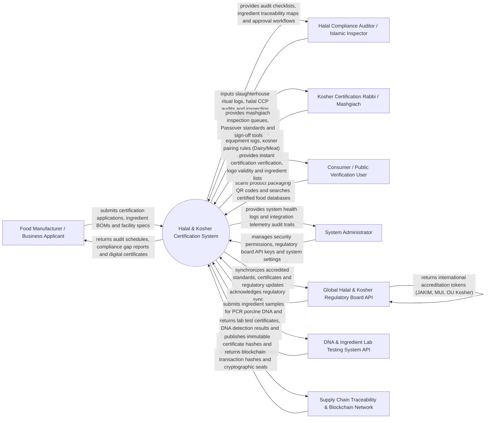

# Context Diagram — Halal & Kosher Certification System

## Mermaid Code

## Actor & Interaction Table | Bang Actor & Tuong tac

| # | Actor | Actor Type | Data Sent TO System | Data Received FROM System | Notes |
|---|-------|------------|---------------------|---------------------------|-------|
| 1 | Food Manufacturer / Business Applicant | Primary | Certification applications, ingredient Bill of Materials (BOM), supplier certificates, facility layouts | Audit schedules, non-compliance gap notices, official digital certificates, logo permits | Commercial food factory, restaurant chain, or slaughterhouse seeking certification. |
| 2 | Halal Compliance Auditor | Primary | On-site slaughterhouse ritual audit logs, Halal Critical Control Points (HCCP), inspection reports | Inspection checklists, raw ingredient origin maps, certificate approval workflows | Islamic auditor evaluating compliance with JAKIM/MUI/GSO Halal standards. |
| 3 | Kosher Certification Rabbi / Mashgiach | Primary | Equipment kashering sanitization logs, Kosher classification (Glatt Meat, Dairy, Pareve), sign-offs | Mashgiach inspection queues, Passover Kosher standards, approval signing tools | Rabbinic supervisor evaluating compliance with OU/OK Kosher standards. |
| 4 | Consumer / Public Verification User | Primary | Product packaging barcode/QR code scans, product search queries, suspicious logo reports | Real-time certificate validity, logo authenticity, ingredient list, expiry dates | End consumer verifying Halal or Kosher authenticity at retail stores. |
| 5 | System Administrator | Primary | User credentials, security role policies, regulatory board API bindings, platform settings | System health metrics, integration telemetry logs, security audit trails | Manages IT infrastructure, API integrations, and security access levels. |
| 6 | Global Halal & Kosher Regulatory Board API | Supporting | Accredited regulatory standards, international recognition tokens, revoked certificate lists | Certificate registry sync payloads, cross-border export compliance reports | International certification authorities (e.g., JAKIM Malaysia, MUI Indonesia, OU Kosher USA). |
| 7 | DNA & Ingredient Lab Testing System API | Supporting | Polymerase Chain Reaction (PCR) porcine DNA test results, ethanol gas chromatography % | Laboratory sample submission requests, test result certificates, contamination flags | Accredited bio-testing laboratory analyzing food samples for pork DNA or ethanol. |
| 8 | Supply Chain Traceability & Blockchain Network | Supporting | Immutable certificate hash validations, distributed ledger transaction confirmations | Certificate cryptographic seals, supply chain custody logs, provenance hashes | Distributed ledger (Blockchain) ensuring tamper-proof certificate authenticity. |

## System Boundary Description | Mo ta Pham vi He thong

The **Halal & Kosher Certification System** manages end-to-end religious food compliance, supply chain ingredient audits, ritual slaughter inspections, laboratory DNA screening, digital certificate issuance, and public QR code verification. Inside its boundary, the system handles online certification application onboarding, ingredient Bill of Materials (BOM) cross-referencing, on-site auditor inspection workflows, ritual slaughterhouse compliance logging, equipment kashering/cleansing tracking, PCR porcine DNA & ethanol lab test ingestion, digital certificate issuance with QR codes, and international regulatory board API synchronization (JAKIM, OU Kosher).

The system boundary excludes physical slaughtering of livestock, physical lab chemical testing equipment manufacturing, physical wiping of factory machinery, and academic religious law jurisprudence writing.
