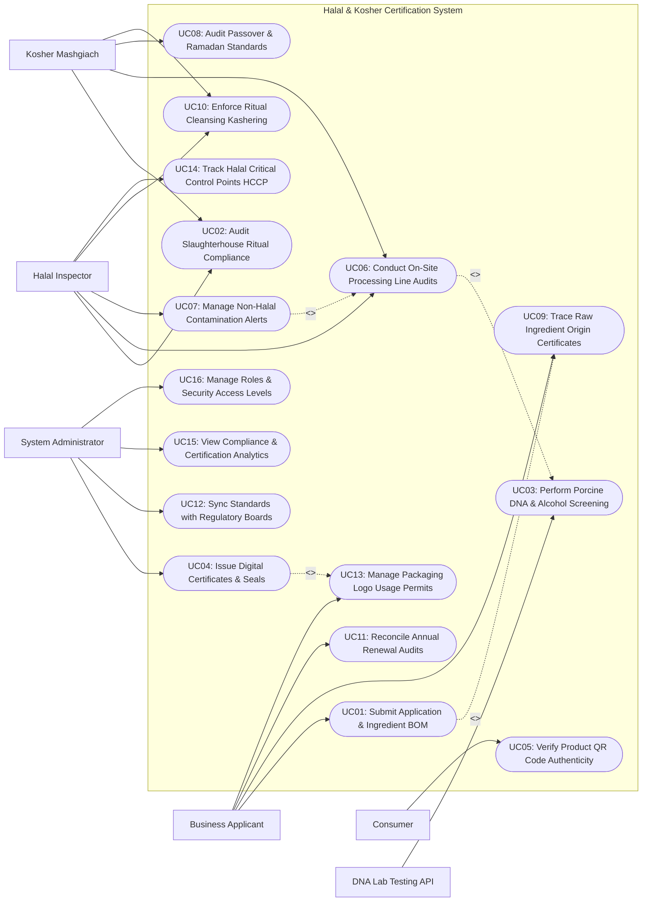

# Use Case Diagram — Halal & Kosher Certification System

## Mermaid Code

## Actor Table | Bang Actor

| # | Actor | Actor Type | Role Description | Related Use Cases |
|---|-------|------------|------------------|-------------------|
| 1 | DNA Lab Testing API | Secondary System | Accredited bio-testing laboratory returning PCR porcine DNA detection results and gas chromatography ethanol % logs. | UC03 |
| 2 | Business Applicant | Primary | Food manufacturer or restaurant chain applying for Halal/Kosher certification, submitting BOMs, and managing logo permits. | UC01, UC09, UC11, UC13 |
| 3 | Halal Inspector | Primary | Certified Islamic auditor verifying halal slaughter compliance, ingredient provenance, HCCP points, and samak cleansing. | UC02, UC06, UC07, UC10, UC14 |
| 4 | Kosher Mashgiach | Primary | Rabbinic supervisor auditing kosher slaughter (Shechita), meat/dairy separation, Passover standards, and kashering machinery. | UC02, UC06, UC08, UC10 |
| 5 | Consumer | Primary | Public user scanning product QR codes or searching the platform database to verify certification validity and ingredients. | UC05 |
| 6 | System Administrator | Primary | Technical admin managing regulatory board API syncs (JAKIM, OU), user roles, digital certificate keys, and analytics. | UC04, UC12, UC15, UC16 |

## Use Case Table | Bang Use Case

| # | UC ID | Use Case Name | Primary Actor | Secondary Actor | Description | Priority |
|---|-------|---------------|---------------|-----------------|-------------|----------|
| 1 | UC01 | Submit Application & Ingredient BOM | Applicant | None | Enables food manufacturers to submit formal certification requests, uploading complete recipe ingredient BOMs and supplier certificates. | High |
| 2 | UC02 | Audit Slaughterhouse Ritual Compliance | Halal Inspector | Kosher Rabbi | Audits ritual slaughter compliance (Dhabihah / Shechita), blessing invocations, animal welfare, and knife sharpness standards. | High |
| 3 | UC03 | Perform Porcine DNA & Alcohol Screening | System | DNA Lab Testing API | Submits food samples for PCR porcine DNA and ethanol testing, enforcing zero-porcine DNA and < 0.5% alcohol limits. | High |
| 4 | UC04 | Issue Digital Certificates & Seals | System Admin | None | Generates cryptographically signed Halal or Kosher digital certificates with embedded QR codes and blockchain provenance seals. | High |
| 5 | UC05 | Verify Product QR Code Authenticity | Consumer | None | Allows consumers to scan product packaging QR codes to instantly verify official certification status, logo legitimacy, and ingredients. | High |
| 6 | UC06 | Conduct On-Site Processing Line Audits | Halal Inspector | Kosher Rabbi | Audits food processing machinery, storage facilities, and cross-contamination barriers during live factory floor inspections. | High |
| 7 | UC07 | Manage Non-Halal Contamination Alerts | Halal Inspector | None | Flags non-halal/non-kosher ingredient contamination incidents, issuing immediate facility quarantine orders and recall notices. | High |
| 8 | UC08 | Audit Passover & Ramadan Standards | Kosher Rabbi | None | Audits specialized seasonal dietary requirements, such as Kosher for Passover (Chametz-free) or Ramadan festive production lines. | Medium |
| 9 | UC09 | Trace Raw Ingredient Origin Certificates | Applicant | None | Traces raw ingredient supply chains to ensure all sub-components (Gelatin, Emulsifiers, Enzymes) hold valid Halal/Kosher certificates. | High |
| 10 | UC10 | Enforce Ritual Cleansing Kashering | Halal Inspector | Kosher Rabbi | Enforces mandatory ritual sanitization procedures (Islamic Samak washing / Rabbinic Kashering purging) for shared equipment. | High |
| 11 | UC11 | Reconcile Annual Renewal Audits | Applicant | None | Schedules and executes mandatory annual recertification audits, evaluating ingredient changes and facility modifications. | High |
| 12 | UC12 | Sync Standards with Regulatory Boards | System Admin | None | Synchronizes accreditation standards, rules, and revoked certificate lists with international bodies (JAKIM, MUI, OU, OK Kosher). | High |
| 13 | UC13 | Manage Packaging Logo Usage Permits | Applicant | None | Issues official packaging logo usage permits (e.g., Halal Logo / OU Kosher Symbol) with authorized artwork vectors and serial numbers. | Medium |
| 14 | UC14 | Track Halal Critical Control Points HCCP | Halal Inspector | None | Monitors Halal Critical Control Points (HCCP) across raw material receiving, storage, cooking, and packaging stages. | High |
| 15 | UC15 | View Compliance & Certification Analytics | System Admin | None | Displays analytical dashboards on total certified products, active applicants, audit pass rates, and regional compliance trends. | High |
| 16 | UC16 | Manage Roles & Security Access Levels | System Admin | None | Configures security access roles (Auditor, Rabbi, Applicant, Public), cryptographic key pairs, and system audit logging. | High |

## Use Case Specification | Dac ta Use Case

---

### UC01 — Submit Application & Ingredient BOM

| Field | Detail |
|-------|--------|
| **UC ID** | UC01 |
| **Use Case Name** | Submit Application & Ingredient BOM |
| **Actor(s)** | Primary: Business Applicant   Secondary: None |
| **Description** | Enables a food manufacturer or restaurant chain to submit a formal Halal or Kosher certification application, providing detailed product lists, complete ingredient Bill of Materials (BOM), E-numbers, and supplier certificates. |
| **Precondition** | 1. Applicant company is registered on the platform portal.   2. Certification type (Halal, Kosher, or Dual Halal-Kosher) is selected. |
| **Main Flow** | 1. Applicant opens "New Certification Application" on portal.   2. Applicant selects Certification Scope: `Halal Certification (MS 1500 / GSO 2055)` or `Kosher Certification (Glatt Pareve / OU)`.   3. Applicant inputs Product Details: Brand Name (Pure Harvest Seasonings), Product SKU (SKU-8812), Manufacturing Facility Address, Annual Output Volume.   4. Applicant uploads complete Recipe Ingredient BOM:      - Ingredient 1: Organic Vegetable Glycerin (E422) — Supplier: BioChem Inc. [Attaches Halal Cert #H-901]      - Ingredient 2: Natural Flavoring Essence — Supplier: FlavorCorp [Attaches Kosher Cert #K-442]      - Ingredient 3: Sodium Benzoate Preservative (E211).   5. System checks E-number database for high-risk additives (e.g., Gelatin E441, Mono- and Diglycerides E471).   6. System validates attached supplier certificates against global registry database (UC09).   7. Applicant submits application fee payment.   8. System generates Application Reference #APP-HAL-2026-9022 and routes application file to Auditor Assignment Queue (UC06). |
| **Alternative Flow** | **AF1** — Bulk CSV import for large product catalogs:   1. Applicant uploads CSV file containing 150 product SKUs and 600 raw ingredients.   2. System automatically parses BOM relationships and flags uncertified ingredients. |
| **Exception Flow** | **EX1** — Uncertified high-risk ingredient detected:   1. System detects Gelatin (E441) without attached Halal/Kosher supplier certificate.   2. System flags error "CRITICAL INGREDIENT GAP: Gelatin requires valid Halal/Kosher certificate", blocking application submission until resolved. |
| **Postcondition** | Certification application and ingredient BOM are submitted, high-risk ingredients are screened, and file is assigned to auditor. |
| **Business Rule** | **BR1**: All animal-derived ingredients (Gelatin, Enzymes, Tallow) MUST be supported by accredited Halal/Kosher certificates from approved bodies.   **BR2**: Applications containing unverified high-risk E-number additives cannot proceed to on-site audit stage. |

---

### UC02 — Audit Slaughterhouse Ritual Compliance

| Field | Detail |
|-------|--------|
| **UC ID** | UC02 |
| **Use Case Name** | Audit Slaughterhouse Ritual Compliance |
| **Actor(s)** | Primary: Halal Inspector, Kosher Mashgiach   Secondary: None |
| **Description** | Conducts on-site or real-time video audits of livestock slaughterhouse facilities to verify strict adherence to religious ritual slaughter laws (Islamic Dhabihah / Jewish Shechita), animal welfare, and knife sharpness. |
| **Precondition** | 1. Slaughterhouse facility is scheduled for ritual audit.   2. Certified Islamic Slaughterer (Muslim) or Jewish Slaughterer (Shochet) is present. |
| **Main Flow** | 1. Auditor/Mashgiach arrives at slaughterhouse processing line with audit tablet.   2. Auditor inspects Animal Welfare & Ante-Mortem Health: Verifies animals are healthy, uninjured, and handled humanely.   3. Auditor inspects Slaughter Equipment & Blades:      - For Shechita (Kosher): Inspects Chalaf blade (must be razor-sharp with ZERO nicks or imperfections).      - For Dhabihah (Halal): Inspects knife sharpness and mechanical slaughter speed parameters.   4. Auditor observes Live Slaughter Process:      - Verifies continuous recitation of Tasmiyah (*Bismillahi Allahu Akbar*) prior to each cut.      - Verifies swift incision severing trachea, esophagus, jugular veins, and carotid arteries without decapitation.   5. Auditor inspects Post-Mortem Exsanguination: Verifies full blood drainage time (minimum 3 minutes) prior to scalding tank.   6. For Kosher (Shechita), Mashgiach inspects lungs for adhesions (Bodek check for Glatt Kosher status).   7. Auditor inputs audit ratings on tablet and signs digital audit clearance.   8. System generates Slaughter Batch Certificate (e.g., Batch #BEEF-HAL-4099) and updates compliance ledger. |
| **Alternative Flow** | **AF1** — Stunning method verification (Halal thoracic stunning):   1. Facility uses reversible electric water-bath stunning for poultry.   2. Auditor verifies stunning voltage is non-lethal (birds remain alive prior to cut). |
| **Exception Flow** | **EX1** — Non-compliant slaughter event (Sharpening failure / Pre-slaughter death):   1. Animal dies prior to slaughter or knife nick occurs during Shechita.   2. Auditor immediately rejects batch (`Carrion / Treif`), tags carcass with non-halal red dye, and logs violation event. |
| **Postcondition** | Ritual slaughter compliance is verified, post-mortem inspection passes, and batch certificate is issued. |
| **Business Rule** | **BR1**: Slaughtered animals MUST be 100% alive at the moment of ritual incision; pre-slaughter stunning must be non-lethal and reversible.   **BR2**: Swine/pork processing MUST be 100% physically absent from any certified Halal or Kosher slaughterhouse facility. |

---

### UC03 — Perform Porcine DNA & Alcohol Screening

| Field | Detail |
|-------|--------|
| **UC ID** | UC03 |
| **Use Case Name** | Perform Porcine DNA & Alcohol Screening |
| **Actor(s)** | Primary: System   Secondary: DNA Lab Testing API |
| **Description** | Submits food product samples to accredited laboratories for Polymerase Chain Reaction (PCR) porcine DNA screening and Gas Chromatography ethanol testing to detect forbidden contamination. |
| **Precondition** | 1. On-site auditor or quality officer has collected food product samples.   2. Accredited bio-testing lab API is integrated. |
| **Main Flow** | 1. Auditor seals food product sample in tamper-evident bag, attaches Barcode Tracking Label (#LAB-SMP-9022), and dispatches sample to accredited testing lab.   2. System registers Lab Test Order: `Sample #LAB-SMP-9022 | Tests Requested: [Real-Time PCR Porcine DNA, Gas Chromatography Ethanol %]`.   3. Testing Laboratory receives sample, conducts Real-Time PCR (Polymerase Chain Reaction) DNA amplification assay, and measures ethanol concentration.   4. Laboratory inputs test results into Lab Information Management System (LIMS).   5. LIMS transmits electronic test certificate via DNA Lab Testing API to System:      - Porcine DNA Assay: `NOT DETECTED (0.00% Pork DNA)`      - Ethanol Alcohol Concentration: `0.02% w/w (Below 0.5% Halal/Kosher Limit)`.   6. System checks test values against strict religious standards:      - Porcine DNA Rule: `MUST BE ZERO (0.00% Tolerance)` -> `PASSED`.      - Ethanol Limit Rule: `MUST BE < 0.5% (Non-Intoxicating Natural Fermentation)` -> `PASSED`.   7. System attaches lab clearance certificate to the product application file and notifies auditor. |
| **Alternative Flow** | **AF1** — Industrial alcohol extraction check:   1. Product contains flavor extract using ethanol carrier.   2. System verifies ethanol evaporated during cooking process to < 0.05% residual level. |
| **Exception Flow** | **EX1** — Positive porcine DNA detection:   1. PCR assay detects porcine DNA contamination (`0.03% Porcine DNA Detected`).   2. System flags **CRITICAL HARAM/TREIF CONTAMINATION ALERT**, automatically locks application, and triggers emergency product quarantine. |
| **Postcondition** | Lab tests verify 0.00% porcine DNA and ethanol < 0.5%, clearing religious safety requirements. |
| **Business Rule** | **BR1**: Porcine DNA detection limit tolerance is ABSOLUTE ZERO (0.00%); any detectable pork DNA invalidates Halal and Kosher status.   **BR2**: Added ethyl alcohol (intoxicants) is strictly forbidden in Halal food; naturally occurring fermentation ethanol must not exceed 0.5%. |

---

### UC04 — Issue Digital Certificates & Seals

| Field | Detail |
|-------|--------|
| **UC ID** | UC04 |
| **Use Case Name** | Issue Digital Certificates & Seals |
| **Actor(s)** | Primary: System Administrator   Secondary: None |
| **Description** | Generates cryptographically signed Halal or Kosher digital certificates with embedded QR codes, official logo permits, and immutable blockchain provenance seals upon full audit approval. |
| **Precondition** | 1. Application, ingredient BOM, slaughter audit, and lab tests have achieved 100% approval status.   2. Certification Board Executive Director has applied cryptographic digital signature. |
| **Main Flow** | 1. System receives final approval sign-off from Certification Executive Board.   2. System triggers Automated Digital Certificate Generation Engine.   3. System compiles official certificate data payload:      - Certificate ID: `HAL-OU-2026-88192`      - Certified Entity: Pure Harvest Foods Ltd.      - Certification Standard: `Halal (MS 1500:2019) & Kosher Pareve (OU)`      - Certified Product List: [Pure Harvest Seasoning Mix SKUs 101-120]      - Issue Date: July 22, 2026      - Expiry Date: July 21, 2027 (1-Year Validity)      - Authorized Logo Permit Code: `LOGO-PERMIT-#4099`.   4. System generates high-resolution PDF certificate embedded with:      - Anti-Forgery Dynamic QR Code      - Official Certification Mark Watermark      - X.509 Cryptographic Digital Signature.   5. System hashes certificate payload and writes cryptographic hash to Blockchain Traceability Network (UC12) for tamper-proof public verification.   6. System publishes active certificate to Public Verification Portal (UC05) and dispatches PDF & vector logo artwork files to Applicant. |
| **Alternative Flow** | **AF1** — Multi-country export endorsement:   1. Applicant requests export endorsement for GCC countries (Saudi Arabia, UAE) and Israel.   2. System appends GSO 2055-1 and Chief Rabbinate export seals to certificate package. |
| **Exception Flow** | **EX1** — Certificate suspension / revocation:   1. Auditor reports contamination breach during unannounced audit (UC07).   2. System revokes Certificate #HAL-OU-2026-88192, updating public verification portal status to `REVOKED / SUSPENDED`. |
| **Postcondition** | Official Halal/Kosher digital certificate is issued, blockchain seal is written, logo permit is authorized, and QR verification is active. |
| **Business Rule** | **BR1**: Digital certificates MUST expire after a maximum of 12 months, requiring mandatory annual recertification audits.   **BR2**: Certificate hashes published to the blockchain network CANNOT be altered or deleted, ensuring immutable audit history. |

---

### UC05 — Verify Product QR Code Authenticity

| Field | Detail |
|-------|--------|
| **UC ID** | UC05 |
| **Use Case Name** | Verify Product QR Code Authenticity |
| **Actor(s)** | Primary: Consumer / Public Verification User   Secondary: None |
| **Description** | Enables consumers and retail inspectors to scan QR codes on food packaging or enter serial numbers to instantly verify official Halal/Kosher certification status, logo legitimacy, and ingredient breakdown. |
| **Precondition** | 1. Food product packaging features official certification QR code or logo permit serial number.   2. Public verification database is online. |
| **Main Flow** | 1. Consumer scans QR code on food product packaging using mobile smartphone camera or opens verification web page.   2. Smartphone browser loads official verification URL: `https://verify.halal-kosher.org/cert/HAL-OU-2026-88192`.   3. System checks Certificate ID `#HAL-OU-2026-88192` against master certificate registry and blockchain ledger.   4. System displays Real-Time Verification Results Screen:      - Verification Status: **OFFICIALLY CERTIFIED (ACTIVE)**      - Product Name: Pure Harvest Seasoning Mix      - Manufacturer: Pure Harvest Foods Ltd.      - Certification Type: `Halal (JAKIM Recognized) & Kosher Pareve (OU)`      - Certificate Expiry Date: July 21, 2027      - Authorized Packaging Logo: Displays official logo badge graphic.   5. System displays full Verified Ingredient Breakdown (confirming zero pork/alcohol derivatives).   6. Consumer reviews verified authenticity screen with 100% confidence. |
| **Alternative Flow** | **AF1** — Manual barcode or batch serial lookup:   1. Packaging lacks QR code; Consumer types 13-digit EAN Barcode `#8934567890123`.   2. System retrieves linked product certificate record and displays status. |
| **Exception Flow** | **EX1** — Fraudulent or fake logo scan:   1. Consumer scans QR code on fraudulent product using fake logo.   2. System flags red warning screen: **WARNING: UNAPPROVED OR FAKE CERTIFICATION LOGO! Product is NOT registered in official database.**   3. System provides "Report Fraudulent Product" button to alert regulatory enforcement officers. |
| **Postcondition** | Consumer receives real-time verification of certificate validity, manufacturer, logo permit, and ingredient transparency. |
| **Business Rule** | **BR1**: Public QR verification scans MUST load results within 1.0 second on mobile networks to support quick retail shopping decisions.   **BR2**: Scans of revoked, expired, or non-existent certificates MUST display prominent high-visibility warning banners to protect consumers. |
