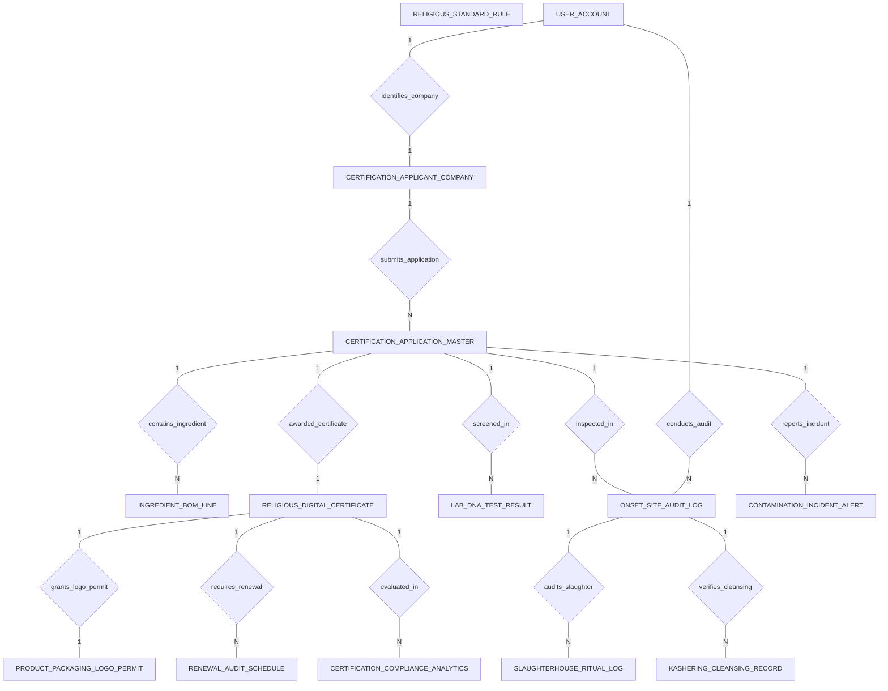

# Conceptual ERD — Halal & Kosher Certification System

## Mermaid Code

## Entity Description Table | Bang mo ta Entity

| # | Entity Name | Vietnamese Name | Description | Key Attributes | Main Relationships |
|---|-------------|-----------------|-------------|----------------|-------------------|
| 1 | CERTIFICATION_APPLICANT_COMPANY | Cong ty dang ky chung nhan | Commercial food manufacturing company profile, company name, FEIN tax ID, business address, email, and applicant status. | company_id, user_id, company_name, tax_id_number, business_address, applicant_status | Belongs to USER_ACCOUNT; One-to-Many with CERTIFICATION_APPLICATION_MASTER |
| 2 | CERTIFICATION_APPLICATION_MASTER | Don dang ky chung nhan master | Master certification application file, application number, certification type (Halal/Kosher/Dual), target market, submission date, and status. | application_id, company_id, application_number, certification_type, target_market_region, application_status | Belongs to CERTIFICATION_APPLICANT_COMPANY; One-to-Many with INGREDIENT_BOM_LINE, ONSET_SITE_AUDIT_LOG, LAB_DNA_TEST_RESULT, CONTAMINATION_INCIDENT_ALERT; One-to-One with RELIGIOUS_DIGITAL_CERTIFICATE |
| 3 | INGREDIENT_BOM_LINE | Chi tiet nguyen lieu BOM | Line item in recipe Bill of Materials (BOM), ingredient name, E-number code, supplier name, supplier certificate #, and high-risk flag. | bom_id, application_id, ingredient_name, e_number_code, supplier_name, is_high_risk | Belongs to CERTIFICATION_APPLICATION_MASTER |
| 4 | RELIGIOUS_STANDARD_RULE | Quy chuan va luật ton giao | Master religious compliance standard reference (JAKIM MS 1500, MUI, GSO 2055, OU Kosher), governing body, max alcohol %, and zero pork DNA rule. | rule_id, standard_code, governing_body, dietary_classification, zero_porcine_dna_required | Reference standard entity |
| 5 | ONSET_SITE_AUDIT_LOG | Nhat ky danh gia tai xuong | On-site facility audit log recorded by Islamic auditor or Kosher Mashgiach, audit date, HCCP score, recommendation, and status. | audit_id, application_id, auditor_user_id, audit_date, hccp_score, audit_recommendation | Belongs to CERTIFICATION_APPLICATION_MASTER, USER_ACCOUNT; One-to-Many with SLAUGHTERHOUSE_RITUAL_LOG, KASHERING_CLEANSING_RECORD |
| 6 | LAB_DNA_TEST_RESULT | Ket qua xet nghiem DNA va con | Laboratory test result record, sample barcode, porcine DNA detection boolean, ethanol %, completion timestamp, and approval status. | test_id, application_id, sample_barcode, porcine_dna_detected, ethanol_percentage, lab_approval_status | Belongs to CERTIFICATION_APPLICATION_MASTER |
| 7 | RELIGIOUS_DIGITAL_CERTIFICATE | Giay chung nhan ky thuat so | Official religious digital certificate record, certificate number, issue/expiry dates, QR verification URL, and blockchain tx hash. | certificate_id, application_id, certificate_number, issue_date, expiry_date, qr_verification_url, cert_status | One-to-One with CERTIFICATION_APPLICATION_MASTER, PRODUCT_PACKAGING_LOGO_PERMIT; One-to-Many with RENEWAL_AUDIT_SCHEDULE, CERTIFICATION_COMPLIANCE_ANALYTICS |
| 8 | PRODUCT_PACKAGING_LOGO_PERMIT | Giay phep su dung logo bao bi | Packaging logo usage permit granted to certified products, logo permit code, authorized artwork vector URL, validity, and active status. | permit_id, certificate_id, logo_permit_code, authorized_artwork_url, valid_until, is_active | One-to-One with RELIGIOUS_DIGITAL_CERTIFICATE |
| 9 | SLAUGHTERHOUSE_RITUAL_LOG | Nhat ky mổ thit nghi le | Livestock ritual slaughter audit log, slaughter type (Dhabihah/Shechita), Tasmiyah blessing recited, knife sharpness, and blood drainage mins. | ritual_id, audit_id, slaughter_type, tasmiyah_blessing_recited, blood_drainage_minutes, batch_pass_status | Belongs to ONSET_SITE_AUDIT_LOG |
| 10 | KASHERING_CLEANSING_RECORD | Nhat ky tay ue nghi le Samak | Equipment ritual cleansing/sanitization log (Islamic Samak clay washing / Rabbinic Kashering purging), method, water temp °C, and Rabbi signature. | cleansing_id, audit_id, cleansing_method, water_temp_celsius, supervising_rabbi_name | Belongs to ONSET_SITE_AUDIT_LOG |
| 11 | CONTAMINATION_INCIDENT_ALERT | Canh bao su co nhiem ban | Non-halal/non-kosher contamination incident alert log, incident type, root cause description, quarantine action taken, and timestamp. | incident_id, application_id, incident_type, root_cause_description, quarantine_action_taken | Belongs to CERTIFICATION_APPLICATION_MASTER |
| 12 | RENEWAL_AUDIT_SCHEDULE | Lich danh gia gia han hang nam | Annual recertification audit schedule, scheduled audit date, notice sent date, and renewal audit status. | renewal_id, certificate_id, scheduled_audit_date, notice_sent_date, renewal_status | Belongs to RELIGIOUS_DIGITAL_CERTIFICATE |
| 13 | USER_ACCOUNT | Tai khoan he thong | Core security authentication account holding credentials, password hashes, and user role definitions. | user_id, username, password_hash, role_name | One-to-One with CERTIFICATION_APPLICANT_COMPANY; One-to-Many with ONSET_SITE_AUDIT_LOG |
| 14 | CERTIFICATION_COMPLIANCE_ANALYTICS | Thong ke tuan thu va chung nhan | Executive daily analytics tracking total active certificates, pending applications, average audit pass rate %, and contamination breaches. | analytics_id, metric_date, total_active_certificates, pending_applications_count, average_audit_pass_rate | Evaluates RELIGIOUS_DIGITAL_CERTIFICATE |

## Relationship Description | Mo ta Quan he

| # | From Entity | Cardinality | To Entity | Relationship Label | Business Explanation |
|---|-------------|-------------|-----------|-------------------|----------------------|
| 1 | USER_ACCOUNT | One-to-One | CERTIFICATION_APPLICANT_COMPANY | identifies_company | Tai khoan he thong dinh danh ho so doanh nghiep dang ky chung nhan. |
| 2 | CERTIFICATION_APPLICANT_COMPANY | One-to-Many | CERTIFICATION_APPLICATION_MASTER | submits_application | Doanh nghiep nop nhieu don dang ky chung nhan Halal hoac Kosher. |
| 3 | CERTIFICATION_APPLICATION_MASTER | One-to-Many | INGREDIENT_BOM_LINE | contains_ingredient | Don dang ky chua danh sach cac nguyen lieu va ma phu gia E-number trong cong thuc. |
| 4 | CERTIFICATION_APPLICATION_MASTER | One-to-Many | ONSET_SITE_AUDIT_LOG | inspected_in | Don dang ky duoc kiem tra thuc te qua cac luot danh gia tai nha may. |
| 5 | USER_ACCOUNT | One-to-Many | ONSET_SITE_AUDIT_LOG | conducts_audit | Chuyen gia pham quy hoac Rabbi thuc hien cac luot danh gia thuc te. |
| 6 | CERTIFICATION_APPLICATION_MASTER | One-to-Many | LAB_DNA_TEST_RESULT | screened_in | Don dang ky duoc kiem nghiem mau DNA heo va nhat ky con ethanol tai phong lab. |
| 7 | CERTIFICATION_APPLICATION_MASTER | One-to-One | RELIGIOUS_DIGITAL_CERTIFICATE | awarded_certificate | Don dang ky dat 100% tieu chuan duoc cap giay chung nhan ky thuat so. |
| 8 | RELIGIOUS_DIGITAL_CERTIFICATE | One-to-One | PRODUCT_PACKAGING_LOGO_PERMIT | grants_logo_permit | Giay chung nhan cap giay phep in logo Halal hoac Kosher tren bao bi san pham. |
| 9 | ONSET_SITE_AUDIT_LOG | One-to-Many | SLAUGHTERHOUSE_RITUAL_LOG | audits_slaughter | Luot danh gia nha may thuc hien kiem tra quy trinh mổ thit nghi le Halal/Kosher. |
| 10 | ONSET_SITE_AUDIT_LOG | One-to-Many | KASHERING_CLEANSING_RECORD | verifies_cleansing | Luot danh gia ghi nhan nhat ky tay ue va lam sach thiet bi theo nghi le Samak/Kashering. |
| 11 | CERTIFICATION_APPLICATION_MASTER | One-to-Many | CONTAMINATION_INCIDENT_ALERT | reports_incident | Ghi nhan cac su co vi phạm hoac nguy co nhiem ban nguyen lieu khong hop quy. |
| 12 | RELIGIOUS_DIGITAL_CERTIFICATE | One-to-Many | RENEWAL_AUDIT_SCHEDULE | requires_renewal | Giay chung nhan duoc thiet lap lich danh gia gia han thuong nien hang nam. |
| 13 | RELIGIOUS_DIGITAL_CERTIFICATE | One-to-Many | CERTIFICATION_COMPLIANCE_ANALYTICS | evaluated_in | Cac chung nhan duoc thong ke va bao cao ty le tuan thu hop quy hang ngay. |
