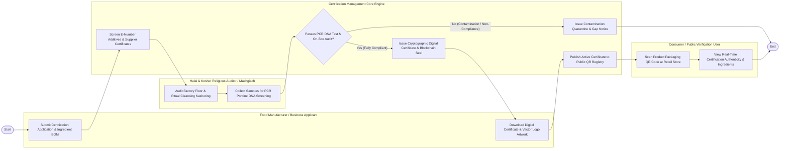

# Swimlane Diagram — Halal & Kosher Certification System

## Mermaid Code

## Flow Description | Mo ta luong

| Lane | Actor | Role in Flow |
|------|-------|-------------|
| **Lane 1** | Food Manufacturer / Business Applicant | Submits certification applications, uploads ingredient Bill of Materials (BOM), downloads official digital certificates, and prints authorized logo artwork on packaging. |
| **Lane 2** | Halal & Kosher Religious Auditor / Mashgiach | Audits factory floor processing lines, verifies ritual slaughter and equipment kashering/samak cleansing, and collects food samples for PCR DNA lab screening. |
| **Lane 3** | Consumer / Public Verification User | Scans product packaging QR codes at retail stores, verifies certificate validity, logo legitimacy, and reviews verified ingredient breakdowns. |
| **Lane 4** | Certification Management Core Engine | Screens E-number additives, ingests PCR DNA lab test results, generates cryptographically signed certificates with blockchain seals, and maintains public QR registry APIs. |

### Process Execution Steps | Cac buoc thuc hien quy trinh

1. **Application & BOM Screening**: Applicant submits application and ingredient BOM (`C1`). Core Engine screens E-number additives and supplier certificates (`S1`).
2. **On-Site Audit & Lab Screening**: Auditor/Mashgiach audits factory floor and ritual cleansing (`K1`), collecting samples for PCR DNA screening (`K2`). Core Engine ingests lab test results (`S2`).
   - If **No (Contamination / Non-Compliance)**: Core Engine issues contamination quarantine notice (`S3`), halting certification execution.
   - If **Yes (Fully Compliant)**: Core Engine generates cryptographically signed digital certificate and writes blockchain seal (`S4`).
3. **Logo Grant & Publication**: Applicant downloads digital certificate and vector logo artwork (`C2`). Core Engine publishes active certificate to public QR registry (`S5`).
4. **Consumer Verification**: Consumer scans product QR code at retail store (`P1`) and views real-time authenticity confirmation (`P2`), completing execution (`Finish`).
