# Action Tree — Halal & Kosher Certification System

## Mermaid Code

```mermaid
graph TD
    Root["Halal & Kosher Certification System"]

    Root --> M1["Application Onboarding & Ingredient BOM Verification"]
    Root --> M2["On-Site Audit & Ritual Slaughterhouse Inspection"]
    Root --> M3["DNA & Chemical Lab Test Screening"]
    Root --> M4["Digital Certificate Issuance & QR Verification"]
    Root --> M5["Contamination Alert & Kashering Sanitization"]
    Root --> M6["Regulatory Board Sync & Annual Renewals"]
    Root --> M7["Compliance Analytics & System Security"]

    M1 --> A11["Submit Online Certification Application Requests"]
    M1 --> A12["Screen Recipe Ingredient BOM E-Number Additives"]
    M1 --> A13["Cross-Reference Supplier Halal Kosher Certificates"]
    M1 --> A14["Flag High-Risk Animal-Derived Ingredient Gaps"]

    M2 --> A21["Audit Slaughterhouse Dhabihah and Shechita Rituals"]
    M2 --> A22["Inspect Ante-Mortem Animal Welfare and Knife Sharpness"]
    M2 --> A23["Monitor Post-Mortem Blood Drainage Time Windows"]
    M2 --> A24["Audit Halal Critical Control Points HCCP in Processing"]

    M3 --> A31["Ingest Real-Time PCR Porcine DNA Screening Results"]
    M3 --> A32["Ingest Gas Chromatography Ethanol Alcohol Percentage"]
    M3 --> A33["Track Tamper-Evident Lab Sample Barcode Chains"]
    M3 --> A34["Enforce Zero-Porcine DNA Clearance Standards"]

    M4 --> A41["Generate Cryptographically Signed Digital Certificates"]
    M4 --> A42["Write Immutable Certificate Hashes to Blockchain"]
    M4 --> A43["Issue Authorized Packaging Logo Usage Permits"]
    M4 --> A44["Provide Public Mobile QR Code Verification APIs"]

    M5 --> A51["Flag Non-Halal Contamination Incidents and Quarantines"]
    M5 --> A52["Enforce Islamic Samak Clay Water Ritual Cleansing"]
    M5 --> A53["Enforce Rabbinic Equipment Kashering Purging"]
    M5 --> A54["Issue Product Recall Directives for Breached Batches"]

    M6 --> A61["Sync Accreditation Standards with JAKIM MUI and OU"]
    M6 --> A62["Schedule Mandatory Annual Recertification Audits"]
    M6 --> A63["Audit Special Passover Kosher and Ramadan Standards"]
    M6 --> A64["Track Cross-Border International Export Endorsements"]

    M7 --> A71["Monitor Fleet Religious Compliance Audit Pass Rates"]
    M7 --> A72["Analyze Active Certified Products and Brand Metrics"]
    M7 --> A73["Manage User Security Roles and Auditor Permissions"]
    M7 --> A74["Manage Regulatory API Integration Keys and Audit Logs"]
```

## Module Description | Mo ta Module

| # | Module | Description | Actions |
|---|--------|-------------|---------|
| 1 | Application Onboarding & Ingredient BOM Verification | Controls application submission, recipe BOM screening, E-number additive risk cross-referencing, and supplier certificate validation. | Submit Online Certification Application Requests, Screen Recipe Ingredient BOM E-Number Additives, Cross-Reference Supplier Halal Kosher Certificates, Flag High-Risk Animal-Derived Ingredient Gaps |
| 2 | On-Site Audit & Ritual Slaughterhouse Inspection | Manages auditor site visits, slaughterhouse ritual audits (Dhabihah/Shechita), animal welfare checks, knife sharpness, and HCCP points. | Audit Slaughterhouse Dhabihah and Shechita Rituals, Inspect Ante-Mortem Animal Welfare and Knife Sharpness, Monitor Post-Mortem Blood Drainage Time Windows, Audit Halal Critical Control Points HCCP in Processing |
| 3 | DNA & Chemical Lab Test Screening | Ingests PCR porcine DNA testing results, gas chromatography ethanol alcohol percentages, tracking sample barcode chains and zero-pork rules. | Ingest Real-Time PCR Porcine DNA Screening Results, Ingest Gas Chromatography Ethanol Alcohol Percentage, Track Tamper-Evident Lab Sample Barcode Chains, Enforce Zero-Porcine DNA Clearance Standards |
| 4 | Digital Certificate Issuance & QR Verification | Generates cryptographically signed digital certificates, writes blockchain seals, grants packaging logo permits, and serves public QR verification APIs. | Generate Cryptographically Signed Digital Certificates, Write Immutable Certificate Hashes to Blockchain, Issue Authorized Packaging Logo Usage Permits, Provide Public Mobile QR Code Verification APIs |
| 5 | Contamination Alert & Kashering Sanitization | Logs contamination incidents, triggers facility quarantines, enforces Islamic Samak clay washing or Rabbinic Kashering purging, and issues recall notices. | Flag Non-Halal Contamination Incidents and Quarantines, Enforce Islamic Samak Clay Water Ritual Cleansing, Enforce Rabbinic Equipment Kashering Purging, Issue Product Recall Directives for Breached Batches |
| 6 | Regulatory Board Sync & Annual Renewals | Synchronizes accredited rules with global boards (JAKIM, MUI, OU Kosher), schedules annual recertification audits, and handles export endorsements. | Sync Accreditation Standards with JAKIM MUI and OU, Schedule Mandatory Annual Recertification Audits, Audit Special Passover Kosher and Ramadan Standards, Track Cross-Border International Export Endorsements |
| 7 | Compliance Analytics & System Security | Displays executive analytics on certified products, audit pass rates, contamination alerts, regulatory API keys, security access roles, and audit logs. | Monitor Fleet Religious Compliance Audit Pass Rates, Analyze Active Certified Products and Brand Metrics, Manage User Security Roles and Auditor Permissions, Manage Regulatory API Integration Keys and Audit Logs |
