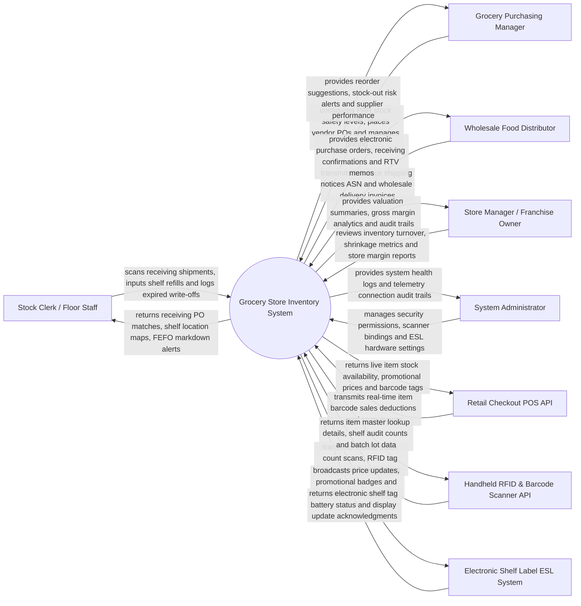

# Context Diagram — Grocery Store Inventory System

## Mermaid Code

## Actor & Interaction Table | Bang Actor & Tuong tac

| # | Actor | Actor Type | Data Sent TO System | Data Received FROM System | Notes |
|---|-------|------------|---------------------|---------------------------|-------|
| 1 | Stock Clerk / Floor Staff | Primary | Receiving dock shipment scans, shelf replenishment logs, FEFO expiry checks, damaged write-offs | Receiving PO match details, shelf aisle mapping, FEFO markdown discount alerts | Operates receiving dock, refills retail shelves, and audits expiry dates. |
| 2 | Grocery Purchasing Manager | Primary | PAR safety reorder thresholds, supplier cost prices, promotional markdowns, purchase orders | Automated reorder suggestions, stock-out risk warnings, supplier SLA scorecards | Manages grocery category sourcing, inventory levels, and purchasing. |
| 3 | Store Manager / Franchise Owner | Primary | Store operational budgets, stock count audit sign-offs, shrinkage tolerance limits | Real-time stock valuation (FIFO), shrinkage loss reports, gross margin analytics | Oversees store profitability, inventory turnover, and loss prevention. |
| 4 | Wholesale Food Distributor | Primary | Advance Shipping Notices (ASN), wholesale product catalogs, electronic invoices | Electronic purchase orders (PO), receiving receipt confirmations, RTV debit memos | Commercial food distributor supplying dry goods, produce, dairy, and meat. |
| 5 | System Administrator | Primary | User credentials, security role policies, scanner IP bindings, ESL gateway settings | System health metrics, hardware telemetry logs, integration audit trails | Manages IT infrastructure, handheld scanner hardware, and ESL gateways. |
| 6 | Retail Checkout POS API | Supporting | Real-time item barcode sales deductions, return transactions, checkout timestamp | Live item stock availability, active promotional prices, scale tare weights | Front-end checkout cash registers and self-checkout kiosks. |
| 7 | Handheld RFID & Barcode Scanner API | Supporting | Barcode 1D/2D scans, RFID EPC tag pings, mobile stock audit counts, aisle location tags | Item master records, batch lot expiry dates, expected vs actual count deltas | Mobile Android/iOS handheld terminal scanners (e.g., Zebra, Honeywell). |
| 8 | Electronic Shelf Label ESL System | Supporting | E-paper tag battery status, RF gateway pings, display refresh confirmations | Live price updates, promotional discount badges, unit price ($/oz) data | Wireless e-paper price tags mounted on store shelf edges (e.g., SES-imagotag). |

## System Boundary Description | Mo ta Pham vi He thong

The **Grocery Store Inventory System** manages retail grocery inventory balances, receiving dock PO matching, FEFO (First-Expired, First-Out) expiration tracking, automated PAR safety reordering, wireless Electronic Shelf Label (ESL) pricing updates, handheld RFID stock audits, and shrinkage loss tracking. Inside its boundary, the system handles real-time stock balance updates, POS checkout sales deductions, multi-temperature storage zone tracking (Dry, Chilled, Frozen), FEFO markdown pricing calculation, supplier Return-to-Vendor (RTV) debit memo processing, FIFO/Weighted-Average stock valuation, and inter-store transfers.

The system boundary excludes physical unloading of pallets, physical operating of forklifts, front-end retail checkout payment processing (handled by Checkout POS), and raw electrical power grid supply.
