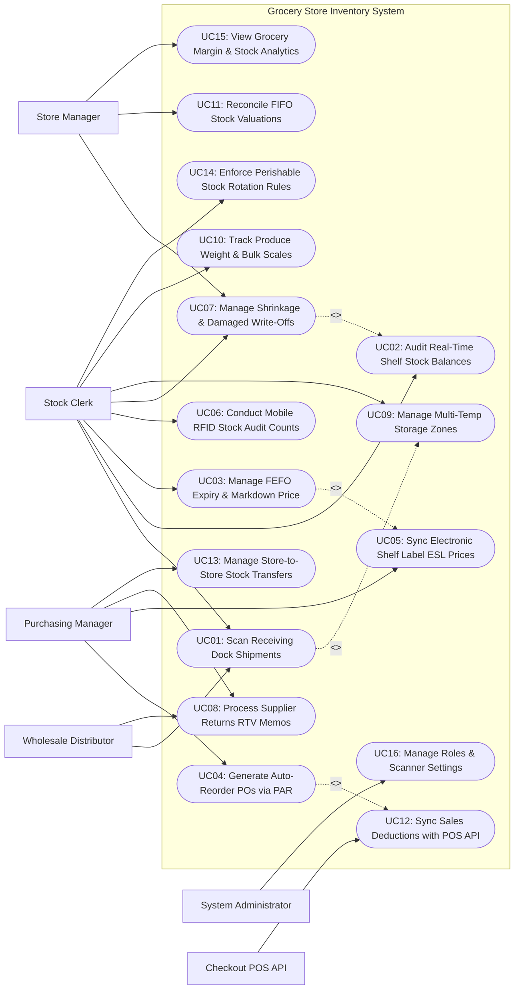

# Use Case Diagram — Grocery Store Inventory System

## Mermaid Code

## Actor Table | Bang Actor

| # | Actor | Actor Type | Role Description | Related Use Cases |
|---|-------|------------|------------------|-------------------|
| 1 | Checkout POS API | Secondary System | Retail checkout system deducting sold item quantities in real time upon barcode scan at registers. | UC12 |
| 2 | Wholesale Distributor | Primary | External food distributor transmitting advance shipping notices (ASN), delivering pallets, and accepting RTV returns. | UC01, UC08 |
| 3 | Stock Clerk | Primary | Retail floor staff scanning receiving shipments, refilling shelf planograms, conducting RFID audits, and executing FEFO markdowns. | UC01, UC02, UC03, UC06, UC07, UC09, UC10, UC14 |
| 4 | Purchasing Manager | Primary | Sourcing specialist configuring PAR safety levels, generating automated POs, setting retail prices, and syncing ESL tags. | UC04, UC05, UC08, UC13 |
| 5 | Store Manager | Primary | Store owner reviewing stock valuations, approving shrinkage write-offs, monitoring gross margins, and analyzing stock-outs. | UC07, UC11, UC15 |
| 6 | System Administrator | Primary | Technical manager configuring user security roles, handheld scanner IP bindings, ESL gateway settings, and audit logs. | UC16 |

## Use Case Table | Bang Use Case

| # | UC ID | Use Case Name | Primary Actor | Secondary Actor | Description | Priority |
|---|-------|---------------|---------------|-----------------|-------------|----------|
| 1 | UC01 | Scan Receiving Dock Shipments | Stock Clerk | Wholesale Distributor | Scans incoming pallet barcodes at the receiving dock, matching delivered quantities and batch lot expiry dates against open POs. | High |
| 2 | UC02 | Audit Real-Time Shelf Stock Balances | Stock Clerk | None | Tracks real-time inventory balances per SKU across backroom storage and retail sales floor shelf locations. | High |
| 3 | UC03 | Manage FEFO Expiry & Markdown Price | Stock Clerk | None | Tracks batch lot expiration dates, applying automated FEFO (First-Expired, First-Out) clearance discounts (e.g., 30%-50% off near-expiry items). | High |
| 4 | UC04 | Generate Auto-Reorder POs via PAR | Purchasing Manager | Checkout POS API | Calculates inventory replenishment requirements based on PAR safety stock levels and POS sales velocity, generating automated POs. | High |
| 5 | UC05 | Sync Electronic Shelf Label ESL Prices | Purchasing Manager | None | Transmits live price changes, promotional badges, and unit price math ($/oz) over RF wireless gateways to e-paper shelf edge tags. | High |
| 6 | UC06 | Conduct Mobile RFID Stock Audit Counts | Stock Clerk | None | Performs fast physical inventory audits using handheld RFID/barcode scanners, comparing scanned counts against system expected balances. | High |
| 7 | UC07 | Manage Shrinkage & Damaged Write-Offs | Stock Clerk | Store Manager | Logs inventory shrinkage loss (Theft, Spoilage, Damaged Packaging, Expired Items) and routes write-offs for manager sign-off. | High |
| 8 | UC08 | Process Supplier Returns RTV Memos | Purchasing Manager | Wholesale Distributor | Generates Return-to-Vendor (RTV) debit memos for damaged, recalled, or short-dated supplier goods, claiming credit. | High |
| 9 | UC09 | Manage Multi-Temp Storage Zones | Stock Clerk | None | Tracks inventory location bins segregated by temperature requirements: Dry Storage, Chilled Cooler (2°C-4°C), and Freezer (-18°C). | High |
| 10 | UC10 | Track Produce Weight & Bulk Scales | Stock Clerk | None | Manages random-weight bulk produce items (Apples, Potatoes, Coffee Beans), integrating scale tare weights and PLU barcode labels. | Medium |
| 11 | UC11 | Reconcile FIFO Stock Valuations | Store Manager | None | Reconciles store inventory financial valuations using FIFO (First-In, First-Out) or Weighted Average Cost accounting methods. | High |
| 12 | UC12 | Sync Sales Deductions with POS API | System | Checkout POS API | Ingests real-time barcode sales transaction feeds from checkout POS terminals, decrementing shelf stock balances instantly. | High |
| 13 | UC13 | Manage Store-to-Store Stock Transfers | Purchasing Manager | None | Manages inter-store inventory transfer manifests, balancing stock surpluses and shortages across multi-store grocery chains. | Medium |
| 14 | UC14 | Enforce Perishable Stock Rotation Rules | Stock Clerk | None | Prompts clerks with stock rotation alerts during shelf restocking to ensure older batch lots are placed at the front of display shelves. | High |
| 15 | UC15 | View Grocery Margin & Stock Analytics | Store Manager | None | Displays analytical dashboards on gross margin %, inventory turnover velocity, stock-out frequency, and shrinkage rates by category. | High |
| 16 | UC16 | Manage Roles & Scanner Settings | System Admin | None | Configures user security access roles, handheld scanner hardware IP bindings, ESL RF gateway channels, and system audit logging. | High |

## Use Case Specification | Dac ta Use Case

---

### UC01 — Scan Receiving Dock Shipments

| Field | Detail |
|-------|--------|
| **UC ID** | UC01 |
| **Use Case Name** | Scan Receiving Dock Shipments |
| **Actor(s)** | Primary: Stock Clerk   Secondary: Wholesale Food Distributor |
| **Description** | Processes incoming freight deliveries at the receiving dock by scanning pallet GS1-128 barcodes, verifying item quantities, capturing batch lot expiry dates, and matching against open POs. |
| **Precondition** | 1. Purchase Order (PO #PO-9022) is open in system.   2. Delivery truck arrives at dock with Advance Shipping Notice (ASN). |
| **Main Flow** | 1. Stock Clerk opens "Receiving Dock Scanner" on handheld terminal.   2. Clerk scans PO barcode or selects PO #PO-9022 from dock queue.   3. System presents expected shipment lines:      - Line 1: Organic Whole Milk 1L (Expected: 50 Cases / 600 Units)      - Line 2: Fresh Greek Yogurt 500g (Expected: 30 Cases / 360 Units)      - Line 3: Whole Wheat Sliced Bread (Expected: 40 Cases / 480 Units).   4. Clerk scans GS1-128 barcode on first pallet of Milk cases.   5. System decodes barcode payload: SKU #10882, Case Qty: 50, Batch Lot #LOT-8812, Expiry Date: Aug 15, 2026.   6. System checks expiry date against Minimum Shelf-Life Rule (e.g., Dairy must have >= 14 days remaining) -> `PASSED (24 Days)`.   7. System records received line: `50 Cases Received (100% PO Line Match)`.   8. Clerk repeats scan for remaining lines.   9. Clerk clicks "Finalize Receiving Receipt".   10. System updates Inventory Stock Balances (UC02), assigns lot location bins (UC09), closes PO line items, and dispatches receiving confirmation to Wholesale Distributor. |
| **Alternative Flow** | **AF1** — Shortage or damaged goods receiving:   1. Line 2 arrives with 25 cases (5 cases short of 30 expected).   2. System logs "Partial Receipt: 5 Cases Shortage", creating an automated RTV Shortage Debit Memo (UC08). |
| **Exception Flow** | **EX1** — Short-dated product rejection:   1. Milk batch expiry date is Aug 2, 2026 (only 11 days remaining, violating 14-day rule).   2. System displays red alert **SHORT-DATED PRODUCT REJECTED: Expiry violates 14-day rule**, blocking receiving and flagging line item for driver return. |
| **Postcondition** | Shipment is scanned, batch expiry dates are validated, inventory balances update, and receiving receipt closes PO. |
| **Business Rule** | **BR1**: Receiving dock scans MUST capture batch lot numbers and expiration dates for all perishable food products.   **BR2**: Perishable products failing minimum remaining shelf-life rules MUST be rejected at the receiving dock. |

---

### UC02 — Audit Real-Time Shelf Stock Balances

| Field | Detail |
|-------|--------|
| **UC ID** | UC02 |
| **Use Case Name** | Audit Real-Time Shelf Stock Balances |
| **Actor(s)** | Primary: Stock Clerk   Secondary: None |
| **Description** | Tracks and updates real-time inventory stock balances for every grocery SKU across backroom storage bins and front-of-house retail sales floor shelf locations. |
| **Precondition** | 1. Grocery product master catalog is configured.   2. Store shelf bin location mapping (e.g., Aisle 4, Shelf B, Slot 12) is active. |
| **Main Flow** | 1. Stock Clerk scans product barcode (e.g., Organic Extra Virgin Olive Oil 500ml) using handheld scanner.   2. System retrieves item master record displaying:      - Total Store Stock: 42 Units      - Sales Floor Location: Aisle 3, Shelf C (Current Balance: 12 Units)      - Backroom Storage Location: Rack B-04 (Current Balance: 30 Units)      - Shelf Facing Capacity: 15 Units      - Minimum Safety Threshold: 8 Units.   3. System detects Sales Floor Stock (12 units) is below Shelf Capacity (15 units) and generates "Restock Alert: Transfer 3 Units from Backroom Rack B-04 to Aisle 3".   4. Clerk moves 3 units from backroom to sales floor and scans location barcode "Aisle 3 Shelf C".   5. System updates Location Balance: `Sales Floor: 15 Units; Backroom: 27 Units`.   6. During operating hours, Checkout POS API (UC12) deducts sales floor stock in real time upon customer purchase. |
| **Alternative Flow** | **AF1** — Stock balance discrepancy correction:   1. Clerk physically counts 8 units on shelf, but system reads 12 units (4 missing due to unrecorded theft).   2. Clerk inputs "Physical Count: 8", prompting System to initiate Shrinkage Write-Off Workflow (UC07). |
| **Exception Flow** | **EX1** — Negative inventory balance warning:   1. POS sales deduction causes stock balance to fall below 0 (system latency or missed receiving scan).   2. System flags "Negative Stock Warning SKU #10882", queuing SKU for immediate handheld audit count (UC06). |
| **Postcondition** | Real-time stock balances are updated across sales floor and backroom locations, and restock alerts are generated. |
| **Business Rule** | **BR1**: System stock balances must reflect real-time POS sales deductions with latency under 1.0 second.   **BR2**: Shelf restocking alerts must trigger automatically whenever sales floor balances drop below 50% of shelf facing capacity. |

---

### UC03 — Manage FEFO Expiry & Markdown Price

| Field | Detail |
|-------|--------|
| **UC ID** | UC03 |
| **Use Case Name** | Manage FEFO Expiry & Markdown Price |
| **Actor(s)** | Primary: Stock Clerk   Secondary: None |
| **Description** | Implements First-Expired, First-Out (FEFO) inventory management by tracking batch lot expiration dates, generating daily near-expiry pull lists, and applying automated clearance markdown discounts. |
| **Precondition** | 1. Batch lot expiration dates were captured during receiving dock scanning (UC01).   2. Store markdown discount policy matrix (e.g., 3 Days to Expiry = 30% Off; 1 Day = 50% Off) is configured. |
| **Main Flow** | 1. System executes daily 5:00 AM automated "FEFO Expiry Scan Batch".   2. System identifies batch lots approaching expiration within configured warning window (e.g., Fresh Artisan Cheese Batch #LOT-409 expiring in 2 days).   3. System generates "Morning FEFO Pull & Markdown List" on Stock Clerk's handheld terminal:      - Item: Fresh Artisan Cheese 250g (Aisle 2, Chilled Case 4)      - Batch Lot: #LOT-409 (14 Units Remaining)      - Expiration Date: July 24, 2026 (2 Days Remaining)      - Action Required: `Apply 30% Clearance Markdown Discount ($6.00 -> $4.20)`.   4. Stock Clerk walks to Aisle 2, locates Batch #LOT-409 items, and scans item barcode on handheld.   5. System confirms match and generates Clearance Markdown Barcode Tag ($4.20 Special Clearance Price).   6. Clerk sticks yellow clearance markdown labels onto the 14 cheese packages and moves them to the "Quick Clearance Fresh Case".   7. System updates Electronic Shelf Labels (UC05) and POS price master for the markdown batch lot.   8. Items expiring TODAY (0 days remaining) are flagged for immediate removal and logged as Expired Spoilage Write-Offs (UC07). |
| **Alternative Flow** | **AF1** — Automated dynamic markdown pricing:   1. System automatically adjusts markdown discount from 30% to 50% on the final day if sales velocity is slow. |
| **Exception Flow** | **EX1** — Un-marked expired item found on shelf:   1. Customer or clerk finds an item past expiry date on shelf.   2. Clerk scans item; System flags "EXPIRED ITEM — DO NOT SELL", blocks POS checkout for barcode, and logs spoilage. |
| **Postcondition** | Near-expiry items are identified, clearance markdown prices are applied, yellow tags are affixed, and ESL tags update. |
| **Business Rule** | **BR1**: Products past their official expiration date MUST be blocked from POS checkout and removed from sales shelves immediately.   **BR2**: FEFO clearance markdown discounts must apply strictly to the specific near-expiry batch lot without lowering the regular price of newer lots. |

---

### UC04 — Generate Auto-Reorder POs via PAR

| Field | Detail |
|-------|--------|
| **UC ID** | UC04 |
| **Use Case Name** | Generate Auto-Reorder POs via PAR |
| **Actor(s)** | Primary: Grocery Purchasing Manager   Secondary: Checkout POS API |
| **Description** | Calculates store replenishment requirements based on PAR safety stock levels, lead times, and POS sales velocity, generating automated draft Purchase Orders for vendor approval. |
| **Precondition** | 1. Product PAR safety levels (Min Stock, Max Stock, Order Point) are configured per SKU.   2. Supplier lead times and minimum order quantities (MOQ) are active. |
| **Main Flow** | 1. System runs automated daily "PAR Stock Replenishment Engine".   2. System evaluates current stock position for all store SKUs: `Effective Stock = On-Hand Stock + On-Order PO Stock - Reserved Customer Stock`.   3. System identifies SKUs where Effective Stock has fallen below configured Reorder Point:      - SKU #10882 (Organic Whole Milk 1L): On-Hand = 18 Units, On-Order = 0, Reorder Point = 40, PAR Max = 120 Units, Supplier Lead Time = 1 Day, Supplier MOQ = 50 Units (1 Case).   4. System calculates Required Order Quantity: `PAR Max (120) - Effective Stock (18) = 102 Units`.   5. System adjusts order quantity to match Supplier MOQ and casepack multiples: `102 rounded up to 100 Units (2 Cases of 50)`.   6. System generates Draft Purchase Order (PO #PO-9099) assigned to Wholesale Food Distributor (UC08).   7. Purchasing Manager receives notification, reviews Draft PO #PO-9099 on portal, and approves order.   8. System transmits PO #PO-9099 electronically via EDI / API to Wholesale Food Distributor.   9. System updates item status to `On-Order (100 Units Pending Delivery)` to prevent duplicate reorders. |
| **Alternative Flow** | **AF1** — Fully automated PO auto-dispatch (Auto-Approve Mode):   1. Purchasing Manager enables "Auto-Approve POs for Tier 1 Staples".   2. System automatically transmits PO to vendor without requiring manual manager click. |
| **Exception Flow** | **EX1** — Supplier discontinued item or price surge:   1. Vendor API responds "SKU Discontinued" or flags a 25% price increase.   2. System flags exception "Supplier Price Increase Alert", requiring manager review before PO approval. |
| **Postcondition** | Stock replenishment needs are calculated, draft PO is generated, manager approves order, and PO is sent to vendor. |
| **Business Rule** | **BR1**: Auto-reorder algorithms MUST incorporate POS sales velocity and promotional lift factors to prevent over-purchasing.   **BR2**: Reorder quantities MUST respect supplier Minimum Order Quantities (MOQ) and casepack container constraints. |

---

### UC05 — Sync Electronic Shelf Label ESL Prices

| Field | Detail |
|-------|--------|
| **UC ID** | UC05 |
| **Use Case Name** | Sync Electronic Shelf Label ESL Prices |
| **Actor(s)** | Primary: Grocery Purchasing Manager   Secondary: None |
| **Description** | Transmits live retail price updates, promotional badges, unit pricing ($/oz), and clearance alerts over RF wireless gateways to e-paper Electronic Shelf Labels (ESL) mounted on store shelf edges. |
| **Precondition** | 1. Wireless ESL RF access point gateways are online across store aisles.   2. ESL e-paper tags are paired to product SKUs and shelf locations. |
| **Main Flow** | 1. Purchasing Manager updates retail price or launches a promotion in the inventory portal (e.g., Organic Extra Virgin Olive Oil reduced from $12.99 to $9.99 Special Promo).   2. System updates central price database and triggers "ESL Wireless Broadcast Event".   3. System compiles ESL display payload for target tag (Tag ID #ESL-4099 bound to SKU #10882):      - Main Retail Price: `$9.99` (Large Bold Font)      - Original Was Price: `$12.99` (Strikethrough)      - Promotional Badge: `SPECIAL PROMO / SAVE $3.00` (Red/Black E-Paper Highlight)      - Unit Price Math: `$0.59 / fl oz`      - Barcode & SKU Number.   4. System transmits payload to store RF Access Point Gateway.   5. RF Gateway broadcasts radio payload over 2.4GHz / Sub-1GHz spectrum to ESL Tag #ESL-4099 on Aisle 3.   6. ESL Tag receives packet, updates e-paper display screen within 3 seconds, and returns RF ACK signal `Display Updated Successfully (Battery 95%)`.   7. System marks price sync status `100% Synced` and verifies price match parity between ESL tag and Checkout POS registers (UC12). |
| **Alternative Flow** | **AF1** — Flashing LED locator light trigger (Pick-to-Light):   1. Stock Clerk uses handheld scanner to locate item for e-commerce order picking.   2. System commands ESL tag to flash its red LED light for 15 seconds, allowing clerk to instantly spot shelf location. |
| **Exception Flow** | **EX1** — ESL tag RF transmission failure / low battery:   1. Tag #ESL-4099 fails to respond due to dead battery or RF obstacle.   2. System flags warning "ESL Price Sync Failed: Aisle 3 Tag #ESL-4099", alerting clerk to inspect tag and ensuring POS register price is correct. |
| **Postcondition** | Electronic shelf tags update live retail prices, unit prices, and promo badges, maintaining 100% price match parity with POS checkout. |
| **Business Rule** | **BR1**: Price Parity Rule: Prices displayed on Electronic Shelf Labels MUST match checkout POS register prices with 100% accuracy to comply with weights and measures laws.   **BR2**: ESL price updates must execute across all store tags within 10 seconds of price change authorization. |
