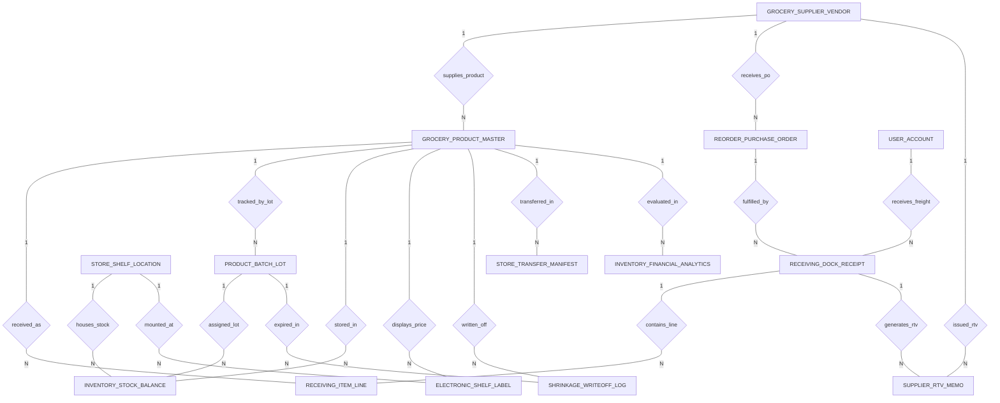

# Conceptual ERD — Grocery Store Inventory System

## Mermaid Code

## Entity Description Table | Bang mo ta Entity

| # | Entity Name | Vietnamese Name | Description | Key Attributes | Main Relationships |
|---|-------------|-----------------|-------------|----------------|-------------------|
| 1 | GROCERY_PRODUCT_MASTER | Danh muc san pham tap hoa | Master grocery product record, barcode UPC/EAN, product name, category, storage zone type, retail price, unit cost, and PAR safety levels. | product_id, vendor_id, barcode_upc_ean, product_name, category, retail_price, par_min_level | Belongs to GROCERY_SUPPLIER_VENDOR; One-to-Many with PRODUCT_BATCH_LOT, INVENTORY_STOCK_BALANCE, ELECTRONIC_SHELF_LABEL, SHRINKAGE_WRITEOFF_LOG, STORE_TRANSFER_MANIFEST, INVENTORY_FINANCIAL_ANALYTICS |
| 2 | PRODUCT_BATCH_LOT | Lo hang va han su dung | Specific batch lot record tracking manufacturing date, expiration date, initial quantity, remaining quantity, and FEFO markdown flags. | lot_id, product_id, batch_lot_number, manufacturing_date, expiration_date, remaining_quantity | Belongs to GROCERY_PRODUCT_MASTER; One-to-Many with INVENTORY_STOCK_BALANCE, SHRINKAGE_WRITEOFF_LOG |
| 3 | STORE_SHELF_LOCATION | Vi tri ke hang va kho | Physical store storage bin location, aisle code, shelf section, storage temp zone (Dry/Chilled/Frozen), and shelf capacity limit. | location_id, aisle_code, shelf_section, storage_temp_zone, shelf_capacity_limit | One-to-Many with INVENTORY_STOCK_BALANCE, ELECTRONIC_SHELF_LABEL |
| 4 | INVENTORY_STOCK_BALANCE | So du ton kho thuc te | Real-time inventory stock balance linking product ID, location ID, lot ID, quantity on hand, and last counted timestamp. | balance_id, product_id, location_id, lot_id, quantity_on_hand, last_counted_at | Belongs to GROCERY_PRODUCT_MASTER, STORE_SHELF_LOCATION, PRODUCT_BATCH_LOT |
| 5 | RECEIVING_DOCK_RECEIPT | Phieu nhan hang tai kho | Receiving dock delivery receipt recording PO ID, receipt number, receiving date, clerk user ID, and receipt status. | receipt_id, po_id, receipt_number, receiving_date, clerk_user_id, receipt_status | Belongs to REORDER_PURCHASE_ORDER, USER_ACCOUNT; One-to-Many with RECEIVING_ITEM_LINE, SUPPLIER_RTV_MEMO |
| 6 | RECEIVING_ITEM_LINE | Chi tiet hang nhan kho | Line item detail within a receiving receipt specifying product ID, quantity received, quantity rejected, and rejection reason. | line_id, receipt_id, product_id, quantity_received, quantity_rejected, rejection_reason | Belongs to RECEIVING_DOCK_RECEIPT, GROCERY_PRODUCT_MASTER |
| 7 | REORDER_PURCHASE_ORDER | Don hang mua si tu dong | Purchase order (PO) generated to replenish inventory, vendor ID, PO number, order date, expected delivery date, and PO status. | po_id, vendor_id, po_number, order_date, expected_delivery_date, total_po_amount | Belongs to GROCERY_SUPPLIER_VENDOR; One-to-Many with RECEIVING_DOCK_RECEIPT |
| 8 | ELECTRONIC_SHELF_LABEL | Nhan gia dien tu ESL | Electronic Shelf Label (ESL) e-paper tag record, product ID, location ID, tag MAC address, displayed price, battery level %, and sync time. | esl_id, product_id, location_id, esl_tag_mac_id, displayed_price, battery_level_pct | Belongs to GROCERY_PRODUCT_MASTER, STORE_SHELF_LOCATION |
| 9 | SHRINKAGE_WRITEOFF_LOG | Nhat ky hao hut va huy hang | Inventory shrinkage loss write-off log, product ID, lot ID, written-off quantity, waste reason code (Theft/Expired/Damaged), and loss $. | writeoff_id, product_id, lot_id, written_off_qty, waste_reason_code, monetary_loss_amount | Belongs to GROCERY_PRODUCT_MASTER, PRODUCT_BATCH_LOT |
| 10 | SUPPLIER_RTV_MEMO | Phieu tra hang va tru tien RTV | Return-to-Vendor (RTV) debit memo issued to suppliers for short-dated or damaged goods, vendor ID, receipt ID, total debit amount, and status. | rtv_id, vendor_id, receipt_id, rtv_number, total_debit_amount, debit_memo_status | Belongs to GROCERY_SUPPLIER_VENDOR, RECEIVING_DOCK_RECEIPT |
| 11 | STORE_TRANSFER_MANIFEST | Phieu dieu chuyen noi bo | Inter-store inventory transfer manifest, product ID, source store code, destination store code, transfer quantity, and transfer status. | transfer_id, product_id, source_store_code, destination_store_code, transfer_quantity | Belongs to GROCERY_PRODUCT_MASTER |
| 12 | GROCERY_SUPPLIER_VENDOR | Nha cung cap tap hoa | Wholesale food distributor vendor profile, vendor code, vendor name, contact email, minimum order quantity (MOQ), and lead time days. | vendor_id, vendor_code, vendor_name, contact_email, minimum_order_qty, lead_time_days | One-to-Many with GROCERY_PRODUCT_MASTER, REORDER_PURCHASE_ORDER, SUPPLIER_RTV_MEMO |
| 13 | USER_ACCOUNT | Tai khoan he thong | Core security authentication account holding credentials, password hashes, and user role definitions. | user_id, username, password_hash, role_name | One-to-Many with RECEIVING_DOCK_RECEIPT |
| 14 | INVENTORY_FINANCIAL_ANALYTICS | Thong ke hieu qua ton kho | Executive daily analytics tracking total inventory valuation (FIFO), total shrinkage loss, turnover velocity, and stock-out counts. | analytics_id, metric_date, total_inventory_valuation, total_shrinkage_loss, inventory_turnover_ratio | Evaluates GROCERY_PRODUCT_MASTER |

## Relationship Description | Mo ta Quan he

| # | From Entity | Cardinality | To Entity | Relationship Label | Business Explanation |
|---|-------------|-------------|-----------|-------------------|----------------------|
| 1 | GROCERY_SUPPLIER_VENDOR | One-to-Many | GROCERY_PRODUCT_MASTER | supplies_product | Nha cung cap phan phoi cac san pham tap hoa trong danh muc cua cua hang. |
| 2 | GROCERY_SUPPLIER_VENDOR | One-to-Many | REORDER_PURCHASE_ORDER | receives_po | Nha cung cap nhan cac don hang mua si tu dong de cung ung hang. |
| 3 | REORDER_PURCHASE_ORDER | One-to-Many | RECEIVING_DOCK_RECEIPT | fulfilled_by | Don hang mua si duoc giao va ghi nhan qua phieu nhan hang tai kho. |
| 4 | RECEIVING_DOCK_RECEIPT | One-to-Many | RECEIVING_ITEM_LINE | contains_line | Phieu nhan kho chua chi tiet tung dong san pham duoc giao. |
| 5 | GROCERY_PRODUCT_MASTER | One-to-Many | RECEIVING_ITEM_LINE | received_as | San pham duoc nhan kho va kiem tra so luong, han su dung. |
| 6 | GROCERY_PRODUCT_MASTER | One-to-Many | PRODUCT_BATCH_LOT | tracked_by_lot | San pham duoc theo doi chi tiet theo tung lo hang va ngay het han FEFO. |
| 7 | GROCERY_PRODUCT_MASTER | One-to-Many | INVENTORY_STOCK_BALANCE | stored_in | San pham duoc luu tru tai cac khoang vi tri va ke hang khac nhau. |
| 8 | STORE_SHELF_LOCATION | One-to-Many | INVENTORY_STOCK_BALANCE | houses_stock | Vi tri ke hang chua so du ton kho thuc te cua cac san pham. |
| 9 | PRODUCT_BATCH_LOT | One-to-Many | INVENTORY_STOCK_BALANCE | assigned_lot | So du ton kho gan voi tung lo hang cu the de uu tien xuat FEFO. |
| 10 | GROCERY_PRODUCT_MASTER | One-to-Many | ELECTRONIC_SHELF_LABEL | displays_price | San pham hien thi gia ban va thong tin unit price tren nhan gia dien tu ESL. |
| 11 | STORE_SHELF_LOCATION | One-to-Many | ELECTRONIC_SHELF_LABEL | mounted_at | Nhan gia dien tu ESL duoc gan tai vi tri ke hang tuong ung. |
| 12 | GROCERY_PRODUCT_MASTER | One-to-Many | SHRINKAGE_WRITEOFF_LOG | written_off | San pham bi ghi nhan hao hut, hu hang hoac het han su dung. |
| 13 | PRODUCT_BATCH_LOT | One-to-Many | SHRINKAGE_WRITEOFF_LOG | expired_in | Lo hang bi huy do het han su dung va duoc ghi nhan thiet hai tai chinh. |
| 14 | GROCERY_SUPPLIER_VENDOR | One-to-Many | SUPPLIER_RTV_MEMO | issued_rtv | Nha cung cap nhan phieu tru tien RTV cho cac hang bi loi hoac can han. |
| 15 | RECEIVING_DOCK_RECEIPT | One-to-Many | SUPPLIER_RTV_MEMO | generates_rtv | Phieu nhan kho tao ra phieu RTV khi hang giao bi thieu hoac loi. |
| 16 | GROCERY_PRODUCT_MASTER | One-to-Many | STORE_TRANSFER_MANIFEST | transferred_in | San pham duoc dieu chuyen noi bo giua cac chi nhanh cua hang. |
| 17 | USER_ACCOUNT | One-to-Many | RECEIVING_DOCK_RECEIPT | receives_freight | Nhan vien kho thuc hien quet va nhan hang tai kho. |
| 18 | GROCERY_PRODUCT_MASTER | One-to-Many | INVENTORY_FINANCIAL_ANALYTICS | evaluated_in | Cac san pham duoc thong ke va danh gia gia tri ton kho (FIFO) va vong quay hang ton. |
