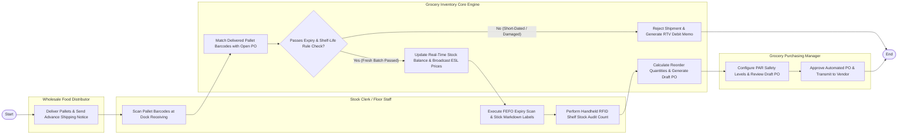

# Swimlane Diagram — Grocery Store Inventory System

## Mermaid Code

## Flow Description | Mo ta luong

| Lane | Actor | Role in Flow |
|------|-------|-------------|
| **Lane 1** | Stock Clerk / Floor Staff | Scans pallet barcodes at receiving dock, executes FEFO expiry checks, applies clearance markdown labels, and performs handheld RFID shelf audit counts. |
| **Lane 2** | Grocery Purchasing Manager | Configures PAR safety stock reorder levels, reviews automated draft purchase orders, approves POs, and manages vendor pricing. |
| **Lane 3** | Wholesale Food Distributor | Delivers palletized freight to receiving dock and transmits Electronic Advance Shipping Notices (ASN). |
| **Lane 4** | Grocery Inventory Core Engine | Matches received barcodes with open POs, validates batch lot expiry dates, updates stock balances, broadcasts ESL price changes, and generates auto-reorder POs. |

### Process Execution Steps | Cac buoc thuc hien quy trinh

1. **Freight Delivery & Dock Scanning**: Wholesale Distributor delivers pallets (`V1`). Stock Clerk scans GS1-128 barcodes on handheld terminal (`C1`). Core Engine matches barcodes with open PO line items (`S1`).
2. **Expiry Rule Validation & Receiving**: Core Engine evaluates batch lot expiry dates against minimum remaining shelf-life rules (`S2`).
   - If **No (Short-Dated / Damaged)**: Core Engine rejects shipment line and generates RTV debit memo (`S3`).
   - If **Yes (Fresh Batch Passed)**: Core Engine updates stock balances and broadcasts ESL tag prices (`S4`).
3. **FEFO Markdown & Stock Audit**: Clerk executes daily FEFO expiry scan, sticking clearance markdown labels on near-expiry items (`C2`), and conducts handheld RFID audit counts (`C3`).
4. **Auto-Reordering & PO Approval**: Core Engine calculates PAR reorder points and generates draft PO (`S5`). Purchasing Manager configures PAR safety levels (`M1`) and approves PO (`M2`), completing execution (`Finish`).
