# Action Tree — Grocery Store Inventory System

## Mermaid Code

```mermaid
graph TD
    Root["Grocery Store Inventory System"]

    Root --> M1["Product Master Catalog & Multi-Zone Storage"]
    Root --> M2["Dock Receiving & Batch FEFO Expiry Tracking"]
    Root --> M3["Auto-Reordering & Vendor Purchase Orders"]
    Root --> M4["Electronic Shelf Label ESL & Markdown Pricing"]
    Root --> M5["Stock Audit & Shrinkage Loss Write-Offs"]
    Root --> M6["Inter-Store Transfers & RTV Returns"]
    Root --> M7["Inventory Analytics & System Administration"]

    M1 --> A11["Maintain Product Barcode UPC EAN Master"]
    M1 --> A12["Configure Multi-Temperature Storage Zones Dry Chilled Frozen"]
    M1 --> A13["Set Store Shelf Aisle Bin Capacity Limits"]
    M1 --> A14["Manage Bulk Produce PLU Weight Scale Integrations"]

    M2 --> A21["Scan GS1-128 Pallet Barcodes at Dock Receiving"]
    M2 --> A22["Capture Batch Lot Numbers and Expiration Dates"]
    M2 --> A23["Enforce Minimum Remaining Shelf-Life Acceptance Rules"]
    M2 --> A24["Match Incoming Deliveries against Open PO Lines"]

    M3 --> A31["Calculate Automated PAR Safety Stock Replenishments"]
    M3 --> A32["Generate Draft POs based on POS Sales Velocity"]
    M3 --> A33["Transmit Electronic Purchase Orders via EDI APIs"]
    M3 --> A34["Enforce Vendor Minimum Order Quantity MOQ Rules"]

    M4 --> A41["Broadcast RF Live Price Updates to ESL E-Paper Tags"]
    M4 --> A42["Execute FEFO Daily Near-Expiry Scan Lists"]
    M4 --> A43["Apply Clearance Markdown Discounts 30 to 50 Percent"]
    M4 --> A44["Flash ESL Red LED Indicator for Fast Order Picking"]

    M5 --> A51["Conduct Mobile Handheld RFID Stock Audit Counts"]
    M5 --> A52["Log Inventory Shrinkage Theft and Spoilage Write-Offs"]
    M5 --> A53["Reconcile Theoretical vs Physical Stock Variances"]
    M5 --> A54["Require Manager Electronic Signature on Loss Approvals"]

    M6 --> A61["Generate Supplier Return-to-Vendor RTV Debit Memos"]
    M6 --> A62["Manage Inter-Store Inventory Transfer Manifests"]
    M6 --> A63["Reconcile FIFO and Weighted Average Stock Valuations"]
    M6 --> A64["Track Shortage Claims on Wholesale Delivery Invoices"]

    M7 --> A71["Monitor Gross Margin Percent and Category Profitability"]
    M7 --> A72["Analyze Inventory Turnover Velocity and Stock-Out Rates"]
    M7 --> A73["Manage User Security Roles and Staff Permissions"]
    M7 --> A74["Manage Handheld Scanner Hardware and ESL Gateway Settings"]
```

## Module Description | Mo ta Module

| # | Module | Description | Actions |
|---|--------|-------------|---------|
| 1 | Product Master Catalog & Multi-Zone Storage | Controls master product catalog UPC/EAN barcodes, multi-temperature storage zones (Dry, Chilled, Frozen), shelf bin capacity limits, and bulk produce scale PLUs. | Maintain Product Barcode UPC EAN Master, Configure Multi-Temperature Storage Zones Dry Chilled Frozen, Set Store Shelf Aisle Bin Capacity Limits, Manage Bulk Produce PLU Weight Scale Integrations |
| 2 | Dock Receiving & Batch FEFO Expiry Tracking | Scans incoming pallet barcodes, captures batch lot expiration dates, enforces minimum shelf-life rules, and matches delivered goods with open POs. | Scan GS1-128 Pallet Barcodes at Dock Receiving, Capture Batch Lot Numbers and Expiration Dates, Enforce Minimum Remaining Shelf-Life Acceptance Rules, Match Incoming Deliveries against Open PO Lines |
| 3 | Auto-Reordering & Vendor Purchase Orders | Calculates replenishment requirements via PAR safety stock algorithms, generates automated POs based on POS sales velocity, and enforces supplier MOQs. | Calculate Automated PAR Safety Stock Replenishments, Generate Draft POs based on POS Sales Velocity, Transmit Electronic Purchase Orders via EDI APIs, Enforce Vendor Minimum Order Quantity MOQ Rules |
| 4 | Electronic Shelf Label ESL & Markdown Pricing | Transmits wireless RF price updates to e-paper ESL tags, executes daily FEFO near-expiry scans, applies clearance markdowns, and flashes LED locators. | Broadcast RF Live Price Updates to ESL E-Paper Tags, Execute FEFO Daily Near-Expiry Scan Lists, Apply Clearance Markdown Discounts 30 to 50 Percent, Flash ESL Red LED Indicator for Fast Order Picking |
| 5 | Stock Audit & Shrinkage Loss Write-Offs | Performs mobile handheld RFID stock audits, logs shrinkage losses (Theft, Spoilage, Damage), reconciles count variances, and routes manager sign-offs. | Conduct Mobile Handheld RFID Stock Audit Counts, Log Inventory Shrinkage Theft and Spoilage Write-Offs, Reconcile Theoretical vs Physical Stock Variances, Require Manager Electronic Signature on Loss Approvals |
| 6 | Inter-Store Transfers & RTV Returns | Generates RTV debit memos for damaged or short-dated goods, manages inter-store transfer manifests, and reconciles FIFO/Weighted-Average stock valuations. | Generate Supplier Return-to-Vendor RTV Debit Memos, Manage Inter-Store Inventory Transfer Manifests, Reconcile FIFO and Weighted Average Stock Valuations, Track Shortage Claims on Wholesale Delivery Invoices |
| 7 | Inventory Analytics & System Administration | Displays executive dashboards on gross margin %, inventory turnover velocity, stock-out frequency, handheld scanner settings, and security roles. | Monitor Gross Margin Percent and Category Profitability, Analyze Inventory Turnover Velocity and Stock-Out Rates, Manage User Security Roles and Staff Permissions, Manage Handheld Scanner Hardware and ESL Gateway Settings |
