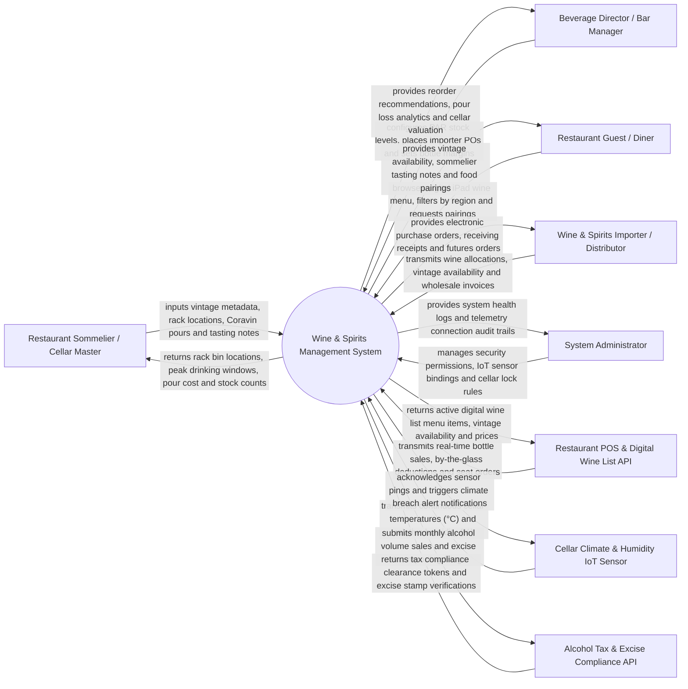

# Context Diagram — Wine & Spirits Management System

## Mermaid Code

## Actor & Interaction Table | Bang Actor & Tuong tac

| # | Actor | Actor Type | Data Sent TO System | Data Received FROM System | Notes |
|---|-------|------------|---------------------|---------------------------|-------|
| 1 | Restaurant Sommelier / Cellar Master | Primary | Vintage catalog entries, cellar bin allocations, Coravin needle pour logs, tasting notes | Cellar rack bin coordinates, peak drinking window alerts, pour cost, bottle counts | Manages fine wine cellar collection, sommelier service, and Coravin pouring. |
| 2 | Beverage Director / Bar Manager | Primary | Bottle PAR safety levels, wholesale price margins, supplier POs, spillage logs | Reorder alerts, pour loss analytics, gross margin reports, cellar financial valuation | Oversees restaurant beverage program, purchasing, and profitability. |
| 3 | Restaurant Guest / Diner | Primary | Digital wine list filters (Region, Varietal, Price, Food Pairing), bottle selections | Live vintage availability, sommelier tasting notes, flavor profiles, food pairing tips | Interacts via iPad digital wine menu at restaurant dining tables. |
| 4 | Wine & Spirits Importer / Distributor | Primary | Wholesale catalog pricing, allocated vintage releases, advance shipment notices | Electronic purchase orders, En Primeur futures orders, receiving confirmations | Commercial wine importer supplying fine wines, rare vintages, and craft spirits. |
| 5 | System Administrator | Primary | User credentials, security role policies, IoT sensor bindings, cellar lock rules | System health metrics, hardware telemetry logs, integration audit trails | Manages software infrastructure, IoT sensor gateways, and access control. |
| 6 | Restaurant POS & Digital Wine List API | Supporting | Live bottle sales, by-the-glass pour deductions, dining table ring-ups | Live digital wine menu updates, bottle stock availability, vintage price master | Front-of-house POS registers and interactive digital tablet wine menus. |
| 7 | Cellar Climate & Humidity IoT Sensor | Supporting | Continuous cellar temperature (°C), relative humidity (RH %), compressor status | Telemetry pings acknowledgment, climate threshold limits (12°C-14°C / 65%-75% RH) | IoT climate probes monitoring fine wine storage environment. |
| 8 | Alcohol Tax & Excise Compliance API | Supporting | Tax compliance filings, alcohol volume by volume (ABV %) reports, age verification | Excise tax clearance tokens, state compliance stamps, regulatory updates | Government alcohol tax authority enforcing state excise taxes and legal age compliance. |

## System Boundary Description | Mo ta Pham vi He thong

The **Wine & Spirits Management System** manages fine wine cellar collections, spirits inventory, digital sommelier wine lists, Coravin by-the-glass preservation tracking, climate IoT telemetry monitoring, En Primeur futures ordering, and alcohol excise tax compliance. Inside its boundary, the system handles vintage metadata management (Appellation, Varietal, Winery, Vintage Year, Alcohol ABV %), cellar rack bin location mapping, Coravin argon gas needle pour logging, automated peak drinking window calculation, IoT cellar climate monitoring (12°C-14°C / 65%-75% RH), real-time POS bottle sales deductions, and FIFO/LIFO cellar valuation.

The system boundary excludes physical harvesting of grapes, physical corking of wine bottles, physical manufacturing of Coravin needles, and physical driving of distributor delivery trucks.
