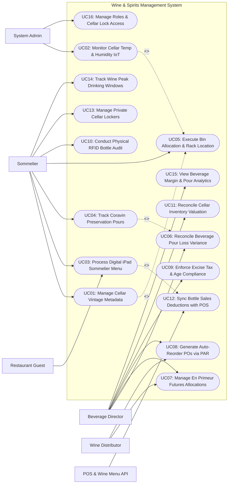

# Use Case Diagram — Wine & Spirits Management System

## Mermaid Code

## Actor Table | Bang Actor

| # | Actor | Actor Type | Role Description | Related Use Cases |
|---|-------|------------|------------------|-------------------|
| 1 | POS & Wine Menu API | Secondary System | Front-of-house POS registers and iPad digital wine list app transmitting real-time bottle sales deductions and seat orders. | UC03, UC12 |
| 2 | Wine Distributor | Primary | Commercial wine importer providing allocated vintage releases, En Primeur futures contracts, and receiving wholesale POs. | UC07, UC08 |
| 3 | Restaurant Guest | Primary | Dining guest browsing digital iPad wine lists, viewing sommelier tasting notes, filtering by varietal/price, and requesting pairings. | UC03 |
| 4 | Sommelier | Primary | Fine wine specialist managing vintage catalog entries, cellar bin locations, Coravin pours, tasting events, and peak drinking windows. | UC01, UC03, UC04, UC05, UC10, UC13, UC14 |
| 5 | Beverage Director | Primary | Bar and beverage manager setting PAR levels, generating reorder POs, auditing pour loss variances, and managing cellar financial valuations. | UC06, UC07, UC08, UC09, UC11, UC15 |
| 6 | System Administrator | Primary | Technical manager configuring IoT climate probe gateways, cellar lock security roles, API keys, and audit logs. | UC02, UC16 |

## Use Case Table | Bang Use Case

| # | UC ID | Use Case Name | Primary Actor | Secondary Actor | Description | Priority |
|---|-------|---------------|---------------|-----------------|-------------|----------|
| 1 | UC01 | Manage Cellar Vintage Metadata | Sommelier | None | Manages rich wine and spirits catalog metadata including Producer, Appellation, Grape Varietal, Vintage Year, Alcohol ABV %, and Tasting Notes. | High |
| 2 | UC02 | Monitor Cellar Temp & Humidity IoT | System Admin | None | Continuously ingests IoT climate telemetry, monitoring optimal cellar environment (12°C-14°C / 65%-75% RH) and alerting on breaches. | High |
| 3 | UC03 | Process Digital iPad Sommelier Menu | Restaurant Guest | POS & Wine Menu API | Powers interactive iPad wine menus with sommelier tasting notes, high-res bottle photos, price filters, and dish pairing suggestions. | High |
| 4 | UC04 | Track Coravin Preservation Pours | Sommelier | None | Logs needle pour volume (e.g., 75ml / 150ml) from high-end reserve bottles accessed via Coravin argon gas preservation systems. | High |
| 5 | UC05 | Execute Bin Allocation & Rack Location | Sommelier | None | Assigns specific cellar rack coordinates (e.g., Rack B, Shelf 4, Bin 12) for every individual bottle to ensure sub-minute retrieval. | High |
| 6 | UC06 | Reconcile Beverage Pour Loss Variance | Beverage Director | None | Compares theoretical pour volume against actual bottle depletion to calculate pour cost percentages, spillage, and un-ringed shots. | High |
| 7 | UC07 | Manage En Primeur Futures Allocations | Beverage Director | Wine Distributor | Tracks pre-purchased En Primeur Bordeaux/Burgundy wine futures contracts, monitoring barrel aging and future delivery dates. | Medium |
| 8 | UC08 | Generate Auto-Reorder POs via PAR | Beverage Director | Wine Distributor | Calculates replenishment needs based on vintage PAR levels, sales velocity, and importer availability, generating electronic POs. | High |
| 9 | UC09 | Enforce Excise Tax & Age Compliance | Beverage Director | None | Enforces state alcohol excise tax compliance filings, ABV % reporting, and mandatory 21+ legal age verification controls. | High |
| 10 | UC10 | Conduct Physical RFID Bottle Audit | Sommelier | None | Executes rapid cellar inventory counts using handheld RFID wand scanners, detecting misplaced bottles and missing inventory. | High |
| 11 | UC11 | Reconcile Cellar Inventory Valuation | Beverage Director | None | Reconciles fine wine cellar portfolio financial valuation using FIFO or Replacement Cost accounting methods for balance sheet reporting. | High |
| 12 | UC12 | Sync Bottle Sales Deductions with POS | System | POS & Wine Menu API | Ingests real-time sales transaction feeds from POS terminals, decrementing bottle stock and updating iPad menu availability instantly. | High |
| 13 | UC13 | Manage Private Cellar Lockers | Sommelier | None | Manages private wine lockers leased by VIP club members, tracking personal bottle deposits, corkage fees, and security codes. | Medium |
| 14 | UC14 | Track Wine Peak Drinking Windows | Sommelier | None | Tracks wine aging maturity phases (Young, Approaching Peak, At Peak, Declining), generating alert reports for wines needing service. | High |
| 15 | UC15 | View Beverage Margin & Pour Analytics | Beverage Director | None | Displays analytical dashboards on pour cost %, top-selling varietals, cellar turnover rate, high-margin spirits, and inventory value. | High |
| 16 | UC16 | Manage Roles & Cellar Lock Access | System Admin | None | Configures user security roles, electronic cellar door lock PINs, IoT probe settings, and audit logging parameters. | High |

## Use Case Specification | Dac ta Use Case

---

### UC01 — Manage Cellar Vintage Metadata

| Field | Detail |
|-------|--------|
| **UC ID** | UC01 |
| **Use Case Name** | Manage Cellar Vintage Metadata |
| **Actor(s)** | Primary: Sommelier   Secondary: None |
| **Description** | Enables the sommelier to build and maintain a rich, professional wine and spirits catalog, capturing detailed terroir metadata, producer history, grape varietals, vintage ratings, and sommelier tasting notes. |
| **Precondition** | 1. Sommelier is logged into management console.   2. Master wine database (e.g., LWIN / Global Wine Database API) is accessible. |
| **Main Flow** | 1. Sommelier opens "Add New Wine / Spirit Master" module.   2. Sommelier scans bottle barcode or types LWIN code: `Château Margaux Premier Grand Cru Classé 2015`.   3. System auto-populates master metadata from global registry:      - Producer: Château Margaux      - Region / Appellation: Margaux, Bordeaux, France      - Grape Varietals: 90% Cabernet Sauvignon, 7% Merlot, 2% Cabernet Franc, 1% Petit Verdot      - Vintage Year: 2015      - Alcohol ABV: 13.5%      - Bottle Format: Standard 750ml.   4. Sommelier adds Professional Critic Ratings: `Robert Parker: 99 Pts | Wine Spectator: 98 Pts`.   5. Sommelier inputs Custom Sommelier Tasting Notes: "Deep ruby color. Aromas of blackcurrant, violet, and cedar. Full-bodied with silky tannins and incredible longevity."   6. Sommelier inputs Food Pairing Tags: `[Prime Dry-Aged Ribeye, Roasted Lamb Rack, Truffle Risotto]`.   7. Sommelier sets Pricing Structure: Wholesale Unit Cost = $450.00 | Retail Bottle List Price = $1,800.00 (Markup Factor: 4.0x / Margin: 75.0%).   8. Sommelier saves record.   9. System binds metadata to SKU #WIN-MAR-2015 and publishes entry to iPad Digital Wine Menu (UC03). |
| **Alternative Flow** | **AF1** — Spirits / Single Malt Whiskey catalog entry:   1. Sommelier logs Single Malt Scotch (Macallan 18 Year Sherry Oak).   2. System captures Distillery, Cask Type (Oloroso Sherry Seasoned Oak), Age Statement (18 Years), and Pour Glass Price ($65.00 / 1.5 oz pour). |
| **Exception Flow** | **EX1** — Duplicate vintage SKU collision:   1. Sommelier attempts to re-create existing 2015 Château Margaux entry.   2. System flags notification "Vintage SKU already exists in cellar database", directing sommelier to update bottle quantity instead. |
| **Postcondition** | Wine metadata, terroir details, critic scores, tasting notes, and price markups are saved and published to digital menus. |
| **Business Rule** | **BR1**: All wine entries MUST include official Appellation, Grape Varietal %, Vintage Year, and Alcohol ABV % metadata.   **BR2**: Retail bottle pricing must strictly enforce minimum markup margins configured by the Beverage Director. |

---

### UC02 — Monitor Cellar Temp & Humidity IoT

| Field | Detail |
|-------|--------|
| **UC ID** | UC02 |
| **Use Case Name** | Monitor Cellar Temp & Humidity IoT |
| **Actor(s)** | Primary: System Administrator   Secondary: None |
| **Description** | Continuously ingests real-time IoT climate probe telemetry to monitor fine wine cellar environmental conditions (12°C-14°C temperature and 65%-75% relative humidity), alerting managers on environmental breaches to prevent wine spoilage. |
| **Precondition** | 1. Wireless IoT climate sensors (temperature and humidity probes) are deployed in cellar zones.   2. Climate threshold limits are configured (Target: 13.0°C / 70% RH). |
| **Main Flow** | 1. Cellar IoT Probes transmit environmental readings every 60 seconds over Zigbee / Wi-Fi gateway.   2. System ingests telemetry payload: `Sensor #CELLAR-ZONE-1 | Temp: 13.2°C | RH: 68.5% | Status: NORMAL`.   3. System logs climate reading in historical telemetry ledger.   4. Refrigeration unit experiences a cooling compressor fault; Cellar temperature rises to 16.5°C over 2 hours.   5. System detects temperature breach above Upper Safety Limit (14.5°C threshold).   6. System starts 15-minute verification buffer timer.   7. Temperature remains elevated (16.8°C).   8. System triggers **HIGH-PRIORITY CELLAR CLIMATE ALARM**:      - Dispatches urgent SMS & Push Notifications to Sommelier and Facilities Manager: **CRITICAL CELLAR TEMP ALERT: Zone 1 at 16.8°C (Exceeds 14.5°C Limit)**      - Displays red alert banner on POS screens and management portal      - Logs environmental breach event for insurance audit records. |
| **Alternative Flow** | **AF1** — Humidity drop warning (Cork drying risk):   1. Humidity drops below 55% RH (risk of corks drying out and oxidizing wine).   2. System triggers "Low Humidity Alert", prompting facilities staff to inspect cellar humidifier. |
| **Exception Flow** | **EX1** — Sensor communication offline:   1. Sensor #CELLAR-ZONE-1 misses 5 consecutive pings (offline).   2. System flags "IoT Sensor Offline Alert", prompting IT admin to check sensor battery and gateway connection. |
| **Postcondition** | Cellar climate telemetry is continuously logged, and environmental breaches trigger multi-channel manager alerts. |
| **Business Rule** | **BR1**: Wine cellar temperature MUST remain strictly between 12°C and 14°C (53.6°F - 57.2°F) to prevent heat damage or premature aging.   **BR2**: Relative humidity MUST be maintained between 65% and 75% to prevent cork shrinkage while avoiding label mildew. |

---

### UC03 — Process Digital iPad Sommelier Menu

| Field | Detail |
|-------|--------|
| **UC ID** | UC03 |
| **Use Case Name** | Process Digital iPad Sommelier Menu |
| **Actor(s)** | Primary: Restaurant Guest, Sommelier   Secondary: POS & Wine Menu API |
| **Description** | Powers an interactive iPad dining table wine menu enabling guests and sommeliers to filter fine wines by region, price, vintage, and food pairings, displaying real-time bottle availability and tasting notes. |
| **Precondition** | 1. Digital iPad wine list tablet application is active at dining table or held by sommelier.   2. Real-time cellar stock balances (UC05) are synced. |
| **Main Flow** | 1. Guest or Sommelier opens Digital Wine List on iPad tablet.   2. System presents interactive categories: `Red Wine`, `White Wine`, `Champagne & Sparkling`, `Reserve Cellar Collection`, `By the Glass (Coravin)`.   3. Guest applies Filters: `Country: France` -> `Region: Bordeaux` -> `Varietal: Cabernet Sauvignon` -> `Price Range: $200 - $500`.   4. System queries database and displays matching available wines in real time:      - `Château Pontet-Canet Pauillac 2010 — $320.00 (In Stock: 4 Bottles)`.   5. Guest taps product card; System displays high-resolution bottle photograph, Sommelier Tasting Notes (UC01), Robert Parker 98-Pt Rating, and Recommended Dish Pairings (`Pairs beautifully with your ordered Dry-Aged Ribeye`).   6. Guest taps "Order Bottle for Table 14".   7. System transmits bottle order ticket directly to POS API (UC12) and Sommelier Smart Watch: **Table 14 Ordered: Château Pontet-Canet 2010 ($320.00) — Location: Rack B, Bin 14**.   8. Sommelier retrieves bottle from Cellar Bin B-14 (UC05), performs table-side service, and confirms order on POS. |
| **Alternative Flow** | **AF1** — Interactive "Wine Pairing Assistant" mode:   1. Guest inputs ordered main courses (Grilled Salmon & Duck Breast).   2. System AI Pairing Engine recommends Pinot Noir as the optimal bridge pairing for both dishes. |
| **Exception Flow** | **EX1** — Last bottle sold out in real time:   1. Another table purchases the final bottle 10 seconds prior.   2. System updates iPad screen instantly to `Sold Out`, suggesting alternative 2012 vintage of same château. |
| **Postcondition** | Interactive wine list displays matching vintages, table order is routed to POS and sommelier, and cellar bin location is provided. |
| **Business Rule** | **BR1**: Digital iPad wine menus MUST display ONLY bottles currently in active cellar stock to prevent guest ordering disappointment.   **BR2**: Wine menu price changes updated in the core system MUST reflect on dining room iPad tablets within 3 seconds. |

---

### UC04 — Track Coravin Preservation Pours

| Field | Detail |
|-------|--------|
| **UC ID** | UC04 |
| **Use Case Name** | Track Coravin Preservation Pours |
| **Actor(s)** | Primary: Sommelier   Secondary: None |
| **Description** | Logs individual needle pour volumes from high-end reserve wine bottles accessed via Coravin argon gas preservation systems, tracking remaining bottle liquid volume and calculating exact pour cost percentages. |
| **Precondition** | 1. High-end reserve wine bottle (e.g., Opus One 2018 @ $600.00/bottle) is fitted with Coravin preservation system.   2. Sommelier handheld terminal or POS Coravin module is active. |
| **Main Flow** | 1. Sommelier receives order for a By-the-Glass Pour of Opus One 2018 ($120.00 per 150ml glass).   2. Sommelier retrieves Opus One bottle from Cellar Bin C-08.   3. Sommelier inserts Coravin teflon-coated needle through natural cork and pours 150ml into guest glass, pressurizing bottle with pure argon gas.   4. Sommelier opens "Coravin Pour Tracker" on handheld terminal.   5. Sommelier scans bottle barcode (Bottle ID #BTL-OPUS-8812).   6. System displays current bottle status:      - Total Bottle Capacity: 750ml      - Previous Volume Poured: 300ml (2 Glasses Poured previously)      - Remaining Volume: 450ml (3 Glasses remaining)      - First Needle Pierced Date: July 10, 2026 (12 Days ago — Argon integrity active).   7. Sommelier taps "Record 150ml Glass Pour" and confirms transaction.   8. System updates remaining liquid volume: `450ml - 150ml = 300ml Remaining (2 Glasses Left)`.   9. System calculates Pour Financial Math: `150ml Pour Cost = $24.00 | Glass Price = $120.00 | Pour Cost % = 20.0%`.   10. System posts pour deduction to Beverage Spillage & Pour Loss Module (UC06). |
| **Alternative Flow** | **AF1** — Final pour bottle depletion:   1. Sommelier pours final 150ml glass from bottle.   2. System updates remaining volume to 0ml, marks bottle `Depleted & Empty`, and prompts sommelier to pull new bottle for Coravin staging. |
| **Exception Flow** | **EX1** — Coravin argon gas capsule depletion alert:   1. System calculates 15 pours executed on Coravin Unit #2.   2. System alerts sommelier "Replace Argon Gas Capsule on Unit #2 (Max 15 pours reached)". |
| **Postcondition** | Coravin pour volume is logged, remaining liquid balance is updated, pour cost % is recorded, and argon integrity is tracked. |
| **Business Rule** | **BR1**: Coravin-accessed bottles MUST be logged per pour to maintain sub-ounce inventory accuracy for high-value reserve wines.   **BR2**: Coravin bottles reaching 30 days past initial needle piercing must trigger quality inspection prompts for the sommelier. |

---

### UC05 — Execute Bin Allocation & Rack Location

| Field | Detail |
|-------|--------|
| **UC ID** | UC05 |
| **Use Case Name** | Execute Bin Allocation & Rack Location |
| **Actor(s)** | Primary: Sommelier   Secondary: None |
| **Description** | Assigns and tracks precise physical cellar coordinates (Rack ID, Shelf Level, Bin Slot Number) for every bottle in the collection, optimizing sommelier retrieval speed during busy dinner services. |
| **Precondition** | 1. Cellar physical layout structure (Racks A through Z, Shelves 1-10, Bins 1-20) is mapped.   2. Bottles are received at dock (UC08) or being relocated. |
| **Main Flow** | 1. Sommelier receives a case of 12 bottles of `Barolo Monfortino Riserva 2013`.   2. Sommelier opens "Cellar Bin Allocation" on mobile tablet scanner.   3. Sommelier scans first bottle barcode (#BTL-BAR-2013-01).   4. System prompts "Scan Target Cellar Bin Location".   5. Sommelier carries bottle into wine cellar, navigates to Rack D (Piedmont Reserve Section), and scans location barcode tag on Bin `D-04-12` (Rack D, Shelf 4, Bin 12).   6. System validates bin availability: `Bin D-04-12 Status: Empty (Capacity: 1 Bottle)`.   7. System binds Bottle #BTL-BAR-2013-01 to Location Bin `D-04-12`.   8. System updates master cellar map, displaying exact 3D grid coordinates on sommelier handheld devices.   9. During dinner service when Table 8 orders Barolo 2013, sommelier handheld highlights **Location: Rack D, Shelf 4, Bin 12**, enabling retrieval in under 30 seconds. |
| **Alternative Flow** | **AF1** — Multi-bottle case bin allocation:   1. Sommelier allocates an entire 6-bottle wood crate to Crate Storage Zone `Rack W-02`.   2. System binds all 6 bottle IDs to crate zone W-02. |
| **Exception Flow** | **EX1** — Bin already occupied collision:   1. Sommelier scans Bin D-04-12, but system indicates it is occupied by 2010 Brunello.   2. System flags error "Bin Occupied", directing sommelier to nearest empty adjacent bin `D-04-13`. |
| **Postcondition** | Bottle barcode is bound to precise cellar rack coordinates, and 3D cellar map updates for sub-minute retrieval. |
| **Business Rule** | **BR1**: Every individual wine bottle valued over $100.00 MUST be assigned a unique single-bottle bin coordinate in the cellar grid.   **BR2**: Sommelier bottle retrieval time during service must average under 60 seconds from order receipt to dining room exit. |
