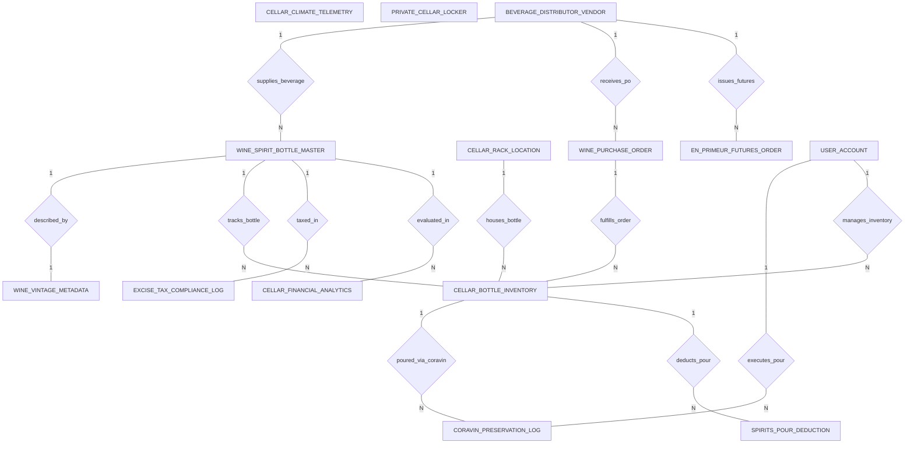

# Conceptual ERD — Wine & Spirits Management System

## Mermaid Code

## Entity Description Table | Bang mo ta Entity

| # | Entity Name | Vietnamese Name | Description | Key Attributes | Main Relationships |
|---|-------------|-----------------|-------------|----------------|-------------------|
| 1 | WINE_SPIRIT_BOTTLE_MASTER | Danh muc ruou va do uong master | Master wine and spirits catalog, barcode LWIN ID, product name, beverage type, wholesale unit cost, retail list price, and PAR safety stock. | product_id, vendor_id, barcode_lwin_id, product_name, beverage_type, wholesale_unit_cost, retail_list_price | Belongs to BEVERAGE_DISTRIBUTOR_VENDOR; One-to-One with WINE_VINTAGE_METADATA; One-to-Many with CELLAR_BOTTLE_INVENTORY, EXCISE_TAX_COMPLIANCE_LOG, CELLAR_FINANCIAL_ANALYTICS |
| 2 | WINE_VINTAGE_METADATA | Du lieu vang ruou va tho nhuong | Vintage and terroir metadata, vintage year, producer winery, country/region, grape varietals, alcohol ABV %, and peak drinking years. | vintage_id, product_id, vintage_year, producer_winery, country_region, grape_varietal, alcohol_abv_pct | One-to-One with WINE_SPIRIT_BOTTLE_MASTER |
| 3 | CELLAR_RACK_LOCATION | Vi tri ke va o ruou trong kho | Physical wine cellar storage bin coordinates, rack code, shelf level, bin number, climate zone, and occupation status. | location_id, rack_code, shelf_level, bin_number, climate_zone, is_occupied | One-to-Many with CELLAR_BOTTLE_INVENTORY |
| 4 | CELLAR_BOTTLE_INVENTORY | Ton kho chai ruou thuc te | Individual bottle inventory unit, product ID, location ID, unique serial number, bottle status (In-Cellar/Coravin/Sold/Decanted), and received date. | bottle_id, product_id, location_id, serial_number, bottle_status, received_at | Belongs to WINE_SPIRIT_BOTTLE_MASTER, CELLAR_RACK_LOCATION; One-to-Many with CORAVIN_PRESERVATION_LOG, SPIRITS_POUR_DEDUCTION |
| 5 | CORAVIN_PRESERVATION_LOG | Nhat ky rot ruou Coravin | Coravin argon gas needle pour log, bottle ID, sommelier user ID, poured volume ml, remaining volume ml, and timestamp. | pour_id, bottle_id, sommelier_user_id, poured_volume_ml, remaining_volume_ml, poured_at | Belongs to CELLAR_BOTTLE_INVENTORY, USER_ACCOUNT |
| 6 | WINE_PURCHASE_ORDER | Don hang mua ruou si | Purchase order generated to replenish wine/spirits, vendor ID, PO number, order date, total amount, and status. | po_id, vendor_id, po_number, order_date, total_amount, po_status | Belongs to BEVERAGE_DISTRIBUTOR_VENDOR; One-to-Many with CELLAR_BOTTLE_INVENTORY |
| 7 | SPIRITS_POUR_DEDUCTION | Khau tru ruou rot | Individual spirits or wine pour deduction log, bottle ID, ounces poured, calculated pour cost, POS receipt ref, and transaction timestamp. | deduction_id, bottle_id, ounces_poured, calculated_pour_cost, pos_receipt_ref, transaction_time | Belongs to CELLAR_BOTTLE_INVENTORY |
| 8 | CELLAR_CLIMATE_TELEMETRY | Nhat ky nhiet do do am hầm ruou | Real-time cellar climate telemetry log recording sensor device ID, temperature °C, relative humidity RH %, breach alert boolean, and timestamp. | telemetry_id, sensor_device_id, temp_celsius, humidity_rh_pct, is_breach_alert, logged_at | Independent IoT sensor log |
| 9 | EN_PRIMEUR_FUTURES_ORDER | Don hang hop dong ruou tuong lai | En Primeur wine futures order contract, vendor ID, estate name, vintage year, cases ordered, estimated delivery date, and deposit paid. | futures_id, vendor_id, estate_name, vintage_year, cases_ordered, estimated_delivery_date, deposit_paid | Belongs to BEVERAGE_DISTRIBUTOR_VENDOR |
| 10 | EXCISE_TAX_COMPLIANCE_LOG | Nhat ky thue tieu thu dac biet | State alcohol excise tax compliance log, filing period, total liters sold by ABV category, total excise tax due, and clearance ref. | tax_log_id, filing_period, total_liters_sold, total_excise_tax_due, compliance_clearance_ref | Evaluates WINE_SPIRIT_BOTTLE_MASTER |
| 11 | PRIVATE_CELLAR_LOCKER | Tu ruou ca nhan hoi vien | Private wine locker leased by VIP club members, locker number, member name, bottles stored count, and monthly lease fee. | locker_id, locker_number, member_name, bottles_stored_count, monthly_lease_fee | Independent VIP amenity |
| 12 | BEVERAGE_DISTRIBUTOR_VENDOR | Nha nhap khau ruou | Wholesale wine & spirits importer vendor profile, vendor code, vendor name, state liquor license number, and contact email. | vendor_id, vendor_code, vendor_name, liquor_license_number, contact_email | One-to-Many with WINE_SPIRIT_BOTTLE_MASTER, WINE_PURCHASE_ORDER, EN_PRIMEUR_FUTURES_ORDER |
| 13 | USER_ACCOUNT | Tai khoan he thong | Core security authentication account holding credentials, password hashes, and user role definitions. | user_id, username, password_hash, role_name | One-to-Many with CORAVIN_PRESERVATION_LOG, CELLAR_BOTTLE_INVENTORY |
| 14 | CELLAR_FINANCIAL_ANALYTICS | Thong ke gia tri va hieu qua hầm ruou | Executive daily analytics tracking total cellar valuation (FIFO), average pour cost %, gross margin %, and past-peak bottles count. | analytics_id, metric_date, total_cellar_valuation, average_pour_cost_pct, wine_gross_margin_pct | Evaluates WINE_SPIRIT_BOTTLE_MASTER |

## Relationship Description | Mo ta Quan he

| # | From Entity | Cardinality | To Entity | Relationship Label | Business Explanation |
|---|-------------|-------------|-----------|-------------------|----------------------|
| 1 | BEVERAGE_DISTRIBUTOR_VENDOR | One-to-Many | WINE_SPIRIT_BOTTLE_MASTER | supplies_beverage | Nha nhap khau cung cap cac dong ruou vang va ruou manh trong danh muc. |
| 2 | BEVERAGE_DISTRIBUTOR_VENDOR | One-to-Many | WINE_PURCHASE_ORDER | receives_po | Nha nhap khau nhan cac don hang mua ruou si tu nha hang. |
| 3 | WINE_SPIRIT_BOTTLE_MASTER | One-to-One | WINE_VINTAGE_METADATA | described_by | Moi dong ruou duoc mo ta chi tiet du lieu vang ruou, tho nhuong va nam thu hoach. |
| 4 | WINE_SPIRIT_BOTTLE_MASTER | One-to-Many | CELLAR_BOTTLE_INVENTORY | tracks_bottle | Danh muc ruou quan ly tung chai ruou thuc te co ma dinh danh serial trong hầm. |
| 5 | CELLAR_RACK_LOCATION | One-to-Many | CELLAR_BOTTLE_INVENTORY | houses_bottle | Vi tri ke o trong hầm ruou chua cac chai ruou tuong ung. |
| 6 | CELLAR_BOTTLE_INVENTORY | One-to-Many | CORAVIN_PRESERVATION_LOG | poured_via_coravin | Chai ruou duoc rots bang kim khi argon Coravin va ghi nhan dung tich con lai. |
| 7 | USER_ACCOUNT | One-to-Many | CORAVIN_PRESERVATION_LOG | executes_pour | Sommelier thuc hien nhat ky rot ruou Coravin. |
| 8 | CELLAR_BOTTLE_INVENTORY | One-to-Many | SPIRITS_POUR_DEDUCTION | deducts_pour | Chai ruou manh duoc khau tru dung tich rot (ounce) theo giao dich POS. |
| 9 | BEVERAGE_DISTRIBUTOR_VENDOR | One-to-Many | EN_PRIMEUR_FUTURES_ORDER | issues_futures | Nha phan phoi phat hanh cac hop dong mua ruou tuong lai En Primeur. |
| 10 | WINE_PURCHASE_ORDER | One-to-Many | CELLAR_BOTTLE_INVENTORY | fulfills_order | Don hang mua si duoc giao va nhap kho thanh cac chai ruou trong hầm. |
| 11 | WINE_SPIRIT_BOTTLE_MASTER | One-to-Many | EXCISE_TAX_COMPLIANCE_LOG | taxed_in | Cac chai ruou ban ra duoc thong ke tinh thue tieu thu dac biet theo dung tich alcohol. |
| 12 | USER_ACCOUNT | One-to-Many | CELLAR_BOTTLE_INVENTORY | manages_inventory | Sommelier va quan ly thuc hien quan ly ton kho chai ruou. |
| 13 | WINE_SPIRIT_BOTTLE_MASTER | One-to-Many | CELLAR_FINANCIAL_ANALYTICS | evaluated_in | Cac chai ruou duoc thong ke va danh gia gia tri tai chinh hầm ruou va ty le pour cost. |
