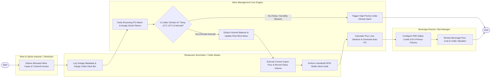

# Swimlane Diagram — Wine & Spirits Management System

## Mermaid Code

## Flow Description | Mo ta luong

| Lane | Actor | Role in Flow |
|------|-------|-------------|
| **Lane 1** | Restaurant Sommelier / Cellar Master | Logs vintage metadata, assigns rack bin coordinates, executes Coravin argon gas pours, records glass volumes, and performs RFID bottle audits. |
| **Lane 2** | Beverage Director / Bar Manager | Configures vintage PAR levels, manages En Primeur wine futures, audits pour loss variances, and reviews cellar financial valuations. |
| **Lane 3** | Wine & Spirits Importer / Distributor | Delivers allocated wine cases to restaurant receiving dock and transmits wholesale billing invoices. |
| **Lane 4** | Wine Management Core Engine | Matches receiving POs, monitors IoT cellar climate sensors, deducts bottle balances upon POS sale, updates iPad menus, and generates auto-PO reorders. |

### Process Execution Steps | Cac buoc thuc hien quy trinh

1. **Delivery & Bin Allocation**: Importer delivers wine cases (`V1`). Sommelier logs vintage metadata and assigns rack bin coordinates (`C1`). Core Engine matches PO and assigns bottle serial tokens (`S1`).
2. **Climate Verification & Menu Sync**: Core Engine verifies IoT cellar climate sensors (`S2`).
   - If **No (Temp/Humidity Breach)**: Core Engine triggers high-priority cellar alarm (`S3`), halting service until climate stabilizes.
   - If **Yes (Climate Normal)**: Core Engine updates stock balances and syncs iPad digital wine list (`S4`).
3. **Coravin Pour & RFID Audit**: Sommelier executes Coravin needle pour and logs glass volume (`C2`), conducting handheld RFID bottle stock audits (`C3`).
4. **Pour Cost & Auto-Reordering**: Core Engine calculates pour loss variances and generates auto-PO suggestions (`S5`). Beverage Director configures PAR levels (`M1`) and reviews cellar valuation analytics (`M2`), completing execution (`Finish`).
