# Action Tree — Wine & Spirits Management System

## Mermaid Code

```mermaid
graph TD
    Root["Wine & Spirits Management System"]

    Root --> M1["Vintage Catalog & Terroir Metadata Management"]
    Root --> M2["Cellar Rack Allocation & Climate IoT Telemetry"]
    Root --> M3["Digital iPad Wine List & Sommelier Food Pairing"]
    Root --> M4["Coravin By-the-Glass & Pour Loss Control"]
    Root --> M5["Purchasing, En Primeur Futures & Vendor Orders"]
    Root --> M6["Excise Tax Compliance & Private Locker Management"]
    Root --> M7["Cellar Analytics & System Administration"]

    M1 --> A11["Maintain Wine Appellation Terroir and Varietal Metadata"]
    M1 --> A12["Record Professional Critic Ratings Parker Spectator"]
    M1 --> A13["Log Sommelier Tasting Notes and Flavor Profiles"]
    M1 --> A14["Track Wine Peak Drinking Windows and Cellar Maturity"]

    M2 --> A21["Assign Bottle Serial Numbers to Cellar Rack Bin Coordinates"]
    M2 --> A22["Monitor IoT Cellar Temperature 12 to 14 Degrees Celsius"]
    M2 --> A23["Monitor IoT Relative Humidity 65 to 75 Percent"]
    M2 --> A24["Trigger High-Priority Cellar Climate Breach Alarms"]

    M3 --> A31["Power Interactive Dining Room iPad Digital Wine Menus"]
    M3 --> A32["Filter Wines by Region Varietal Price and Vintage"]
    M3 --> A33["Suggest Sommelier Food and Wine Bridge Pairings"]
    M3 --> A34["Update Real-Time Bottle Availability and Prices"]

    M4 --> A41["Log Coravin Argon Gas Needle Pour Volumes in Milliliters"]
    M4 --> A42["Track Remaining Liquid Volume in High-End Reserve Bottles"]
    M4 --> A43["Reconcile Theoretical vs Actual Spirits Pour Loss"]
    M4 --> A44["Alert Sommelier on Coravin Argon Gas Capsule Replacement"]

    M5 --> A51["Calculate Reorder POs via Vintage PAR Safety Levels"]
    M5 --> A52["Track En Primeur Bordeaux Burgundy Wine Futures Contracts"]
    M5 --> A53["Receive Wholesale Cases at Dock with Serial Tokens"]
    M5 --> A54["Enforce Importer Minimum Order Quantity Rules"]

    M6 --> A61["File State Alcohol Volume Sales Excise Tax Reports"]
    M6 --> A62["Verify Legal Drinking Age 21 Plus POS Checkout Rules"]
    M6 --> A63["Manage VIP Member Private Cellar Locker Leases"]
    M6 --> A64["Track Personal Bottle Corkage Fee Transactions"]

    M7 --> A71["Monitor Cellar Financial Portfolio Valuation FIFO"]
    M7 --> A72["Analyze Pour Cost Percentages and Beverage Gross Margins"]
    M7 --> A73["Manage User Security Roles and Cellar Lock Permissions"]
    M7 --> A74["Manage IoT Climate Sensor Gateway Settings and Logs"]
```

## Module Description | Mo ta Module

| # | Module | Description | Actions |
|---|--------|-------------|---------|
| 1 | Vintage Catalog & Terroir Metadata Management | Controls master wine/spirits catalog entries, terroir metadata (Appellation, Varietals), critic ratings (Parker/Spectator), tasting notes, and peak drinking windows. | Maintain Wine Appellation Terroir and Varietal Metadata, Record Professional Critic Ratings Parker Spectator, Log Sommelier Tasting Notes and Flavor Profiles, Track Wine Peak Drinking Windows and Cellar Maturity |
| 2 | Cellar Rack Allocation & Climate IoT Telemetry | Assigns bottle serial numbers to cellar rack bin coordinates, ingests IoT climate probe telemetry (12°C-14°C / 65%-75% RH), and alerts on climate breaches. | Assign Bottle Serial Numbers to Cellar Rack Bin Coordinates, Monitor IoT Cellar Temperature 12 to 14 Degrees Celsius, Monitor IoT Relative Humidity 65 to 75 Percent, Trigger High-Priority Cellar Climate Breach Alarms |
| 3 | Digital iPad Wine List & Sommelier Food Pairing | Powers interactive dining room iPad digital wine lists, filtering by region/varietal/price, recommending sommelier food pairings, and updating stock. | Power Interactive Dining Room iPad Digital Wine Menus, Filter Wines by Region Varietal Price and Vintage, Suggest Sommelier Food and Wine Bridge Pairings, Update Real-Time Bottle Availability and Prices |
| 4 | Coravin By-the-Glass & Pour Loss Control | Logs Coravin argon gas needle pours (ml), tracks remaining liquid in reserve bottles, reconciles pour cost %, and alerts on argon capsule replacements. | Log Coravin Argon Gas Needle Pour Volumes in Milliliters, Track Remaining Liquid Volume in High-End Reserve Bottles, Reconcile Theoretical vs Actual Spirits Pour Loss, Alert Sommelier on Coravin Argon Gas Capsule Replacement |
| 5 | Purchasing, En Primeur Futures & Vendor Orders | Calculates auto-reorders via PAR levels, tracks En Primeur wine futures contracts, receives wholesale cases at dock, and enforces importer MOQs. | Calculate Reorder POs via Vintage PAR Safety Levels, Track En Primeur Bordeaux Burgundy Wine Futures Contracts, Receive Wholesale Cases at Dock with Serial Tokens, Enforce Importer Minimum Order Quantity Rules |
| 6 | Excise Tax Compliance & Private Locker Management | Files alcohol excise tax reports, enforces legal age 21+ compliance, manages private VIP cellar lockers, and logs member corkage fees. | File State Alcohol Volume Sales Excise Tax Reports, Verify Legal Drinking Age 21 Plus POS Checkout Rules, Manage VIP Member Private Cellar Locker Leases, Track Personal Bottle Corkage Fee Transactions |
| 7 | Cellar Analytics & System Administration | Displays executive analytics on cellar valuation (FIFO), pour cost %, beverage gross margins, IoT sensor settings, cellar lock access, and security roles. | Monitor Cellar Financial Portfolio Valuation FIFO, Analyze Pour Cost Percentages and Beverage Gross Margins, Manage User Security Roles and Cellar Lock Permissions, Manage IoT Climate Sensor Gateway Settings and Logs |
