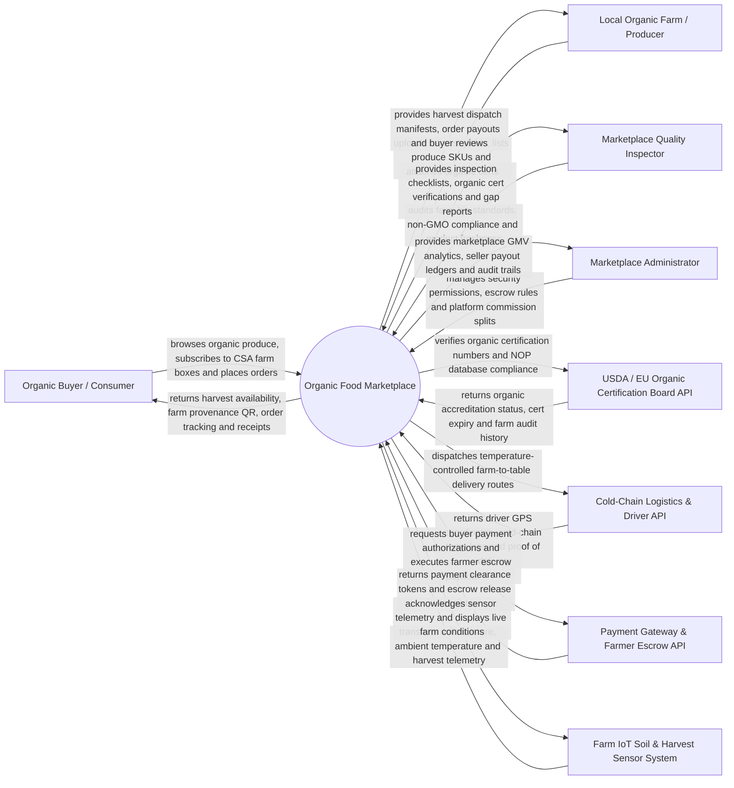

# Context Diagram — Organic Food Marketplace

## Mermaid Code

## Actor & Interaction Table | Bang Actor & Tuong tac

| # | Actor | Actor Type | Data Sent TO System | Data Received FROM System | Notes |
|---|-------|------------|---------------------|---------------------------|-------|
| 1 | Organic Buyer / Consumer | Primary | Produce orders, CSA farm box subscriptions, delivery addresses, ratings & reviews | Harvest availability, farm-to-fork provenance QR, order tracking, digital receipts | Consumers and restaurants purchasing certified organic food directly from farms. |
| 2 | Local Organic Farm / Producer | Primary | Produce listings, harvest yield forecasts, organic cert documents, bank payout details | Dispatch manifests, customer orders, escrow payout statements, buyer reviews | Certified organic farmers, orchards, and artisanal food producers. |
| 3 | Marketplace Quality Inspector | Primary | On-farm audit reports, non-GMO testing logs, produce freshness ratings | Inspection queues, USDA cert verification tokens, quality gap reports | Quality control inspector enforcing marketplace bio-organic standards. |
| 4 | Marketplace Administrator | Primary | Platform commission rates (e.g., 12%), escrow release policies, user security roles | Marketplace Gross Merchandise Value (GMV), seller ledgers, audit trails | Oversees platform operation, dispute resolutions, and seller payouts. |
| 5 | USDA / EU Organic Cert Board API | Supporting | Organic certification accreditation status, NOP registration numbers, audit history | Organic certificate validation requests, farm operator queries | Government/NGO organic certification registries (USDA NOP, EU Organic, JAS). |
| 6 | Cold-Chain Logistics & Driver API | Supporting | Driver GPS tracking coordinates, refrigerated container temp logs (°C), proof of delivery | Farm-to-door delivery manifests, pickup addresses, customer delivery windows | Refrigerated courier partners delivering perishable produce from farm to doorstep. |
| 7 | Payment Gateway & Escrow API | Supporting | Credit card charge authorizations, Apple Pay tokens, farmer bank ACH payouts | Payment clearance tokens, escrow hold confirmations, payout settlement receipts | Handles customer payments with escrow holding until buyer confirms delivery. |
| 8 | Farm IoT Soil & Harvest Sensor System | Supporting | Soil moisture %, ambient temperature (°C), solar radiation, harvest yield sensor data | Sensor telemetry pings acknowledgment, farm health dashboard updates | IoT soil probes and micro-climate sensors installed at partner organic farms. |

## System Boundary Description | Mo ta Pham vi He thong

The **Organic Food Marketplace** manages farm-direct organic produce e-commerce, Community Supported Agriculture (CSA) farm box subscriptions, USDA/EU organic certification verification, harvest batch QR code provenance tracing, cold-chain farm-to-door logistics, and buyer-seller escrow payment protection. Inside its boundary, the system handles organic farm seller onboarding, USDA NOP certificate database verification, seasonal produce catalog listings, CSA weekly box subscription management, escrow payment processing, zero-waste imperfect "ugly" produce clearance, farm-to-fork QR code generation, and cold-chain refrigerated delivery routing.

The system boundary excludes physical farming of crops, physical driving of refrigerated trucks, physical soil tilling, and raw credit card processing (handled by Payment Gateways).
