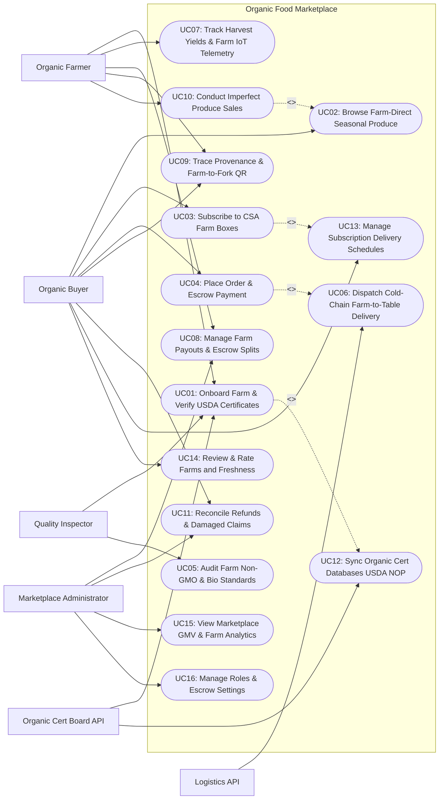

# Use Case Diagram — Organic Food Marketplace

## Mermaid Code

## Actor Table | Bang Actor

| # | Actor | Actor Type | Role Description | Related Use Cases |
|---|-------|------------|------------------|-------------------|
| 1 | Organic Cert Board API | Secondary System | Government NOP registry verifying farm organic accreditation numbers and certificate expiration status. | UC01, UC12 |
| 2 | Logistics API | Secondary System | Refrigerated courier network dispatching drivers, monitoring cold-chain temperatures, and providing proof of delivery. | UC06 |
| 3 | Organic Buyer | Primary | Consumer or restaurant buyer browsing produce, subscribing to weekly CSA farm boxes, placing escrow orders, and scanning QR codes. | UC02, UC03, UC04, UC09, UC11, UC13, UC14 |
| 4 | Organic Farmer | Primary | Certified organic producer listing seasonal crops, tracking harvest yields, managing CSA box contents, and receiving escrow payouts. | UC01, UC07, UC08, UC09, UC10 |
| 5 | Quality Inspector | Primary | Marketplace bio-auditor inspecting farm soil management, non-GMO compliance, chemical-free standards, and product freshness. | UC01, UC05 |
| 6 | Marketplace Administrator | Primary | Platform manager setting commission splits, releasing farmer escrow payouts, managing refund disputes, and analyzing GMV. | UC08, UC11, UC15, UC16 |

## Use Case Table | Bang Use Case

| # | UC ID | Use Case Name | Primary Actor | Secondary Actor | Description | Priority |
|---|-------|---------------|---------------|-----------------|-------------|----------|
| 1 | UC01 | Onboard Farm & Verify USDA Certificates | Organic Farmer | Organic Cert Board API | Onboards new organic farms, cross-referencing USDA NOP or EU Organic registration numbers against official database APIs. | High |
| 2 | UC02 | Browse Farm-Direct Seasonal Produce | Organic Buyer | None | Enables buyers to search seasonal organic fruits, vegetables, dairy, and meats directly from local partner farms. | High |
| 3 | UC03 | Subscribe to CSA Farm Boxes | Organic Buyer | None | Allows consumers to subscribe to weekly or bi-weekly Community Supported Agriculture (CSA) mystery harvest boxes. | High |
| 4 | UC04 | Place Order & Escrow Payment | Organic Buyer | None | Processes buyer orders, holding funds in buyer-protection escrow until cold-chain delivery is confirmed. | High |
| 5 | UC05 | Audit Farm Non-GMO & Bio Standards | Quality Inspector | None | Conducts on-farm audits verifying synthetic pesticide-free soil, non-GMO seed sourcing, and regenerative bio standards. | High |
| 6 | UC06 | Dispatch Cold-Chain Farm-to-Table Delivery | System | Logistics API | Routes harvest pick-ups from partner farms directly to buyer doorsteps using refrigerated temperature-monitored vehicles. | High |
| 7 | UC07 | Track Harvest Yields & Farm IoT Telemetry | Organic Farmer | None | Tracks weekly harvest yield forecasts and ingests farm IoT sensor telemetry (Soil Moisture, Ambient Temp) to predict crop availability. | Medium |
| 8 | UC08 | Manage Farm Payouts & Escrow Splits | Organic Farmer | Marketplace Admin | Releases escrow funds to farmers upon delivery confirmation, deducting platform commission shares (e.g., 12%). | High |
| 9 | UC09 | Trace Provenance & Farm-to-Fork QR | Organic Buyer | Organic Farmer | Generates unique QR codes on produce packages allowing consumers to view exact farm origin, harvest date, and soil certs. | High |
| 10 | UC10 | Conduct Imperfect Produce Sales | Organic Farmer | None | Discounts cosmetically imperfect "ugly" organic produce (e.g., 30% off mis-shapen carrots), reducing farm food waste. | Medium |
| 11 | UC11 | Reconcile Refunds & Damaged Claims | Organic Buyer | Marketplace Admin | Manages buyer refund requests for bruised or damaged produce, photo proof review, and escrow chargebacks. | High |
| 12 | UC12 | Sync Organic Cert Databases USDA NOP | System | Organic Cert Board API | Synchronizes marketplace farm records with USDA NOP and EU Organic databases to instantly flag revoked farm certificates. | High |
| 13 | UC13 | Manage Subscription Delivery Schedules | Organic Buyer | None | Enables CSA subscribers to pause delivery, swap box contents, or adjust delivery address preferences for upcoming weeks. | High |
| 14 | UC14 | Review & Rate Farms and Freshness | Organic Buyer | None | Allows buyers to post ratings (1-5 stars) and reviews regarding farm produce freshness, packaging, and delivery promptness. | High |
| 15 | UC15 | View Marketplace GMV & Farm Analytics | Marketplace Admin | None | Displays analytical dashboards on Gross Merchandise Value (GMV), active farm sellers, top-selling organic crops, and buyer retention. | High |
| 16 | UC16 | Manage Roles & Escrow Settings | Marketplace Admin | None | Configures user security access roles, escrow release hold periods (e.g., 24-hour buyer hold), API keys, and system audit logs. | High |

## Use Case Specification | Dac ta Use Case

---

### UC01 — Onboard Farm & Verify USDA Certificates

| Field | Detail |
|-------|--------|
| **UC ID** | UC01 |
| **Use Case Name** | Onboard Farm & Verify USDA Certificates |
| **Actor(s)** | Primary: Organic Farmer, Quality Inspector   Secondary: Organic Cert Board API |
| **Description** | Onboards a new local organic farm onto the marketplace, collecting business registration, farm location, and automatically verifying USDA NOP / EU Organic certification numbers against government database APIs. |
| **Precondition** | 1. Farmer has created a user account.   2. Farm holds valid USDA NOP or EU Organic accreditation certificate. |
| **Main Flow** | 1. Farmer opens "Seller Onboarding Application" on portal.   2. Farmer inputs Farm Details: Farm Name (Sun Valley Organic Farm), Location (Sonoma County, CA), Farm Size (45 Acres), Organic Certification Agency (CCOF Organic).   3. Farmer inputs USDA NOP Operation ID Number: `#NOP-9022-8812` and uploads PDF copy of Organic Certificate.   4. System sends automated verification request to USDA NOP Database API via Organic Cert Board API (UC12).   5. USDA API verifies registration: `Status: ACTIVE | Certified Scope: Crops & Livestock | Expiry: Dec 31, 2026 | Certifier: CCOF`.   6. System cross-references farm name and address against USDA record -> `100% MATCH`.   7. Quality Inspector conducts preliminary document audit and approves farm seller profile.   8. System activates Sun Valley Organic Farm seller storefront, issues "USDA Certified Organic" verified badge, and enables product listing creation (UC02). |
| **Alternative Flow** | **AF1** — Transitional organic farm onboarding:   1. Farm is in "Year 2 of Organic Transition" (pesticide-free for 2+ years, pending final cert).   2. System flags storefront badge as `Certified Pesticide-Free (Transitional Organic)` with explanatory tooltip. |
| **Exception Flow** | **EX1** — Revoked or expired organic certificate:   1. USDA API returns status `SUSPENDED / EXPIRED`.   2. System flags error "ORGANIC CERTIFICATE INVALID", blocks seller store activation, and notifies Quality Inspector to reject application. |
| **Postcondition** | Organic farm is onboarded, USDA certificate is verified via API, seller storefront is activated, and verified badge is displayed. |
| **Business Rule** | **BR1**: All farms listing products as "Certified Organic" MUST hold verified, active certification in the USDA NOP or EU Organic database.   **BR2**: Farm organic certificates MUST be re-verified automatically via API every 90 days to prevent unaccredited sales. |

---

### UC02 — Browse Farm-Direct Seasonal Produce

| Field | Detail |
|-------|--------|
| **UC ID** | UC02 |
| **Use Case Name** | Browse Farm-Direct Seasonal Produce |
| **Actor(s)** | Primary: Organic Buyer   Secondary: None |
| **Description** | Enables consumers to search and filter farm-direct seasonal organic produce by crop category, harvest date, proximity distance (e.g., Within 50 miles), farm story, and organic cert type. |
| **Precondition** | 1. Farmer has published active crop listings with available inventory (UC07).   2. Buyer is browsing website or mobile app. |
| **Main Flow** | 1. Buyer opens "Farm-Direct Organic Market" on mobile app.   2. System detects buyer location (e.g., San Francisco, CA) and sets default radius: `Local Farms Within 50 Miles`.   3. Buyer filters catalog: `Category: Heirloom Tomatoes` -> `Certification: 100% Certified Organic` -> `Harvest Window: Harvested Yesterday / Today`.   4. System presents matching farm listings:      - Product: Organic Cherokee Purple Heirloom Tomatoes ($4.50 / lb)      - Farm: Sun Valley Organic Farm (12 Miles Away)      - Harvest Date: July 21, 2026 (Harvested 24 Hours Ago)      - Soil & Bio Notes: Grown in compost-enriched living soil without synthetic pesticides      - Badges: `USDA Certified Organic`, `Non-GMO Verified`.   5. Buyer clicks product card; System displays high-res crop photos, farm story, farmer profile video, and QR provenance preview (UC09).   6. Buyer inputs quantity: `3 lbs` and clicks "Add to Basket".   7. System updates buyer cart and displays estimated delivery date (Next-Day Cold-Chain Delivery). |
| **Alternative Flow** | **AF1** — Browsing Zero-Waste Imperfect Produce (UC10):   1. Buyer toggles "Imperfect / Ugly Produce" filter.   2. System displays mis-shapen organic carrots at 35% discount ($2.00/lb instead of $3.10/lb). |
| **Exception Flow** | **EX1** — Out-of-stock crop item:   1. Crop inventory reaches 0 lbs.   2. System grays out item "Harvest Sold Out for Today", prompting buyer to subscribe to "Notify Me on Next Harvest". |
| **Postcondition** | Buyer filters local organic produce, reviews farm provenance details, selects quantities, and adds items to cart. |
| **Business Rule** | **BR1**: Crop listings MUST display the exact harvest date or estimated pick date to guarantee farm freshness transparency.   **BR2**: Marketplace search rankings MUST prioritize local farms located closest to the buyer's delivery postal code. |

---

### UC03 — Subscribe to CSA Farm Boxes

| Field | Detail |
|-------|--------|
| **UC ID** | UC03 |
| **Use Case Name** | Subscribe to CSA Farm Boxes |
| **Actor(s)** | Primary: Organic Buyer   Secondary: None |
| **Description** | Allows consumers to subscribe to weekly or bi-weekly Community Supported Agriculture (CSA) mystery harvest boxes curated directly by local partner farms, locking in regular fresh produce deliveries. |
| **Precondition** | 1. Local farm has published active CSA subscription box plans.   2. Buyer account is logged in. |
| **Main Flow** | 1. Buyer opens "CSA Harvest Box Subscriptions" on marketplace app.   2. System displays available local farm CSA options:      - Plan 1: `Small Family Harvest Box (5-7 Seasonal Crop Types)` — $28.00 / Week      - Plan 2: `Large Chef Harvest Box (10-12 Seasonal Crop Types + Artisanal Eggs)` — $45.00 / Week      - Plan 3: `Organic Fruit Lover Box (Seasonal Berries, Stone Fruit, Citrus)` — $32.00 / Week.   3. Buyer selects `Small Family Harvest Box ($28.00/Week)`.   4. Buyer configures Subscription Preferences:      - Delivery Frequency: `Weekly (Every Thursday Morning)`      - Excluded Items (Dietary / Allergy Preferences): `No Cilantro, No Radishes`      - Delivery Method: `Doorstep Refrigerated Drop Box`.   5. System displays sneak peek of upcoming Thursday box harvest contents: *2 lbs Organic Strawberries, 1 Bunch Lacinato Kale, 1.5 lbs Heirloom Zucchini, 1 Head Butterhead Lettuce, 1 lb Baby Carrots*.   6. Buyer inputs payment method for recurring weekly billing.   7. System authorizes first weekly charge ($28.00), registers CSA subscription schedule (UC13), and notifies partner farm to include subscriber in weekly harvest packing run. |
| **Alternative Flow** | **AF1** — Customizing box contents (Swap Item feature):   1. Subscriber receives Monday preview email: "Swap 1 item in your Thursday box".   2. Subscriber swaps Radishes for Extra Strawberries on mobile portal. |
| **Exception Flow** | **EX1** — Extreme weather crop loss affects CSA box:   1. Hailstorm damages kale crop at partner farm.   2. System sends notification "Kale crop substituted with Organic Swiss Chard", maintaining box value. |
| **Postcondition** | Weekly CSA subscription is active, recurring payment is scheduled, exclusion preferences are saved, and farm receives packing order. |
| **Business Rule** | **BR1**: CSA subscription boxes MUST deliver a retail crop value equal to or greater than the weekly subscription fee.   **BR2**: Subscribers MUST be allowed to pause or skip weekly deliveries up to 48 hours prior to scheduled harvest packing day. |

---

### UC04 — Place Order & Escrow Payment

| Field | Detail |
|-------|--------|
| **UC ID** | UC04 |
| **Use Case Name** | Place Order & Escrow Payment |
| **Actor(s)** | Primary: Organic Buyer   Secondary: None |
| **Description** | Processes buyer checkout orders, collecting funds via credit card or digital wallet and holding payment in a buyer-protection escrow account until cold-chain delivery is completed and quality is verified. |
| **Precondition** | 1. Items are in buyer's cart.   2. Escrow payment hold rules (UC16) are active. |
| **Main Flow** | 1. Buyer clicks "Proceed to Checkout" from shopping cart ($45.00 produce + $5.00 delivery fee = Total $50.00).   2. Buyer confirms Delivery Address and selects Delivery Time Slot: `Tomorrow between 8:00 AM - 12:00 PM`.   3. Buyer selects Payment Method: Apple Pay or Visa Credit Card.   4. Buyer clicks "Place Order & Pay $50.00".   5. System sends payment authorization to Payment Gateway.   6. Payment Gateway clears $50.00 transaction and holds funds in **Marketplace Farmer Escrow Account** (Escrow Hold #ESC-9022).   7. System displays order confirmation screen: **Order Confirmed! $50.00 Held Safely in Escrow until Delivery Approval**.   8. System dispatches order packing tickets to partner farms, generates QR harvest tracking tags (UC09), and dispatches Cold-Chain Delivery Courier (UC06).   9. Upon delivery completion, buyer has 24 hours to inspect produce freshness.   10. Once delivery is confirmed without damage claims (UC11), System releases escrow funds to farmer bank account (UC08). |
| **Alternative Flow** | **AF1** — Multi-farm consolidated checkout:   1. Order contains items from 2 separate local organic farms.   2. System splits order into 2 farm fulfillment tickets, while processing a single consolidated delivery route and payment. |
| **Exception Flow** | **EX1** — Payment card authorization declined:   1. Payment Gateway returns card decline error.   2. System flags notification "Payment Declined", prompting buyer to select alternative card while retaining cart items. |
| **Postcondition** | Order is placed, payment is secured in farmer escrow, harvest tickets are dispatched, and cold-chain courier is scheduled. |
| **Business Rule** | **BR1**: Buyer payment MUST be held in escrow until delivery is confirmed to protect buyers against spoiled or non-delivered produce.   **BR2**: Escrow funds MUST automatically release to farmers 24 hours after verified delivery if no buyer damage claim (UC11) is filed. |

---

### UC06 — Dispatch Cold-Chain Farm-to-Table Delivery

| Field | Detail |
|-------|--------|
| **UC ID** | UC06 |
| **Use Case Name** | Dispatch Cold-Chain Farm-to-Table Delivery |
| **Actor(s)** | Primary: System   Secondary: Logistics API |
| **Description** | Routes farm pick-ups and optimizes door-to-door delivery routes using refrigerated courier vehicles equipped with IoT temperature sensors to maintain 2°C-4°C fresh produce cold-chain integrity. |
| **Precondition** | 1. Farmer has packed order in insulated, temperature-controlled boxes.   2. Cold-chain courier network API is integrated. |
| **Main Flow** | 1. System receives order confirmation (UC04) requiring next-day morning delivery.   2. System Logistics Optimization Engine calculates optimal multi-farm pick-up and multi-stop drop-off route.   3. System dispatches dispatch manifest to Logistics API (e.g., DoorDash Drive / Cold-Chain Courier API).   4. Refrigerated Delivery Driver accepts route, arrives at Sun Valley Organic Farm at 6:30 AM, and scans package QR code (UC09).   5. Driver places insulated produce boxes into refrigerated van cargo bay (Temperature: 3.0°C).   6. System tracks driver GPS location and ingests continuous van cargo temperature telemetry (2.5°C - 3.8°C).   7. Driver arrives at buyer doorstep at 9:15 AM, places box on porch (or inside insulated drop box), and takes delivery photo.   8. Driver scans QR code on box, executing `DELIVERY_COMPLETE` in driver app.   9. Logistics API sends delivery webhook to System; System sends push notification & SMS to buyer: "Your Fresh Organic Farm Box has arrived! Kept cool at 3°C." |
| **Alternative Flow** | **AF1** — Buyer unattended doorstep drop box:   1. Buyer is not home; Driver places box inside buyer's porch cool-box with ice pack.   2. Driver logs "Placed in Porch Cool-Box" with photo. |
| **Exception Flow** | **EX1** — Cold-chain temperature spike in transit:   1. Refrigeration unit fails; Van cargo temp rises to 14°C for 45 minutes.   2. System flags "Cold-Chain Temperature Breach", alerts courier manager, and queues replacement fresh box dispatch. |
| **Postcondition** | Delivery route is optimized, produce is transported in 2°C-4°C cold-chain, delivery photo is taken, and buyer SMS alert is sent. |
| **Business Rule** | **BR1**: Perishable organic produce MUST be transported in temperature-controlled environments maintained between 2°C and 4°C (35.6°F - 39.2°F).   **BR2**: Proof of delivery (photo + barcode scan timestamp) is MANDATORY to trigger the 24-hour buyer escrow release clock (UC08). |
