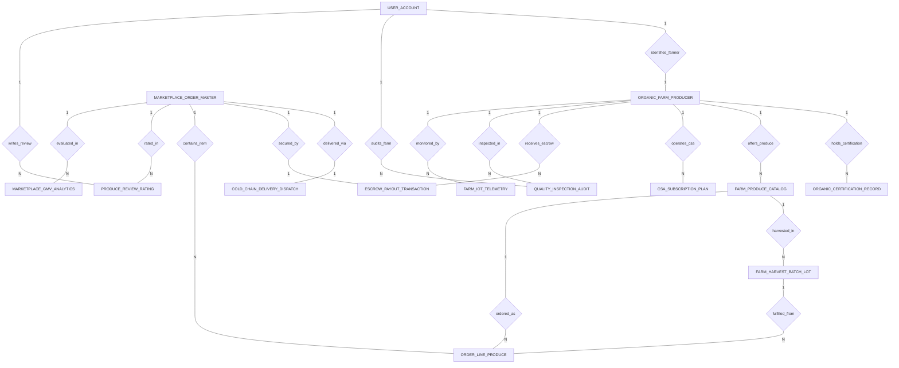

# Conceptual ERD — Organic Food Marketplace

## Mermaid Code

## Entity Description Table | Bang mo ta Entity

| # | Entity Name | Vietnamese Name | Description | Key Attributes | Main Relationships |
|---|-------------|-----------------|-------------|----------------|-------------------|
| 1 | ORGANIC_FARM_PRODUCER | Trang trai thuc pham huu co | Certified organic farm profile, farm name, USDA NOP operation ID, address, acreage, and farm status. | farm_id, user_id, farm_name, usda_nop_operation_id, farm_location_address, farm_status | Belongs to USER_ACCOUNT; One-to-Many with ORGANIC_CERTIFICATION_RECORD, FARM_PRODUCE_CATALOG, CSA_SUBSCRIPTION_PLAN, ESCROW_PAYOUT_TRANSACTION, QUALITY_INSPECTION_AUDIT, FARM_IOT_TELEMETRY |
| 2 | ORGANIC_CERTIFICATION_RECORD | Giay chung nhan huu co | Organic accreditation certificate record, cert agency name (CCOF, USDA), cert number, issue/expiry dates, and verification boolean. | cert_id, farm_id, cert_agency_name, cert_number, issue_date, expiry_date, is_verified | Belongs to ORGANIC_FARM_PRODUCER |
| 3 | FARM_PRODUCE_CATALOG | Danh muc nong san huu co | Master produce item listed by a farm, product name, crop category, unit price, unit of measure (lb/kg/bunch), imperfect ugly flag, and availability. | product_id, farm_id, product_name, crop_category, unit_price, unit_of_measure, is_available | Belongs to ORGANIC_FARM_PRODUCER; One-to-Many with FARM_HARVEST_BATCH_LOT, ORDER_LINE_PRODUCE |
| 4 | CSA_SUBSCRIPTION_PLAN | Goi dang ky CSA gia dinh | Community Supported Agriculture (CSA) subscription plan, plan name, weekly price $, delivery frequency, and description. | plan_id, farm_id, plan_name, weekly_price, delivery_frequency, plan_description | Belongs to ORGANIC_FARM_PRODUCER |
| 5 | MARKETPLACE_ORDER_MASTER | Don hang master tren cho | Marketplace order master record placed by buyers, buyer user ID, order number, order date, total amount, delivery fee, and status. | order_id, buyer_user_id, order_number, order_date, total_order_amount, order_status | One-to-Many with ORDER_LINE_PRODUCE, PRODUCE_REVIEW_RATING, MARKETPLACE_GMV_ANALYTICS; One-to-One with COLD_CHAIN_DELIVERY_DISPATCH, ESCROW_PAYOUT_TRANSACTION |
| 6 | ORDER_LINE_PRODUCE | Chi tiet nong san don hang | Line item in an order specifying product ID, harvest lot ID, quantity ordered, unit price, and line subtotal. | line_id, order_id, product_id, lot_id, quantity_ordered, unit_price, line_total | Belongs to MARKETPLACE_ORDER_MASTER, FARM_PRODUCE_CATALOG, FARM_HARVEST_BATCH_LOT |
| 7 | FARM_HARVEST_BATCH_LOT | Lo thu hoach va ma QR | Specific harvest batch lot record, crop product ID, harvest batch code, harvest date, total yield quantity, and QR provenance hash. | lot_id, product_id, harvest_batch_code, harvest_date, total_yield_quantity, qr_provenance_hash | Belongs to FARM_PRODUCE_CATALOG; One-to-Many with ORDER_LINE_PRODUCE |
| 8 | COLD_CHAIN_DELIVERY_DISPATCH | Nhat ky van chuyen chuoi lanh | Cold-chain delivery dispatch log, order ID, driver name, min/max container temperatures °C, delivered timestamp, and delivery status. | dispatch_id, order_id, driver_name, min_container_temp_celsius, max_container_temp_celsius, delivery_status | One-to-One with MARKETPLACE_ORDER_MASTER |
| 9 | ESCROW_PAYOUT_TRANSACTION | Giao dich ky quy va thanh toan | Buyer-protection escrow payout transaction log holding order funds, deducting platform commission share, net farmer payout, and status. | payout_id, order_id, farm_id, escrow_amount_held, commission_deducted, net_farmer_payout | One-to-One with MARKETPLACE_ORDER_MASTER; Belongs to ORGANIC_FARM_PRODUCER |
| 10 | QUALITY_INSPECTION_AUDIT | Nhat ky kiem dinh chat luong | On-farm quality audit log recorded by inspectors, audit date, bio-compliance score, non-GMO verified boolean, and audit status. | audit_id, farm_id, inspector_user_id, audit_date, bio_compliance_score, non_gmo_verified | Belongs to ORGANIC_FARM_PRODUCER, USER_ACCOUNT |
| 11 | PRODUCE_REVIEW_RATING | Danh gia nong san va farm | Order review and rating published by buyers, star rating (1-5), review text, and review timestamp. | review_id, order_id, buyer_user_id, star_rating, review_text, reviewed_at | Belongs to MARKETPLACE_ORDER_MASTER, USER_ACCOUNT |
| 12 | FARM_IOT_TELEMETRY | Nhat ky cam bien IoT nong nghiep | Real-time farm IoT sensor telemetry log recording soil moisture %, ambient temperature °C, and timestamp. | telemetry_id, farm_id, soil_moisture_pct, ambient_temp_celsius, logged_at | Belongs to ORGANIC_FARM_PRODUCER |
| 13 | USER_ACCOUNT | Tai khoan he thong | Core security authentication account holding credentials, password hashes, and user role definitions. | user_id, username, password_hash, role_name | One-to-One with ORGANIC_FARM_PRODUCER; One-to-Many with QUALITY_INSPECTION_AUDIT, PRODUCE_REVIEW_RATING |
| 14 | MARKETPLACE_GMV_ANALYTICS | Thong ke hieu qua cho huu co | Executive daily analytics tracking Gross Merchandise Value (GMV) revenue, active CSA subscriptions, average order value, and active farms. | analytics_id, metric_date, total_gmv_revenue, active_buyer_subscriptions, avg_order_value | Evaluates MARKETPLACE_ORDER_MASTER |

## Relationship Description | Mo ta Quan he

| # | From Entity | Cardinality | To Entity | Relationship Label | Business Explanation |
|---|-------------|-------------|-----------|-------------------|----------------------|
| 1 | USER_ACCOUNT | One-to-One | ORGANIC_FARM_PRODUCER | identifies_farmer | Tai khoan he thong dinh danh trang trai huu co va nguoi nong dan. |
| 2 | ORGANIC_FARM_PRODUCER | One-to-Many | ORGANIC_CERTIFICATION_RECORD | holds_certification | Trang trai so huu giay chung nhan huu co USDA NOP hoac EU Organic. |
| 3 | ORGANIC_FARM_PRODUCER | One-to-Many | FARM_PRODUCE_CATALOG | offers_produce | Trang trai niêm yet cac loai nong san huu co trong danh muc cua cho. |
| 4 | ORGANIC_FARM_PRODUCER | One-to-Many | CSA_SUBSCRIPTION_PLAN | operates_csa | Trang trai van hanh cac goi dang ky hop tac xa nong nghiep CSA hang tuan. |
| 5 | FARM_PRODUCE_CATALOG | One-to-Many | FARM_HARVEST_BATCH_LOT | harvested_in | Nong san duoc thu hoach va chia thanh cac lo hang theo ngay harvest. |
| 6 | MARKETPLACE_ORDER_MASTER | One-to-Many | ORDER_LINE_PRODUCE | contains_item | Don hang tren cho chua nhieu dong chi tiet cac mon nong san huu co. |
| 7 | FARM_PRODUCE_CATALOG | One-to-Many | ORDER_LINE_PRODUCE | ordered_as | Mon nong san duoc chon va ban duoi dang dong chi tiet don hang. |
| 8 | FARM_HARVEST_BATCH_LOT | One-to-Many | ORDER_LINE_PRODUCE | fulfilled_from | Dong chi tiet don hang duoc xuat tu lo thu hoach cu the de truy xuat nguon goc. |
| 9 | MARKETPLACE_ORDER_MASTER | One-to-One | COLD_CHAIN_DELIVERY_DISPATCH | delivered_via | Don hang duoc van chuyen den nha nguoi mua qua xe giao hang chuoi lanh 2°C-4°C. |
| 10 | MARKETPLACE_ORDER_MASTER | One-to-One | ESCROW_PAYOUT_TRANSACTION | secured_by | Tien hang duoc giu trong tai khoan ky quy va giai ngan cho farmer khi giao thanh cong. |
| 11 | ORGANIC_FARM_PRODUCER | One-to-Many | ESCROW_PAYOUT_TRANSACTION | receives_escrow | Trang trai nhan thanh toan ky quy sau khi tru hoa hong nen tang (12%). |
| 12 | ORGANIC_FARM_PRODUCER | One-to-Many | QUALITY_INSPECTION_AUDIT | inspected_in | Trang trai duoc thuc hien cac luot kiem dinh tieu chuan non-GMO va huu co thuc te. |
| 13 | USER_ACCOUNT | One-to-Many | QUALITY_INSPECTION_AUDIT | audits_farm | Chuyen gia kiem dinh chat luong thuc hien danh gia trang trai. |
| 14 | MARKETPLACE_ORDER_MASTER | One-to-Many | PRODUCE_REVIEW_RATING | rated_in | Don hang duoc nguoi mua danh gia va binh chon sao ve do tuoi ngon. |
| 15 | USER_ACCOUNT | One-to-Many | PRODUCE_REVIEW_RATING | writes_review | Nguoi mua viet binh luan va danh gia chat luong nong san. |
| 16 | ORGANIC_FARM_PRODUCER | One-to-Many | FARM_IOT_TELEMETRY | monitored_by | Trang trai duoc theo doi nhat ky cam bien IoT do am dat va nhiet do. |
| 17 | MARKETPLACE_ORDER_MASTER | One-to-Many | MARKETPLACE_GMV_ANALYTICS | evaluated_in | Cac don hang duoc thong ke va danh gia tong gia tri giao dịch GMV hang ngay. |
