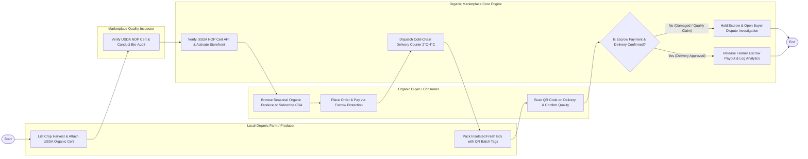

# Swimlane Diagram — Organic Food Marketplace

## Mermaid Code

## Flow Description | Mo ta luong

| Lane | Actor | Role in Flow |
|------|-------|-------------|
| **Lane 1** | Organic Buyer / Consumer | Browses seasonal organic produce or subscribes to CSA harvest boxes, places escrow orders, scans farm-to-fork QR codes on delivery, and confirms freshness. |
| **Lane 2** | Local Organic Farm / Producer | Lists crop harvest yields, attaches USDA organic certificates, packs insulated fresh boxes, and affixes QR batch provenance tags. |
| **Lane 3** | Marketplace Quality Inspector | Conducts on-farm bio-audits, verifies synthetic chemical-free practices, and checks USDA NOP organic registration compliance. |
| **Lane 4** | Organic Marketplace Core Engine | Verifies USDA NOP database APIs, holds buyer payments in escrow, dispatches 2°C-4°C cold-chain couriers, and releases farmer payouts upon approval. |

### Process Execution Steps | Cac buoc thuc hien quy trinh

1. **Farm Onboarding & Listing**: Organic Farmer lists crop harvest (`F1`). Quality Inspector audits bio standards (`I1`). Core Engine verifies USDA NOP cert API (`S1`).
2. **Order Placement & Escrow**: Organic Buyer browses produce or CSA boxes (`C1`) and places order with escrow payment (`C2`). Core Engine holds funds in escrow and dispatches cold-chain courier (`S4`).
3. **Fulfillment & Delivery**: Farmer packs insulated fresh box with QR tags (`F2`). Buyer receives delivery, scans QR code, and inspects quality (`C3`).
4. **Escrow Audit & Release**: Core Engine checks delivery approval status (`S2`).
   - If **No (Damaged / Quality Claim)**: Core Engine holds escrow and opens dispute investigation (`S3`).
   - If **Yes (Delivery Approved)**: Core Engine releases net farmer payout and updates analytics (`S5`), completing execution (`Finish`).
