# Action Tree — Organic Food Marketplace

## Mermaid Code

```mermaid
graph TD
    Root["Organic Food Marketplace"]

    Root --> M1["Organic Farm Onboarding & USDA Certificate Verification"]
    Root --> M2["Farm-Direct Produce Catalog & CSA Subscriptions"]
    Root --> M3["Escrow Payments & Order Processing"]
    Root --> M4["Farm-to-Table Cold-Chain Delivery Logistics"]
    Root --> M5["Farm Provenance & Harvest Batch QR Traceability"]
    Root --> M6["Imperfect Produce Zero-Waste Sales & Quality Audits"]
    Root --> M7["Marketplace Analytics & System Administration"]

    M1 --> A11["Verify USDA NOP and EU Organic Certificate Databases"]
    M1 --> A12["Audit Farm Synthetic Pesticide Free Bio Standards"]
    M1 --> A13["Issue Verified USDA Organic Merchant Badge"]
    M1 --> A14["Monitor Farm Organic Accreditation Expiry Dates"]

    M2 --> A21["List Farm-Direct Seasonal Organic Crops and Yields"]
    M2 --> A22["Manage Weekly Community Supported Agriculture CSA Boxes"]
    M2 --> A23["Configure Subscriber Delivery Schedules and Exclusions"]
    M2 --> A24["Filter Local Organic Produce by Distance and Harvest Date"]

    M3 --> A31["Hold Buyer Payments in Farmer Escrow Accounts"]
    M3 --> A32["Process Multi-Farm Consolidated Checkout Cart Orders"]
    M3 --> A33["Release Net Farmer Payouts upon Delivery Sign-Off"]
    M3 --> A34["Deduct Marketplace Platform Commission Share Splits"]

    M4 --> A41["Dispatch Refrigerated Vehicles 2 to 4 Degrees Celsius"]
    M4 --> A42["Monitor In-Transit Cargo Temperature IoT Telemetry"]
    M4 --> A43["Optimize Multi-Farm Pickup and Doorstep Delivery Routes"]
    M4 --> A44["Capture Delivery Photo and GPS Stamp Proof of Delivery"]

    M5 --> A51["Generate Unique QR Codes per Harvest Batch Lot"]
    M5 --> A52["Trace Farm Origin Soil Types and Harvest Timestamps"]
    M5 --> A53["Publish Immutable Farm-to-Fork Provenance Profiles"]
    M5 --> A54["Ingest Farm IoT Soil Moisture and Weather Telemetry"]

    M6 --> A61["Discount Cosmetically Imperfect Ugly Organic Produce"]
    M6 --> A62["Conduct On-Farm Soil and Non-GMO Quality Inspections"]
    M6 --> A63["Reconcile Buyer Damaged Goods Refund Claims"]
    M6 --> A64["Log Zero-Waste Landfill Food Diversion Volumes"]

    M7 --> A71["Monitor Gross Merchandise Value GMV Revenue"]
    M7 --> A72["Analyze Active CSA Buyer Subscription Retention Rates"]
    M7 --> A73["Manage User Roles Farmer Buyer Inspector Permissions"]
    M7 --> A74["Manage Escrow Hold Period Rules and Integration APIs"]
```

## Module Description | Mo ta Module

| # | Module | Description | Actions |
|---|--------|-------------|---------|
| 1 | Organic Farm Onboarding & USDA Certificate Verification | Onboards partner farms, verifies USDA NOP/EU Organic database APIs, audits bio standards, and issues verified seller badges. | Verify USDA NOP and EU Organic Certificate Databases, Audit Farm Synthetic Pesticide Free Bio Standards, Issue Verified USDA Organic Merchant Badge, Monitor Farm Organic Accreditation Expiry Dates |
| 2 | Farm-Direct Produce Catalog & CSA Subscriptions | Controls seasonal produce listings, weekly Community Supported Agriculture (CSA) mystery harvest box subscriptions, and location filters. | List Farm-Direct Seasonal Organic Crops and Yields, Manage Weekly Community Supported Agriculture CSA Boxes, Configure Subscriber Delivery Schedules and Exclusions, Filter Local Organic Produce by Distance and Harvest Date |
| 3 | Escrow Payments & Order Processing | Holds buyer checkout payments in escrow, processes multi-farm consolidated orders, deducts platform commissions (12%), and releases farmer payouts. | Hold Buyer Payments in Farmer Escrow Accounts, Process Multi-Farm Consolidated Checkout Cart Orders, Release Net Farmer Payouts upon Delivery Sign-Off, Deduct Marketplace Platform Commission Share Splits |
| 4 | Farm-to-Table Cold-Chain Delivery Logistics | Routes refrigerated courier pickups (2°C-4°C), monitors cargo temperature telemetry, optimizes routes, and captures photo proof of delivery. | Dispatch Refrigerated Vehicles 2 to 4 Degrees Celsius, Monitor In-Transit Cargo Temperature IoT Telemetry, Optimize Multi-Farm Pickup and Doorstep Delivery Routes, Capture Delivery Photo and GPS Stamp Proof of Delivery |
| 5 | Farm Provenance & Harvest Batch QR Traceability | Generates unique QR codes per harvest batch lot, tracing farm origin, soil types, harvest timestamps, and ingesting farm IoT sensor telemetry. | Generate Unique QR Codes per Harvest Batch Lot, Trace Farm Origin Soil Types and Harvest Timestamps, Publish Immutable Farm-to-Fork Provenance Profiles, Ingest Farm IoT Soil Moisture and Weather Telemetry |
| 6 | Imperfect Produce Zero-Waste Sales & Quality Audits | Discounts cosmetically imperfect "ugly" produce (30% off), conducts on-farm non-GMO inspections, and reconciles damaged goods refunds. | Discount Cosmetically Imperfect Ugly Organic Produce, Conduct On-Farm Soil and Non-GMO Quality Inspections, Reconcile Buyer Damaged Goods Refund Claims, Log Zero-Waste Landfill Food Diversion Volumes |
| 7 | Marketplace Analytics & System Administration | Displays executive dashboards on Gross Merchandise Value (GMV), CSA subscriber retention, escrow hold rules, security roles, and APIs. | Monitor Gross Merchandise Value GMV Revenue, Analyze Active CSA Buyer Subscription Retention Rates, Manage User Roles Farmer Buyer Inspector Permissions, Manage Escrow Hold Period Rules and Integration APIs |
