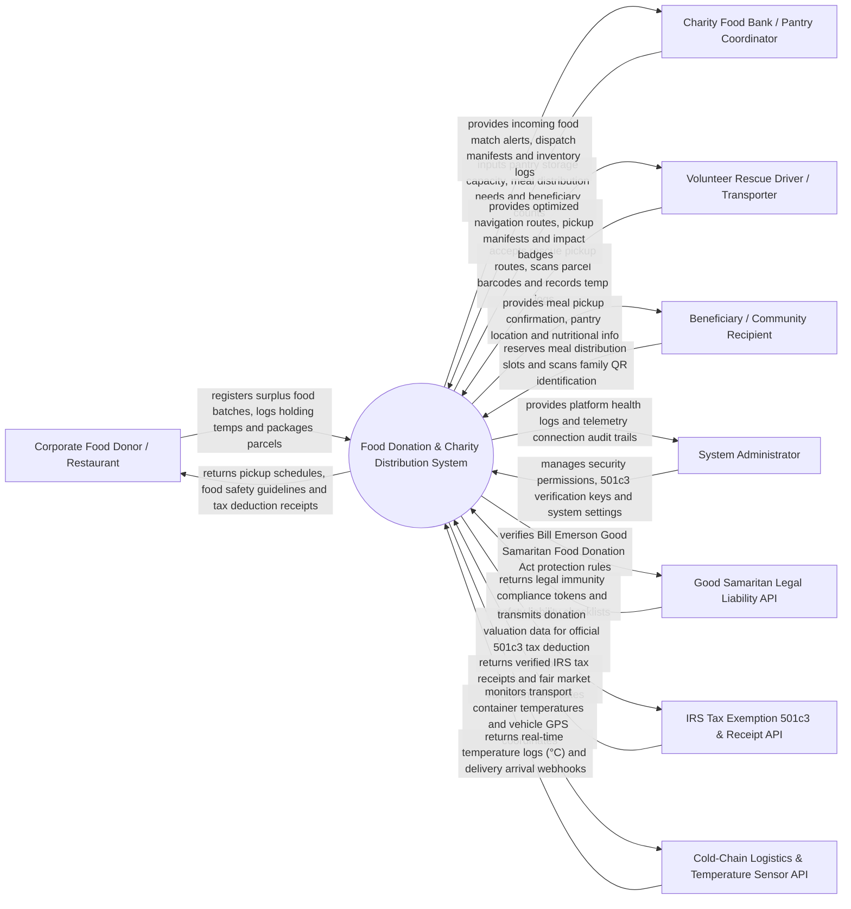

# Context Diagram — Food Donation & Charity Distribution System

## Mermaid Code

## Actor & Interaction Table | Bang Actor & Tuong tac

| # | Actor | Actor Type | Data Sent TO System | Data Received FROM System | Notes |
|---|-------|------------|---------------------|---------------------------|-------|
| 1 | Corporate Food Donor / Restaurant | Primary | Surplus food batch registrations, food holding temperatures, food parcel counts, packaging labels | Rescue pickup schedules, food safety checklists, official IRS 501(c)(3) tax receipts | Grocery stores, catering halls, hotels, and restaurants donating surplus food. |
| 2 | Charity Food Bank Coordinator | Primary | Pantry storage capacity limits, refrigerated bin status, beneficiary headcount needs | Incoming food rescue alerts, dispatch manifests, pantry inventory ledgers | Non-profit food banks, soup kitchens, and local community pantries. |
| 3 | Volunteer Rescue Driver | Primary | Rescue route acceptance, parcel barcode scans, transport temperature readings, delivery photos | Optimized GPS navigation routes, pickup manifests, volunteer impact badges | Volunteer drivers and non-profit couriers picking up and delivering food. |
| 4 | Beneficiary / Community Recipient | Primary | Meal pickup slot reservations, family QR identification codes, dietary preferences | Meal reservation confirmations, pantry distribution locations, nutrition info | Low-income individuals, families, and shelter residents receiving meal aid. |
| 5 | System Administrator | Primary | User credentials, security role policies, 501(c)(3) registry keys, system settings | Platform health metrics, dispatch telemetry logs, security audit trails | Manages non-profit platform infrastructure, hardware integrations, and access. |
| 6 | Good Samaritan Legal Liability API | Supporting | Legal liability immunity rules, safety compliance standards, legal disclaimer tokens | Good Samaritan audit logs, food donor liability protection verifications | Legal compliance engine enforcing Bill Emerson Good Samaritan Food Donation Act protections. |
| 7 | IRS Tax Exemption 501c3 & Receipt API | Supporting | Non-profit 501(c)(3) status verifications, fair market value calculations, tax receipt forms | Verified IRS tax deduction receipts, annual tax deduction summary reports | Integrates with tax databases to calculate and issue official tax deduction receipts. |
| 8 | Cold-Chain Logistics & Temperature API | Supporting | Vehicle GPS coordinates, cargo bay temperature logs (°C), door sensor alerts | Temperature threshold warnings, delivery arrival webhooks, route updates | Telemetry system monitoring temperature-controlled transport of perishable food. |

## System Boundary Description | Mo ta Pham vi He thong

The **Food Donation & Charity Distribution System** manages corporate surplus food donation onboarding, food safety temperature compliance, automated charity pantry matching, volunteer rescue driver routing, cold-chain transport monitoring, IRS 501(c)(3) tax deduction receipt generation, and community meal distribution. Inside its boundary, the system handles surplus food batch logging, Good Samaritan legal liability compliance auditing, real-time food bank storage capacity matching, volunteer pickup route optimization, refrigerated transit temperature logging, tax receipt issuing, and beneficiary meal slot reservations.

The system boundary excludes physical cooking of food, physical driving of volunteer vehicles, physical eating of meals, and government tax code legislation.
