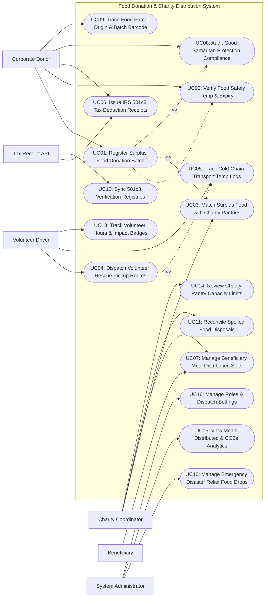

# Use Case Diagram — Food Donation & Charity Distribution System

## Mermaid Code

## Actor Table | Bang Actor

| # | Actor | Actor Type | Role Description | Related Use Cases |
|---|-------|------------|------------------|-------------------|
| 1 | Tax Receipt API | Secondary System | External non-profit tax integration validating IRS 501(c)(3) status and generating official tax deduction receipts. | UC06, UC12 |
| 2 | Corporate Donor | Primary | Commercial food business (Grocery, Catering, Hotel, Restaurant) registering surplus food batches and receiving tax receipts. | UC01, UC02, UC06, UC08, UC09 |
| 3 | Volunteer Driver | Primary | Community volunteer picking up surplus food parcels, tracking cold-chain temperatures, and delivering to pantries. | UC04, UC05, UC13 |
| 4 | Charity Coordinator | Primary | Food bank or pantry manager setting storage capacity, accepting food rescue matches, and overseeing meal distribution. | UC03, UC07, UC11, UC14 |
| 5 | Beneficiary | Primary | Community member reserving meal distribution slots and collecting fresh food parcels at local pantries. | UC07 |
| 6 | System Administrator | Primary | Technical manager configuring dispatch rules, disaster relief modes, security roles, and platform analytics. | UC10, UC15, UC16 |

## Use Case Table | Bang Use Case

| # | UC ID | Use Case Name | Primary Actor | Secondary Actor | Description | Priority |
|---|-------|---------------|---------------|-----------------|-------------|----------|
| 1 | UC01 | Register Surplus Food Donation Batch | Corporate Donor | None | Registers surplus unserved food batches, specifying food type, weight (kg), parcel counts, and pickup availability window. | High |
| 2 | UC02 | Verify Food Safety Temp & Expiry | Corporate Donor | None | Validates food safety compliance (Hot holding >= 60°C or Cold holding <= 4°C, expiration dates, sealed food-grade packaging). | High |
| 3 | UC03 | Match Surplus Food with Charity Pantries | Charity Coordinator | None | Matches registered food donation batches with nearby accredited food pantries based on distance, storage capacity, and urgency. | High |
| 4 | UC04 | Dispatch Volunteer Rescue Pickup Routes | Volunteer Driver | None | Generates optimized pickup and delivery routes for volunteer drivers, routing food from donor locations to charity pantries. | High |
| 5 | UC05 | Track Cold-Chain Transport Temp Logs | Volunteer Driver | None | Monitors vehicle transit cargo temperatures and parcel insulation to ensure perishable food remains within safe 2°C-4°C limits. | High |
| 6 | UC06 | Issue IRS 501c3 Tax Deduction Receipts | Corporate Donor | Tax Receipt API | Calculates fair market value of donated food and issues official IRS 501(c)(3) tax deduction receipts to corporate donors. | High |
| 7 | UC07 | Manage Beneficiary Meal Distribution Slots | Beneficiary | Charity Coordinator | Enables community recipients to reserve meal pickup slots at local pantries using digital QR identification. | High |
| 8 | UC08 | Audit Good Samaritan Protection Compliance | Corporate Donor | None | Audits compliance with Bill Emerson Good Samaritan Food Donation Act requirements to ensure legal liability protection for donors. | High |
| 9 | UC09 | Trace Food Parcel Origin & Batch Barcode | Corporate Donor | None | Attaches GS1 barcode tags to donated food parcels, enabling full supply chain traceability from donor kitchen to beneficiary plate. | Medium |
| 10 | UC10 | Manage Emergency Disaster Relief Food Drops | System Admin | None | Activates emergency rapid-response mode during natural disasters to route large-scale food donations to temporary relief shelters. | High |
| 11 | UC11 | Reconcile Spoiled Food Disposals | Charity Coordinator | None | Logs spoiled or rejected food items that failed temperature checks upon arrival, routing scraps to organic composting streams. | Medium |
| 12 | UC12 | Sync 501c3 Verification Registries | System Admin | Tax Receipt API | Synchronizes non-profit charity registry databases to instantly verify active 501(c)(3) tax-exempt status of partner food banks. | High |
| 13 | UC13 | Track Volunteer Hours & Impact Badges | Volunteer Driver | None | Logs volunteer driving hours, miles traveled, and total food weight rescued, awarding gamification impact badges and certificates. | Medium |
| 14 | UC14 | Review Charity Pantry Capacity Limits | Charity Coordinator | None | Manages real-time food bank storage capacity limits (Refrigerated, Frozen, Dry Storage cubic feet) to prevent over-allocation. | High |
| 15 | UC15 | View Meals Distributed & CO2e Analytics | System Admin | None | Displays analytical dashboards on total meals served, total food weight rescued (kg), CO2e greenhouse gas emissions avoided, and tax savings. | High |
| 16 | UC16 | Manage Roles & Dispatch Settings | System Admin | None | Configures user security access roles, rescue radius thresholds (e.g., 15-mile pickup radius), API keys, and system audit logs. | High |

## Use Case Specification | Dac ta Use Case

---

### UC01 — Register Surplus Food Donation Batch

| Field | Detail |
|-------|--------|
| **UC ID** | UC01 |
| **Use Case Name** | Register Surplus Food Donation Batch |
| **Actor(s)** | Primary: Corporate Donor   Secondary: None |
| **Description** | Enables a corporate food business (Hotel, Restaurant, Grocery, Catering Hall) to register a batch of unserved surplus food, logging food category, weight, parcel counts, holding temperature, and pickup window. |
| **Precondition** | 1. Corporate donor account is active and verified.   2. Food batch is unserved, un-contaminated, and packaged in food-grade containers. |
| **Main Flow** | 1. Donor opens "Register Food Donation" on mobile app or donor portal.   2. Donor selects Food Category:      - Option 1: Prepared Hot Meals (e.g., Roasted Turkey & Rice)      - Option 2: Prepared Cold Salads / Sandwiches      - Option 3: Fresh Produce & Dairy      - Option 4: Packaged Dry Goods / Bakery.   3. Donor inputs Batch Details: Item Description (Roasted Turkey Breast & Wild Rice), Estimated Weight (`18.5 kg / 40.7 lbs`), Number of Containers (`6 Sealed Trays`), Number of Estimated Meal Portions (`45 Meals`).   4. System executes Food Safety Temperature & Expiry Verification (UC02).   5. Donor inputs Pickup Availability Window: Today between `4:30 PM - 6:00 PM`.   6. System checks Good Samaritan Legal Liability Protection Checklist (UC08) and prompts donor confirmation.   7. Donor checks "I certify food was prepared in a licensed commercial kitchen and held at safe temperatures".   8. Donor clicks "Submit Donation Batch".   9. System generates Donation Tracking Number (#DON-2026-9022), prints GS1 barcode parcel tags (UC09), and triggers Smart Charity Matching Engine (UC03). |
| **Alternative Flow** | **AF1** — Recurring daily donation template:   1. Grocery donor registers daily surplus bakery item template.   2. System auto-fills weight and categories, requiring only quick weight verification. |
| **Exception Flow** | **EX1** — Illegal home-prepared food attempt:   1. Donor account is registered as an uncertified home kitchen.   2. System blocks donation registration "Donations must originate from licensed commercial food establishments". |
| **Postcondition** | Surplus food batch is registered, safety checklist is verified, barcode tags are printed, and charity matching triggers. |
| **Business Rule** | **BR1**: Donated food MUST originate from licensed commercial food kitchens or retail grocery establishments.   **BR2**: Pickup availability windows must allow a minimum 90-minute window for volunteer driver dispatch and transit. |

---

### UC02 — Verify Food Safety Temp & Expiry

| Field | Detail |
|-------|--------|
| **UC ID** | UC02 |
| **Use Case Name** | Verify Food Safety Temp & Expiry |
| **Actor(s)** | Primary: Corporate Donor   Secondary: None |
| **Description** | Enforces strict food safety verification guidelines by requiring donors to measure and input calibrated internal food temperature probe readings and verify minimum remaining shelf-life prior to donation approval. |
| **Precondition** | 1. Surplus food batch registration (UC01) is initiated.   2. Food temperature probe thermometer is available. |
| **Main Flow** | 1. During donation batch registration (UC01), System prompts: "Measure Internal Food Holding Temperature".   2. Donor measures internal temperature of food trays using calibrated probe thermometer.   3. Donor inputs Temperature Reading:      - For Hot Prepared Food: Donor inputs `63.5°C` (Required: >= 60.0°C / 140°F)      - For Chilled / Refrigerated Food: Donor inputs `3.2°C` (Required: <= 4.0°C / 40°F).   4. System evaluates temperature reading against ServSafe food safety parameters:      - Hot Food Check (63.5°C >= 60.0°C) -> `SAFETY PASSED`      - Temperature Danger Zone (4.0°C - 60.0°C) Check -> `PASSED`.   5. System prompts: "Verify Expiration / Prep Timestamp": Donor inputs Prep Time (Today at 1:00 PM) and Expiry (Must be consumed within 24 hours of prep).   6. System verifies food safety clearance and attaches Food Safety Certificate Badge to the donation batch file. |
| **Alternative Flow** | **AF1** — Blast-chilled hot food conversion:   1. Donor blast-chills hot cooked food down to 3.0°C within 2 hours.   2. System logs chilled conversion and extends allowable donation window to 48 hours. |
| **Exception Flow** | **EX1** — Temperature Danger Zone breach:   1. Donor inputs hot food temperature of 45.0°C (inside 4.0°C-60.0°C Danger Zone for > 2 hours).   2. System flags **FOOD SAFETY BREACH: Food in Danger Zone**, rejects donation batch, and instructs donor to discard food to prevent food poisoning. |
| **Postcondition** | Food holding temperatures are verified, safety clearance is granted, and danger zone breaches are rejected. |
| **Business Rule** | **BR1**: Hot prepared food MUST be maintained at or above 60.0°C (140°F); Chilled food MUST be maintained at or below 4.0°C (40°F).   **BR2**: Food items exposed to the Temperature Danger Zone (4.0°C - 60.0°C) for longer than 2 hours CANNOT be accepted for donation. |

---

### UC03 — Match Surplus Food with Charity Pantries

| Field | Detail |
|-------|--------|
| **UC ID** | UC03 |
| **Use Case Name** | Match Surplus Food with Charity Pantries |
| **Actor(s)** | Primary: Charity Coordinator   Secondary: None |
| **Description** | Matches registered surplus food batches with accredited local food banks and pantries based on geographic proximity, storage capacity limits (Refrigerated/Freezer/Dry), food category needs, and delivery urgency. |
| **Precondition** | 1. Surplus food batch (#DON-2026-9022) is safety-verified (UC02).   2. Local food bank capacity ledgers (UC14) are updated. |
| **Main Flow** | 1. System receives registered food batch: `18.5 kg Hot Prepared Turkey & Rice (45 Portions) | Pickup Location: Grand Hotel (Downtown) | Window: 4:30 PM - 6:00 PM`.   2. System Smart Charity Matching Engine searches active accredited 501(c)(3) food pantries within a 15-mile radius.   3. Matching Engine evaluates 4 operational criteria for candidate pantries:      - Proximity Distance: St. Vincent Food Bank (2.3 Miles away)      - Storage Capacity: Hot holding cabinet available & 45 meal capacity open (UC14)      - Operating Hours: Open until 8:00 PM for dinner meal service      - Beneficiary Need: High demand (Dinner soup kitchen serving 120 guests tonight).   4. Matching Engine selects `St. Vincent Food Bank` as top match (Score: 98/100).   5. System dispatches high-priority Food Rescue Alert to St. Vincent Charity Coordinator's mobile app.   6. Charity Coordinator reviews alert and taps "Accept Food Donation Match".   7. System reserves 45-meal capacity at St. Vincent Food Bank and triggers Volunteer Rescue Pickup Route Dispatch (UC04). |
| **Alternative Flow** | **AF1** — Multi-pantry split allocation for large batches:   1. Donation batch is 200 kg (too large for a single small pantry).   2. System splits batch across 3 nearby pantries (70kg / 70kg / 60kg) and dispatches multi-stop route. |
| **Exception Flow** | **EX1** — Primary charity declines match / timeout:   1. Primary charity does not respond within 15 minutes.   2. System automatically cascades alert to 2nd-ranked nearby charity (Salvation Army Pantry). |
| **Postcondition** | Surplus food batch is matched with optimal charity pantry, coordinator accepts match, and volunteer dispatch triggers. |
| **Business Rule** | **BR1**: Perishable hot food batches MUST be matched with pantries within a 15-minute dispatch response window to ensure timely consumption.   **BR2**: System MUST NOT allocate food batches to pantries whose refrigerated/chilled storage capacity is 100% full. |

---

### UC04 — Dispatch Volunteer Rescue Pickup Routes

| Field | Detail |
|-------|--------|
| **UC ID** | UC04 |
| **Use Case Name** | Dispatch Volunteer Rescue Pickup Routes |
| **Actor(s)** | Primary: Volunteer Driver   Secondary: None |
| **Description** | Generates optimized pickup and delivery routes for volunteer drivers, routing food parcels from donor locations to matched charity pantries with turn-by-turn navigation and parcel scanning. |
| **Precondition** | 1. Food donation match (UC03) is accepted by charity pantry.   2. Volunteer drivers are online in the dispatch area. |
| **Main Flow** | 1. System dispatches Rescue Mission Alert to nearby active Volunteer Drivers: **Food Rescue Mission: Pickup 18.5kg Hot Meals at Grand Hotel -> Deliver to St. Vincent Pantry (Total Dist: 3.1 Miles | Est Time: 25 Mins)**.   2. Volunteer Driver accepts mission on mobile driver app.   3. System presents turn-by-turn GPS navigation route to Donor Location (Grand Hotel Loading Dock).   4. Driver arrives at donor dock, opens driver app, and scans GS1 barcode tags on 6 food trays (UC09).   5. System verifies barcode match: `6/6 Trays Scanned — Correct Match`.   6. Driver inspects thermal insulation bags, loads food trays into vehicle, and inputs transport start time.   7. System monitors Cold-Chain Transport Temperature Logs (UC05) during transit.   8. Driver arrives at St. Vincent Food Bank, unloads food trays, and scans barcodes into charity pantry terminal.   9. Charity Coordinator signs digital delivery receipt on driver tablet; Driver takes delivery photo.   10. System marks rescue mission `COMPLETED`, logs volunteer hours (UC13), and issues IRS 501(c)(3) Tax Receipt to donor (UC06). |
| **Alternative Flow** | **AF1** — Direct corporate fleet dispatch (Non-volunteer):   1. Donation volume requires commercial refrigerated truck.   2. System dispatches dedicated non-profit food bank fleet driver instead of individual volunteer. |
| **Exception Flow** | **EX1** — Volunteer vehicle breakdown mid-route:   1. Volunteer driver suffers flat tire mid-transit.   2. Driver taps "Emergency Driver Breakdown" in app; System dispatches backup volunteer to driver's GPS location within 10 minutes. |
| **Postcondition** | Volunteer accepts route, scans barcodes at pickup and drop-off, completes delivery, and logs volunteer impact. |
| **Business Rule** | **BR1**: Volunteer rescue drivers MUST scan parcel barcodes at both pickup and drop-off points to maintain custody chain transparency.   **BR2**: Transport time between donor pickup and pantry delivery MUST NOT exceed 45 minutes for hot prepared meals. |

---

### UC06 — Issue IRS 501c3 Tax Deduction Receipts

| Field | Detail |
|-------|--------|
| **UC ID** | UC06 |
| **Use Case Name** | Issue IRS 501c3 Tax Deduction Receipts |
| **Actor(s)** | Primary: Corporate Donor   Secondary: Tax Receipt API |
| **Description** | Calculates the fair market value of donated food items upon confirmed delivery to an accredited non-profit charity and generates official IRS 501(c)(3) tax deduction receipts for corporate donors. |
| **Precondition** | 1. Food donation batch delivery (UC04) is confirmed completed by accredited 501(c)(3) charity.   2. Corporate donor tax FEIN ID is on file. |
| **Main Flow** | 1. System receives confirmed delivery receipt for Batch #DON-2026-9022 (18.5 kg Roasted Turkey & Rice / 45 Portions delivered to St. Vincent Food Bank).   2. System verifies recipient charity 501(c)(3) tax-exempt status via Tax Receipt API (UC12): `St. Vincent Food Bank — EIN #94-1234567 (ACTIVE 501c3)`.   3. System calculates Fair Market Value (FMV) of donated food:      - Meal Portion Count: 45 Portions      - Standard Fair Market Value per Prepared Meal: $8.50 / Portion      - Total Calculated Fair Market Value: `45 * $8.50 = $382.50`.   4. System generates Official IRS 501(c)(3) Tax Deduction Receipt:      - Receipt Number: `#TAX-501C3-2026-88192`      - Donor Entity: Grand Hotel Corporate Operations (FEIN #12-3456789)      - Recipient Charity: St. Vincent Food Bank (EIN #94-1234567)      - Date of Contribution: July 22, 2026      - Description of Donated Property: 18.5 kg Prepared Hot Meals (45 Portions)      - Total Appraised Fair Market Tax Deduction: `$382.50`      - Statutory Statement: "No goods or services were provided in exchange for this contribution."   5. System attaches digital X.509 signature seal and dispatches PDF receipt to Corporate Donor tax portal and email.   6. System logs tax deduction summary for donor's annual corporate tax filing ledger. |
| **Alternative Flow** | **AF1** — Grocery inventory cost-basis valuation (Section 170(e)(3) Enhanced Deduction):   1. Donor is a C-Corporation grocery store claiming Enhanced Tax Deduction (Cost + 50% Margin).   2. System calculates enhanced tax deduction valuation formula according to IRS Section 170(e)(3). |
| **Exception Flow** | **EX1** — Charity 501(c)(3) status revoked:   1. Tax API indicates recipient charity status is `REVOKED`.   2. System blocks tax receipt issuance, flags compliance alert, and prompts manager to re-verify charity accreditation. |
| **Postcondition** | Fair market value is calculated, official IRS 501(c)(3) tax deduction receipt PDF is issued, and donor tax ledger updates. |
| **Business Rule** | **BR1**: IRS 501(c)(3) tax deduction receipts CANNOT be issued until delivery completion is officially confirmed by the recipient charity.   **BR2**: Tax receipts MUST state explicitly that no goods or services were provided to the donor in exchange for the food contribution. |
