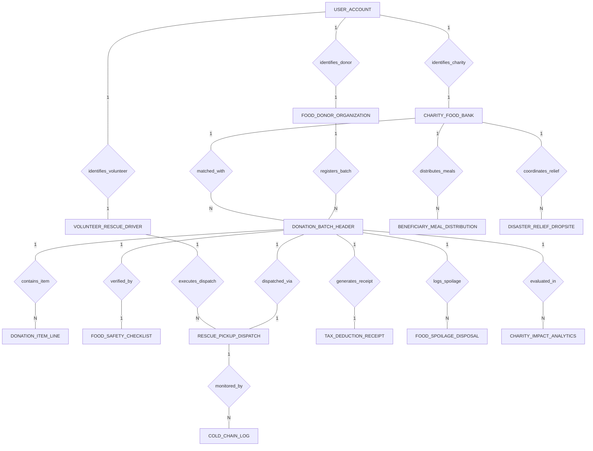

# Conceptual ERD — Food Donation & Charity Distribution System

## Mermaid Code

## Entity Description Table | Bang mo ta Entity

| # | Entity Name | Vietnamese Name | Description | Key Attributes | Main Relationships |
|---|-------------|-----------------|-------------|----------------|-------------------|
| 1 | FOOD_DONOR_ORGANIZATION | To chuc doanh nghiep quyen gop | Corporate food donor business profile (Grocery, Hotel, Restaurant), company name, FEIN tax #, business category, address, and contact email. | donor_id, user_id, company_name, fein_tax_number, business_category, contact_email | Belongs to USER_ACCOUNT; One-to-Many with DONATION_BATCH_HEADER |
| 2 | CHARITY_FOOD_BANK | Ngan hang thuc pham tu thien | Accredited 501(c)(3) food bank profile, charity name, EIN tax #, max chilled capacity cuft, current occupancy cuft, and status. | charity_id, user_id, charity_name, ein_501c3_number, max_chilled_capacity_cuft, charity_status | Belongs to USER_ACCOUNT; One-to-Many with DONATION_BATCH_HEADER, BENEFICIARY_MEAL_DISTRIBUTION, DISASTER_RELIEF_DROPSITE |
| 3 | DONATION_BATCH_HEADER | Dot quyen gop thuc pham master | Master food donation batch record, donor ID, matched charity ID, batch number, total weight kg, estimated portions, pickup window, and status. | batch_id, donor_id, charity_id, batch_number, total_weight_kg, estimated_portions, batch_status | Belongs to FOOD_DONOR_ORGANIZATION, CHARITY_FOOD_BANK; One-to-Many with DONATION_ITEM_LINE, FOOD_SPOILAGE_DISPOSAL, CHARITY_IMPACT_ANALYTICS; One-to-One with FOOD_SAFETY_CHECKLIST, RESCUE_PICKUP_DISPATCH, TAX_DEDUCTION_RECEIPT |
| 4 | DONATION_ITEM_LINE | Chi tiet mon thuc pham quyen gop | Line item in a donation batch specifying food description, category (Hot/Chilled/Produce/Dry), container count, and line weight kg. | line_id, batch_id, food_description, food_category, container_count, weight_kg | Belongs to DONATION_BATCH_HEADER |
| 5 | FOOD_SAFETY_CHECKLIST | Bang kiem tra an toan thuc pham | Food safety verification checklist recording measured holding temp °C, packaging seal boolean, danger zone verification, safety pass result, and timestamp. | checklist_id, batch_id, measured_temp_celsius, packaging_sealed, danger_zone_verified, passed_safety | One-to-One with DONATION_BATCH_HEADER |
| 6 | RESCUE_PICKUP_DISPATCH | Phieu dieu phoi tinh nguyen vien | Volunteer rescue pickup dispatch log, batch ID, volunteer user ID, pickup time, delivery time, distance miles, and dispatch status. | dispatch_id, batch_id, volunteer_user_id, pickup_time, delivery_time, distance_miles, dispatch_status | One-to-One with DONATION_BATCH_HEADER; Belongs to VOLUNTEER_RESCUE_DRIVER; One-to-Many with COLD_CHAIN_LOG |
| 7 | VOLUNTEER_RESCUE_DRIVER | Tinh nguyen vien van chuyen | Volunteer rescue driver profile, vehicle type, total hours volunteered, total miles driven, and total rescues completed. | driver_id, user_id, vehicle_type, total_hours_volunteered, total_miles_driven, total_rescues_completed | Belongs to USER_ACCOUNT; One-to-Many with RESCUE_PICKUP_DISPATCH |
| 8 | COLD_CHAIN_LOG | Nhat ky nhiet do van chuyen | Refrigerated transport temperature telemetry log recording cargo temp °C, breach alerts, and timestamp. | cold_log_id, dispatch_id, cargo_temp_celsius, is_temp_breached, logged_at | Belongs to RESCUE_PICKUP_DISPATCH |
| 9 | TAX_DEDUCTION_RECEIPT | Bien nhan thue quyen gop 501c3 | Official IRS 501(c)(3) tax deduction receipt issued to donors, batch ID, receipt number, fair market value $, issued date, and digital signature. | receipt_id, batch_id, receipt_number, fair_market_value_usd, issued_date, digital_signature_hash | One-to-One with DONATION_BATCH_HEADER |
| 10 | BENEFICIARY_MEAL_DISTRIBUTION | Nhat ky phan phoi suat an | Beneficiary meal distribution log, charity ID, QR identification code, family members count, meal portions given, and distribution time. | distribution_id, charity_id, beneficiary_qr_code, family_members_count, meal_portions_given | Belongs to CHARITY_FOOD_BANK |
| 11 | DISASTER_RELIEF_DROPSITE | Diem phan phoi cuu tro thien tai | Emergency disaster relief food drop location, dropsite name, emergency event name, address, and daily meals needed. | dropsite_id, dropsite_name, emergency_event_name, location_address, daily_meals_needed | Belongs to CHARITY_FOOD_BANK |
| 12 | FOOD_SPOILAGE_DISPOSAL | Nhat ky thuc pham bi hu hong | Spoiled or rejected food disposal log, batch ID, rejected weight kg, rejection reason, disposal method (Compost/Waste), and timestamp. | disposal_id, batch_id, rejected_weight_kg, rejection_reason, disposal_method, logged_at | Belongs to DONATION_BATCH_HEADER |
| 13 | USER_ACCOUNT | Tai khoan he thong | Core security authentication account holding credentials, password hashes, and user role definitions. | user_id, username, password_hash, role_name | One-to-One with FOOD_DONOR_ORGANIZATION, CHARITY_FOOD_BANK, VOLUNTEER_RESCUE_DRIVER |
| 14 | CHARITY_IMPACT_ANALYTICS | Thong ke hieu qua xa hoi | Executive daily analytics tracking total meals served, total food weight rescued kg, CO2e avoided kg, and total tax deduction $. | analytics_id, metric_date, total_meals_served, total_food_rescued_kg, total_co2e_avoided_kg, total_tax_deductions_usd | Evaluates DONATION_BATCH_HEADER |

## Relationship Description | Mo ta Quan he

| # | From Entity | Cardinality | To Entity | Relationship Label | Business Explanation |
|---|-------------|-------------|-----------|-------------------|----------------------|
| 1 | USER_ACCOUNT | One-to-One | FOOD_DONOR_ORGANIZATION | identifies_donor | Tai khoan he thong dinh danh ho so to chuc quyen gop thuc pham. |
| 2 | USER_ACCOUNT | One-to-One | CHARITY_FOOD_BANK | identifies_charity | Tai khoan he thong dinh danh ho so ngan hang thuc pham tu thien. |
| 3 | USER_ACCOUNT | One-to-One | VOLUNTEER_RESCUE_DRIVER | identifies_volunteer | Tai khoan he thong dinh danh tinh nguyen vien lai xe van chuyen. |
| 4 | FOOD_DONOR_ORGANIZATION | One-to-Many | DONATION_BATCH_HEADER | registers_batch | To chuc doanh nghiep dang ky cac dot quyen gop thuc pham du. |
| 5 | CHARITY_FOOD_BANK | One-to-Many | DONATION_BATCH_HEADER | matched_with | Ngan hang thuc pham duoc ghep noi tiep nhan cac dot quyen gop. |
| 6 | DONATION_BATCH_HEADER | One-to-Many | DONATION_ITEM_LINE | contains_item | Dot quyen gop chua nhieu dong chi tiet thuc pham va so luong khac nhau. |
| 7 | DONATION_BATCH_HEADER | One-to-One | FOOD_SAFETY_CHECKLIST | verified_by | Dot quyen gop duoc kiem tra va xac nhan an toan nhiet do va bao bi. |
| 8 | DONATION_BATCH_HEADER | One-to-One | RESCUE_PICKUP_DISPATCH | dispatched_via | Dot quyen gop duoc dieu phoi tinh nguyen vien den nhan va van chuyen. |
| 9 | VOLUNTEER_RESCUE_DRIVER | One-to-Many | RESCUE_PICKUP_DISPATCH | executes_dispatch | Tinh nguyen vien thuc hien cac ca nhan va giao thuc pham den pantry. |
| 10 | RESCUE_PICKUP_DISPATCH | One-to-Many | COLD_CHAIN_LOG | monitored_by | Ca van chuyen duoc theo doi nhat ky nhiet do khoang xe va thoi gian. |
| 11 | DONATION_BATCH_HEADER | One-to-One | TAX_DEDUCTION_RECEIPT | generates_receipt | Dot quyen gop hoan thanh tao ra bien nhan thue khau tru 501(c)(3) hop le. |
| 12 | CHARITY_FOOD_BANK | One-to-Many | BENEFICIARY_MEAL_DISTRIBUTION | distributes_meals | Ngan hang thuc pham phan phoi cac suat an cho nguoi thu huong trong cong dong. |
| 13 | DONATION_BATCH_HEADER | One-to-Many | FOOD_SPOILAGE_DISPOSAL | logs_spoilage | Dot quyen gop ghi nhan luong thuc pham bi loai bo neu vi pham an toan. |
| 14 | CHARITY_FOOD_BANK | One-to-Many | DISASTER_RELIEF_DROPSITE | coordinates_relief | Ngan hang thuc pham dieu phoi cuu tro cac diem nong thien tai khan cap. |
| 15 | DONATION_BATCH_HEADER | One-to-Many | CHARITY_IMPACT_ANALYTICS | evaluated_in | Cac dot quyen gop duoc thong ke quy doi thanh so suat an va chi so CO2e giam thieu. |
