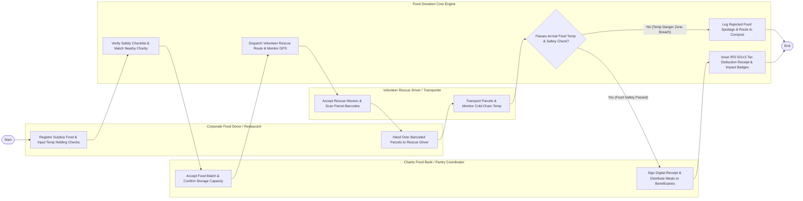

# Swimlane Diagram — Food Donation & Charity Distribution System

## Mermaid Code

## Flow Description | Mo ta luong

| Lane | Actor | Role in Flow |
|------|-------|-------------|
| **Lane 1** | Corporate Food Donor / Restaurant | Registers surplus unserved food batches, inputs holding temperature safety checks, packages parcels, and hands barcoded food to drivers. |
| **Lane 2** | Volunteer Rescue Driver / Transporter | Accepts rescue pickup missions, scans parcel barcodes at pickup, transports food, and monitors cold-chain cargo temperatures. |
| **Lane 3** | Charity Food Bank Coordinator | Accepts surplus food matches, confirms storage capacity limits, receives delivered parcels, signs receipts, and distributes meals to community recipients. |
| **Lane 4** | Food Donation Core Engine | Verifies Good Samaritan safety checklists, matches food banks, dispatches volunteer routes, ingests cold-chain telemetry, and issues IRS tax receipts. |

### Process Execution Steps | Cac buoc thuc hien quy trinh

1. **Donation Registration & Matching**: Donor registers surplus food batch and inputs holding temperature checks (`C1`). Core Engine verifies safety checklist and identifies nearby pantries (`S1`). Charity Coordinator accepts food match (`M1`).
2. **Dispatch & Pickup**: Core Engine dispatches volunteer rescue route (`S4`). Volunteer Driver accepts mission and scans parcel barcodes at donor dock (`V1`). Donor hands over barcoded food parcels (`C2`).
3. **Transport & Safety Verification**: Driver transports food parcels and monitors cold-chain transit temperatures (`V2`). Core Engine evaluates arrival food safety checks (`S2`).
   - If **No (Temp Danger Zone Breach)**: Core Engine logs rejected food spoilage and routes to compost stream (`S3`).
   - If **Yes (Food Safety Passed)**: Charity Coordinator signs digital delivery receipt and distributes meals to beneficiaries (`M2`).
4. **Tax Receipt & Impact Logging**: Core Engine issues official IRS 501(c)(3) tax deduction receipt to donor and awards volunteer impact badges (`S5`), completing execution (`Finish`).
