# Action Tree — Food Donation & Charity Distribution System

## Mermaid Code

```mermaid
graph TD
    Root["Food Donation & Charity Distribution System"]

    Root --> M1["Donor Registration & Surplus Food Batching"]
    Root --> M2["Food Safety Verification & Legal Protection"]
    Root --> M3["Smart Charity Matching & Pickup Dispatch"]
    Root --> M4["Cold-Chain Transport & Volunteer Tracking"]
    Root --> M5["Pantry Inventory & Beneficiary Meal Distribution"]
    Root --> M6["Tax Deduction Receipts & ESG Impact Metrics"]
    Root --> M7["Charity Analytics & System Administration"]

    M1 --> A11["Register Surplus Food Batches from Commercial Donors"]
    M1 --> A12["Category Food Parcels Hot Chilled Produce Dry Goods"]
    M1 --> A13["Print GS1 Barcode Parcel Tags and Staging Labels"]
    M1 --> A14["Set Pickup Availability Time Windows"]

    M2 --> A21["Verify Internal Food Holding Temperature Probes"]
    M2 --> A22["Audit Bill Emerson Good Samaritan Legal Immunity Rules"]
    M2 --> A23["Enforce Sealed Food-Grade Packaging Requirements"]
    M2 --> A24["Reject Food Breaching Temperature Danger Zone Limits"]

    M3 --> A31["Match Food Batches with Nearby Accredited 501c3 Pantries"]
    M3 --> A32["Check Real-Time Food Bank Storage Capacity Limits"]
    M3 --> A33["Cascade Priority Rescue Alerts to Local Pantries"]
    M3 --> A34["Manage Emergency Disaster Relief Food Drop Dispatch"]

    M4 --> A41["Generate Turn-by-Turn GPS Navigation Rescue Routes"]
    M4 --> A42["Scan Parcel Barcodes at Pickup and Delivery Points"]
    M4 --> A43["Monitor In-Transit Cargo Bay Temperature IoT Telemetry"]
    M4 --> A44["Track Volunteer Hours Miles Driven and Impact Badges"]

    M5 --> A51["Reserve Beneficiary Meal Distribution Slots"]
    M5 --> A52["Scan Family QR Identification at Pantry Check-In"]
    M5 --> A53["Manage Pantry Refrigerated Inventory Storage Ledgers"]
    M5 --> A54["Log Spoiled Food Scraps and Composting Disposals"]

    M6 --> A61["Calculate Fair Market Valuation of Donated Food"]
    M6 --> A62["Issue Official IRS 501c3 Tax Deduction Receipts"]
    M6 --> A63["Calculate Greenhouse Gas CO2e Emissions Avoided"]
    M6 --> A64["Export Corporate Sustainability ESG Audit Reports"]

    M7 --> A71["Monitor Total Meals Served and Food Rescued Weight"]
    M7 --> A72["Verify Active Non-Profit 501c3 Tax-Exempt Status"]
    M7 --> A73["Manage Security Roles Donor Volunteer Charity Admin"]
    M7 --> A74["Manage Rescue Dispatch Radius and Integration APIs"]
```

## Module Description | Mo ta Module

| # | Module | Description | Actions |
|---|--------|-------------|---------|
| 1 | Donor Registration & Surplus Food Batching | Registers surplus unserved food batches, categorizes food types (Hot, Chilled, Produce, Dry), prints GS1 barcode parcel tags, and sets pickup windows. | Register Surplus Food Batches from Commercial Donors, Category Food Parcels Hot Chilled Produce Dry Goods, Print GS1 Barcode Parcel Tags and Staging Labels, Set Pickup Availability Time Windows |
| 2 | Food Safety Verification & Legal Protection | Verifies internal food holding temperatures, audits Good Samaritan legal immunity compliance, enforces sealed packaging, and rejects danger zone items. | Verify Internal Food Holding Temperature Probes, Audit Bill Emerson Good Samaritan Legal Immunity Rules, Enforce Sealed Food-Grade Packaging Requirements, Reject Food Breaching Temperature Danger Zone Limits |
| 3 | Smart Charity Matching & Pickup Dispatch | Matches surplus food with nearby 501(c)(3) food banks, checks real-time storage capacity limits, cascades rescue alerts, and handles disaster relief drops. | Match Food Batches with Nearby Accredited 501c3 Pantries, Check Real-Time Food Bank Storage Capacity Limits, Cascade Priority Rescue Alerts to Local Pantries, Manage Emergency Disaster Relief Food Drop Dispatch |
| 4 | Cold-Chain Transport & Volunteer Tracking | Generates turn-by-turn navigation routes for volunteer drivers, scans parcel barcodes, monitors transit temperature logs, and awards volunteer impact badges. | Generate Turn-by-Turn GPS Navigation Rescue Routes, Scan Parcel Barcodes at Pickup and Delivery Points, Monitor In-Transit Cargo Bay Temperature IoT Telemetry, Track Volunteer Hours Miles Driven and Impact Badges |
| 5 | Pantry Inventory & Beneficiary Meal Distribution | Manages beneficiary meal pickup reservations, scans family QR codes at check-in, tracks pantry inventory ledgers, and logs spoiled food disposals. | Reserve Beneficiary Meal Distribution Slots, Scan Family QR Identification at Pantry Check-In, Manage Pantry Refrigerated Inventory Storage Ledgers, Log Spoiled Food Scraps and Composting Disposals |
| 6 | Tax Deduction Receipts & ESG Impact Metrics | Calculates fair market food values, issues official IRS 501(c)(3) tax deduction receipts, computes CO2e emissions avoided, and exports ESG reports. | Calculate Fair Market Valuation of Donated Food, Issue Official IRS 501c3 Tax Deduction Receipts, Calculate Greenhouse Gas CO2e Emissions Avoided, Export Corporate Sustainability ESG Audit Reports |
| 7 | Charity Analytics & System Administration | Displays executive dashboards on meals served, total food weight rescued (kg), 501(c)(3) status verifications, security roles, and dispatch API keys. | Monitor Total Meals Served and Food Rescued Weight, Verify Active Non-Profit 501c3 Tax-Exempt Status, Manage Security Roles Donor Volunteer Charity Admin, Manage Rescue Dispatch Radius and Integration APIs |
