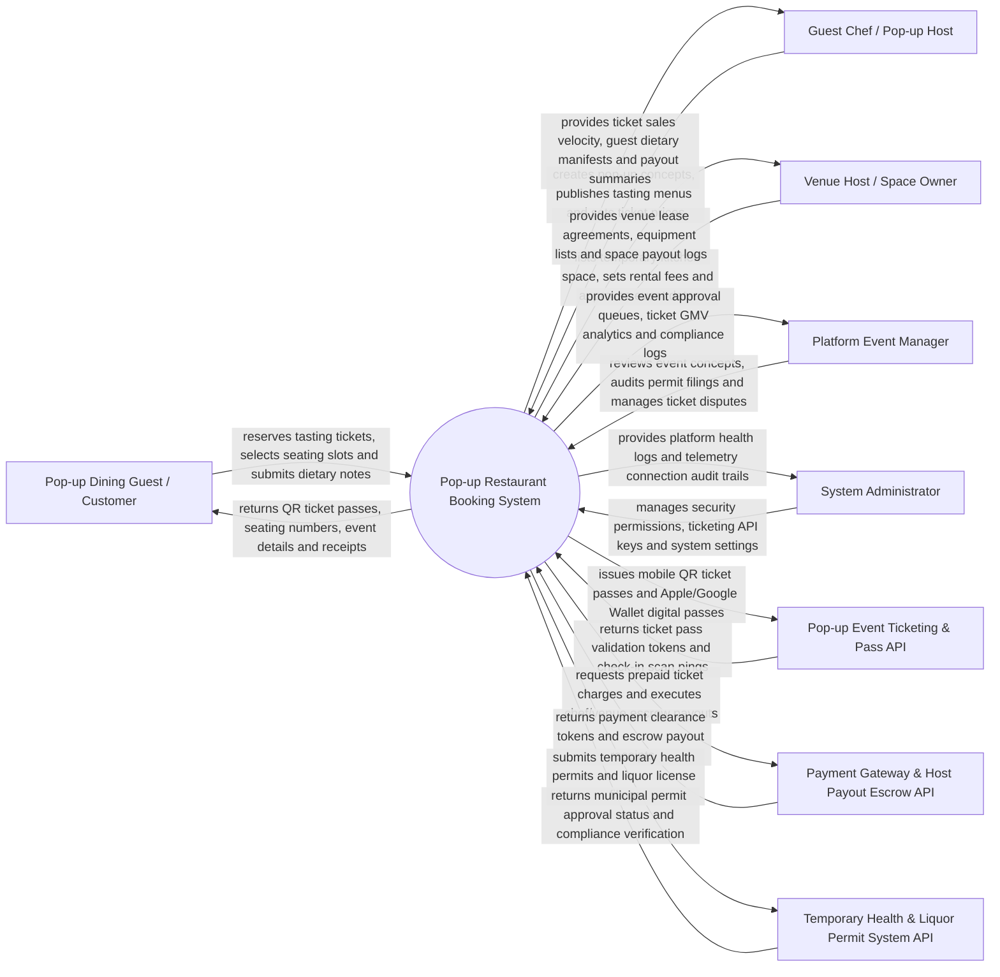

# Context Diagram — Pop-up Restaurant Booking System

## Mermaid Code

## Actor & Interaction Table | Bang Actor & Tuong tac

| # | Actor | Actor Type | Data Sent TO System | Data Received FROM System | Notes |
|---|-------|------------|---------------------|---------------------------|-------|
| 1 | Pop-up Dining Guest / Customer | Primary | Ticket seat reservations, prepaid ticket payments, dietary restriction notes, review ratings | Mobile QR ticket passes, seating slot assignments, venue secret address details, receipts | Diners booking exclusive, limited-run pop-up culinary dining experiences. |
| 2 | Guest Chef / Pop-up Host | Primary | Pop-up event concepts, multi-course fixed tasting menus, ticket pricing, seating shift times | Ticket sales velocity, guest allergen manifests, net escrow payout statements | Visiting chefs, culinary creators, and pop-up restaurateurs hosting dining events. |
| 3 | Venue Host / Space Owner | Primary | Commercial kitchen listings, dining hall layouts, hourly/daily rental fees, available dates | Venue booking requests, lease agreements, payout ledgers, equipment checklists | Commercial kitchen owners, rooftop venues, and art galleries leasing space for pop-ups. |
| 4 | Platform Event Manager | Primary | Pop-up event approvals, permit audit verifications, ticket dispute resolutions | Event submission queues, ticket sales analytics, compliance verification logs | Oversees pop-up event safety, venue leasing compliance, and ticket sales. |
| 5 | System Administrator | Primary | User credentials, security role policies, escrow hold settings, platform parameters | System health metrics, API usage telemetry, security audit logs | Manages platform infrastructure, API integrations, and security permissions. |
| 6 | Pop-up Event Ticketing & Pass API | Supporting | Mobile ticket pass check-in scans, QR code verification pings | QR ticket pass generation payloads, PKPass Apple Wallet tokens | Generates mobile ticket passes and integrates with digital wallet apps. |
| 7 | Payment Gateway & Host Payout Escrow API | Supporting | Credit card payment authorizations, prepaid ticket transactions, bank payouts | Payment clearance tokens, escrow hold confirmations, payout receipts | Processes prepaid tickets, holding funds in escrow until event completion. |
| 8 | Temporary Health & Liquor Permit API | Supporting | Temporary food handler permit filings, special event liquor license applications | Municipal permit approval tokens, health compliance clearance certificates | Municipal city government systems approving temporary food & alcohol permits. |

## System Boundary Description | Mo ta Pham vi He thong

The **Pop-up Restaurant Booking System** manages limited-run pop-up restaurant events, prepaid multi-course tasting menu ticket sales, temporary commercial kitchen venue leasing, guest seating slot allocation, dietary restriction collection, temporary health/liquor permit verification, and host escrow payout settlement. Inside its boundary, the system handles pop-up concept creation, fixed multi-course tasting menu publishing, venue space leasing, prepaid non-refundable ticket reservations, mobile QR pass check-in, guest allergy manifest compilation, event cancellation refund rules, and host payout escrow releases.

The system boundary excludes physical cooking of food, physical building architectural construction, physical municipal government health inspection visits, and raw credit card processing.
