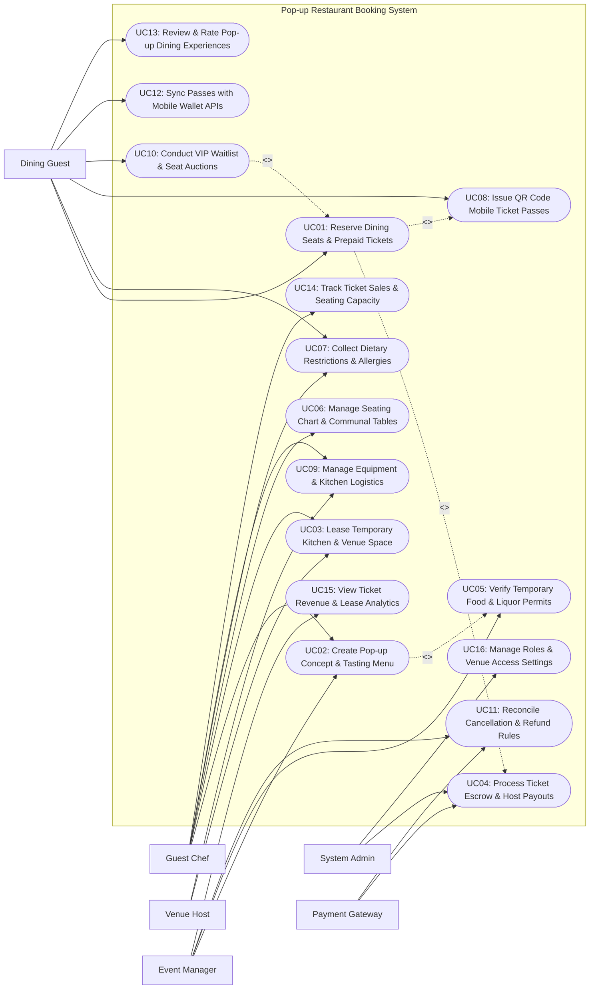

# Use Case Diagram — Pop-up Restaurant Booking System

## Mermaid Code

## Actor Table | Bang Actor

| # | Actor | Actor Type | Role Description | Related Use Cases |
|---|-------|------------|------------------|-------------------|
| 1 | Payment Gateway | Secondary System | Payment processor handling prepaid ticket transactions, holding funds in escrow, and releasing host payouts. | UC04, UC11 |
| 2 | Dining Guest | Primary | Culinary consumer browsing pop-up events, buying prepaid tickets, submitting dietary restrictions, and checking in via QR pass. | UC01, UC07, UC08, UC10, UC12, UC13 |
| 3 | Guest Chef | Primary | Culinary host creating pop-up event concepts, designing fixed tasting menus, leasing venue space, and viewing ticket sales. | UC02, UC03, UC06, UC07, UC09, UC14 |
| 4 | Venue Host | Primary | Owner of commercial kitchens, rooftops, or art galleries listing temporary space, managing lease dates, and receiving rent payouts. | UC03, UC09 |
| 5 | Event Manager | Primary | Platform event director auditing temporary health/liquor permits, approving pop-up concepts, and managing event cancellations. | UC02, UC05, UC11, UC15 |
| 6 | System Administrator | Primary | Technical manager configuring security access roles, ticketing API parameters, escrow release rules, and platform analytics. | UC04, UC16 |

## Use Case Table | Bang Use Case

| # | UC ID | Use Case Name | Primary Actor | Secondary Actor | Description | Priority |
|---|-------|---------------|---------------|-----------------|-------------|----------|
| 1 | UC01 | Reserve Dining Seats & Prepaid Tickets | Dining Guest | Payment Gateway | Enables guests to select pop-up dining dates, choose seating time slots, and purchase prepaid, non-refundable multi-course tickets. | High |
| 2 | UC02 | Create Pop-up Concept & Tasting Menu | Guest Chef | Event Manager | Allows visiting chefs to publish pop-up event listings, specifying culinary themes, fixed multi-course tasting menus, and ticket prices. | High |
| 3 | UC03 | Lease Temporary Kitchen & Venue Space | Guest Chef | Venue Host | Enables chefs to search and lease temporary commercial kitchens, rooftop venues, or dining spaces for limited pop-up dates. | High |
| 4 | UC04 | Process Ticket Escrow & Host Payouts | System Admin | Payment Gateway | Collects prepaid ticket revenue into escrow, releasing payouts to chef and venue hosts 24 hours after successful event completion. | High |
| 5 | UC05 | Verify Temporary Food & Liquor Permits | Event Manager | None | Verifies municipal temporary food handler permits, pop-up health permits, and special event liquor licenses prior to event publishing. | High |
| 6 | UC06 | Manage Seating Chart & Communal Tables | Guest Chef | None | Configures interactive seating charts, allocating private tables, chef counter seats, or shared communal dining benches. | High |
| 7 | UC07 | Collect Dietary Restrictions & Allergies | Dining Guest | Guest Chef | Compiles guest dietary requirements (Severe Allergies, Vegetarian, Gluten-Free) prior to event to allow chef menu adjustments. | High |
| 8 | UC08 | Issue QR Code Mobile Ticket Passes | Dining Guest | None | Generates digital QR ticket passes with secret venue location reveals and door check-in scan codes upon ticket purchase. | High |
| 9 | UC09 | Manage Equipment & Kitchen Logistics | Guest Chef | Venue Host | Manages kitchen equipment rental manifests (Combi-ovens, Sous-vide baths, Plateware) and venue setup/cleanup schedules. | Medium |
| 10 | UC10 | Conduct VIP Waitlist & Seat Auctions | Dining Guest | None | Manages automated waitlists for sold-out pop-ups, allowing last-minute seat drops or Dutch auctions for high-demand chef seatings. | Medium |
| 11 | UC11 | Reconcile Cancellation & Refund Rules | Event Manager | Payment Gateway | Enforces pop-up cancellation and weather contingency policies, processing automatic ticket refunds if a chef or venue cancels. | High |
| 12 | UC12 | Sync Passes with Mobile Wallet APIs | Dining Guest | None | Exports digital ticket passes directly to Apple Wallet (PKPass) and Google Wallet for seamless smartphone check-in. | Medium |
| 13 | UC13 | Review & Rate Pop-up Dining Experiences | Dining Guest | None | Allows attending guests to post ratings (1-5 stars) and reviews for the chef's tasting menu, atmosphere, and service. | High |
| 14 | UC14 | Track Ticket Sales & Seating Capacity | Guest Chef | None | Displays real-time ticket sales velocity graphs, remaining seat counts per seating shift, and revenue totals for chefs. | High |
| 15 | UC15 | View Ticket Revenue & Lease Analytics | Event Manager | None | Displays analytical dashboards on total pop-up ticket GMV, platform commission earnings, popular cuisine themes, and top venues. | High |
| 16 | UC16 | Manage Roles & Venue Access Settings | System Admin | None | Configures user security access roles, escrow hold periods, digital door lock PIN integrations, and system audit logs. | High |

## Use Case Specification | Dac ta Use Case

---

### UC01 — Reserve Dining Seats & Prepaid Tickets

| Field | Detail |
|-------|--------|
| **UC ID** | UC01 |
| **Use Case Name** | Reserve Dining Seats & Prepaid Tickets |
| **Actor(s)** | Primary: Dining Guest   Secondary: Payment Gateway |
| **Description** | Enables a diner to browse exclusive pop-up restaurant events, select a seating shift (e.g., 6:00 PM vs 8:30 PM), choose specific seats or communal bench tickets, and purchase prepaid non-refundable multi-course tasting tickets. |
| **Precondition** | 1. Pop-up event listing is published and approved by Event Manager (UC02).   2. Ticket seat inventory is available for the selected seating shift. |
| **Main Flow** | 1. Guest opens "Pop-up Dining Events" catalog on mobile app or portal.   2. Guest selects an event: `Modern Nordic 7-Course Pop-up by Chef Erik`.   3. System presents event details: Chef Profile, Dates (Friday & Saturday Only), Seating Shifts (`Shift 1: 6:00 PM` | `Shift 2: 8:30 PM`), Fixed 7-Course Tasting Menu ($120.00 / Person), Optional Beverage Pairing ($50.00 / Person).   4. Guest selects `Shift 2: 8:30 PM` for 2 Guests.   5. System displays interactive Seating Chart (UC06): Guest selects `Chef Counter Seats #3 and #4`.   6. Guest adds `2 x Wine Pairing Add-on ($100.00)`.   7. System calculates total charge: `$240.00 Tickets + $100.00 Wine Pairing + $24.00 Service Fee = $364.00 Total`.   8. Guest submits payment via Payment Gateway.   9. Payment Gateway clears transaction and holds funds in **Host Escrow Account** (UC04).   10. System registers ticket reservation, locks selected seats, prompts guest for Dietary Restrictions (UC07), issues Mobile QR Ticket Passes (UC08), and sends email confirmation containing secret venue address reveal details. |
| **Alternative Flow** | **AF1** — Secret location address reveal countdown:   1. Event location is marked "Secret Underground Location".   2. System reveals exact street address to ticket holder 24 hours prior to event time. |
| **Exception Flow** | **EX1** — Seat reservation race condition (Sold out mid-checkout):   1. Another guest completes checkout for Seats #3 and #4 seconds prior.   2. System displays notification "Selected seats were just reserved. Please select alternative seats or seating shift." |
| **Postcondition** | Prepaid tickets are purchased, seats are reserved, funds enter escrow hold, and QR ticket passes are issued. |
| **Business Rule** | **BR1**: Pop-up dining tickets are prepaid and non-refundable to protect chefs against no-shows and food waste.   **BR2**: Ticket sales for a seating shift MUST close 24 hours prior to event time to allow chefs to finalize prep quantities. |

---

### UC02 — Create Pop-up Concept & Tasting Menu

| Field | Detail |
|-------|--------|
| **UC ID** | UC02 |
| **Use Case Name** | Create Pop-up Concept & Tasting Menu |
| **Actor(s)** | Primary: Guest Chef   Secondary: Event Manager |
| **Description** | Enables a guest chef to create and publish a new pop-up restaurant event listing, defining the culinary theme, multi-course fixed tasting menu, ticket prices, seating shift times, and venue space lease link. |
| **Precondition** | 1. Chef holds an active Chef Instructor / Host profile.   2. Venue space lease agreement (UC03) is drafted or selected. |
| **Main Flow** | 1. Chef opens "Create New Pop-up Event" on Instructor Studio console.   2. Chef inputs Event Profile: Event Title (`Oaxacan Mole Masterclass & 5-Course Dinner`), Event Description, Cuisine Category (`Mexican Fine Dining`), Event Dates (August 14-15, 2026).   3. Chef inputs Fixed Multi-Course Tasting Menu:      - Course 1: Hamachi Crudo with Mezcal Citrus Dressing      - Course 2: Charred Octopus with Mole Blanco      - Course 3: Duck Breast with 30-Ingredient Mole Negro      - Course 4: Artisan Corn Masa Tlacoyo      - Course 5: Mexican Chocolate & Ancho Chili Tart.   4. Chef configures Seating Shifts & Capacity:      - Shift 1: 6:00 PM (Capacity: 24 Guests)      - Shift 2: 8:30 PM (Capacity: 24 Guests).   5. Chef sets Ticket Pricing: `$95.00 per Ticket` | Beverage Pairing: `$45.00 Add-on`.   6. Chef links leased venue space (UC03) and uploads required Temporary Food Handler Permits (UC05).   7. Chef submits event listing for review.   8. Event Manager receives notification, reviews permit compliance, and clicks "Approve Pop-up Event".   9. System publishes pop-up listing to public marketplace catalog, enabling ticket pre-sales (UC01). |
| **Alternative Flow** | **AF1** — Private corporate pop-up booking mode:   1. Chef creates a private pop-up event protected by passcode.   2. Only corporate client guests with private link can purchase tickets. |
| **Exception Flow** | **EX1** — Missing food safety permit error:   1. Chef submits event without valid Temporary Food Permit.   2. System flags error "Permit Required", blocking event publication until permit is uploaded and verified (UC05). |
| **Postcondition** | Pop-up event listing is created, multi-course menu is configured, permit compliance is verified, and listing is published. |
| **Business Rule** | **BR1**: All pop-up events MUST feature a fixed multi-course tasting menu or explicit dining format to set clear guest expectations.   **BR2**: Event listings CANNOT go live on the marketplace without verified temporary food handler permits. |

---

### UC03 — Lease Temporary Kitchen & Venue Space

| Field | Detail |
|-------|--------|
| **UC ID** | UC03 |
| **Use Case Name** | Lease Temporary Kitchen & Venue Space |
| **Actor(s)** | Primary: Guest Chef, Venue Host   Secondary: None |
| **Description** | Enables guest chefs to search, request, and lease temporary commercial kitchens, rooftop venues, or dining spaces for limited pop-up event dates, executing digital venue lease agreements. |
| **Precondition** | 1. Venue Host has registered property listing (e.g., Commercial Kitchen & Dining Space in SoHo).   2. Chef is planning a pop-up event. |
| **Main Flow** | 1. Chef opens "Search Pop-up Venues" on platform portal.   2. Chef applies Search Filters: `Location: New York City` -> `Space Type: Commercial Kitchen + Dining Room` -> `Seating Capacity: 30+ Guests` -> `Dates: August 14-15`.   3. System presents matching venue listings:      - Venue: The Loft at SoHo (36 Seated Capacity, 6-Burner Commercial Range, Combi-Oven, Walk-in Cooler)      - Daily Lease Rate: $800.00 / Day      - Cleaning & Security Deposit: $300.00.   4. Chef selects venue and submits "Lease Request for Aug 14-15".   5. Venue Host receives notification, reviews chef credentials and event concept, and clicks "Accept Lease Request".   6. System generates Digital Venue Lease Agreement (specifying lease hours, equipment access, noise ordinances, and cleanup terms).   7. Chef and Venue Host execute digital e-signatures on agreement.   8. System reserves venue calendar for target dates, binds venue to pop-up event listing (UC02), and queues venue lease fee payout from ticket escrow (UC04). |
| **Alternative Flow** | **AF1** — Revenue-share venue lease model:   1. Venue host agrees to 15% ticket revenue share instead of fixed daily rent fee.   2. System configures automated 15% escrow split payout to venue host upon event completion. |
| **Exception Flow** | **EX1** — Venue date conflict:   1. Another chef books the same venue date 5 minutes prior.   2. System flags notification "Venue Dates No Longer Available", directing chef to select alternative dates or venue. |
| **Postcondition** | Temporary venue lease is executed, space calendar is locked, lease agreement is signed, and venue is linked to pop-up event. |
| **Business Rule** | **BR1**: Temporary venue lease contracts MUST include explicit clauses for equipment responsibility and end-of-night kitchen sanitation.   **BR2**: Venue rental fees are held in platform escrow and disbursed to venue hosts 24 hours after event completion. |

---

### UC04 — Process Ticket Escrow & Host Payouts

| Field | Detail |
|-------|--------|
| **UC ID** | UC04 |
| **Use Case Name** | Process Ticket Escrow & Host Payouts |
| **Actor(s)** | Primary: System Administrator   Secondary: Payment Gateway |
| **Description** | Holds prepaid ticket sales revenue in a secure buyer-protection escrow account throughout the event lifecycle, disbursing net payouts to chef and venue hosts 24 hours after successful event execution. |
| **Precondition** | 1. Prepaid ticket sales (UC01) are collected.   2. Chef and Venue bank ACH payout profiles are verified. |
| **Main Flow** | 1. Dining Guests purchase prepaid tickets for Pop-up Event #POP-9022 ($3,600.00 Gross Ticket Revenue collected).   2. System collects funds via Payment Gateway and places $3,600.00 in **Pop-up Event Escrow Account** (Escrow Hold #ESC-POP-9022).   3. Event takes place on August 14th; Guests check in via QR ticket passes (UC08).   4. Event completes without major cancellation or health hazard claims.   5. System initiates 24-Hour Post-Event Escrow Hold Window to allow guest dispute reviews (UC11).   6. At 24 hours post-event (August 15th at 11:00 PM), System executes Automated Escrow Payout Settlement:      - Gross Ticket Revenue: $3,600.00      - Deduct Platform Commission Fee (10%): -$360.00      - Deduct Venue Rental Lease Fee (UC03): -$800.00 (Routed to Venue Host Bank ACH)      - Net Chef Host Payout: `$2,440.00` (Routed to Chef Bank ACH).   7. System transmits electronic ACH payout instructions to Payment Gateway.   8. Payment Gateway settles bank transfers and returns clearance tokens.   9. System updates event financial ledger status to `Settled & Paid` and dispatches payout statements to Chef and Venue Host. |
| **Alternative Flow** | **AF1** — Early ingredient prep advance payout:   1. Chef requests 25% early advance payout 5 days prior to event to purchase expensive ingredients (Wagyu, Truffles).   2. System releases $600.00 early advance from escrow if chef meets high rating threshold. |
| **Exception Flow** | **EX1** — Guest dispute freeze on escrow:   1. Multiple guests file severe food poisoning claims post-event.   2. System freezes $3,600.00 escrow hold, halting payout pending Event Manager investigation (UC11). |
| **Postcondition** | Prepaid ticket funds are held in escrow, commission/venue fees are split, and net payouts are disbursed to chef and venue hosts. |
| **Business Rule** | **BR1**: Ticket revenue MUST be held in escrow until 24 hours after event completion to protect guests against chef no-shows.   **BR2**: Venue rental fees and platform commissions MUST be automatically deducted prior to disbursing net earnings to chef hosts. |

---

### UC06 — Manage Seating Chart & Communal Tables

| Field | Detail |
|-------|--------|
| **UC ID** | UC06 |
| **Use Case Name** | Manage Seating Chart & Communal Tables |
| **Actor(s)** | Primary: Guest Chef   Secondary: None |
| **Description** | Enables chefs to configure interactive 2D floor plan seating charts, allocating private dining tables, intimate chef counter seats, or long communal dining benches for social dining experiences. |
| **Precondition** | 1. Leased venue floor plan (UC03) is loaded into system.   2. Pop-up event listing is in draft or active state. |
| **Main Flow** | 1. Chef opens "Seating Chart Builder" on Instructor Studio.   2. System presents 2D floor plan canvas representing leased venue space (The Loft at SoHo).   3. Chef configures Dining Layout Format:      - Section 1: `Chef Counter Bar (8 Seats)` — Front-row view of plating station      - Section 2: `Communal Family Benches (2 Benches x 8 Seats = 16 Seats)` — Shared social dining      - Section 3: `Private Two-Top Tables (4 Tables x 2 Seats = 8 Seats)`.   4. Chef sets Seat Premium Pricing:      - Chef Counter Seats: `$140.00` (Includes complimentary glass of Champagne)      - Communal / Private Table Seats: `$120.00`.   5. Chef saves seating chart layout.   6. System generates interactive visual seating map for dining guests during ticket checkout (UC01).   7. As guests purchase tickets, System dynamically locks selected seats (e.g., Seat #C-03 marked `Reserved by Sarah J.`).   8. On event night, System outputs Master Seating Manifest for front-of-house host door check-in. |
| **Alternative Flow** | **AF1** — Open seating / First-come assignment:   1. Chef selects "Open Seating Format".   2. System sells general admission tickets without specific seat numbers, assigning tables upon arrival. |
| **Exception Flow** | **EX1** — Odd-numbered party size seating gap:   1. Single guest attempts to book 1 seat on a private 2-top table.   2. System prompts "This table requires 2 tickets. Select communal bench for single seat bookings." |
| **Postcondition** | Interactive 2D seating chart is published, seat pricing tiers are set, and real-time seat locking is active during checkout. |
| **Business Rule** | **BR1**: Seating chart layouts MUST NOT exceed the official municipal fire code occupancy limit of the leased venue space.   **BR2**: Chef counter seats featuring premium pricing must explicitly detail included perks (e.g., kitchen view, extra course). |
