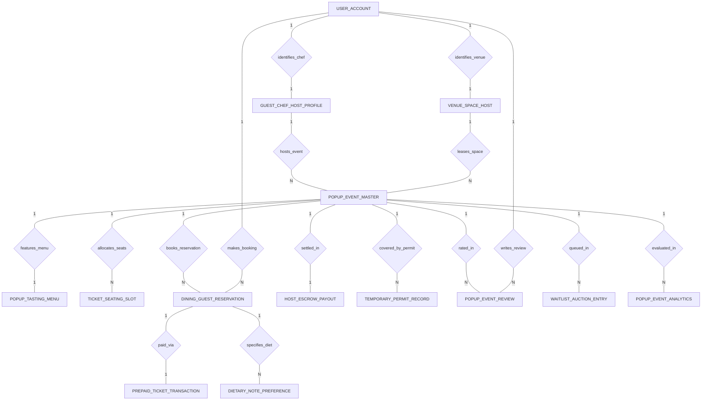

# Conceptual ERD — Pop-up Restaurant Booking System

## Mermaid Code

## Entity Description Table | Bang mo ta Entity

| # | Entity Name | Vietnamese Name | Description | Key Attributes | Main Relationships |
|---|-------------|-----------------|-------------|----------------|-------------------|
| 1 | POPUP_EVENT_MASTER | Su kien nha hang pop-up master | Master pop-up restaurant event record, chef ID, venue ID, event title, cuisine theme, start/end dates, and status. | event_id, chef_id, venue_id, event_title, cuisine_theme, start_date, event_status | Belongs to GUEST_CHEF_HOST_PROFILE, VENUE_SPACE_HOST; One-to-One with POPUP_TASTING_MENU, HOST_ESCROW_PAYOUT; One-to-Many with TICKET_SEATING_SLOT, DINING_GUEST_RESERVATION, TEMPORARY_PERMIT_RECORD, POPUP_EVENT_REVIEW, WAITLIST_AUCTION_ENTRY, POPUP_EVENT_ANALYTICS |
| 2 | GUEST_CHEF_HOST_PROFILE | Ho so dau bếp pop-up | Visiting guest chef host profile, user ID, chef name, bio credentials, average rating, and ACH payout account. | chef_id, user_id, chef_name, bio_credentials, average_chef_rating, payout_ach_account | Belongs to USER_ACCOUNT; One-to-Many with POPUP_EVENT_MASTER; One-to-One with HOST_ESCROW_PAYOUT |
| 3 | VENUE_SPACE_HOST | Dia diem cho thue pop-up | Commercial kitchen or venue space host profile, user ID, venue name, address, max capacity, daily lease rate, and status. | venue_id, user_id, venue_name, street_address, max_seating_capacity, daily_lease_rate | Belongs to USER_ACCOUNT; One-to-Many with POPUP_EVENT_MASTER; One-to-One with HOST_ESCROW_PAYOUT |
| 4 | POPUP_TASTING_MENU | Thuc don tasting menu pop-up | Fixed multi-course tasting menu for a pop-up event, course count, ticket price per guest, beverage pairing price, and description. | menu_id, event_id, course_count, ticket_price_per_guest, beverage_pairing_price | One-to-One with POPUP_EVENT_MASTER |
| 5 | TICKET_SEATING_SLOT | Vi tri cho ngoi xem ve | Individual seating slot per shift, event ID, seating time, table section, seat number, premium price, and reservation status. | slot_id, event_id, seating_time, table_section, seat_number, is_reserved | Belongs to POPUP_EVENT_MASTER |
| 6 | DINING_GUEST_RESERVATION | Dat cho cua khach an | Guest dining reservation record, event ID, guest user ID, booking reference, party size, QR ticket pass token, and status. | reservation_id, event_id, guest_user_id, booking_reference, party_size, qr_ticket_pass_token | Belongs to POPUP_EVENT_MASTER, USER_ACCOUNT; One-to-One with PREPAID_TICKET_TRANSACTION; One-to-Many with DIETARY_NOTE_PREFERENCE |
| 7 | PREPAID_TICKET_TRANSACTION | Giao dich ve tra truoc | Financial prepaid ticket transaction record, reservation ID, total ticket amount, beverage add-on, platform fee, and timestamp. | transaction_id, reservation_id, total_ticket_amount, beverage_add_on_amount, platform_fee_amount | One-to-One with DINING_GUEST_RESERVATION |
| 8 | HOST_ESCROW_PAYOUT | Thanh toan ky quy cho host | Escrow payout settlement record disbursing net earnings to chef host and venue host 24 hours post-event, and payout status. | payout_id, event_id, chef_id, venue_id, gross_ticket_escrow, net_chef_payout, net_venue_payout | One-to-One with POPUP_EVENT_MASTER |
| 9 | TEMPORARY_PERMIT_RECORD | Giay phep tam thoi food & liquor | Municipal temporary food handler permit or liquor license record, permit type, permit #, issuing authority, expiry, and verification status. | permit_id, event_id, permit_type, permit_number, issuing_authority, is_verified | Belongs to POPUP_EVENT_MASTER |
| 10 | DIETARY_NOTE_PREFERENCE | Ghi chu di ung va che do an | Guest dietary restriction record bound to a reservation, guest name, severe allergies, vegetarian flag, and special requests. | preference_id, reservation_id, guest_name, severe_allergies, is_vegetarian | Belongs to DINING_GUEST_RESERVATION |
| 11 | POPUP_EVENT_REVIEW | Danh gia su kien pop-up | Guest dining experience rating and written review published post-event, star rating (1-5), review text, and timestamp. | review_id, event_id, guest_user_id, star_rating, review_text, reviewed_at | Belongs to POPUP_EVENT_MASTER, USER_ACCOUNT |
| 12 | WAITLIST_AUCTION_ENTRY | Danh sach cho va dau gia ve | VIP waitlist entry or drop-in seat auction bid for sold-out pop-up shifts, preferred seating time, bid offered, and status. | waitlist_id, event_id, guest_user_id, seating_shift_preferred, bid_amount_offered | Belongs to POPUP_EVENT_MASTER, USER_ACCOUNT |
| 13 | USER_ACCOUNT | Tai khoan he thong | Core security authentication account holding credentials, password hashes, and user role definitions. | user_id, username, password_hash, role_name | One-to-One with GUEST_CHEF_HOST_PROFILE, VENUE_SPACE_HOST; One-to-Many with DINING_GUEST_RESERVATION, POPUP_EVENT_REVIEW |
| 14 | POPUP_EVENT_ANALYTICS | Thong ke hieu qua su kien | Executive daily analytics tracking total ticket Gross Merchandise Value (GMV), occupancy %, tickets sold, and revenue splits. | analytics_id, event_id, metric_date, total_ticket_gmv, occupancy_percentage, total_tickets_sold | Belongs to POPUP_EVENT_MASTER |

## Relationship Description | Mo ta Quan he

| # | From Entity | Cardinality | To Entity | Relationship Label | Business Explanation |
|---|-------------|-------------|-----------|-------------------|----------------------|
| 1 | USER_ACCOUNT | One-to-One | GUEST_CHEF_HOST_PROFILE | identifies_chef | Tai khoan he thong dinh danh ho so dau bếp giang vien / host pop-up. |
| 2 | USER_ACCOUNT | One-to-One | VENUE_SPACE_HOST | identifies_venue | Tai khoan he thong dinh danh ho so chu dia diem cho thue khong gian. |
| 3 | GUEST_CHEF_HOST_PROFILE | One-to-Many | POPUP_EVENT_MASTER | hosts_event | Dau bếp giang vien sang tao va to chuc cac su kien nha hang pop-up. |
| 4 | VENUE_SPACE_HOST | One-to-Many | POPUP_EVENT_MASTER | leases_space | Chu dia diem cho thue khong gian bep va phong an cho cac su kien. |
| 5 | POPUP_EVENT_MASTER | One-to-One | POPUP_TASTING_MENU | features_menu | Su kien pop-up di kem mot thuc don tasting menu nhieu mon co dinh. |
| 6 | POPUP_EVENT_MASTER | One-to-Many | TICKET_SEATING_SLOT | allocates_seats | Su kien phan chia cac vi tri cho ngoi va khung gio an (seating shift). |
| 7 | POPUP_EVENT_MASTER | One-to-Many | DINING_GUEST_RESERVATION | books_reservation | Su kien nhan cac luot dat cho tra truoc tu khach an. |
| 8 | DINING_GUEST_RESERVATION | One-to-One | PREPAID_TICKET_TRANSACTION | paid_via | Luot dat cho duoc thanh toan qua giao dich ve tra truoc giu trong ky quy. |
| 9 | DINING_GUEST_RESERVATION | One-to-Many | DIETARY_NOTE_PREFERENCE | specifies_diet | Luot dat cho duoc khach ghi chu cac yeu cau ve di ung va che do an kieng. |
| 10 | POPUP_EVENT_MASTER | One-to-One | HOST_ESCROW_PAYOUT | settled_in | Su kien duoc quyet toan thanh toan ky quy 24h sau khi su kien ket thuc. |
| 11 | POPUP_EVENT_MASTER | One-to-Many | TEMPORARY_PERMIT_RECORD | covered_by_permit | Su kien phai co cac giay phep ve sinh va ruou tam thoi duoc phe duyet. |
| 12 | POPUP_EVENT_MASTER | One-to-Many | POPUP_EVENT_REVIEW | rated_in | Su kien nhan cac luot danh gia va binh chon sao tu khach an tham gia. |
| 13 | POPUP_EVENT_MASTER | One-to-Many | WAITLIST_AUCTION_ENTRY | queued_in | Su kien quan ly danh sach cho va dau gia ve khi da chay ve. |
| 14 | USER_ACCOUNT | One-to-Many | DINING_GUEST_RESERVATION | makes_booking | Khach an thuc hien dat ve tham gia suat an pop-up. |
| 15 | USER_ACCOUNT | One-to-Many | POPUP_EVENT_REVIEW | writes_review | Khach an viet binh luan va danh gia trai nghiem am thuc. |
| 16 | POPUP_EVENT_MASTER | One-to-Many | POPUP_EVENT_ANALYTICS | evaluated_in | Su kien duoc thong ke va danh gia tong doanh thu ve GMV va ty le lap day cho ngoi. |
