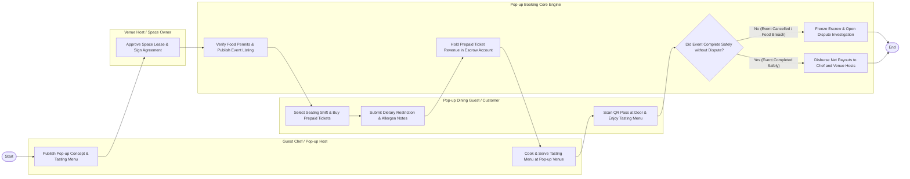

# Swimlane Diagram — Pop-up Restaurant Booking System

## Mermaid Code

## Flow Description | Mo ta luong

| Lane | Actor | Role in Flow |
|------|-------|-------------|
| **Lane 1** | Pop-up Dining Guest / Customer | Selects seating shift times, buys prepaid multi-course tickets, submits dietary restrictions, scans QR passes at the door, and reviews experiences. |
| **Lane 2** | Guest Chef / Pop-up Host | Publishes pop-up event concepts and fixed tasting menus, leases venue space, reviews guest allergen manifests, and cooks live for guests. |
| **Lane 3** | Venue Host / Space Owner | Lists commercial kitchen spaces, sets daily rental fees, approves space lease requests, and signs digital lease agreements. |
| **Lane 4** | Pop-up Booking Core Engine | Verifies temporary food permits, holds ticket payments in escrow, issues mobile QR passes, and releases net payouts to chef and venue hosts 24 hours post-event. |

### Process Execution Steps | Cac buoc thuc hien quy trinh

1. **Concept Creation & Venue Lease**: Guest Chef publishes pop-up concept (`F1`). Venue Host approves space lease (`V1`). Core Engine verifies food permits and publishes event (`S1`).
2. **Ticket Booking & Escrow Hold**: Dining Guest selects seating shift and buys prepaid tickets (`C1`), submitting dietary notes (`C2`). Core Engine holds funds in escrow (`S2`).
3. **Event Execution & Check-In**: Chef cooks and serves tasting menu at venue (`F2`). Guest scans QR pass at door and enjoys dinner (`C3`).
4. **Escrow Audit & Settlement**: Core Engine evaluates 24-hour post-event completion status (`S3`).
   - If **No (Event Cancelled / Food Breach)**: Core Engine freezes escrow and opens dispute investigation (`S4`).
   - If **Yes (Event Completed Safely)**: Core Engine disburses net payouts to chef and venue hosts (`S5`), completing execution (`Finish`).
