# Action Tree — Pop-up Restaurant Booking System

## Mermaid Code

```mermaid
graph TD
    Root["Pop-up Restaurant Booking System"]

    Root --> M1["Event Concept & Tasting Menu Management"]
    Root --> M2["Venue Space Leasing & Kitchen Logistics"]
    Root --> M3["Prepaid Ticket Reservations & Seating Charts"]
    Root --> M4["Escrow Payment Processing & Host Payouts"]
    Root --> M5["Guest Dietary Notes & QR Pass Check-In"]
    Root --> M6["Permits Verification & Event Cancellation Policies"]
    Root --> M7["Event Analytics & System Administration"]

    M1 --> A11["Publish Pop-up Culinary Concepts and Themes"]
    M1 --> A12["Build Multi-Course Fixed Tasting Menus"]
    M1 --> A13["Set Ticket Pricing Tiers and Beverage Pairings"]
    M1 --> A14["Configure Seating Shift Times and Capacities"]

    M2 --> A21["Search and Lease Temporary Commercial Kitchens"]
    M2 --> A22["Execute Digital Venue Space Lease Agreements"]
    M2 --> A23["Manage Kitchen Equipment Rental Manifests"]
    M2 --> A24["Set Daily Venue Rental Rates and Cleaning Fees"]

    M3 --> A31["Reserve Prepaid Non-Refundable Multi-Course Tickets"]
    M3 --> A32["Configure Interactive 2D Seating Charts"]
    M3 --> A33["Allocate Chef Counter Seats and Communal Benches"]
    M3 --> A34["Manage VIP Waitlists and Seat Auctions"]

    M4 --> A41["Hold Prepaid Ticket Sales Revenue in Escrow"]
    M4 --> A42["Disburse Net Payouts to Chef and Venue Hosts"]
    M4 --> A43["Deduct Platform Commission Shares 10 Percent"]
    M4 --> A44["Process Early Ingredient Prep Payout Advances"]

    M5 --> A51["Compile Guest Dietary Restriction and Allergy Manifests"]
    M5 --> A52["Issue Mobile QR Ticket Passes and Secret Address Reveals"]
    M5 --> A53["Sync Passes with Apple Wallet and Google Wallet"]
    M5 --> A54["Scan QR Code Tickets at Venue Door Check-In"]

    M6 --> A61["Verify Municipal Temporary Food and Health Permits"]
    M6 --> A62["Verify Special Event Liquor License Approvals"]
    M6 --> A63["Execute Automated Refunds on Chef Cancellation"]
    M6 --> A64["Enforce Weather Contingency and Force Majeure Rules"]

    M7 --> A71["Monitor Gross Merchandise Value GMV Ticket Sales"]
    M7 --> A72["Analyze Seating Occupancy and Ticket Sales Velocity"]
    M7 --> A73["Manage User Security Roles Chef Venue Guest Admin"]
    M7 --> A74["Manage Escrow Hold Period Rules and Integration APIs"]
```

## Module Description | Mo ta Module

| # | Module | Description | Actions |
|---|--------|-------------|---------|
| 1 | Event Concept & Tasting Menu Management | Controls pop-up concept listings, fixed multi-course tasting menus, beverage pairing add-ons, ticket pricing tiers, and seating shift times. | Publish Pop-up Culinary Concepts and Themes, Build Multi-Course Fixed Tasting Menus, Set Ticket Pricing Tiers and Beverage Pairings, Configure Seating Shift Times and Capacities |
| 2 | Venue Space Leasing & Kitchen Logistics | Enables chefs to search and lease temporary commercial kitchens, execute digital lease contracts, manage equipment rentals, and set daily rates. | Search and Lease Temporary Commercial Kitchens, Execute Digital Venue Space Lease Agreements, Manage Kitchen Equipment Rental Manifests, Set Daily Venue Rental Rates and Cleaning Fees |
| 3 | Prepaid Ticket Reservations & Seating Charts | Manages prepaid non-refundable ticket purchases, interactive 2D seating charts, chef counter allocations, communal bench seating, and VIP waitlist auctions. | Reserve Prepaid Non-Refundable Multi-Course Tickets, Configure Interactive 2D Seating Charts, Allocate Chef Counter Seats and Communal Benches, Manage VIP Waitlists and Seat Auctions |
| 4 | Escrow Payment Processing & Host Payouts | Holds prepaid ticket revenue in buyer-protection escrow, deducts platform commissions (10%), disburses net payouts to hosts 24 hours post-event, and processes advances. | Hold Prepaid Ticket Sales Revenue in Escrow, Disburse Net Payouts to Chef and Venue Hosts, Deduct Platform Commission Shares 10 Percent, Process Early Ingredient Prep Payout Advances |
| 5 | Guest Dietary Notes & QR Pass Check-In | Compiles guest allergen manifests for chefs, issues mobile QR ticket passes with secret address reveals, syncs Apple/Google Wallets, and scans door passes. | Compile Guest Dietary Restriction and Allergy Manifests, Issue Mobile QR Ticket Passes and Secret Address Reveals, Sync Passes with Apple Wallet and Google Wallet, Scan QR Code Tickets at Venue Door Check-In |
| 6 | Permits Verification & Event Cancellation Policies | Verifies municipal temporary food/health permits, special event liquor licenses, executes event cancellation refunds, and enforces weather policies. | Verify Municipal Temporary Food and Health Permits, Verify Special Event Liquor License Approvals, Execute Automated Refunds on Chef Cancellation, Enforce Weather Contingency and Force Majeure Rules |
| 7 | Event Analytics & System Administration | Displays executive dashboards on total ticket GMV, seating occupancy %, ticket sales velocity, escrow hold rules, security access roles, and APIs. | Monitor Gross Merchandise Value GMV Ticket Sales, Analyze Seating Occupancy and Ticket Sales Velocity, Manage User Security Roles Chef Venue Guest Admin, Manage Escrow Hold Period Rules and Integration APIs |
