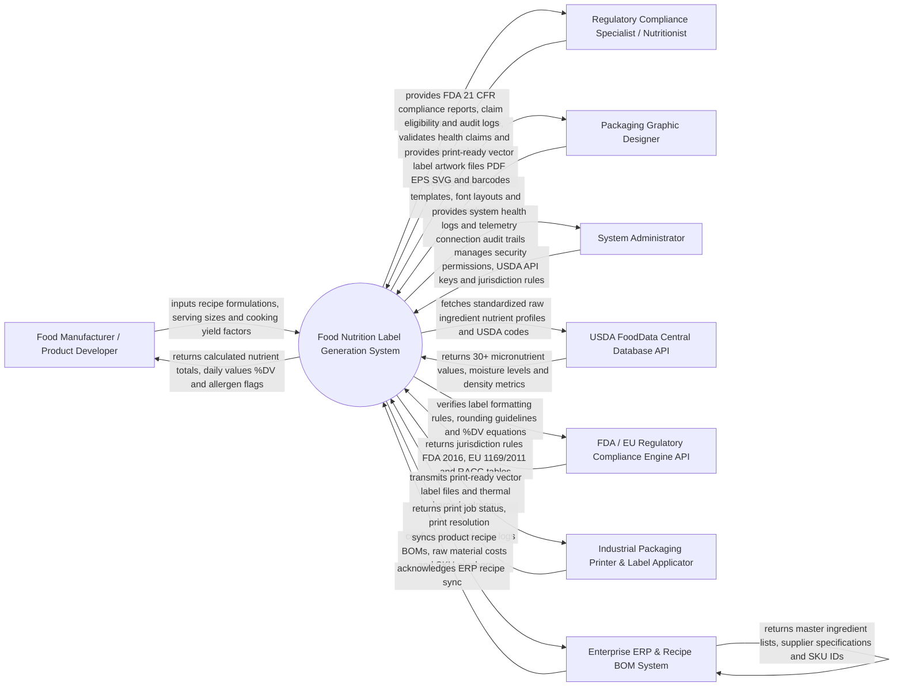

# Context Diagram — Food Nutrition Label Generation System

## Mermaid Code

## Actor & Interaction Table | Bang Actor & Tuong tac

| # | Actor | Actor Type | Data Sent TO System | Data Received FROM System | Notes |
|---|-------|------------|---------------------|---------------------------|-------|
| 1 | Food Manufacturer / Product Developer | Primary | Recipe formulation weights (grams), serving size (RACC), cooking moisture loss %, net container weight | Calculated macronutrients/micronutrients, % Daily Values (%DV), allergen flags, cost per serving | Food R&D scientist or CPG brand manager formulating food products. |
| 2 | Regulatory Compliance Specialist | Primary | Jurisdiction selections (US FDA, EU 1169/2011, UK Traffic Light, Health Canada), health claim audit flags | FDA 21 CFR compliance audit reports, nutrient content claim eligibility, risk warnings | Food lawyer or regulatory nutritionist ensuring legal labeling compliance. |
| 3 | Packaging Graphic Designer | Primary | Label layout templates, font size parameters, print dimensions (mm), barcode specifications | High-resolution print-ready vector artwork files (PDF, EPS, SVG), barcode graphics | Packaging designer incorporating nutrition panels into product package artwork. |
| 4 | System Administrator | Primary | User security credentials, jurisdiction regulatory rule updates, USDA API tokens, platform parameters | System health metrics, USDA API sync telemetry, security audit logs | Manages IT infrastructure, database integrations, and system permissions. |
| 5 | USDA FoodData Central Database API | Supporting | Standardized raw ingredient nutrient profiles, Foundation Foods/SR Legacy data, FDC IDs | Nutrient lookup queries, ingredient keyword searches, FDC code sync | Official USDA agricultural database providing authoritative nutrient values for 300,000+ foods. |
| 6 | FDA / EU Compliance Engine API | Supporting | Jurisdiction compliance rules, Reference Amounts Customarily Consumed (RACC), rounding rules | Formatted Daily Value (%DV) equations, mandatory nutrient lists, rounding rules | Legal compliance engine maintaining up-to-date food labeling regulations. |
| 7 | Industrial Packaging Printer | Supporting | Print job status, thermal print head resolution (300/600 DPI), printer error webhooks | Vector PDF/EPS nutrition panel artwork, GS1-128/UPC barcode raster files | Commercial packaging printing press or inline thermal label applicator. |
| 8 | Enterprise ERP & Recipe BOM System | Supporting | Product Bill of Materials (BOM), raw material specifications, supplier IDs | Formulated recipe nutritional profiles, generated ingredient lists | Corporate ERP system (SAP, Oracle NetSuite) managing product formulations. |

## System Boundary Description | Mo ta Pham vi He thong

The **Food Nutrition Label Generation System** manages automated recipe nutritional analysis, legal nutrition facts panel layout rendering, ingredient declaration sorting by weight, allergen warning identification, health claim validation, and print-ready vector artwork export. Inside its boundary, the system handles recipe formulation nutrient aggregation, cooking moisture/fat yield loss compensation, USDA FoodData Central API integration, multi-jurisdiction rule application (US FDA 2016, EU 1169/2011, UK Traffic Light, Health Canada), FDA 21 CFR 101 rounding rules, FALCPA Major Allergen identification, nutrient content claim verification (e.g., "Low Sodium", "Excellent Source of Fiber"), dual-column label formatting, and vector artwork generation (PDF, EPS, SVG).

The system boundary excludes physical mixing of ingredients in factories, physical printing of plastic packaging film, consumer taste testing, and raw credit card processing.
