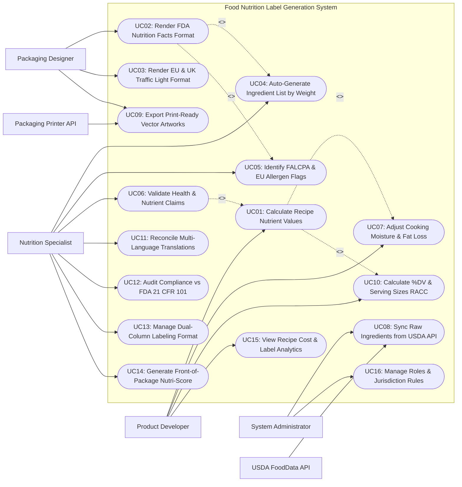

# Use Case Diagram — Food Nutrition Label Generation System

## Mermaid Code

## Actor Table | Bang Actor

| # | Actor | Actor Type | Role Description | Related Use Cases |
|---|-------|------------|------------------|-------------------|
| 1 | USDA FoodData API | Secondary System | Official agricultural database API supplying standardized raw ingredient nutritional profiles and FDC codes. | UC08 |
| 2 | Packaging Printer API | Secondary System | Commercial print press hardware API receiving print-ready vector nutrition panels (PDF/EPS) for package printing. | UC09 |
| 3 | Product Developer | Primary | Food R&D developer inputting recipe ingredient formulations, batch weights, cooking loss factors, and serving sizes. | UC01, UC07, UC10, UC15 |
| 4 | Nutrition Specialist | Primary | Regulatory nutritionist auditing label compliance against FDA 21 CFR 101, validating health claims, and managing allergens. | UC04, UC05, UC06, UC11, UC12, UC13, UC14 |
| 5 | Packaging Designer | Primary | Graphic designer selecting label formats (FDA, EU, UK Traffic Light), adjusting font layouts, and exporting vector artwork. | UC02, UC03, UC09 |
| 6 | System Administrator | Primary | Technical manager configuring regulatory jurisdiction rules (FDA 2016, EU 1169/2011), USDA API keys, user security roles, and audit logs. | UC08, UC16 |

## Use Case Table | Bang Use Case

| # | UC ID | Use Case Name | Primary Actor | Secondary Actor | Description | Priority |
|---|-------|---------------|---------------|-----------------|-------------|----------|
| 1 | UC01 | Calculate Recipe Nutrient Values | Product Developer | None | Aggregates 30+ macronutrients and micronutrients across all formulation ingredients, calculating exact values per serving. | High |
| 2 | UC02 | Render FDA Nutrition Facts Format | Packaging Designer | None | Renders official FDA 2016 vertical, tabular, or linear Nutrition Facts panel layouts matching strict font and border specifications. | High |
| 3 | UC03 | Render EU & UK Traffic Light Format | Packaging Designer | None | Generates European Union (EU 1169/2011) and UK Traffic Light (Red/Amber/Green) front-of-pack nutrition label graphics per 100g/100ml. | High |
| 4 | UC04 | Auto-Generate Ingredient List by Weight | Nutrition Specialist | None | Automatically sorts and formats the product ingredient declaration in descending order of predominance by weight, grouping sub-ingredients. | High |
| 5 | UC05 | Identify FALCPA & EU Allergen Flags | Nutrition Specialist | None | Scans recipe ingredients to identify major allergens (Milk, Eggs, Fish, Crustaceans, Tree Nuts, Peanuts, Wheat, Soy, Sesame), generating bold "Contains" statements. | High |
| 6 | UC06 | Validate Health & Nutrient Claims | Nutrition Specialist | None | Evaluates product formulation against regulatory thresholds to validate nutrient claims (e.g., "Low Sodium", "High Protein", "Gluten-Free"). | High |
| 7 | UC07 | Adjust Cooking Moisture & Fat Loss | Product Developer | None | Applies cooking yield factors (Moisture Evaporation loss %, Fat Absorption %) to accurately reflect nutritional changes after baking/frying. | High |
| 8 | UC08 | Sync Raw Ingredients from USDA API | System Admin | USDA FoodData API | Synchronizes raw ingredient nutrient profiles, FDC IDs, density values, and moisture levels from the USDA FoodData Central database. | High |
| 9 | UC09 | Export Print-Ready Vector Artworks | Packaging Designer | Packaging Printer API | Exports 100% vector nutrition panels and barcodes in PDF, EPS, and SVG formats for seamless integration into commercial packaging artwork. | High |
| 10 | UC10 | Calculate %DV & Serving Sizes RACC | Product Developer | None | Calculates Percent Daily Values (%DV) using FDA 2016 daily reference values and assigns Reference Amounts Customarily Consumed (RACC) serving sizes. | High |
| 11 | UC11 | Reconcile Multi-Language Translations | Nutrition Specialist | None | Translates ingredient lists and nutrition declarations into multiple target languages (e.g., English, Spanish, French, Vietnamese). | Medium |
| 12 | UC12 | Audit Compliance vs FDA 21 CFR 101 | Nutrition Specialist | None | Audits nutrition labels against FDA 21 CFR Part 101 regulatory rules, checking font size ratios, mandatory nutrients, and rounding rules. | High |
| 13 | UC13 | Manage Dual-Column Labeling Format | Nutrition Specialist | None | Generates dual-column nutrition panels displaying nutrient values "Per Serving" AND "Per Container" for multi-serving snack packages. | High |
| 14 | UC14 | Generate Front-of-Package Nutri-Score | Nutrition Specialist | None | Calculates European Nutri-Score grades (A/B/C/D/E) and Chilean black warning octagons for front-of-package food labeling. | Medium |
| 15 | UC15 | View Recipe Cost & Label Analytics | Product Developer | None | Displays analytical dashboards on recipe formulation cost per serving, nutritional balance breakdown, label audit status, and active SKUs. | High |
| 16 | UC16 | Manage Roles & Jurisdiction Rules | System Admin | None | Configures user security access roles, regulatory jurisdiction rule sets (FDA, EU, Health Canada, ANZFA), and audit logging policies. | High |

## Use Case Specification | Dac ta Use Case

---

### UC01 — Calculate Recipe Nutrient Values

| Field | Detail |
|-------|--------|
| **UC ID** | UC01 |
| **Use Case Name** | Calculate Recipe Nutrient Values |
| **Actor(s)** | Primary: Product Developer   Secondary: None |
| **Description** | Aggregates macronutrients and micronutrients (Calories, Total Fat, Saturated Fat, Trans Fat, Cholesterol, Sodium, Total Carbohydrates, Fiber, Total Sugars, Added Sugars, Protein, Vitamin D, Calcium, Iron, Potassium) across all formulation ingredients. |
| **Precondition** | 1. Formulation ingredient weights (grams) are entered.   2. All ingredients are mapped to nutrient database profiles (UC08). |
| **Main Flow** | 1. Product Developer opens "Recipe Nutritional Formulation Workbench" for a new product (e.g., Artisan Chocolate Chip Cookies).   2. Developer enters recipe ingredient quantities (Total Batch Weight = 1,000g):      - Unbleached Wheat Flour: 400g      - Unsalted Butter: 200g      - Semi-Sweet Chocolate Chips: 200g      - Cane Sugar: 100g      - Whole Eggs: 90g      - Baking Soda & Salt: 10g.   3. Developer inputs Cooking Loss Factor (UC07): `12% Moisture Evaporation Loss during baking (Baked Batch Weight = 880g)`.   4. Developer inputs Serving Parameters: `Serving Size = 30g (1 Cookie); Servings per Container = 29`.   5. System queries ingredient nutrient database and sums nutrient mass values for all 1,000g of raw ingredients.   6. System applies 12% moisture reduction factor, re-adjusting nutrient concentrations per 100g of baked product.   7. System calculates Unrounded Nutrient Values per 30g Serving:      - Calories: 142.6 kcal      - Total Fat: 7.23g (Saturated Fat: 4.41g, Trans Fat: 0.08g)      - Sodium: 84.2mg      - Total Carbs: 18.1g (Fiber: 0.92g, Total Sugars: 9.8g, Added Sugars: 9.2g)      - Protein: 1.95g.   8. System applies FDA 21 CFR 101.9 mandatory rounding rules (UC10/UC12) (e.g., 142.6 kcal rounds to **140 Calories**; 7.23g fat rounds to **7g Total Fat**).   9. System displays unrounded vs rounded nutrient summary table and saves formulation profile. |
| **Alternative Flow** | **AF1** — Chemical lab test override:   1. Developer has official lab chemistry report for Trans Fat.   2. Developer overrides calculated Trans Fat value with certified lab analytical result (0.00g). |
| **Exception Flow** | **EX1** — Unmapped ingredient nutrient gap:   1. Semi-Sweet Chocolate Chips is missing Vitamin D value.   2. System flags "NUTRIENT DATA GAP: Vitamin D missing for Chocolate Chips", prompting developer to input vendor specification value before finalizing label. |
| **Postcondition** | Recipe nutrient mass is aggregated, cooking loss is compensated, FDA rounding rules are applied, and serving totals are saved. |
| **Business Rule** | **BR1**: Recipe nutrient calculations MUST account for cooking moisture loss and fat absorption to reflect actual consumed food composition.   **BR2**: Mandatory FDA 2016 nutrients (Calories, Fat, Sat Fat, Trans Fat, Cholesterol, Sodium, Carbs, Fiber, Sugars, Added Sugars, Protein, Vit D, Calcium, Iron, Potassium) MUST be 100% populated without unmapped gaps. |

---

### UC02 — Render FDA Nutrition Facts Format

| Field | Detail |
|-------|--------|
| **UC ID** | UC02 |
| **Use Case Name** | Render FDA Nutrition Facts Format |
| **Actor(s)** | Primary: Packaging Designer   Secondary: None |
| **Description** | Renders official FDA 2016 compliant Nutrition Facts panel graphics in Vertical, Tabular, or Linear formats, enforcing mandatory typography, bolding, line rules, and % Daily Value layout standards. |
| **Precondition** | 1. Recipe nutrient values per serving are calculated and rounded (UC01).   2. FDA 2016 regulatory ruleset is active (UC12). |
| **Main Flow** | 1. Packaging Designer opens "Label Layout Studio" for Artisan Chocolate Chip Cookies.   2. Designer selects Target Regulatory Jurisdiction: `US FDA 2016 (21 CFR 101.9)`.   3. Designer selects Label Layout Format: `Standard Vertical Box` (or Tabular for wide packages / Linear for small packages).   4. System renders high-precision FDA 2016 Nutrition Facts Panel graphic displaying:      - Title: **Nutrition Facts** (Bold, 16pt+ Franklin Gothic / Helvetica font)      - Serving Info: **29 servings per container**      - Serving Size: **Serving size 1 cookie (30g)**      - Calories: **Calories 140** (Extra-large bold 22pt font)      - % Daily Value Column Header: **% Daily Value***      - Mandatory Nutrients with %DV:        - **Total Fat** 7g (9% DV)        - Saturated Fat 4.5g (23% DV)        - *Trans* Fat 0g        - **Cholesterol** 15mg (5% DV)        - **Sodium** 85mg (4% DV)        - **Total Carbohydrate** 18g (7% DV)        - Dietary Fiber 1g (4% DV)        - Total Sugars 10g        - Includes 9g Added Sugars (18% DV)        - **Protein** 2g      - Micronutrients: Vitamin D 0mcg (0% DV), Calcium 15mg (2% DV), Iron 0.8mg (4% DV), Potassium 45mg (0% DV)      - Standard Footnote: "* The % Daily Value (DV) tells you how much a nutrient in a serving of food contributes to a daily diet. 2,000 calories a day is used for general nutrition advice."   5. System validates font sizes, line weights (7pt thick line under Calories), and border padding.   6. Designer previews graphic and approves layout for print artwork export (UC09). |
| **Alternative Flow** | **AF1** — Small package simplified format (< 12 sq inches printable area):   1. Package area is small lip balm or snack stick.   2. System renders FDA Linear Format: "Calories 140, Total Fat 7g (9% DV), Sat Fat 4.5g..." in a single continuous text row. |
| **Exception Flow** | **EX1** — Non-compliant font scaling error:   1. Designer resizes label box causing "Calories" font to fall below mandatory 16pt minimum.   2. System flags red layout warning "FDA VIOLATION: Calories font height must be >= 16pt", preventing artwork export until scale is corrected. |
| **Postcondition** | FDA 2016 Nutrition Facts panel graphic is rendered with 100% typographical accuracy and ready for artwork export. |
| **Business Rule** | **BR1**: FDA 2016 labels MUST feature "Calories" in prominent bold font (minimum 16pt height) and include "Added Sugars" as a distinct indented sub-line.   **BR2**: Border rules, thick dividing lines, font families, and indentations MUST strictly adhere to FDA 21 CFR 101.9 Appendix illustrations. |

---

### UC03 — Render EU & UK Traffic Light Format

| Field | Detail |
|-------|--------|
| **UC ID** | UC03 |
| **Use Case Name** | Render EU & UK Traffic Light Format |
| **Actor(s)** | Primary: Packaging Designer   Secondary: None |
| **Description** | Generates European Union (EU 1169/2011) compliant nutrition tables per 100g/100ml and UK Front-of-Pack Traffic Light color-coded summary graphics (Red/Amber/Green). |
| **Precondition** | 1. Recipe nutrient values (UC01) are calculated per 100g.   2. Target market includes EU or UK distribution. |
| **Main Flow** | 1. Packaging Designer opens "Multi-Market Label Studio".   2. Designer selects Target Regulatory Jurisdiction: `European Union (EU No 1169/2011)` and `UK Front-of-Pack Traffic Light`.   3. System calculates nutrient values strictly per **100g** of product (EU mandatory standard):      - Energy: 1988 kJ / 475 kcal      - Fat: 24.1g (of which saturates: 14.7g)      - Carbohydrate: 60.3g (of which sugars: 32.7g)      - Protein: 6.5g      - Salt: 0.70g (EU uses Salt = Sodium x 2.5, NOT Sodium).   4. System renders EU Mandatory Nutrition Table: `Energy | Fat | of which saturates | Carbohydrate | of which sugars | Protein | Salt` in 6pt font table.   5. System calculates UK Traffic Light Color-Coding Thresholds per 100g:      - Energy: 143 kcal / 6% Reference Intake (Gray)      - Fat (24.1g > 17.5g threshold) -> **HIGH / RED**      - Saturates (14.7g > 5.0g threshold) -> **HIGH / RED**      - Sugars (32.7g > 22.5g threshold) -> **HIGH / RED**      - Salt (0.70g <= 1.5g threshold) -> **MEDIUM / AMBER**.   6. System renders UK Traffic Light Front-of-Pack Graphic featuring 5 color-coded lozenge badges (1 Gray, 3 Red, 1 Amber) with % Reference Intake (%RI).   7. Designer previews graphics and saves EU/UK packaging artwork layout. |
| **Alternative Flow** | **AF1** — Liquid beverage formatting (per 100ml):   1. Product is an organic juice beverage.   2. System calculates nutrient values per 100ml instead of per 100g. |
| **Exception Flow** | **EX1** — Incorrect use of "Sodium" instead of "Salt":   1. User attempts to export EU label with "Sodium".   2. System auto-converts Sodium (g) to Salt (g) via formula `Salt = Sodium * 2.5` to comply with EU 1169/2011 Article 30. |
| **Postcondition** | EU 100g nutrition table and UK Traffic Light color-coded lozenge graphics are generated in compliance with European laws. |
| **Business Rule** | **BR1**: EU nutrition declarations MUST express energy in both kilojoules (kJ) and kilocalories (kcal) per 100g or 100ml.   **BR2**: EU labels MUST declare "Salt" (calculated as Sodium x 2.5), whereas US FDA labels declare "Sodium" in milligrams. |

---

### UC04 — Auto-Generate Ingredient List by Weight

| Field | Detail |
|-------|--------|
| **UC ID** | UC04 |
| **Use Case Name** | Auto-Generate Ingredient List by Weight |
| **Actor(s)** | Primary: Nutrition Specialist   Secondary: None |
| **Description** | Automatically parses, sorts, and formats the product ingredient declaration in descending order of predominance by weight, expanding multi-component sub-ingredients in parentheses. |
| **Precondition** | 1. Recipe formulation ingredient weights and component breakdowns are loaded (UC01).   2. Ingredient common/usual names are configured. |
| **Main Flow** | 1. Nutrition Specialist opens "Ingredient List & Allergen Generator".   2. System analyzes raw formulation weights (Total Batch = 1,000g):      - Wheat Flour: 400g (40.0%)      - Butter: 200g (20.0%)      - Chocolate Chips: 200g (20.0%) [Sub-ingredients: Cane Sugar, Chocolate Liquor, Cocoa Butter, Soy Lecithin, Vanilla]      - Cane Sugar: 100g (10.0%)      - Whole Eggs: 90g (9.0%)      - Baking Soda: 6g (0.6%)      - Sea Salt: 4g (0.4%).   3. System sorts ingredients in descending order of weight (400g > 200g > 200g > 100g > 90g > 6g > 4g).   4. System expands sub-ingredients inside parenthetical brackets for composite items (Chocolate Chips).   5. System consolidates duplicate ingredients across components (e.g., Sugar in dough + Sugar in chocolate chips).   6. System generates Legal Ingredient Declaration Text:      `INGREDIENTS: Unbleached Wheat Flour, Unsalted Butter (Cream, Natural Flavor), Semi-Sweet Chocolate Chips (Cane Sugar, Chocolate Liquor, Cocoa Butter, Soy Lecithin, Vanilla Extract), Cane Sugar, Whole Eggs, Contains 2% or less of: Baking Soda, Sea Salt.`   7. System verifies compliance with FDA 21 CFR 101.4 common name rules.   8. Specialist reviews generated text and approves ingredient declaration for label rendering. |
| **Alternative Flow** | **AF1** — "Contains 2% or less of" grouping:   1. Ingredients weighing <= 2% of total batch (Baking Soda 0.6%, Salt 0.4%) are grouped after the "Contains 2% or less of:" phrase in any order. |
| **Exception Flow** | **EX1** — Un-declared sub-ingredient in composite item:   1. Chocolate Chips supplier spec is missing sub-ingredient breakdown.   2. System flags warning "COMPOSITE INGREDIENT MISSING SUB-LIST: Chocolate Chips requires sub-ingredients", blocking label approval. |
| **Postcondition** | Legal ingredient declaration is auto-sorted by weight, sub-ingredients are expanded, and text is approved for packaging artwork. |
| **Business Rule** | **BR1**: Ingredients MUST be listed in strict descending order of predominance by weight as added to the food batch.   **BR2**: Multi-component ingredients (e.g., Chocolate, Margarine, Cheese) MUST declare all sub-components in parentheses following their common name. |

---

### UC05 — Identify FALCPA & EU Allergen Flags

| Field | Detail |
|-------|--------|
| **UC ID** | UC05 |
| **Use Case Name** | Identify FALCPA & EU Allergen Flags |
| **Actor(s)** | Primary: Nutrition Specialist   Secondary: None |
| **Description** | Scans all formulation ingredients and sub-components against US FALCPA / FASTER Act (9 Major Allergens) and EU 14 Major Allergens, generating bold "Contains" allergen warning statements. |
| **Precondition** | 1. Recipe formulation and sub-ingredient list (UC04) are generated.   2. Master allergen taxonomy database (US 9 Major & EU 14 Major) is active. |
| **Main Flow** | 1. System initiates automated "Allergen Screening Audit" on the formulation ingredient list:      `INGREDIENTS: Unbleached Wheat Flour, Unsalted Butter (Cream), Semi-Sweet Chocolate Chips (Soy Lecithin), Whole Eggs...`   2. System screens ingredients against US FALCPA / FASTER Act 9 Major Allergens:      - Wheat Flour -> Detects **WHEAT**      - Unsalted Butter (Cream) -> Detects **MILK**      - Soy Lecithin -> Detects **SOY**      - Whole Eggs -> Detects **EGG**      - (Peanuts, Tree Nuts, Fish, Crustaceans, Sesame -> NOT DETECTED).   3. System generates US Compliant Bold Allergen Warning Statement:      **CONTAINS: WHEAT, MILK, EGG, SOY.**   4. System screens ingredients against EU 14 Major Allergens (adding Celery, Mustard, Lupin, Molluscs, Sulphites, Gluten):      - Identifies **GLUTEN (from Wheat)**.   5. System options for EU format: Renders ingredient text with allergens in **BOLD CAPITAL LETTERS**:      `INGREDIENTS: Unbleached **WHEAT** Flour, Unsalted Butter (**MILK**), Semi-Sweet Chocolate Chips (**SOY** Lecithin), Whole **EGG**s...`   6. Specialist reviews allergen flags, confirms accuracy against facility cross-contact risk assessments, and approves allergen warnings. |
| **Alternative Flow** | **AF1** — Precautionary "May Contain" cross-contact statement:   1. Product is manufactured on shared equipment processing Peanuts.   2. Specialist adds Precautionary Statement: **May Contain: Peanuts, Tree Nuts.** |
| **Exception Flow** | **EX1** — Hidden allergen in artificial flavor:   1. Natural Flavoring contains a hidden Milk derivative (Whey).   2. System allergen database identifies Whey under Natural Flavor, auto-triggering **MILK** allergen warning flag. |
| **Postcondition** | Major food allergens are accurately identified, and legal bold "Contains" warning statements are generated for package printing. |
| **Business Rule** | **BR1**: US FALCPA / FASTER Act requires explicit declaration of 9 Major Allergens (Milk, Egg, Peanut, Tree Nuts, Wheat, Soy, Fish, Crustacean Shellfish, Sesame).   **BR2**: Allergen declarations MUST use the clear common name of the food source (e.g., "Milk" instead of "Casein"; "Wheat" instead of "Spelt"). |
