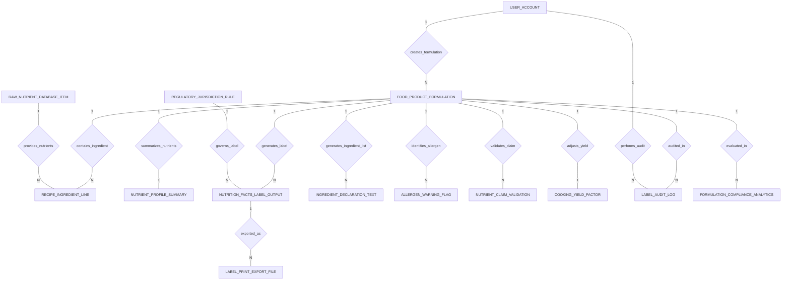

# Conceptual ERD — Food Nutrition Label Generation System

## Mermaid Code

## Entity Description Table | Bang mo ta Entity

| # | Entity Name | Vietnamese Name | Description | Key Attributes | Main Relationships |
|---|-------------|-----------------|-------------|----------------|-------------------|
| 1 | FOOD_PRODUCT_FORMULATION | Cong thuc che bien thuc pham | Food product recipe formulation record, developer user ID, product SKU, batch weight g, serving size g, servings per container, and status. | formulation_id, developer_user_id, product_code_sku, product_name, total_batch_weight_g, serving_size_g, formulation_status | Belongs to USER_ACCOUNT; One-to-Many with RECIPE_INGREDIENT_LINE, NUTRITION_FACTS_LABEL_OUTPUT, INGREDIENT_DECLARATION_TEXT, ALLERGEN_WARNING_FLAG, NUTRIENT_CLAIM_VALIDATION, LABEL_AUDIT_LOG, FORMULATION_COMPLIANCE_ANALYTICS; One-to-One with NUTRIENT_PROFILE_SUMMARY, COOKING_YIELD_FACTOR |
| 2 | RECIPE_INGREDIENT_LINE | Dong nguyen lieu cong thuc | Line item in recipe formulation specifying raw item ID, ingredient name, raw weight in grams, and batch weight percentage. | line_id, formulation_id, raw_item_id, ingredient_name, raw_weight_grams, weight_percentage | Belongs to FOOD_PRODUCT_FORMULATION, RAW_NUTRIENT_DATABASE_ITEM |
| 3 | RAW_NUTRIENT_DATABASE_ITEM | Dinh duong nguyen lieu tho | Master raw ingredient nutrient profile item (USDA FoodData Central ID), ingredient common name, calories/100g, protein, fat, carbs, and sodium. | raw_item_id, fdc_id_usda, ingredient_common_name, calories_per_100g, protein_g_100g, total_fat_g_100g, sodium_mg_100g | One-to-Many with RECIPE_INGREDIENT_LINE |
| 4 | NUTRIENT_PROFILE_SUMMARY | Tong hop dinh duong khau phan | Aggregated nutrient values per serving profile (both unrounded and FDA rounded values for 14 mandatory nutrients). | profile_id, formulation_id, calories_unrounded, calories_rounded, total_fat_g, saturated_fat_g, sodium_mg, protein_g | One-to-One with FOOD_PRODUCT_FORMULATION |
| 5 | NUTRITION_FACTS_LABEL_OUTPUT | Nhan dinh duong thanh pham | Rendered nutrition facts label output graphic, formulation ID, rule ID, label format type (Vertical/Tabular/Linear), jurisdiction, and HTML/vector payload. | label_id, formulation_id, rule_id, label_format_type, target_jurisdiction, rendered_html_layout | Belongs to FOOD_PRODUCT_FORMULATION, REGULATORY_JURISDICTION_RULE; One-to-Many with LABEL_PRINT_EXPORT_FILE |
| 6 | INGREDIENT_DECLARATION_TEXT | Van ban thanh phan phap ly | Legal ingredient list declaration text formatted in descending order of weight by predominance, target language, and approval status. | declaration_id, formulation_id, legal_ingredient_list_text, target_language, is_approved | Belongs to FOOD_PRODUCT_FORMULATION |
| 7 | ALLERGEN_WARNING_FLAG | Cánh bao di ung phap ly | Identified food allergen warning flag, allergen name (Milk, Soy, Wheat, Egg, etc.), source ingredient, and bold "Contains" statement text. | allergen_flag_id, formulation_id, allergen_name, allergen_source_ingredient, contains_statement_text | Belongs to FOOD_PRODUCT_FORMULATION |
| 8 | NUTRIENT_CLAIM_VALIDATION | Thap dinh khuyen nghi dinh duong | Health and nutrient content claim validation log (Low Fat, High Fiber, Gluten-Free), claim type, eligibility boolean, and regulatory rule reference. | claim_id, formulation_id, claim_type, is_eligible, regulatory_reference_rule | Belongs to FOOD_PRODUCT_FORMULATION |
| 9 | REGULATORY_JURISDICTION_RULE | Quy dinh nhan theo vung phap ly | Regulatory ruleset reference (US FDA 2016 21 CFR 101, EU 1169/2011, Health Canada), Daily Values JSON, and rounding matrices. | rule_id, jurisdiction_code, regulation_name, daily_value_reference_json, rounding_rule_matrix_json | One-to-Many with NUTRITION_FACTS_LABEL_OUTPUT |
| 10 | LABEL_PRINT_EXPORT_FILE | File in nhan vector | Exported print-ready label artwork file record, label ID, file format (PDF, EPS, SVG), DPI resolution, vector storage URL, and export timestamp. | export_id, label_id, file_format, resolution_dpi, storage_vector_url, exported_at | Belongs to NUTRITION_FACTS_LABEL_OUTPUT |
| 11 | COOKING_YIELD_FACTOR | He so hao hut che bien | Cooking yield compensation factor profile tracking moisture loss %, fat absorption %, and final baked/cooked product weight g. | yield_id, formulation_id, moisture_loss_pct, fat_absorption_pct, baked_final_weight_g | One-to-One with FOOD_PRODUCT_FORMULATION |
| 12 | LABEL_AUDIT_LOG | Nhat ky kiem dinh nhan | Regulatory compliance audit log recorded by nutrition specialists, audit result (Passed/Failed), compliance notes, and timestamp. | audit_id, formulation_id, auditor_user_id, audit_result, compliance_notes, audited_at | Belongs to FOOD_PRODUCT_FORMULATION, USER_ACCOUNT |
| 13 | USER_ACCOUNT | Tai khoan he thong | Core security authentication account holding credentials, password hashes, and user role definitions. | user_id, username, password_hash, role_name | One-to-Many with FOOD_PRODUCT_FORMULATION, LABEL_AUDIT_LOG |
| 14 | FORMULATION_COMPLIANCE_ANALYTICS | Thong ke hieu qua nhan dinh duong | Executive daily analytics tracking total product formulations, compliant labels count, pending audits, and average recipe cost. | analytics_id, metric_date, total_formulations_count, compliant_labels_count, pending_audits_count | Evaluates FOOD_PRODUCT_FORMULATION |

## Relationship Description | Mo ta Quan he

| # | From Entity | Cardinality | To Entity | Relationship Label | Business Explanation |
|---|-------------|-------------|-----------|-------------------|----------------------|
| 1 | USER_ACCOUNT | One-to-Many | FOOD_PRODUCT_FORMULATION | creates_formulation | Nhan vien R&D tao cac cong thuc che bien thuc pham. |
| 2 | FOOD_PRODUCT_FORMULATION | One-to-Many | RECIPE_INGREDIENT_LINE | contains_ingredient | Cong thuc che bien chua nhieu dong nguyen lieu voi khoi luong gam tuong ung. |
| 3 | RAW_NUTRIENT_DATABASE_ITEM | One-to-Many | RECIPE_INGREDIENT_LINE | provides_nutrients | Nguyen lieu tho cung cap du lieu dinh duong 100g tu co so du lieu USDA FoodData. |
| 4 | FOOD_PRODUCT_FORMULATION | One-to-One | NUTRIENT_PROFILE_SUMMARY | summarizes_nutrients | Cong thuc thuc pham co mot bang tong hop gia tri dinh duong khau phan. |
| 5 | FOOD_PRODUCT_FORMULATION | One-to-One | COOKING_YIELD_FACTOR | adjusts_yield | Cong thuc duoc dieu chinh he so hao hut do bay hoi nuoc va ngam mo khi nau. |
| 6 | FOOD_PRODUCT_FORMULATION | One-to-Many | NUTRITION_FACTS_LABEL_OUTPUT | generates_label | Cong thuc sinh ra cac phien ban nhan dinh duong hien thi theo dinh dang phap ly. |
| 7 | REGULATORY_JURISDICTION_RULE | One-to-Many | NUTRITION_FACTS_LABEL_OUTPUT | governs_label | Quy dinh vung phap ly (FDA/EU) chi phoi quy tac lam tron va trinh bay nhan. |
| 8 | FOOD_PRODUCT_FORMULATION | One-to-Many | INGREDIENT_DECLARATION_TEXT | generates_ingredient_list | Cong thuc sinh ra danh sach thanh phan phap ly theo thu tu khoi luong giam dan. |
| 9 | FOOD_PRODUCT_FORMULATION | One-to-Many | ALLERGEN_WARNING_FLAG | identifies_allergen | Cong thuc nhan dien va sinh ra cac canh bao di ung phap ly (FALCPA 9 nhom). |
| 10 | FOOD_PRODUCT_FORMULATION | One-to-Many | NUTRIENT_CLAIM_VALIDATION | validates_claim | Cong thuc duoc thap dinh cac khuyen nghi dinh duong (Low Fat, High Fiber). |
| 11 | NUTRITION_FACTS_LABEL_OUTPUT | One-to-Many | LABEL_PRINT_EXPORT_FILE | exported_as | Nhan dinh duong duoc xuat thanh cac file in vector (PDF/EPS/SVG) chat luong cao. |
| 12 | FOOD_PRODUCT_FORMULATION | One-to-Many | LABEL_AUDIT_LOG | audited_in | Cong thuc duoc kiem dinh tinh tuong thich va tuan thu boi chuyen gia dinh duong. |
| 13 | USER_ACCOUNT | One-to-Many | LABEL_AUDIT_LOG | performs_audit | Chuyen gia dinh duong thuc hien kiem dinh va ky duyet nhan. |
| 14 | FOOD_PRODUCT_FORMULATION | One-to-Many | FORMULATION_COMPLIANCE_ANALYTICS | evaluated_in | Cac cong thuc duoc thong ke va danh gia ty le dat chuan nhan hang ngay. |
