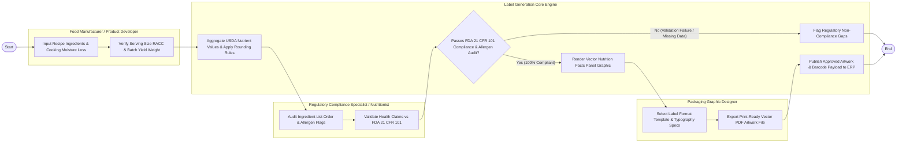

# Swimlane Diagram — Food Nutrition Label Generation System

## Mermaid Code

## Flow Description | Mo ta luong

| Lane | Actor | Role in Flow |
|------|-------|-------------|
| **Lane 1** | Food Manufacturer / Product Developer | Inputs recipe ingredient formulation weights, sets cooking moisture/fat loss yield factors, and verifies RACC serving size parameters. |
| **Lane 2** | Regulatory Compliance Specialist / Nutritionist | Audits auto-generated ingredient lists by weight, confirms major FALCPA allergen warning flags, and validates health/nutrient content claims. |
| **Lane 3** | Packaging Graphic Designer | Selects FDA 2016 or EU nutrition label layout templates, configures typography parameters, and exports print-ready vector PDF artwork. |
| **Lane 4** | Label Generation Core Engine | Aggregates USDA nutrient values, applies legal rounding rules, checks compliance against FDA 21 CFR 101, renders vector graphics, and syncs ERP systems. |

### Process Execution Steps | Cac buoc thuc hien quy trinh

1. **Formulation Input & Yield Adjustment**: Product Developer inputs recipe formulation weights and cooking moisture loss % (`C1`), verifying RACC serving sizes (`C2`).
2. **Nutrient Calculation & Compliance Audit**: Core Engine aggregates USDA nutrient values and applies FDA rounding rules (`S1`). Nutrition Specialist audits ingredient list order and allergen flags (`M1`), validating health claims (`M2`). Core Engine checks overall compliance (`S2`).
   - If **No (Validation Failure / Missing Data)**: Core Engine flags regulatory non-compliance gaps (`S3`), halting label generation.
   - If **Yes (100% Compliant)**: Core Engine renders vector Nutrition Facts panel graphic (`S4`).
3. **Layout Rendering & Vector Export**: Packaging Designer selects layout template (`D1`) and exports print-ready vector PDF/EPS artwork (`D2`).
4. **ERP Sync & Approval**: Core Engine publishes approved label artwork and barcode payloads to corporate ERP systems (`S5`), completing execution (`Finish`).
