# Action Tree — Food Nutrition Label Generation System

## Mermaid Code

```mermaid
graph TD
    Root["Food Nutrition Label Generation System"]

    Root --> M1["Formulation Recipe & Ingredient BOM Setup"]
    Root --> M2["Nutrient Calculation & Cooking Yield Factors"]
    Root --> M3["FDA / EU Nutrition Label Layout Rendering"]
    Root --> M4["Ingredient List & Allergen Warning Generation"]
    Root --> M5["Nutrient Content Claim Validation & Compliance Audit"]
    Root --> M6["Print Vector Artwork Export & Multi-Language Translation"]
    Root --> M7["Formulation Analytics & System Administration"]

    M1 --> A11["Input Product Recipe Ingredient Formulation Weights"]
    M1 --> A12["Map Ingredients to USDA FoodData Central FDC IDs"]
    M1 --> A13["Set Serving Sizes and Containers per Package RACC"]
    M1 --> A14["Import Bill of Materials BOM Data from Enterprise ERP"]

    M2 --> A21["Aggregate 30 Plus Macronutrients and Micronutrients Mass"]
    M2 --> A22["Apply Cooking Moisture Loss and Fat Absorption Percentages"]
    M2 --> A23["Calculate FDA 2016 Percent Daily Values Percent DV"]
    M2 --> A24["Apply Mandatory Regulatory Rounding Rules 21 CFR 101"]

    M3 --> A31["Render Standard FDA 2016 Vertical Nutrition Facts Panels"]
    M3 --> A32["Render EU 1169 and UK Traffic Light Color Coded Labels"]
    M3 --> A33["Generate Dual-Column Per Serving and Per Container Layouts"]
    M3 --> A34["Generate Front-of-Package Nutri-Score and Summary Badges"]

    M4 --> A41["Sort Legal Ingredient Declarations in Descending Weight Order"]
    M4 --> A42["Expand Composite Sub-Ingredients in Parentheses"]
    M4 --> A43["Identify US FALCPA 9 Major Allergens Milk Soy Wheat Egg"]
    M4 --> A44["Generate Bold Contains and Precautionary Cross-Contact Statements"]

    M5 --> A51["Validate Low Sodium High Fiber and Gluten-Free Health Claims"]
    M5 --> A52["Audit Label Layout Compliance against FDA 21 CFR 101 Guidelines"]
    M5 --> A53["Flag Missing Nutrient Data Gaps and Regulatory Violations"]
    M5 --> A54["Require Nutrition Specialist Sign-Off on Approved Labels"]

    M6 --> A61["Export Print-Ready Vector PDF EPS and SVG Label Files"]
    M6 --> A62["Generate High-Resolution GS1-128 and UPC Barcode Rasters"]
    M6 --> A63["Reconcile Multi-Language Ingredient List Translations"]
    M6 --> A64["Sync Approved Label Artwork Payloads with ERP Systems"]

    M7 --> A71["Monitor Total Product Formulations and Compliant Labels"]
    M7 --> A72["Analyze Recipe Formulation Cost per Serving and Margins"]
    M7 --> A73["Manage User Security Roles Developer Nutritionist Designer"]
    M7 --> A74["Manage Regulatory Jurisdiction Rule Sets and USDA API Keys"]
```

## Module Description | Mo ta Module

| # | Module | Description | Actions |
|---|--------|-------------|---------|
| 1 | Formulation Recipe & Ingredient BOM Setup | Controls recipe formulation weight inputs, USDA FDC ID ingredient mapping, RACC serving size definitions, and ERP BOM imports. | Input Product Recipe Ingredient Formulation Weights, Map Ingredients to USDA FoodData Central FDC IDs, Set Serving Sizes and Containers per Package RACC, Import Bill of Materials BOM Data from Enterprise ERP |
| 2 | Nutrient Calculation & Cooking Yield Factors | Aggregates 30+ macronutrients and micronutrients, applies cooking moisture/fat loss yield factors, calculates %DV, and enforces FDA rounding rules. | Aggregate 30 Plus Macronutrients and Micronutrients Mass, Apply Cooking Moisture Loss and Fat Absorption Percentages, Calculate FDA 2016 Percent Daily Values Percent DV, Apply Mandatory Regulatory Rounding Rules 21 CFR 101 |
| 3 | FDA / EU Nutrition Label Layout Rendering | Renders official FDA 2016 vertical panels, EU 1169/2011 100g tables, UK Traffic Light graphics, dual-column panels, and Nutri-Score badges. | Render Standard FDA 2016 Vertical Nutrition Facts Panels, Render EU 1169 and UK Traffic Light Color Coded Labels, Generate Dual-Column Per Serving and Per Container Layouts, Generate Front-of-Package Nutri-Score and Summary Badges |
| 4 | Ingredient List & Allergen Warning Generation | Auto-sorts ingredient lists by weight in descending order, expands composite sub-ingredients, identifies FALCPA 9 major allergens, and generates bold warning tags. | Sort Legal Ingredient Declarations in Descending Weight Order, Expand Composite Sub-Ingredients in Parentheses, Identify US FALCPA 9 Major Allergens Milk Soy Wheat Egg, Generate Bold Contains and Precautionary Cross-Contact Statements |
| 5 | Nutrient Content Claim Validation & Compliance Audit | Validates nutrient content claims (Low Fat, High Fiber), audits label typography/layout against FDA 21 CFR 101, and flags compliance errors. | Validate Low Sodium High Fiber and Gluten-Free Health Claims, Audit Label Layout Compliance against FDA 21 CFR 101 Guidelines, Flag Missing Nutrient Data Gaps and Regulatory Violations, Require Nutrition Specialist Sign-Off on Approved Labels |
| 6 | Print Vector Artwork Export & Multi-Language Translation | Exports 100% vector artwork files (PDF, EPS, SVG), barcode rasters, reconciles multi-language label translations, and syncs corporate ERP systems. | Export Print-Ready Vector PDF EPS and SVG Label Files, Generate High-Resolution GS1-128 and UPC Barcode Rasters, Reconcile Multi-Language Ingredient List Translations, Sync Approved Label Artwork Payloads with ERP Systems |
| 7 | Formulation Analytics & System Administration | Displays executive dashboards on product formulations, recipe cost per serving, regulatory jurisdiction rule sets (FDA/EU), USDA API keys, and security roles. | Monitor Total Product Formulations and Compliant Labels, Analyze Recipe Formulation Cost per Serving and Margins, Manage User Security Roles Developer Nutritionist Designer, Manage Regulatory Jurisdiction Rule Sets and USDA API Keys |
