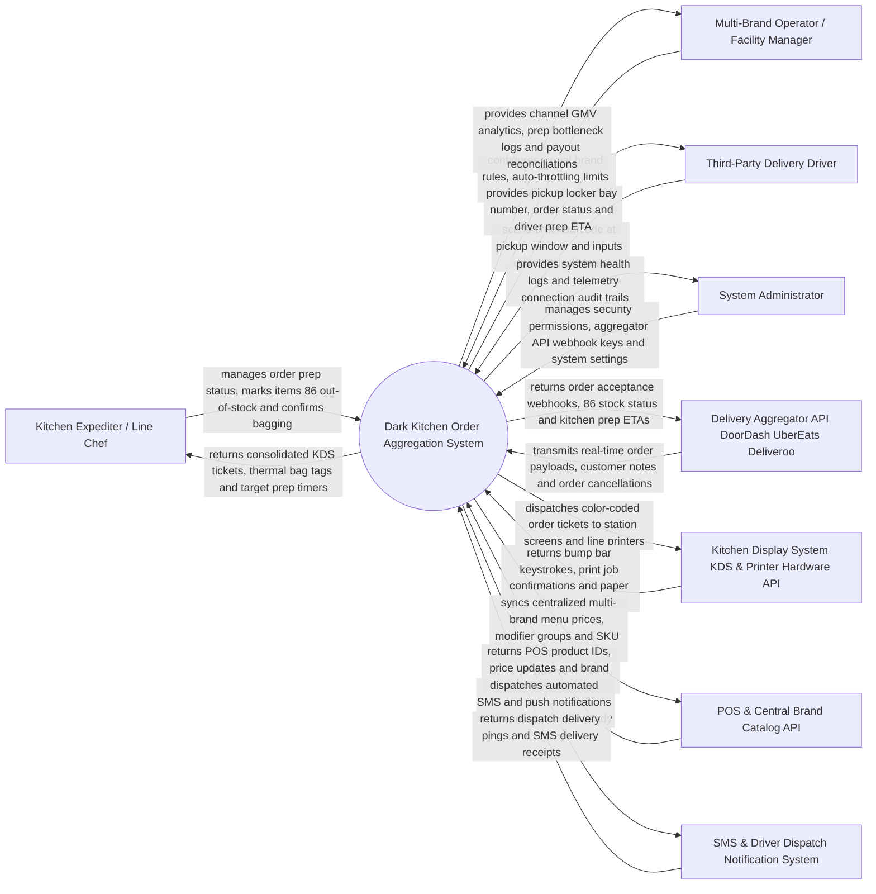

# Context Diagram — Dark Kitchen Order Aggregation System

## Mermaid Code

## Actor & Interaction Table | Bang Actor & Tuong tac

| # | Actor | Actor Type | Data Sent TO System | Data Received FROM System | Notes |
|---|-------|------------|---------------------|---------------------------|-------|
| 1 | Kitchen Expediter / Line Chef | Primary | Order bump actions, item 86 out-of-stock toggles, bagging complete scans, prep time adjustments | Consolidated Kitchen Display System (KDS) order tickets, thermal bag stickers, target prep timers | Kitchen staff managing cooking, plating, and packaging across multiple virtual food brands. |
| 2 | Multi-Brand Operator / Facility Manager | Primary | Virtual brand configurations, auto-throttling surge thresholds, channel menu price overrides | Consolidated channel GMV dashboards, prep bottleneck telemetry, financial payout reconciliations | Ghost kitchen facility manager overseeing operations of 5-20 virtual brands under one roof. |
| 3 | Third-Party Delivery Driver | Primary | Driver arrival webhooks, order QR barcode scans, locker bay door check-ins | Assigned pickup locker bay number, order prep status (Cooking vs Ready), order pickup verification | Courier drivers (DoorDash, UberEats, Grubhub, Deliveroo) picking up food for delivery. |
| 4 | System Administrator | Primary | User credentials, security role policies, aggregator API webhook keys, platform parameters | System uptime health, webhook latency logs, hardware telemetry audit trails | IT manager configuring aggregator API connections, KDS hardware, and system access. |
| 5 | Delivery Aggregator API | Supporting | Incoming order JSON payloads, customer delivery addresses, cancellation events | Automated order acceptance webhooks, 86 out-of-stock item updates, real-time prep ETAs | Third-party food delivery platforms (UberEats, DoorDash, Deliveroo, Grubhub, JustEat). |
| 6 | KDS & Printer Hardware API | Supporting | Bump bar keystroke events, thermal printer status, paper out warnings | Station line ticket render payloads, thermal sticker graphic files, kitchen screen updates | Kitchen display monitors (KDS) and thermal sticky label printers at prep stations. |
| 7 | POS & Central Brand Catalog API | Supporting | POS master catalog SKUs, modifier group maps, central price change pushes | Normalized multi-brand menu mappings, SKU mapping confirmations, sales tax tables | Enterprise Cloud POS system maintaining master virtual brand menus and inventory. |
| 8 | SMS & Driver Dispatch Notification System | Supporting | Driver SMS delivery status, push notification dispatch confirmations | Driver pickup ready alerts, locker bay door pin codes, customer delay notices | Automated notification service alerting drivers when food is bagged and ready for pickup. |

## System Boundary Description | Mo ta Pham vi He thong

The **Dark Kitchen Order Aggregation System** manages multi-channel order ingestion from third-party delivery aggregators (UberEats, DoorDash, Deliveroo, Grubhub), single-tablet order consolidation, multi-brand virtual menu 86 stock syncing, Kitchen Display System (KDS) prep station ticket routing, automated kitchen surge throttling, thermal bag sticker tagging, pickup locker bay assignment, and aggregator commission financial reconciliation. Inside its boundary, the system handles order JSON normalization, multi-brand modifier mapping, KDS screen bump bar integration, thermal sticker printing, kitchen capacity throttling, driver ETA tracking, order cancellation webhooks, and channel revenue analytics.

The system boundary excludes physical cooking of food, physical driving of delivery vehicles, consumer credit card payment processing (handled by aggregators), and building lease management.
