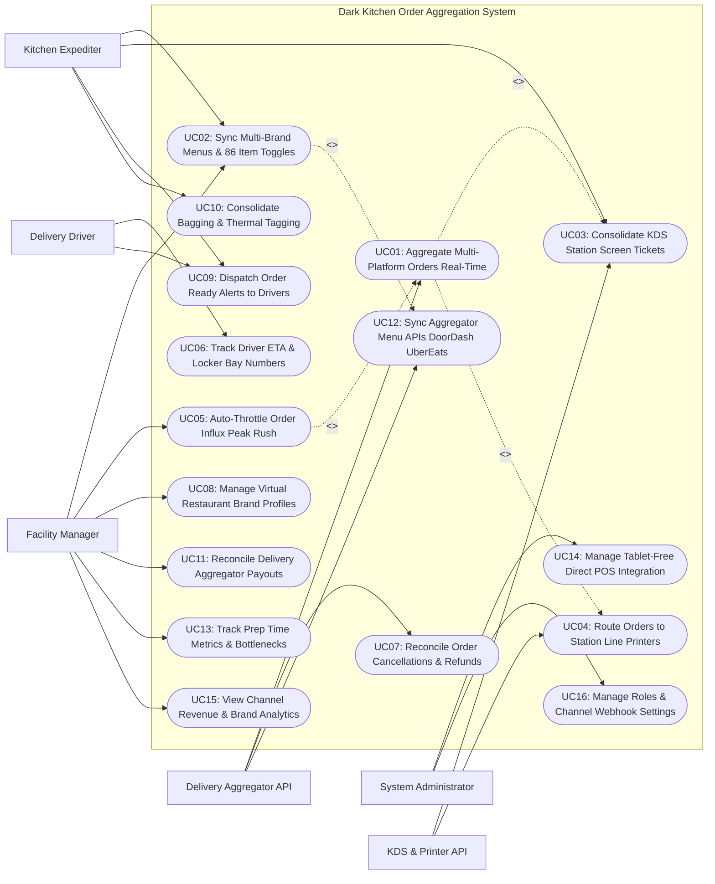

# Use Case Diagram — Dark Kitchen Order Aggregation System

## Mermaid Code

## Actor Table | Bang Actor

| # | Actor | Actor Type | Role Description | Related Use Cases |
|---|-------|------------|------------------|-------------------|
| 1 | Delivery Aggregator API | Secondary System | Third-party food platforms (DoorDash, UberEats, Deliveroo) transmitting orders and receiving menu updates. | UC01, UC07, UC12 |
| 2 | KDS & Printer API | Secondary System | Kitchen Display System monitors and thermal sticky printers rendering station tickets and bag labels. | UC03, UC04 |
| 3 | Kitchen Expediter | Primary | Line chef or expediter bumping KDS screen tickets, marking 86 out-of-stock items, and bagging multi-brand orders. | UC02, UC03, UC09, UC10 |
| 4 | Third-Party Delivery Driver | Primary | Courier driver checking driver ETA status, scanning pickup barcodes, and retrieving bags from assigned locker bays. | UC06, UC09 |
| 5 | Facility Manager | Primary | Ghost kitchen manager setting auto-throttling surge limits, managing virtual brand profiles, and auditing payouts. | UC02, UC05, UC08, UC11, UC13, UC15 |
| 6 | System Administrator | Primary | Technical manager configuring aggregator API webhooks, POS integrations, security access roles, and system parameters. | UC14, UC16 |

## Use Case Table | Bang Use Case

| # | UC ID | Use Case Name | Primary Actor | Secondary Actor | Description | Priority |
|---|-------|---------------|---------------|-----------------|-------------|----------|
| 1 | UC01 | Aggregate Multi-Platform Orders Real-Time | System | Delivery Aggregator API | Ingests and normalizes order payloads from DoorDash, UberEats, Deliveroo, and Grubhub into a single unified stream. | High |
| 2 | UC02 | Sync Multi-Brand Menus & 86 Item Toggles | Kitchen Expediter | Delivery Aggregator API | Toggles item "86 Out-of-Stock" status across all delivery channels simultaneously with a single tap to prevent unfulfillable orders. | High |
| 3 | UC03 | Consolidate KDS Station Screen Tickets | Kitchen Expediter | KDS & Printer API | Consolidates incoming multi-brand orders onto color-coded Kitchen Display System (KDS) prep screens filtered by station (Fryer, Grill, Assembly). | High |
| 4 | UC04 | Route Orders to Station Line Printers | System | KDS & Printer API | Automatically prints sticky thermal tickets at dedicated prep line stations, parsing brand logos, modifier notes, and order timers. | High |
| 5 | UC05 | Auto-Throttle Order Influx Peak Rush | Facility Manager | Delivery Aggregator API | Automatically pauses or extends prep ETAs on delivery platforms when kitchen order volume exceeds max cooking capacity. | High |
| 6 | UC06 | Track Driver ETA & Locker Bay Numbers | Third-Party Driver | None | Monitors courier GPS arrival ETAs, assigning completed order bags to specific pickup locker bays (e.g., Locker #04) for fast driver pickup. | High |
| 7 | UC07 | Reconcile Order Cancellations & Refunds | System | Delivery Aggregator API | Ingests real-time cancellation webhooks from aggregators, auto-bumping KDS tickets and recording financial refund adjustments. | High |
| 8 | UC08 | Manage Virtual Restaurant Brand Profiles | Facility Manager | None | Manages multiple virtual restaurant brand profiles operating within the single ghost kitchen facility (e.g., Burger Brand, Wings Brand, Salad Brand). | High |
| 9 | UC09 | Dispatch Order Ready Alerts to Drivers | Kitchen Expediter | Delivery Driver | Triggers automated SMS/push alerts to delivery couriers when expediter scans order barcode at the final packaging station. | High |
| 10 | UC10 | Consolidate Bagging & Thermal Tagging | Kitchen Expediter | KDS & Printer API | Prints consolidated multi-brand thermal sticky bag tags containing item checklists, brand logos, customer names, and tamper-evident seals. | High |
| 11 | UC11 | Reconcile Delivery Aggregator Payouts | Facility Manager | None | Reconciles weekly net payouts, platform commission fees (15%-30%), error adjustments, and promo discounts across all aggregator channels. | High |
| 12 | UC12 | Sync Aggregator Menu APIs DoorDash UberEats | System | Delivery Aggregator API | Publishes menu prices, modifier groups, and operating hours from the core catalog to all connected aggregator APIs in real time. | High |
| 13 | UC13 | Track Prep Time Metrics & Bottlenecks | Facility Manager | None | Displays analytical metrics on average ticket prep time, expediter bump speed, driver wait times, and station bottleneck delays. | High |
| 14 | UC14 | Manage Tablet-Free Direct POS Integration | System Admin | None | Replaces dozens of fragmented delivery tablets with a single tablet-free direct POS injection architecture. | High |
| 15 | UC15 | View Channel Revenue & Brand Analytics | Facility Manager | None | Displays analytical dashboards comparing Gross Merchandise Value (GMV), order volume, top-selling items, and margin by channel and brand. | High |
| 16 | UC16 | Manage Roles & Channel Webhook Settings | System Admin | None | Configures user security access roles, API webhook endpoint keys, printer IP addresses, and system error audit logs. | High |

## Use Case Specification | Dac ta Use Case

---

### UC01 — Aggregate Multi-Platform Orders Real-Time

| Field | Detail |
|-------|--------|
| **UC ID** | UC01 |
| **Use Case Name** | Aggregate Multi-Platform Orders Real-Time |
| **Actor(s)** | Primary: System   Secondary: Delivery Aggregator API |
| **Description** | Ingests, parses, and normalizes incoming order webhook payloads from multiple third-party delivery platforms (DoorDash, UberEats, Deliveroo, Grubhub) into a unified order structure within sub-second latency. |
| **Precondition** | 1. Aggregator API webhook connections (UC16) are active.   2. Virtual restaurant brand menu SKU mapping (UC12) is synchronized. |
| **Main Flow** | 1. DoorDash API dispatches `ORDER_CREATED` webhook payload: `Order #DD-8812 | Virtual Brand: Smash Burger Co. | Items: 2x Double Bacon Cheeseburger, 1x Large Truffle Fries | Pickup ETA: 12 Mins`.   2. Simultaneously, UberEats API dispatches `ORDER_CREATED` webhook payload: `Order #UE-4419 | Virtual Brand: Wing Dynasty | Items: 12x Buffalo Wings, 1x Ranch Dip | Pickup ETA: 15 Mins`.   3. System Ingestion Gateway intercepts both payloads simultaneously, validating signature tokens.   4. System normalizes channel-specific JSON structures into a unified **Aggregated Order Master Schema**:      - Assigns Global Kitchen Ticket ID `#KT-9022`      - Maps Channel Brand IDs to Internal Virtual Brand Accounts (UC08)      - Standardizes item modifier text (`Extra Cheese`, `No Onions`)      - Calculates target kitchen prep completion timestamp (e.g., 17:42:00).   5. System sends automated HTTP 200 OK `ORDER_ACCEPTED` webhook response to DoorDash and UberEats within 300ms.   6. System routes normalized order ticket `#KT-9022` to Kitchen Display System (KDS) Screen Tickets (UC03) and Station Line Printers (UC04). |
| **Alternative Flow** | **AF1** — Direct consumer web order ingestion:   1. Order originates from dark kitchen's first-party direct online ordering website.   2. System ingests order without aggregator commission tags, marking channel as `Direct First-Party`. |
| **Exception Flow** | **EX1** — Unmapped SKU modifier payload error:   1. UberEats sends an order containing a newly added modifier ID unmapped in the system database.   2. System flags "UNMAPPED MODIFIER SKU: Item #MOD-991", applies fallback text description on KDS, and dispatches mapping alert to Facility Manager. |
| **Postcondition** | Multi-platform orders are ingested, normalized into unified schema, accepted via API, and routed to KDS screens. |
| **Business Rule** | **BR1**: Aggregator order webhook payloads MUST be ingested, normalized, and acknowledged via HTTP 200 OK within 500 milliseconds.   **BR2**: All incoming orders MUST be assigned a unique global kitchen ticket sequence number to prevent multi-brand pickup confusion. |

---

### UC02 — Sync Multi-Brand Menus & 86 Item Toggles

| Field | Detail |
|-------|--------|
| **UC ID** | UC02 |
| **Use Case Name** | Sync Multi-Brand Menus & 86 Item Toggles |
| **Actor(s)** | Primary: Kitchen Expediter, Facility Manager   Secondary: Delivery Aggregator API |
| **Description** | Enables kitchen expediters to toggle an ingredient or item as "86 Out-of-Stock" with a single tap, automatically propagating item unavailability across all connected delivery platforms (UberEats, DoorDash, Deliveroo) within 3 seconds. |
| **Precondition** | 1. Dark kitchen runs out of a key ingredient (e.g., Avocados or Brioche Buns).   2. Aggregator menu management APIs (UC12) are linked. |
| **Main Flow** | 1. Kitchen Expediter notices Brioche Buns are completely depleted during dinner rush.   2. Expediter taps "86 Inventory Quick Toggle" on KDS Master Terminal.   3. Expediter selects Item / Ingredient: `Brioche Buns`.   4. System identifies all virtual brand menu items utilizing Brioche Buns across 4 virtual brands:      - Brand 1 (Smash Burger Co.): *Double Bacon Cheeseburger*, *Classic Single Burger*      - Brand 2 (Vegan Bites Co.): *Plant-Based Brioche Slider*      - Brand 3 (Breakfast Club): *Brioche French Toast*.   5. Expediter selects `Mark Out of Stock (86) on All Platforms`.   6. System dispatches parallel menu availability updates to all connected aggregator APIs (DoorDash, UberEats, Deliveroo, Grubhub):      `PATCH /v1/menu/items/status -> { item_id: "SKU-BRIOCHE", availability: "OUT_OF_STOCK" }`.   7. DoorDash, UberEats, and Deliveroo confirm update within 2.1 seconds; item status switches to "Sold Out" on consumer mobile apps.   8. System logs 86 action, preventing new incoming orders containing Brioche Buns and eliminating order cancellation penalties. |
| **Alternative Flow** | **AF1** — Automatic 86 toggle via inventory depletion count:   1. Pre-set inventory count for Truffle Mayo reaches 0 portions.   2. System auto-toggles Truffle Mayo to 86 Out-of-Stock without requiring manual expediter button press. |
| **Exception Flow** | **EX1** — Aggregator API menu sync timeout:   1. Deliveroo API times out during 86 push payload transmission.   2. System retries API push 3 times, flags "Deliveroo 86 Sync Delayed" alert banner on manager console, and auto-declines incoming orders containing the item. |
| **Postcondition** | Item is marked 86 out-of-stock, menu availability updates across all aggregator channels within 3 seconds, and new order breaches are prevented. |
| **Business Rule** | **BR1**: An 86 out-of-stock toggle performed in the central system MUST update ALL connected delivery channels within 5 seconds.   **BR2**: Toggling an ingredient 86 MUST automatically disable all child menu SKUs containing that ingredient across all virtual brands. |

---

### UC03 — Consolidate KDS Station Screen Tickets

| Field | Detail |
|-------|--------|
| **UC ID** | UC03 |
| **Use Case Name** | Consolidate KDS Station Screen Tickets |
| **Actor(s)** | Primary: Kitchen Expediter   Secondary: KDS & Printer API |
| **Description** | Displays normalized multi-brand orders on color-coded Kitchen Display System (KDS) touchscreens, routing specific items to specialized cooking prep stations (Grill Station, Fryer Station, Assembly & Packaging Station). |
| **Precondition** | 1. Aggregated order #KT-9022 is ingested (UC01).   2. KDS monitors are configured per cooking station. |
| **Main Flow** | 1. System receives normalized order ticket `#KT-9022` containing items for 2 virtual brands:      - Smash Burger Co.: 2x Bacon Cheeseburgers, 1x Truffle Fries      - Wing Dynasty: 12x Buffalo Wings.   2. System parses items and routes order components to 3 designated KDS Station Monitors:      - **Grill Station KDS**: Displays `2x Bacon Beef Patties (Medium-Well) | Ticket #KT-9022 | Brand: Smash Burger`      - **Fryer Station KDS**: Displays `1x Truffle Fries + 12x Wings | Ticket #KT-9022 | Brands: Smash / Wings`      - **Expediter Master KDS**: Displays full consolidated order ticket with real-time target prep timer (`10:00 Mins Countdown`).   3. KDS screens color-code order headers based on prep urgency:      - Green: `0 - 5 Mins Elapsed`      - Yellow: `5 - 10 Mins Elapsed`      - Flashing Red: `> 10 Mins Elapsed (Prep Delay Warning)`.   4. Grill Line Chef cooks patties and presses physical bump bar button on Grill KDS; Grill items turn green on Master Expediter screen.   5. Fryer Line Chef cooks fries/wings and bumps Fryer KDS.   6. Master Expediter verifies all items are green, consolidates items into delivery bag, and bumps Master Expediter screen.   7. System updates order status to `PREP_COMPLETED` and triggers Bagging & Thermal Tagging (UC10). |
| **Alternative Flow** | **AF1** — Multi-brand synchronized prep timing:   1. Wings take 8 minutes to fry, while burgers take 4 minutes to grill.   2. System holds burger ticket release on Grill KDS for 4 minutes so both items finish cooking simultaneously hot and fresh. |
| **Exception Flow** | **EX1** — KDS screen hardware disconnect:   1. Fryer KDS monitor loses Ethernet connection.   2. System automatically reroutes Fryer station tickets to backup Line Printer (UC04) and highlights network alert on Expediter KDS. |
| **Postcondition** | Order items are routed to appropriate station screens, prep timers count down, bump bar presses synchronize, and items finish together. |
| **Business Rule** | **BR1**: Multi-brand items belonging to the same aggregated order MUST be synchronized so hot food items complete prep within 60 seconds of each other.   **BR2**: Orders exceeding 12 minutes of prep time MUST flash red on all KDS monitors to prioritize expediter intervention. |

---

### UC04 — Route Orders to Station Line Printers

| Field | Detail |
|-------|--------|
| **UC ID** | UC04 |
| **Use Case Name** | Route Orders to Station Line Printers |
| **Actor(s)** | Primary: System   Secondary: KDS & Printer API |
| **Description** | Automatically formats and prints sticky thermal tickets at specific kitchen line station printers, printing brand logos, item modifiers, special customer notes, and order pickup barcodes. |
| **Precondition** | 1. Aggregated order is ingested (UC01).   2. Station thermal sticky printers (ESC/POS protocol) are connected via IP network. |
| **Main Flow** | 1. System processes incoming order `#KT-9022` requiring physical paper ticket backups for prep line chefs.   2. System Station Routing Engine determines target printer IP endpoints based on item prep categories:      - Grill Line Printer IP: `192.168.1.101`      - Fryer Line Printer IP: `192.168.1.102`      - Packaging & Expediter Sticky Printer IP: `192.168.1.105`.   3. System formats raw thermal print commands (ESC/POS) featuring:      - High-contrast virtual brand logo raster header      - Large bold ticket number: `#KT-9022`      - Order Source: `DoorDash` (with DoorDash logo)      - Item Name & Quantities: `2x DOUBLE BACON BURGER`      - Modifiers in Reverse Bold: `** NO ONIONS ** | ** EXTRA PICKLES **`      - Special Customer Request: `Please pack sauce separately`      - High-density 1D/2D GS1 barcode for scanning at bagging station (UC10).   4. System transmits print payloads over TCP/IP socket to station printers.   5. Printers output sticky thermal tickets; line chefs peel and stick tickets directly onto burger wrapper wrappers and fry boxes for accurate order assembly. |
| **Alternative Flow** | **AF1** — Thermal sticky label printer vs standard paper chit:   1. Packaging station uses repositionable linerless thermal sticky labels.   2. Line chefs stick labels directly onto food containers, replacing tape or stapling. |
| **Exception Flow** | **EX1** — Line printer paper out error:   1. Grill Line Printer runs out of thermal paper roll.   2. Printer API sends paper-out status code; System re-routes print job to adjacent Assembly Printer and beeps Expediter console. |
| **Postcondition** | Station line printers output formatted sticky tickets with brand logos, modifier callouts, and barcodes for kitchen line staff. |
| **Business Rule** | **BR1**: Station line tickets MUST highlight special dietary modifications (e.g., "ALLERGY: GLUTEN FREE") in large reverse-contrast bold text.   **BR2**: Print jobs MUST execute within 1.0 second of order ingestion to prevent line chef delays. |

---

### UC06 — Track Driver ETA & Locker Bay Numbers

| Field | Detail |
|-------|--------|
| **UC ID** | UC06 |
| **Use Case Name** | Track Driver ETA & Locker Bay Numbers |
| **Actor(s)** | Primary: Third-Party Delivery Driver   Secondary: None |
| **Description** | Monitors courier GPS arrival ETAs, matching driver arrival times with kitchen prep completion timers, and automatically assigning completed order bags to secure pickup locker bays for rapid 10-second driver pickup. |
| **Precondition** | 1. Aggregator API provides driver GPS location updates (UC01).   2. Automated pickup locker bay hardware is installed at dark kitchen pickup window. |
| **Main Flow** | 1. Driver accepted UberEats order `#UE-4419` for Wing Dynasty; UberEats API transmits courier GPS telemetry.   2. System tracks Courier ETA: `Driver John D. is 3.5 Minutes away (Distance: 0.8 Miles)`.   3. System compares Driver ETA with Kitchen Prep Countdown: `Wing Dynasty order prep completes in 2.0 Minutes -> PERFECT MATCH`.   4. Kitchen Expediter completes bagging and scans order barcode at packaging station (UC10).   5. System selects available heated pickup locker: `Locker Bay #04 (Temperature: 60°C Hot Holding)`.   6. System unlocks Locker Bay #04 door; Expediter places bagged food inside and closes door.   7. System updates order status to `IN_LOCKER_BAY_04` and dispatches automated SMS & Driver App Alert (UC09): **Order #UE-4419 Ready! Pick up from Locker Bay #04 (PIN: 8812)**.   8. Driver John D. arrives at pickup window 3 minutes later, approaches Locker Bay #04 touchpad, and scans barcode on driver phone or enters PIN `8812`.   9. Locker Bay #04 door automatically pops open; Driver retrieves food bag and closes door.   10. System registers `DRIVER_PICKUP_COMPLETE` timestamp, releasing locker bay for next order and updating aggregator API status to `EN_ROUTE_TO_CUSTOMER`. |
| **Alternative Flow** | **AF1** — Cold / Chilled dessert locker assignment:   1. Order is 2 pints of ice cream from Virtual Ice Cream Brand.   2. System routes bag to Refrigerated Locker Bay #12 (Temperature: -4°C Cold Holding). |
| **Exception Flow** | **EX1** — Driver late arrival (Holding time delay):   1. Driver gets stuck in traffic; Driver ETA delayed by 25 minutes.   2. System keeps food in heated Locker Bay #04 and alerts expediter to inspect food quality before handover. |
| **Postcondition** | Courier GPS ETA is tracked, food bag is assigned to heated/chilled locker bay, SMS PIN is sent, and driver retrieves food in 10 seconds. |
| **Business Rule** | **BR1**: Orders MUST be assigned to temperature-controlled locker bays (Heated 60°C or Chilled -4°C) to maintain food quality during driver waiting windows.   **BR2**: Driver pickup dwell time at the dark kitchen window MUST average under 30 seconds from vehicle park to departure. |
