# Conceptual ERD — Dark Kitchen Order Aggregation System

## Mermaid Code

```mermaid
graph TD
    %% Định dạng hình dạng: [] là Thực thể (Hình chữ nhật), {} là Mối quan hệ (Hình thoi)

    VIRTUAL_RESTAURANT_BRAND["VIRTUAL_RESTAURANT_BRAND"]
    DELIVERY_CHANNEL_PARTNER["DELIVERY_CHANNEL_PARTNER"]
    AGGREGATED_ORDER_HEADER["AGGREGATED_ORDER_HEADER"]
    ORDER_ITEM_LINE["ORDER_ITEM_LINE"]
    KITCHEN_PREP_STATION["KITCHEN_PREP_STATION"]
    KDS_ROUTING_TICKET["KDS_ROUTING_TICKET"]
    DISPATCH_DRIVER_COURIER["DISPATCH_DRIVER_COURIER"]
    MENU_ITEM_SYNC_MAPPER["MENU_ITEM_SYNC_MAPPER"]
    ORDER_THROTTLING_RULE["ORDER_THROTTLING_RULE"]
    PICKUP_LOCKER_BAY["PICKUP_LOCKER_BAY"]
    CHANNEL_FINANCIAL_PAYOUT["CHANNEL_FINANCIAL_PAYOUT"]
    PREP_TIME_TELEMETRY_LOG["PREP_TIME_TELEMETRY_LOG"]
    USER_ACCOUNT["USER_ACCOUNT"]
    DARK_KITCHEN_ANALYTICS["DARK_KITCHEN_ANALYTICS"]

    %% Các khối hình thoi quan hệ
    rel_receives_order{"receives_order"}
    rel_ingests_order{"ingests_order"}
    rel_contains_item{"contains_item"}
    rel_routes_to_kds{"routes_to_kds"}
    rel_displays_ticket{"displays_ticket"}
    rel_assigned_driver{"assigned_driver"}
    rel_maps_menu{"maps_menu"}
    rel_synced_with{"synced_with"}
    rel_throttled_by{"throttled_by"}
    rel_stored_in{"stored_in"}
    rel_settles_payout{"settles_payout"}
    rel_monitored_in{"monitored_in"}
    rel_logs_prep_speed{"logs_prep_speed"}
    rel_expedites_order{"expedites_order"}
    rel_evaluated_in{"evaluated_in"}

    %% Kết nối 1-1
    AGGREGATED_ORDER_HEADER ---|1| rel_assigned_driver ---|1| DISPATCH_DRIVER_COURIER
    AGGREGATED_ORDER_HEADER ---|1| rel_stored_in ---|1| PICKUP_LOCKER_BAY

    %% Kết nối 1-N
    VIRTUAL_RESTAURANT_BRAND ---|1| rel_receives_order ---|N| AGGREGATED_ORDER_HEADER
    DELIVERY_CHANNEL_PARTNER ---|1| rel_ingests_order ---|N| AGGREGATED_ORDER_HEADER
    AGGREGATED_ORDER_HEADER ---|1| rel_contains_item ---|N| ORDER_ITEM_LINE
    AGGREGATED_ORDER_HEADER ---|1| rel_routes_to_kds ---|N| KDS_ROUTING_TICKET
    KITCHEN_PREP_STATION ---|1| rel_displays_ticket ---|N| KDS_ROUTING_TICKET
    VIRTUAL_RESTAURANT_BRAND ---|1| rel_maps_menu ---|N| MENU_ITEM_SYNC_MAPPER
    DELIVERY_CHANNEL_PARTNER ---|1| rel_synced_with ---|N| MENU_ITEM_SYNC_MAPPER
    DELIVERY_CHANNEL_PARTNER ---|1| rel_throttled_by ---|N| ORDER_THROTTLING_RULE
    DELIVERY_CHANNEL_PARTNER ---|1| rel_settles_payout ---|N| CHANNEL_FINANCIAL_PAYOUT
    AGGREGATED_ORDER_HEADER ---|1| rel_monitored_in ---|N| PREP_TIME_TELEMETRY_LOG
    KITCHEN_PREP_STATION ---|1| rel_logs_prep_speed ---|N| PREP_TIME_TELEMETRY_LOG
    USER_ACCOUNT ---|1| rel_expedites_order ---|N| AGGREGATED_ORDER_HEADER
    AGGREGATED_ORDER_HEADER ---|1| rel_evaluated_in ---|N| DARK_KITCHEN_ANALYTICS

```

## Entity Description Table | Bang mo ta Entity

| # | Entity Name | Vietnamese Name | Description | Key Attributes | Main Relationships |
|---|-------------|-----------------|-------------|----------------|-------------------|
| 1 | VIRTUAL_RESTAURANT_BRAND | Thuong hieu nha hang ao | Virtual restaurant brand profile operating inside the dark kitchen facility, brand code, name, logo URL, cuisine category, and active status. | brand_id, brand_code, brand_name, logo_graphic_url, cuisine_category, is_active | One-to-Many with AGGREGATED_ORDER_HEADER, MENU_ITEM_SYNC_MAPPER |
| 2 | DELIVERY_CHANNEL_PARTNER | Doi tac kenh giao hang | Third-party delivery aggregator partner (DoorDash, UberEats, Deliveroo, Grubhub), channel code, commission %, API webhook URL, and connection status. | channel_id, channel_code, channel_name, platform_commission_pct, api_webhook_url, is_connected | One-to-Many with AGGREGATED_ORDER_HEADER, MENU_ITEM_SYNC_MAPPER, ORDER_THROTTLING_RULE, CHANNEL_FINANCIAL_PAYOUT |
| 3 | AGGREGATED_ORDER_HEADER | Don hang tong hop master | Normalized aggregated order header record ingested from delivery channels, brand ID, channel ID, global ticket #, channel ref, received timestamp, target prep time, total amount, and status. | order_id, brand_id, channel_id, global_kitchen_ticket_no, channel_order_reference, received_at, total_order_amount, order_status | Belongs to VIRTUAL_RESTAURANT_BRAND, DELIVERY_CHANNEL_PARTNER; One-to-Many with ORDER_ITEM_LINE, KDS_ROUTING_TICKET, PREP_TIME_TELEMETRY_LOG, DARK_KITCHEN_ANALYTICS; One-to-One with DISPATCH_DRIVER_COURIER, PICKUP_LOCKER_BAY |
| 4 | ORDER_ITEM_LINE | Chi tiet mon don hang | Line item in an aggregated order specifying SKU code, item name, quantity, unit price, and modifier notes (e.g., No Onions). | line_id, order_id, sku_code, item_name, quantity, unit_price, modifier_notes | Belongs to AGGREGATED_ORDER_HEADER |
| 5 | KITCHEN_PREP_STATION | Tram che bien trong bep | Kitchen cooking prep station (Grill, Fryer, Assembly, Packaging), station code, station name, line printer IP, and KDS screen number. | station_id, station_code, station_name, printer_ip_address, kds_screen_number | One-to-Many with KDS_ROUTING_TICKET, PREP_TIME_TELEMETRY_LOG |
| 6 | KDS_ROUTING_TICKET | Phieu dieu phoi man hinh KDS | KDS station ticket routing log, order ID, station ID, routed timestamp, bumped timestamp, prep duration seconds, and ticket status. | ticket_id, order_id, station_id, routed_at, bumped_at, prep_duration_seconds, ticket_status | Belongs to AGGREGATED_ORDER_HEADER, KITCHEN_PREP_STATION |
| 7 | DISPATCH_DRIVER_COURIER | Taix xe giao hang doi tac | Third-party courier driver assigned to pick up order, order ID, courier name, platform, driver phone, estimated arrival mins, and pickup PIN code. | driver_id, order_id, courier_name, courier_platform, estimated_arrival_mins, pickup_pin_code | One-to-One with AGGREGATED_ORDER_HEADER |
| 8 | MENU_ITEM_SYNC_MAPPER | Bang dong bo danh muc 86 | Cross-platform menu item mapping table linking internal SKUs to external channel SKUs, tracking 86 out-of-stock boolean and last synced timestamp. | map_id, brand_id, channel_id, internal_sku, channel_external_sku, is_86_out_of_stock, last_synced_at | Belongs to VIRTUAL_RESTAURANT_BRAND, DELIVERY_CHANNEL_PARTNER |
| 9 | ORDER_THROTTLING_RULE | Quy tac dieu tiet qua tai | Kitchen surge order throttling rule tracking max orders per 10-min window, current active orders, throttling active boolean, and prep buffer mins. | rule_id, max_orders_per_10min, current_active_orders, is_throttling_active, prep_time_buffer_mins | Belongs to DELIVERY_CHANNEL_PARTNER |
| 10 | PICKUP_LOCKER_BAY | Tu giu do cho tai xe nhan | Temperature-controlled pickup locker bay assignment, order ID, locker number, type (Heated 60°C / Chilled -4°C), target temp, and occupied boolean. | locker_id, order_id, locker_number, locker_type, target_temperature_celsius, is_occupied | One-to-One with AGGREGATED_ORDER_HEADER |
| 11 | CHANNEL_FINANCIAL_PAYOUT | Quyet toan doanh thu kenh | Financial payout settlement log per delivery channel, channel ID, payout period, gross sales, commission deducted, net payout amount, and status. | payout_id, channel_id, payout_period_start, gross_sales_amount, commission_deducted, net_payout_amount | Belongs to DELIVERY_CHANNEL_PARTNER |
| 12 | PREP_TIME_TELEMETRY_LOG | Nhat ky toc do che bien | Kitchen prep speed telemetry log recording actual vs target prep duration seconds per station, and delay boolean. | telemetry_id, order_id, station_id, actual_prep_seconds, target_prep_seconds, is_delayed | Belongs to AGGREGATED_ORDER_HEADER, KITCHEN_PREP_STATION |
| 13 | USER_ACCOUNT | Tai khoan he thong | Core security authentication account holding credentials, password hashes, and user role definitions. | user_id, username, password_hash, role_name | One-to-Many with AGGREGATED_ORDER_HEADER |
| 14 | DARK_KITCHEN_ANALYTICS | Thong ke hieu qua bep toi | Executive daily analytics tracking total dark kitchen GMV, orders completed, average prep time mins, and average driver wait mins. | analytics_id, metric_date, total_kitchen_gmv, total_orders_completed, avg_prep_time_mins, avg_driver_wait_mins | Evaluates AGGREGATED_ORDER_HEADER |

## Relationship Description | Mo ta Quan he

| # | From Entity | Cardinality | To Entity | Relationship Label | Business Explanation |
|---|-------------|-------------|-----------|-------------------|----------------------|
| 1 | VIRTUAL_RESTAURANT_BRAND | One-to-Many | AGGREGATED_ORDER_HEADER | receives_order | Thuong hieu ao trong bep toi nhan cac don hang duoc tong hop ve. |
| 2 | DELIVERY_CHANNEL_PARTNER | One-to-Many | AGGREGATED_ORDER_HEADER | ingests_order | Kenh giao hang (DoorDash/UberEats) truyen cac don hang vao he thong tong hop. |
| 3 | AGGREGATED_ORDER_HEADER | One-to-Many | ORDER_ITEM_LINE | contains_item | Don hang master chua nhieu dong chi tiet cac mon an va ghi chu modifier. |
| 4 | AGGREGATED_ORDER_HEADER | One-to-Many | KDS_ROUTING_TICKET | routes_to_kds | Don hang duoc phan chia thanh cac phieu dieu phoi gui den cac tram KDS. |
| 5 | KITCHEN_PREP_STATION | One-to-Many | KDS_ROUTING_TICKET | displays_ticket | Tram che bien (Grill/Fryer/Packaging) hien thi cac phieu ticket tuong ung. |
| 6 | AGGREGATED_ORDER_HEADER | One-to-One | DISPATCH_DRIVER_COURIER | assigned_driver | Don hang duoc phan cong tai xe cua kenh delivery den nhan hang. |
| 7 | VIRTUAL_RESTAURANT_BRAND | One-to-Many | MENU_ITEM_SYNC_MAPPER | maps_menu | Thuong hieu ao quan ly bang anh xa SKU mon an qua cac kenh. |
| 8 | DELIVERY_CHANNEL_PARTNER | One-to-Many | MENU_ITEM_SYNC_MAPPER | synced_with | Kenh giao hang duoc dong bo trang thai 86 tam ngung ban mon tu dong. |
| 9 | DELIVERY_CHANNEL_PARTNER | One-to-Many | ORDER_THROTTLING_RULE | throttled_by | Kenh giao hang duoc dieu tiet dong mo tu dong khi bep bi qua tai giow cao diem. |
| 10 | AGGREGATED_ORDER_HEADER | One-to-One | PICKUP_LOCKER_BAY | stored_in | Don hang hoan thanh duoc cat vao o tu nhan hang giu nhiet 60°C hoac lam lam -4°C. |
| 11 | DELIVERY_CHANNEL_PARTNER | One-to-Many | CHANNEL_FINANCIAL_PAYOUT | settles_payout | Kenh giao hang thuc hien quyet toan doanh thu va hoa hong dinh ky. |
| 12 | AGGREGATED_ORDER_HEADER | One-to-Many | PREP_TIME_TELEMETRY_LOG | monitored_in | Don hang duoc theo doi nhat ky thoi gian che bien thuc te so voi muc tieu. |
| 13 | KITCHEN_PREP_STATION | One-to-Many | PREP_TIME_TELEMETRY_LOG | logs_prep_speed | Tram che bien ghi nhan toc do bump ticket va do tre che bien. |
| 14 | USER_ACCOUNT | One-to-Many | AGGREGATED_ORDER_HEADER | expediting_order | Nhan vien expediter thuc hien dieu phoi va dong goi don hang. |
| 15 | AGGREGATED_ORDER_HEADER | One-to-Many | DARK_KITCHEN_ANALYTICS | evaluated_in | Cac don hang duoc thong ke va danh gia chi so hieu qua GMV va thoi gian cho cua tai xe. |
