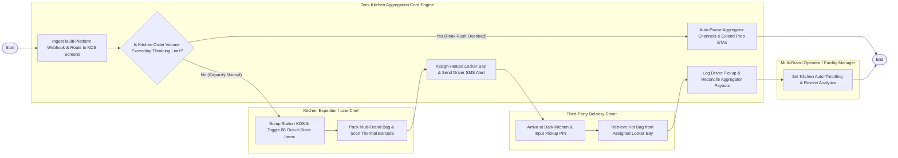

# Swimlane Diagram — Dark Kitchen Order Aggregation System

## Mermaid Code

## Flow Description | Mo ta luong

| Lane | Actor | Role in Flow |
|------|-------|-------------|
| **Lane 1** | Kitchen Expediter / Line Chef | Cooks prep station items, bumps KDS screens, toggles 86 out-of-stock items, packs multi-brand bags, and scans thermal sticky barcodes. |
| **Lane 2** | Multi-Brand Operator / Facility Manager | Configures kitchen surge auto-throttling rules, manages virtual brand profiles, and reviews channel revenue analytics. |
| **Lane 3** | Third-Party Delivery Driver | Tracks GPS arrival ETAs, arrives at dark kitchen pickup window, inputs PIN at locker bay, and retrieves hot food bags. |
| **Lane 4** | Dark Kitchen Aggregation Core Engine | Ingests multi-platform order webhooks, routes tickets to KDS screens, auto-throttles peak rushes, assigns locker bays, and dispatches driver SMS alerts. |

### Process Execution Steps | Cac buoc thuc hien quy trinh

1. **Order Ingestion & Throttling Evaluation**: Core Engine ingests multi-platform webhook orders (DoorDash, UberEats) and checks kitchen cooking capacity (`S1`, `S2`).
   - If **Yes (Peak Rush Overload)**: Core Engine auto-pauses aggregator channels and extends prep ETAs (`S3`), preventing kitchen crashes.
   - If **No (Capacity Normal)**: Core Engine routes normalized tickets to KDS station screens.
2. **Prep & Packaging**: Line Chefs cook items, bump KDS screens (`C1`), pack multi-brand bags, and scan thermal sticky barcodes (`C2`).
3. **Locker Bay Assignment & Driver Pickup**: Core Engine assigns heated pickup locker bay and sends driver SMS PIN (`S4`). Delivery Driver arrives, enters PIN (`V1`), and retrieves hot food bag from locker (`V2`).
4. **Pickup Logging & Financial Settlement**: Core Engine logs driver pickup timestamp, updates aggregator API status, and reconciles channel payouts (`S5`). Facility Manager reviews analytics (`M1`), completing execution (`Finish`).
