# Action Tree — Dark Kitchen Order Aggregation System

## Mermaid Code

```mermaid
graph TD
    Root["Dark Kitchen Order Aggregation System"]

    Root --> M1["Multi-Platform Order Ingestion & Aggregation"]
    Root --> M2["Multi-Brand Virtual Menu & 86 Item Syncing"]
    Root --> M3["KDS Routing & Station Line Printing"]
    Root --> M4["Kitchen Throttling & Surge Capacity Control"]
    Root --> M5["Bagging, Thermal Tagging & Driver Dispatch"]
    Root --> M6["Channel Payout Reconciliation & Cancellation Refunds"]
    Root --> M7["Dark Kitchen Analytics & System Administration"]

    M1 --> A11["Ingest Real-Time Order Webhooks DoorDash UberEats Deliveroo"]
    M1 --> A12["Normalize Channel JSON Structures into Unified Kitchen Schema"]
    M1 --> A13["Assign Global Kitchen Ticket Sequence Numbers"]
    M1 --> A14["Acknowledge Webhook Ingestion within 500 Milliseconds"]

    M2 --> A21["Toggle Ingredient 86 Out-of-Stock Across All Channels"]
    M2 --> A22["Publish Multi-Brand Menu Prices and Modifier Groups"]
    M2 --> A23["Map Internal Product SKUs to External Aggregator SKUs"]
    M2 --> A24["Configure Virtual Restaurant Brand Operating Hours"]

    M3 --> A31["Route Order Items to Grill Fryer and Packaging KDS Screens"]
    M3 --> A32["Print Thermal Sticky Tickets with Brand Logos and Modifiers"]
    M3 --> A33["Synchronize Prep Timers for Simultaneous Hot Plating"]
    M3 --> A34["Color-Code KDS Ticket Urgency Green Yellow Red"]

    M4 --> A41["Monitor Active Cooking Order Volume in 10-Minute Windows"]
    M4 --> A42["Auto-Pause Delivery Channels During Peak Kitchen Surge"]
    M4 --> A43["Dynamically Extend Prep ETAs on Aggregator Platforms"]
    M4 --> A44["Set Station Prep Capacity Limits per Virtual Brand"]

    M5 --> A51["Print Multi-Brand Thermal Bag Tags with Tamper Seals"]
    M5 --> A52["Assign Completed Orders to Heated or Chilled Locker Bays"]
    M5 --> A53["Dispatch Automated SMS and PIN Codes to Courier Drivers"]
    M5 --> A54["Scan Barcodes at Final Packaging Station and Locker Bay"]

    M6 --> A61["Ingest Order Cancellation Webhooks and Auto-Bump KDS"]
    M6 --> A62["Reconcile Weekly Net Payouts and Channel Commissions"]
    M6 --> A63["Track Delivery Platform Error Adjustments and Refund Claims"]
    M6 --> A64["Export Consolidated Financial Settlement Ledgers"]

    M7 --> A71["Monitor Dark Kitchen Gross Merchandise Value GMV Revenue"]
    M7 --> A72["Analyze Prep Time Speed Driver Wait Times and Bottlenecks"]
    M7 --> A73["Manage Security Roles Expediter Manager Admin"]
    M7 --> A74["Manage Channel Webhook Keys and Printer IP Settings"]
```

## Module Description | Mo ta Module

| # | Module | Description | Actions |
|---|--------|-------------|---------|
| 1 | Multi-Platform Order Ingestion & Aggregation | Ingests order webhooks from DoorDash, UberEats, Deliveroo, and Grubhub, normalizing payloads into a single unified schema within 500ms. | Ingest Real-Time Order Webhooks DoorDash UberEats Deliveroo, Normalize Channel JSON Structures into Unified Kitchen Schema, Assign Global Kitchen Ticket Sequence Numbers, Acknowledge Webhook Ingestion within 500 Milliseconds |
| 2 | Multi-Brand Virtual Menu & 86 Item Syncing | Controls central menu publishing, SKU mapping across brands, and single-tap 86 out-of-stock toggles across all delivery channels. | Toggle Ingredient 86 Out-of-Stock Across All Channels, Publish Multi-Brand Menu Prices and Modifier Groups, Map Internal Product SKUs to External Aggregator SKUs, Configure Virtual Restaurant Brand Operating Hours |
| 3 | KDS Routing & Station Line Printing | Routes order items to KDS prep screens (Grill, Fryer, Assembly), prints sticky thermal tickets, color-codes urgency, and syncs prep timers. | Route Order Items to Grill Fryer and Packaging KDS Screens, Print Thermal Sticky Tickets with Brand Logos and Modifiers, Synchronize Prep Timers for Simultaneous Hot Plating, Color-Code KDS Ticket Urgency Green Yellow Red |
| 4 | Kitchen Throttling & Surge Capacity Control | Monitors order influx per 10-minute window, auto-pauses aggregator channels during surges, and dynamically extends prep ETAs. | Monitor Active Cooking Order Volume in 10-Minute Windows, Auto-Pause Delivery Channels During Peak Kitchen Surge, Dynamically Extend Prep ETAs on Aggregator Platforms, Set Station Prep Capacity Limits per Virtual Brand |
| 5 | Bagging, Thermal Tagging & Driver Dispatch | Prints thermal sticky bag labels, assigns orders to heated/chilled locker bays, dispatches SMS PIN alerts to couriers, and scans barcodes. | Print Multi-Brand Thermal Bag Tags with Tamper Seals, Assign Completed Orders to Heated or Chilled Locker Bays, Dispatch Automated SMS and PIN Codes to Courier Drivers, Scan Barcodes at Final Packaging Station and Locker Bay |
| 6 | Channel Payout Reconciliation & Cancellation Refunds | Ingests cancellation webhooks, reconciles weekly aggregator payouts, tracks platform commission fees (15%-30%), and manages error adjustments. | Ingest Order Cancellation Webhooks and Auto-Bump KDS, Reconcile Weekly Net Payouts and Channel Commissions, Track Delivery Platform Error Adjustments and Refund Claims, Export Consolidated Financial Settlement Ledgers |
| 7 | Dark Kitchen Analytics & System Administration | Displays executive dashboards on dark kitchen GMV, average prep time, driver wait times, station bottlenecks, security roles, and webhooks. | Monitor Dark Kitchen Gross Merchandise Value GMV Revenue, Analyze Prep Time Speed Driver Wait Times and Bottlenecks, Manage Security Roles Expediter Manager Admin, Manage Channel Webhook Keys and Printer IP Settings |
