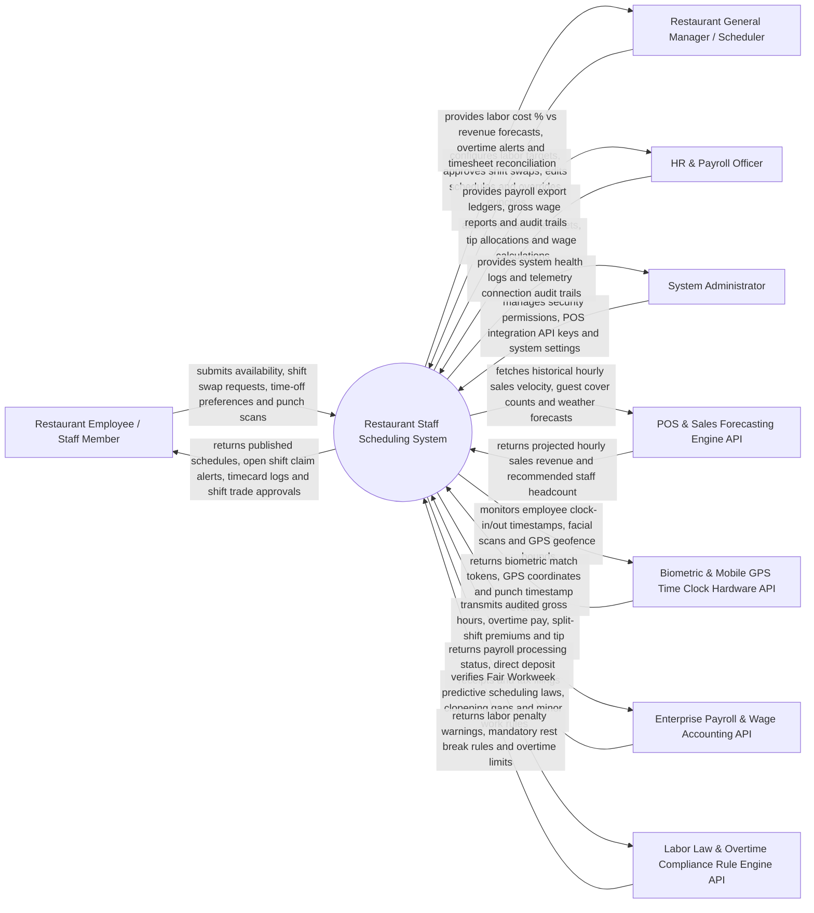

# Context Diagram — Restaurant Staff Scheduling System

## Mermaid Code

## Actor & Interaction Table | Bang Actor & Tuong tac

| # | Actor | Actor Type | Data Sent TO System | Data Received FROM System | Notes |
|---|-------|------------|---------------------|---------------------------|-------|
| 1 | Restaurant Employee / Staff Member | Primary | Weekly availability patterns, time-off requests, peer shift swap submissions, GPS/biometric clock punches | Published shift schedules, open shift availability notifications, shift trade statuses, personal timecards | Front-of-House (Servers, Hosts, Bartenders) and Back-of-House (Chefs, Line Cooks, Dishwashers) staff. |
| 2 | Restaurant General Manager | Primary | Target labor cost % limits (e.g., 28%), schedule edits, shift swap approvals, punch variance overrides | Labor cost % vs revenue forecast, real-time overtime alerts, Fair Workweek violation warnings | Restaurant GM, Floor Manager, or Kitchen Manager building weekly shift rosters. |
| 3 | HR & Payroll Officer | Primary | Payroll period parameters, wage rate adjustments, tax exemption updates, tip pooling rules | Verified timesheet ledgers, gross pay calculations, overtime penalty logs, payroll export files | HR specialist or payroll accountant finalizing wages for payment. |
| 4 | System Administrator | Primary | Security access credentials, POS API tokens, time clock hardware IP settings, platform configuration | System health logs, API webhook latency, biometric hardware telemetry logs | Manages IT infrastructure, user security permissions, and hardware integrations. |
| 5 | POS & Sales Forecasting Engine API | Supporting | Historical hourly sales revenue, guest cover counts, table turnover speed, weather forecasts | Labor demand forecast queries, staffing requirement calculations, sales telemetry | Cloud POS system (Toast, Square, Aloha) providing real-time sales telemetry. |
| 6 | Biometric & Mobile GPS Time Clock API | Supporting | Employee facial recognition scans, PIN punch events, mobile GPS location coordinates | Clock-in authorization tokens, geofence radius checks, early punch restriction locks | Tablet time clock hardware or mobile app enforcing geofenced punch-ins. |
| 7 | Enterprise Payroll & Wage API | Supporting | Direct deposit clearance receipts, tax withholding tables, pay stub confirmations | Audited timesheet payloads, regular vs overtime hours, split-shift premium pay totals | External payroll platform (ADP, Gusto, Paychex, Workday) executing wage payments. |
| 8 | Labor Law & Compliance Engine API | Supporting | State/Federal labor laws (FLSA), Fair Workweek predictive scheduling rules, minor hour limits | Predictive scheduling penalty warnings, mandatory meal break rules, overtime limits | Legal engine enforcing labor compliance (e.g., California 8-hour daily overtime, NYC Fair Workweek). |

## System Boundary Description | Mo ta Pham vi He thong

The **Restaurant Staff Scheduling System** manages AI-driven demand-based labor scheduling, POS sales velocity forecasting, Fair Workweek predictive scheduling compliance, employee shift swapping, geofenced mobile GPS/biometric time clocking, meal/rest break compliance, overtime prevention alerting, and payroll timesheet reconciliation. Inside its boundary, the system handles hourly labor demand forecasting, staff availability mapping, automated shift roster generation, peer-to-peer shift trade workflows, open shift broadcasts, biometric/GPS clock-in validation, clopening rest gap enforcement (minimum 11 hours between shifts), split-shift premium calculations, punch variance reconciliation, and payroll data export.

The system boundary excludes physical cooking of food, physical serving of guests, raw credit card processing, and government tax code legislation.
