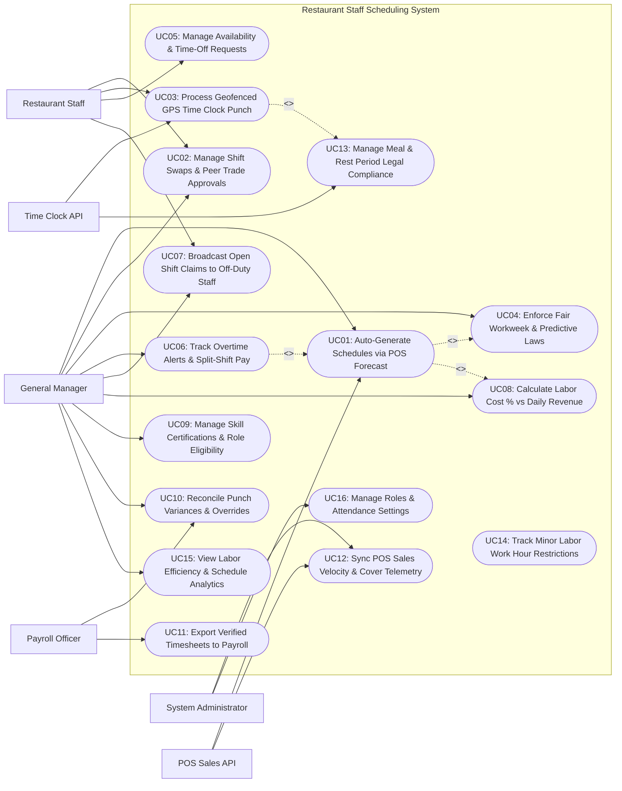

# Use Case Diagram — Restaurant Staff Scheduling System

## Mermaid Code

## Actor Table | Bang Actor

| # | Actor | Actor Type | Role Description | Related Use Cases |
|---|-------|------------|------------------|-------------------|
| 1 | POS Sales API | Secondary System | Cloud POS engine transmitting historical hourly sales revenue, cover counts, and weather forecasts. | UC01, UC12 |
| 2 | Time Clock API | Secondary System | Tablet hardware and mobile app capturing facial recognition scans, PIN inputs, and GPS geofence coordinates. | UC03, UC13 |
| 3 | Restaurant Staff | Primary | Restaurant employee (Server, Cook, Bartender, Host) viewing schedules, clocking in/out, submitting time-off, and trading shifts. | UC02, UC03, UC05, UC07 |
| 4 | General Manager | Primary | Restaurant manager creating rosters, approving shift swaps, monitoring labor cost %, overriding punch variances, and enforcing compliance. | UC01, UC02, UC04, UC06, UC07, UC08, UC09, UC10, UC15 |
| 5 | Payroll Officer | Primary | HR/Payroll accountant auditing verified timecards, approving overtime premiums, and exporting payroll data to external wage systems. | UC10, UC11 |
| 6 | System Administrator | Primary | Technical manager configuring security access roles, POS/Payroll API integration keys, geofence radius settings, and audit logs. | UC12, UC16 |

## Use Case Table | Bang Use Case

| # | UC ID | Use Case Name | Primary Actor | Secondary Actor | Description | Priority |
|---|-------|---------------|---------------|-----------------|-------------|----------|
| 1 | UC01 | Auto-Generate Schedules via POS Forecast | General Manager | POS Sales API | Generates optimized weekly shift rosters based on POS historical sales velocity, projected covers, labor cost targets, and staff availability. | High |
| 2 | UC02 | Manage Shift Swaps & Peer Trade Approvals | Restaurant Staff | General Manager | Enables staff to initiate peer-to-peer shift swaps or giveaways, requiring manager approval and compliance checks. | High |
| 3 | UC03 | Process Geofenced GPS Time Clock Punch | Restaurant Staff | Time Clock API | Captures clock-in/out timestamps via mobile GPS geofencing or tablet facial recognition, locking early punches outside 5-minute buffer. | High |
| 4 | UC04 | Enforce Fair Workweek & Predictive Laws | General Manager | None | Audits schedules against Fair Workweek laws, enforcing 14-day advance notice, premium pay for schedule edits, and 11-hour "clopening" rest gaps. | High |
| 5 | UC05 | Manage Availability & Time-Off Requests | Restaurant Staff | None | Allows staff to define recurring weekly un-availability windows and submit paid/unpaid time-off requests for manager approval. | High |
| 6 | UC06 | Track Overtime Alerts & Split-Shift Pay | General Manager | None | Flags real-time overtime warnings (e.g., Approaching 40 hrs/week or 8 hrs/day) and automatically calculates split-shift premium pay. | High |
| 7 | UC07 | Broadcast Open Shift Claims to Off-Duty Staff | General Manager | Restaurant Staff | Broadcasts unfilled open shift notifications to eligible off-duty staff members on a first-come, first-served or manager-approved basis. | Medium |
| 8 | UC08 | Calculate Labor Cost % vs Daily Revenue | General Manager | None | Computes projected daily and weekly labor cost percentages (Labor Cost / Sales Revenue) against target budget limits (e.g., 28.0%). | High |
| 9 | UC09 | Manage Skill Certifications & Role Eligibility | General Manager | None | Tracks employee job role qualifications (Head Bartender, Lead Grill Cook) and mandatory certifications (ServSafe, Food Handler, TABC Alcohol). | Medium |
| 10 | UC10 | Reconcile Punch Variances & Overrides | Payroll Officer | General Manager | Reconciles missed punches, late clock-ins, and early departures, requiring manager digital signature overrides for timesheet auditing. | High |
| 11 | UC11 | Export Verified Timesheets to Payroll | Payroll Officer | None | Exports audited timesheet data containing regular hours, overtime hours, split-shift premiums, tip pools, and gross pay to external payroll APIs. | High |
| 12 | UC12 | Sync POS Sales Velocity & Cover Telemetry | System Admin | POS Sales API | Synchronizes real-time hourly sales data, guest cover counts, and table turnover rates from POS terminals to refine labor demand models. | High |
| 13 | UC13 | Manage Meal & Rest Period Legal Compliance | Restaurant Staff | Time Clock API | Enforces mandatory 30-minute unpaid meal breaks and 10-minute paid rest breaks based on total shift length, logging break compliance. | High |
| 14 | UC14 | Track Minor Labor Work Hour Restrictions | General Manager | None | Enforces strict legal work hour limits for minor employees under 18 years old (e.g., Max 8 hrs/day, no shifts past 10:00 PM on school nights). | High |
| 15 | UC15 | View Labor Efficiency & Schedule Analytics | General Manager | None | Displays analytical dashboards on Sales Per Labor Hour (SPLH), schedule adherence %, overtime leakage, and labor cost variance. | High |
| 16 | UC16 | Manage Roles & Attendance Settings | System Admin | None | Configures user security access roles, time clock geofence radius (e.g., 100 meters), grace period buffers, and audit logging parameters. | High |

## Use Case Specification | Dac ta Use Case

---

### UC01 — Auto-Generate Schedules via POS Forecast

| Field | Detail |
|-------|--------|
| **UC ID** | UC01 |
| **Use Case Name** | Auto-Generate Schedules via POS Forecast |
| **Actor(s)** | Primary: General Manager   Secondary: POS Sales API |
| **Description** | Generates an optimized, compliant weekly restaurant shift schedule using machine learning algorithms that analyze historical POS hourly sales velocity, projected guest cover counts, target labor cost percentages, staff availability, and legal labor constraints. |
| **Precondition** | 1. POS sales velocity data (UC12) for past 8 weeks is ingested.   2. Target labor cost percentage budget (e.g., 28.0%) and staff availability (UC05) are configured. |
| **Main Flow** | 1. General Manager opens "Auto-Schedule Generator" for upcoming week (August 10 - August 16).   2. Manager selects Schedule Optimization Goals:      - Target Labor Cost Percentage: `28.0% of Projected Sales`      - Projected Weekly Sales Revenue (from POS Forecast): `$45,000.00` -> Allowable Weekly Labor Budget = `$12,600.00`      - Priority: `Minimize Overtime & Eliminate Clopening Shifts`.   3. Manager clicks "Generate AI Shift Roster".   4. System queries POS Sales Forecast API for hourly sales curves:      - Friday Dinner Peak (6:00 PM - 9:00 PM): Projected Sales = $2,800/hr -> Required Staff = 8 Servers, 2 Bartenders, 4 Line Cooks, 2 Dishwashers.   5. System matches labor demand against Employee Availability (UC05), Job Qualifications (UC09), and Labor Laws (UC04/UC14).   6. System generates 142 individual shift slots across Front-of-House and Back-of-House:      - Total Scheduled Labor Cost: `$12,180.00` (Projected Labor Cost % = **27.06%** -> Below 28.0% Target)      - Overtime Hours: `0.0 Hours`      - Fair Workweek Compliance Score: `100% (No clopening shifts / 14-day advance notice)`.   7. Manager reviews visual schedule grid, makes minor manual adjustments, and clicks "Publish & Broadcast Schedule".   8. System dispatches mobile push notifications and emails to all scheduled staff members, making shifts visible in employee apps. |
| **Alternative Flow** | **AF1** — Weather-driven labor demand adjustment:   1. POS weather integration predicts heavy rainstorm on Saturday.   2. System auto-reduces patio server shift slots by 30%, adjusting labor budget accordingly. |
| **Exception Flow** | **EX1** — Un-fillable shift slot due to staff availability deficit:   1. Saturday night requires 3 Lead Bartenders, but only 2 are available.   2. System flags red schedule warning "STAFFING SHORTAGE: Lead Bartender role under-staffed by 1 slot", prompting manager to broadcast open shift (UC07). |
| **Postcondition** | Weekly shift schedule is auto-generated within budget targets, Fair Workweek rules are satisfied, and schedule is published to staff. |
| **Business Rule** | **BR1**: Auto-generated schedules MUST NOT exceed the target labor cost percentage threshold configured by management.   **BR2**: Schedules MUST be published at least 14 days in advance to comply with municipal Fair Workweek predictive scheduling laws. |

---

### UC02 — Manage Shift Swaps & Peer Trade Approvals

| Field | Detail |
|-------|--------|
| **UC ID** | UC02 |
| **Use Case Name** | Manage Shift Swaps & Peer Trade Approvals |
| **Actor(s)** | Primary: Restaurant Staff, General Manager   Secondary: None |
| **Description** | Enables restaurant employees to initiate peer-to-peer shift swaps or shift giveaways through their mobile app, automatically evaluating role eligibility, overtime impact, and labor law compliance prior to manager approval. |
| **Precondition** | 1. Employee holds a published shift assignment on an active schedule.   2. Peer employee is active and holds required job role qualification. |
| **Main Flow** | 1. Server Sarah holds a Friday 5:00 PM - 11:00 PM shift (6 Hours) but needs time off for a family event.   2. Sarah opens "Shift Trade Center" on her mobile app, selects her Friday shift, and taps "Request Peer Swap".   3. System presents list of eligible off-duty peers who hold the "Server" role qualification (UC09) and are available on Friday evening.   4. Sarah selects peer Server Mark and submits trade request.   5. Mark receives mobile push notification: "Sarah wants to trade her Friday 5:00 PM shift with you. Accept?"   6. Mark taps "Accept Trade Request".   7. System executes **Automated Trade Compliance Check**:      - Qualification Check: Mark is a certified Server -> `PASSED`      - Overtime Check: Adding 6 hours to Mark's weekly total (34.0 hrs -> 40.0 hrs) does NOT trigger overtime -> `PASSED`      - Clopening Check: Mark is scheduled Saturday at 11:00 AM (12 hours rest after Friday 11:00 PM shift) -> `PASSED`      - Fair Workweek Edit Penalty Check -> `NO PENALTY (Voluntary Peer Trade)`.   8. System dispatches Manager Approval Request ticket to General Manager console: **Shift Swap Request: Sarah -> Mark (Friday 5:00 PM Server Shift) — Compliance Checked: PASSED**.   9. General Manager reviews request and taps "Approve Swap".   10. System updates master schedule roster instantly, moving Friday shift to Mark's timecard, updating mobile apps for both employees, and sending confirmation push notifications. |
| **Alternative Flow** | **AF1** — Open shift giveaway (No swap back):   1. Sarah gives away shift to Mark without taking a shift in return.   2. System updates Mark's hours and removes shift from Sarah. |
| **Exception Flow** | **EX1** — Overtime breach rejection:   1. Accepting Friday shift would push Mark's weekly total to 44.0 hours (4 hours Overtime).   2. System flags warning **OVERTIME RISK: Trade will incur 4.0 hours overtime pay**, requiring explicit Manager Overtime Override before approval. |
| **Postcondition** | Shift trade is validated for qualification and overtime risk, approved by manager, and master roster is updated. |
| **Business Rule** | **BR1**: Peer shift swaps MUST NOT be finalized until automated compliance checks verify role eligibility, overtime risk, and rest gaps.   **BR2**: Voluntary peer-to-peer shift trades executed by employees MUST NOT trigger employer Fair Workweek schedule change penalty pay. |

---

### UC03 — Process Geofenced GPS Time Clock Punch

| Field | Detail |
|-------|--------|
| **UC ID** | UC03 |
| **Use Case Name** | Process Geofenced GPS Time Clock Punch |
| **Actor(s)** | Primary: Restaurant Staff   Secondary: Time Clock API |
| **Description** | Captures employee clock-in and clock-out punch events via mobile GPS geofencing or tablet biometric facial recognition, enforcing grace period buffers (e.g., 5 minutes) to prevent early unauthorized clock-ins. |
| **Precondition** | 1. Staff member is scheduled for a shift (or possesses open punch approval).   2. Restaurant GPS geofence radius (e.g., 100 meters) or tablet clock hardware is active. |
| **Main Flow** | 1. Line Cook Alex arrives at the restaurant for his scheduled 11:00 AM shift.   2. At 10:56 AM (4 minutes prior to shift), Alex opens "Mobile Time Clock" on his smartphone and taps "Clock In".   3. System checks Mobile Device GPS Location Coordinates against Restaurant Address Geofence:      - Distance: 25 meters from restaurant entrance (Radius Limit: 100 meters) -> `GEOFENCE PASSED`.   4. System checks Scheduled Shift Start Time (11:00 AM) against Punch Attempt Time (10:56 AM):      - Grace Period Buffer: Allowed within 5 minutes prior to shift -> `PUNCH WINDOW PASSED`.   5. System logs Punch In Event: `Employee: Alex M. | Role: Line Cook | Time: 10:56 AM | Status: CLOCKED_IN | Method: Mobile GPS Geofence`.   6. System displays success screen: **Clocked In Successfully at 10:56 AM for Line Cook Shift**.   7. At shift end (7:00 PM), Alex walks to Manager Office Tablet, scans his face via Biometric Facial Recognition Camera (Time Clock API), and taps "Clock Out".   8. Tablet verifies facial match token (`99.8% Match`), prompts Alex: "Did you take your mandatory 30-minute unpaid meal break today?", Alex checks "Yes".   9. System records Clock Out Event (7:01 PM), computes Net Shift Hours (`8.0 Hours Paid / 0.5 Hours Break`), and updates daily timecard ledger. |
| **Alternative Flow** | **AF1** — Clocking in on restaurant POS terminal:   1. Staff inputs 4-digit PIN on Toast POS terminal.   2. POS terminal verifies PIN and punches employee in for scheduled job code. |
| **Exception Flow** | **EX1** — Early clock-in restriction lock (> 5 mins early):   1. Staff attempts to clock in at 10:45 AM (15 minutes early for 11:00 AM shift without authorization).   2. System locks clock-in button: **EARLY PUNCH RESTRICTED: Scheduled start is 11:00 AM. Clock-in opens at 10:55 AM (or request Manager Override).** |
| **Postcondition** | Geofence and punch buffer checks pass, clock-in/out timestamps are recorded, and net shift hours are updated on timecard. |
| **Business Rule** | **BR1**: Mobile GPS clock-ins MUST be rejected if the employee device is outside the mandatory 100-meter restaurant geofence boundary.   **BR2**: Clock-ins attempted more than 5 minutes prior to scheduled shift start MUST be blocked unless digitally overridden by a manager. |

---

### UC04 — Enforce Fair Workweek & Predictive Laws

| Field | Detail |
|-------|--------|
| **UC ID** | UC04 |
| **Use Case Name** | Enforce Fair Workweek & Predictive Laws |
| **Actor(s)** | Primary: General Manager   Secondary: None |
| **Description** | Continuously audits schedules and real-time roster edits against municipal Fair Workweek predictive scheduling laws, calculating mandatory employer penalty pay for late schedule changes and enforcing 11-hour rest gaps between shifts. |
| **Precondition** | 1. Restaurant operates in a Fair Workweek jurisdiction (e.g., New York City, Chicago, Seattle, Philadelphia, California).   2. Predictive scheduling ruleset parameters are active in system settings (UC16). |
| **Main Flow** | 1. General Manager opens active schedule for current week (published 10 days ago).   2. Manager needs to add an extra dinner server shift on Friday due to unexpected catering booking.   3. Manager attempts to add a new 5:00 PM - 11:00 PM shift for Server David with 3 days advance notice (less than the 14-day advance notice requirement).   4. System triggers **Fair Workweek Compliance Engine Audit**:      - Audit 1: Advance Notice Check -> Schedule edit performed with 3 days notice (< 14 days required) -> `PREDICTIVE PAY PENALTY APPLIES`      - Audit 2: Schedule Change Premium Pay Calculation -> Required Employer Penalty Pay = `$15.00 Predictability Pay`      - Audit 3: "Clopening" Rest Gap Check -> David worked Thursday late night (closed at 12:30 AM); Friday shift starts at 5:00 PM (16.5 hours rest >= 11 hours required) -> `REST GAP PASSED`.   5. System presents **Fair Workweek Warning Modal** to Manager:      - **WARNING: Adding this shift with < 14 days notice incurs a $15.00 Predictability Pay Penalty to the employee.**      - Option A: Confirm Shift Edit & Accept $15.00 Penalty      - Option B: Broadcast as Voluntary Open Shift (No Penalty if employee voluntarily claims - UC07).   6. Manager selects Option B (Broadcast Voluntary Open Shift).   7. System broadcasts open shift to eligible staff (UC07); Server David voluntarily claims shift.   8. System logs voluntary claim tag, waiving predictability pay penalty while maintaining full legal audit trails. |
| **Alternative Flow** | **AF1** — "Clopening" rest gap violation block (< 11 hours rest):   1. Manager attempts to schedule Server Lisa for Friday Close (11:30 PM end) AND Saturday Open (7:00 AM start) -> Only 7.5 hours rest.   2. System flags severe violation **ILLEGAL CLOPENING SHIFT: Only 7.5 hrs rest (< 11 hrs limit). Incurs $100.00 Clopening Penalty Pay.** |
| **Exception Flow** | **EX1** — Emergency cancellation predictability penalty:   1. Manager cuts a server shift 2 hours prior to start due to slow business.   2. System automatically calculates 50% shift wage cancellation penalty pay ($45.00) credited to employee timecard. |
| **Postcondition** | Schedule edits are audited for predictive pay penalties, clopening rest gaps are enforced, and legal compliance logs update. |
| **Business Rule** | **BR1**: Employer-initiated schedule changes made within 14 days of shift start MUST trigger mandatory predictability pay penalties per local laws.   **BR2**: Shifts scheduled with less than 11 hours rest between end of previous shift and start of next ("Clopening") MUST be flagged with mandatory premium pay. |

---

### UC06 — Track Overtime Alerts & Split-Shift Pay

| Field | Detail |
|-------|--------|
| **UC ID** | UC06 |
| **Use Case Name** | Track Overtime Alerts & Split-Shift Pay |
| **Actor(s)** | Primary: General Manager   Secondary: None |
| **Description** | Monitors real-time weekly work hours and daily shift configurations, triggering early warning alerts before staff exceed overtime limits (40 hrs/week or 8 hrs/day) and automatically calculating split-shift premium pay. |
| **Precondition** | 1. State labor law overtime rules (e.g., Federal FLSA 40 hr/week; California 8 hr/day + 40 hr/week) are configured.   2. Active timecard punch data is live. |
| **Main Flow** | 1. General Manager opens "Real-Time Overtime & Labor Cost Dashboard" on Friday afternoon.   2. System monitors active clock-in hours and scheduled remaining shifts for all staff for the current work week.   3. System identifies 2 employees approaching overtime thresholds:      - Line Cook Carlos: Active Hours = 36.5 hrs | Scheduled Saturday Shift = 8.0 hrs -> Projected Total = **44.5 hrs (4.5 hrs Overtime)**      - Server Jessica: Worked 9.5 hours today -> Triggers **1.5 hrs Daily Overtime (California 8-hr rule)**.   4. System triggers **HIGH-PRIORITY OVERTIME WARNING ALERT**:      - Sends push notification to GM tablet: **OVERTIME ALERT: Cook Carlos will incur 4.5 hrs OT ($135.00 extra cost) if Saturday shift is worked as scheduled.**   5. Manager clicks "Resolve Overtime Warning" for Carlos:      - Option 1: Re-assign 4.5 hours of Carlos's Saturday shift to an off-duty part-time cook (0 hrs OT)      - Option 2: Approve Overtime Pay.   6. Manager selects Option 1 (Re-assign shift to off-duty cook).   7. System updates Saturday schedule, removing 4.5 hours from Carlos and assigning to part-time cook, saving $135.00 in overtime leakage.   8. Simultaneously, System detects Server Maria is working a Split Shift today (Lunch 11:00 AM - 2:00 PM [3 hrs] AND Dinner 5:00 PM - 10:00 PM [5 hrs] with a 3-hour unpaid afternoon gap).   9. System automatically calculates State Split-Shift Premium Pay (1 hour extra pay at minimum wage = `$16.00 Split-Shift Premium`) and appends item to Maria's daily timecard. |
| **Alternative Flow** | **AF1** — Double time calculation (> 12 hours daily):   1. Dishwasher works 13.0 hours in a single day during emergency catering event.   2. System calculates 8 hrs Regular Pay + 4 hrs Overtime (1.5x) + 1 hr Double Time (2.0x). |
| **Exception Flow** | **EX1** — Un-authorized overtime clock-out:   1. Server stays clocked in 45 minutes past shift end without manager approval, pushing week to 40.75 hours.   2. System flags "UNAPPROVED OVERTIME PUNCH", requiring GM audit signature while maintaining legal wage calculations. |
| **Postcondition** | Overtime risk is flagged before occurrence, shift re-assignments prevent wage leakage, and split-shift premiums are automatically computed. |
| **Business Rule** | **BR1**: System MUST flag overtime warnings at least 24 hours prior to shift execution to allow managers to re-assign hours.   **BR2**: Split-shift configurations (interrupted workday with > 1 hour unpaid gap) MUST automatically calculate statutory split-shift premium pay. |
