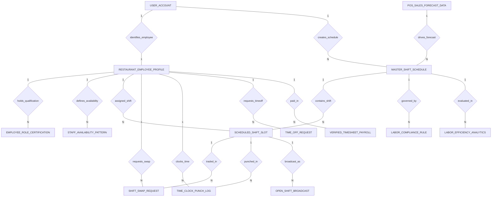

# Conceptual ERD — Restaurant Staff Scheduling System

## Mermaid Code

## Entity Description Table | Bang mo ta Entity

| # | Entity Name | Vietnamese Name | Description | Key Attributes | Main Relationships |
|---|-------------|-----------------|-------------|----------------|-------------------|
| 1 | RESTAURANT_EMPLOYEE_PROFILE | Ho so nhan vien nha hang | Employee master record, employee number, name, primary job role, hourly pay rate, minor status, and user ID. | employee_id, user_id, employee_number, primary_job_role, hourly_pay_rate, is_minor | Belongs to USER_ACCOUNT; One-to-Many with EMPLOYEE_ROLE_CERTIFICATION, STAFF_AVAILABILITY_PATTERN, SCHEDULED_SHIFT_SLOT, SHIFT_SWAP_REQUEST, TIME_CLOCK_PUNCH_LOG, TIME_OFF_REQUEST, VERIFIED_TIMESHEET_PAYROLL |
| 2 | EMPLOYEE_ROLE_CERTIFICATION | Chung chi va bang cap nhan vien | Job qualifications and mandatory certifications (ServSafe, TABC Alcohol, Food Handler), license #, issue/expiry dates. | cert_id, employee_id, certification_name, cert_license_number, expiry_date, is_active | Belongs to RESTAURANT_EMPLOYEE_PROFILE |
| 3 | STAFF_AVAILABILITY_PATTERN | Lich ranh ca nhan vien | Weekly recurring availability pattern, day of week, available start/end times, and recurring boolean. | availability_id, employee_id, day_of_week, available_start_time, available_end_time, is_recurring | Belongs to RESTAURANT_EMPLOYEE_PROFILE |
| 4 | POS_SALES_FORECAST_DATA | Du bao doanh thu POS | Hourly sales forecast data ingested from POS API, forecast date, hour of day, projected sales $, projected covers, recommended staff count. | forecast_id, forecast_date, hour_of_day, projected_sales_amount, projected_guest_covers, recommended_staff_count | One-to-Many with MASTER_SHIFT_SCHEDULE |
| 5 | MASTER_SHIFT_SCHEDULE | Lich lam viec master hang tuan | Master weekly schedule roster, week start/end dates, target labor cost %, projected labor cost $, and schedule status. | schedule_id, week_start_date, week_end_date, target_labor_cost_pct, projected_labor_cost, schedule_status | Belongs to USER_ACCOUNT, POS_SALES_FORECAST_DATA; One-to-Many with SCHEDULED_SHIFT_SLOT, LABOR_COMPLIANCE_RULE, LABOR_EFFICIENCY_ANALYTICS |
| 6 | SCHEDULED_SHIFT_SLOT | Ca lam viec duoc phan cong | Individual shift slot on a schedule, schedule ID, employee ID, job code role, shift start/end times, scheduled hours, and publication status. | shift_id, schedule_id, employee_id, job_code_role, shift_start_time, shift_end_time, is_published | Belongs to MASTER_SHIFT_SCHEDULE, RESTAURANT_EMPLOYEE_PROFILE; One-to-Many with SHIFT_SWAP_REQUEST, TIME_CLOCK_PUNCH_LOG, OPEN_SHIFT_BROADCAST |
| 7 | SHIFT_SWAP_REQUEST | Yeu cau doi ca nhan vien | Peer-to-peer shift swap or giveaway request, shift ID, requester ID, recipient ID, timestamp, and manager approval status. | swap_id, shift_id, requester_employee_id, recipient_employee_id, request_timestamp, manager_approval_status | Belongs to SCHEDULED_SHIFT_SLOT, RESTAURANT_EMPLOYEE_PROFILE |
| 8 | TIME_CLOCK_PUNCH_LOG | Nhat ky cham cong GPS biometrics | Real-time time clock punch log, shift ID, employee ID, clock in/out times, GPS latitude/longitude, and punch method (Geofence/Facial/POS). | punch_id, shift_id, employee_id, clock_in_time, clock_out_time, gps_latitude, punch_method | Belongs to SCHEDULED_SHIFT_SLOT, RESTAURANT_EMPLOYEE_PROFILE |
| 9 | TIME_OFF_REQUEST | Yeu cau nghi phep nhan vien | Paid or unpaid time-off request submitted by employee, start/end dates, time-off type (Vacation/Sick/Personal), and approval status. | timeoff_id, employee_id, start_date, end_date, timeoff_type, approval_status | Belongs to RESTAURANT_EMPLOYEE_PROFILE |
| 10 | LABOR_COMPLIANCE_RULE | Quy tac tuan thu luat lao dong | Regulatory labor law ruleset (FLSA, Fair Workweek, Minor rules), jurisdiction code, max daily/weekly regular hours, clopening rest hours, notice days. | rule_id, jurisdiction_code, max_regular_daily_hours, min_rest_between_shifts_hrs, advance_notice_days | Belongs to MASTER_SHIFT_SCHEDULE |
| 11 | VERIFIED_TIMESHEET_PAYROLL | Bang luong duoc xac nhan | Audited timesheet payload for payroll processing, pay period end, regular hours, overtime hours, split-shift premiums $, and gross pay $. | timesheet_id, employee_id, pay_period_end, regular_hours, overtime_hours, gross_pay_usd | Belongs to RESTAURANT_EMPLOYEE_PROFILE |
| 12 | OPEN_SHIFT_BROADCAST | Thong bao ca nhan mo | Broadcast notification for unfilled open shifts dispatched to off-duty staff, broadcast timestamp, claim count, and status. | broadcast_id, shift_id, broadcast_sent_at, claim_count, broadcast_status | Belongs to SCHEDULED_SHIFT_SLOT |
| 13 | USER_ACCOUNT | Tai khoan he thong | Core security authentication account holding credentials, password hashes, and user role definitions. | user_id, username, password_hash, role_name | One-to-One with RESTAURANT_EMPLOYEE_PROFILE; One-to-Many with MASTER_SHIFT_SCHEDULE |
| 14 | LABOR_EFFICIENCY_ANALYTICS | Thong ke hieu qua chi phi lao dong | Executive daily analytics tracking actual labor cost %, Sales Per Labor Hour (SPLH), overtime leakage $, and schedule adherence %. | analytics_id, metric_date, actual_labor_cost_pct, sales_per_labor_hour, overtime_leakage_usd, schedule_adherence_pct | Evaluates MASTER_SHIFT_SCHEDULE |

## Relationship Description | Mo ta Quan he

| # | From Entity | Cardinality | To Entity | Relationship Label | Business Explanation |
|---|-------------|-------------|-----------|-------------------|----------------------|
| 1 | USER_ACCOUNT | One-to-One | RESTAURANT_EMPLOYEE_PROFILE | identifies_employee | Tai khoan he thong dinh danh ho so nhan vien nha hang. |
| 2 | RESTAURANT_EMPLOYEE_PROFILE | One-to-Many | EMPLOYEE_ROLE_CERTIFICATION | holds_qualification | Nhan vien so huu cac chung chi nghe nghiep va an toan thuc pham. |
| 3 | RESTAURANT_EMPLOYEE_PROFILE | One-to-Many | STAFF_AVAILABILITY_PATTERN | defines_availability | Nhan vien khai bao khung gio ranh co the di lam hang tuan. |
| 4 | RESTAURANT_EMPLOYEE_PROFILE | One-to-Many | SCHEDULED_SHIFT_SLOT | assigned_shift | Nhan vien duoc phan cong cac ca lam viec trong bang lich master. |
| 5 | MASTER_SHIFT_SCHEDULE | One-to-Many | SCHEDULED_SHIFT_SLOT | contains_shift | Bang lich master hang tuan chua danh sach cac ca lam viec chi tiet. |
| 6 | SCHEDULED_SHIFT_SLOT | One-to-Many | SHIFT_SWAP_REQUEST | traded_in | Ca lam viec duoc tao yeu cau doi ca giua hai nhan vien. |
| 7 | RESTAURANT_EMPLOYEE_PROFILE | One-to-Many | SHIFT_SWAP_REQUEST | requests_swap | Nhan vien gui yeu cau doi ca cho dong nghiep. |
| 8 | SCHEDULED_SHIFT_SLOT | One-to-Many | TIME_CLOCK_PUNCH_LOG | punched_in | Ca lam viec duoc ghi nhan cac luot quet gio vao va ra thuc te. |
| 9 | RESTAURANT_EMPLOYEE_PROFILE | One-to-Many | TIME_CLOCK_PUNCH_LOG | clocks_time | Nhan vien thuc hien quet gio qua khuon mat biometric hoac GPS geofence. |
| 10 | RESTAURANT_EMPLOYEE_PROFILE | One-to-Many | TIME_OFF_REQUEST | requests_timeoff | Nhan vien gui yeu cau xin nghi phep co luong hoac khong luong. |
| 11 | MASTER_SHIFT_SCHEDULE | One-to-Many | LABOR_COMPLIANCE_RULE | governed_by | Lich lam viec chiu su quan ly cua cac quy dinh luat lao dong va Fair Workweek. |
| 12 | SCHEDULED_SHIFT_SLOT | One-to-Many | OPEN_SHIFT_BROADCAST | broadcast_as | Ca trong chua co nguoi lam duoc phat thong bao cho nhan vien dang ranh ca. |
| 13 | RESTAURANT_EMPLOYEE_PROFILE | One-to-Many | VERIFIED_TIMESHEET_PAYROLL | paid_in | Nhan vien duoc tong hop gio cong va tinh luong trong bang luong xac nhan. |
| 14 | USER_ACCOUNT | One-to-Many | MASTER_SHIFT_SCHEDULE | creates_schedule | Quan ly nha hang dung tai khoan he thong de lap va xuat bang lich. |
| 15 | MASTER_SHIFT_SCHEDULE | One-to-Many | LABOR_EFFICIENCY_ANALYTICS | evaluated_in | Bang lich duoc danh gia hieu qua chi phi lao dong va doanh thu SPLH. |
| 16 | POS_SALES_FORECAST_DATA | One-to-Many | MASTER_SHIFT_SCHEDULE | drives_forecast | Du bao doanh thu tu POS thuc hay lap nhu cau nhan su cho bang lich. |
