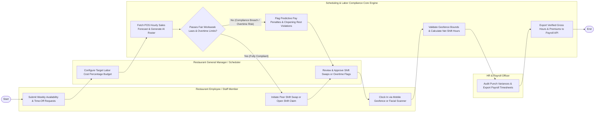

# Swimlane Diagram — Restaurant Staff Scheduling System

## Mermaid Code

## Flow Description | Mo ta luong

| Lane | Actor | Role in Flow |
|------|-------|-------------|
| **Lane 1** | Restaurant Employee / Staff Member | Submits weekly availability patterns, initiates peer shift swaps, claims open shifts, and clocks in via geofenced mobile GPS or facial scanners. |
| **Lane 2** | Restaurant General Manager / Scheduler | Configures labor cost percentage budgets (e.g., 28%), reviews AI-generated rosters, approves shift swaps, and overrides punch variances. |
| **Lane 3** | HR & Payroll Officer | Audits verified timecards, checks meal break compliance, verifies overtime calculations, and exports timesheets to payroll. |
| **Lane 4** | Scheduling & Labor Compliance Core Engine | Fetches POS sales forecasts, auto-generates shift rosters, enforces Fair Workweek/clopening laws, validates geofenced punches, and exports payroll data. |

### Process Execution Steps | Cac buoc thuc hien quy trinh

1. **Availability & Demand Forecasting**: Restaurant Staff submits availability (`C1`). Manager sets target labor cost % budget (`M1`). Core Engine fetches POS sales forecasts and generates AI roster (`S1`).
2. **Labor Compliance Audit**: Core Engine audits schedule against Fair Workweek laws and overtime limits (`S2`).
   - If **No (Compliance Breach / Overtime Risk)**: Core Engine flags predictive pay penalties and clopening rest violations (`S3`), requiring Manager review (`M2`).
   - If **Yes (Fully Compliant)**: Staff initiates peer shift swap or claims open shift (`C2`), and Manager approves (`M2`).
3. **Time Clocking & Punch Validation**: Staff clocks in via mobile GPS geofence or facial scanner (`C3`). Core Engine validates geofence bounds and computes net shift hours (`S4`).
4. **Timesheet Reconciliation & Payroll**: HR/Payroll Officer audits punch variances (`P1`). Core Engine exports verified gross hours, overtime, and split-shift premiums to external payroll API (`S5`), completing execution (`Finish`).
