# Action Tree — Restaurant Staff Scheduling System

## Mermaid Code

```mermaid
graph TD
    Root["Restaurant Staff Scheduling System"]

    Root --> M1["Employee Availability & Skill Role Profiles"]
    Root --> M2["POS Sales Forecasting & Auto-Scheduling Engine"]
    Root --> M3["Shift Swaps, Open Shift Claims & Time-Off"]
    Root --> M4["Geofenced Mobile GPS Time Clock & Punch Logs"]
    Root --> M5["Fair Workweek & Overtime Compliance Rules"]
    Root --> M6["Timesheet Reconciliation & Payroll Export"]
    Root --> M7["Labor Analytics & System Administration"]

    M1 --> A11["Define Weekly Recurring Staff Availability Patterns"]
    M1 --> A12["Track Employee Job Qualifications and Role Eligibility"]
    M1 --> A13["Monitor Mandatory ServSafe and TABC License Expirations"]
    M1 --> A14["Flag Minor Employee Age Work Restriction Profiles"]

    M2 --> A21["Fetch POS Hourly Sales Velocity and Cover Forecasts"]
    M2 --> A22["Generate AI Demand Based Weekly Shift Schedules"]
    M2 --> A23["Configure Target Labor Cost Percentage Budget Limits"]
    M2 --> A24["Publish and Broadcast Shift Schedules to Mobile Apps"]

    M3 --> A31["Process Peer to Peer Shift Swaps and Giveaways"]
    M3 --> A32["Broadcast Unfilled Open Shift Claims to Off-Duty Staff"]
    M3 --> A33["Manage Paid and Unpaid Time-Off Request Approvals"]
    M3 --> A34["Validate Skill Eligibility for Shift Trade Recipients"]

    M4 --> A41["Verify Mobile Device GPS Location Geofence Bounds"]
    M4 --> A42["Execute Tablet Biometric Facial Recognition Clock Ins"]
    M4 --> A43["Lock Early Un-Authorized Clock Ins Outside Buffer"]
    M4 --> A44["Log Mandatory Meal Break and Rest Period Timestamps"]

    M5 --> A51["Enforce Fair Workweek 14 Day Advance Notice Rules"]
    M5 --> A52["Audit 11 Hour Clopening Rest Gaps Between Shifts"]
    M5 --> A53["Calculate Real-Time Overtime Warning Threshold Alerts"]
    M5 --> A54["Calculate Statutory Split-Shift Premium Pay Rates"]

    M6 --> A61["Reconcile Missed Punches and Manager Overrides"]
    M6 --> A62["Calculate Regular Overtime and Split Shift Hours"]
    M6 --> A63["Export Audited Timesheet Ledgers to External Payroll API"]
    M6 --> A64["Sync Tip Pool Allocation Totals for Payroll Processing"]

    M7 --> A71["Monitor Labor Cost Percentage vs Projected Daily Revenue"]
    M7 --> A72["Analyze Sales Per Labor Hour SPLH and Efficiency"]
    M7 --> A73["Manage Security Roles Employee Manager Payroll Admin"]
    M7 --> A74["Manage Geofence Radius Parameters and Integration APIs"]
```

## Module Description | Mo ta Module

| # | Module | Description | Actions |
|---|--------|-------------|---------|
| 1 | Employee Availability & Skill Role Profiles | Manages weekly staff availability, job role qualifications (Server, Cook, Bartender), ServSafe/TABC license expiration dates, and minor labor profiles. | Define Weekly Recurring Staff Availability Patterns, Track Employee Job Qualifications and Role Eligibility, Monitor Mandatory ServSafe and TABC License Expirations, Flag Minor Employee Age Work Restriction Profiles |
| 2 | POS Sales Forecasting & Auto-Scheduling Engine | Ingests POS sales velocity forecasts, auto-generates demand-based shift rosters, enforces target labor cost % budgets, and broadcasts schedules. | Fetch POS Hourly Sales Velocity and Cover Forecasts, Generate AI Demand Based Weekly Shift Schedules, Configure Target Labor Cost Percentage Budget Limits, Publish and Broadcast Shift Schedules to Mobile Apps |
| 3 | Shift Swaps, Open Shift Claims & Time-Off | Handles peer-to-peer shift trades, open shift broadcasts, paid/unpaid time-off requests, and validates trade recipient skill eligibility. | Process Peer to Peer Shift Swaps and Giveaways, Broadcast Unfilled Open Shift Claims to Off-Duty Staff, Manage Paid and Unpaid Time-Off Request Approvals, Validate Skill Eligibility for Shift Trade Recipients |
| 4 | Geofenced Mobile GPS Time Clock & Punch Logs | Validates 100-meter GPS geofences, executes biometric facial recognition clock-ins, locks early punches, and logs 30-minute meal break timestamps. | Verify Mobile Device GPS Location Geofence Bounds, Execute Tablet Biometric Facial Recognition Clock Ins, Lock Early Un-Authorized Clock Ins Outside Buffer, Log Mandatory Meal Break and Rest Period Timestamps |
| 5 | Fair Workweek & Overtime Compliance Rules | Audits Fair Workweek 14-day advance notice laws, enforces 11-hour clopening rest gaps, flags overtime alerts, and calculates split-shift premiums. | Enforce Fair Workweek 14 Day Advance Notice Rules, Audit 11 Hour Clopening Rest Gaps Between Shifts, Calculate Real-Time Overtime Warning Threshold Alerts, Calculate Statutory Split-Shift Premium Pay Rates |
| 6 | Timesheet Reconciliation & Payroll Export | Reconciles punch variances/manager overrides, computes gross wage hours (Regular, Overtime, Split-Shift), and exports timesheets to Payroll APIs. | Reconcile Missed Punches and Manager Overrides, Calculate Regular Overtime and Split Shift Hours, Export Audited Timesheet Ledgers to External Payroll API, Sync Tip Pool Allocation Totals for Payroll Processing |
| 7 | Labor Analytics & System Administration | Displays executive dashboards on labor cost %, Sales Per Labor Hour (SPLH), overtime leakage, geofence settings, security roles, and APIs. | Monitor Labor Cost Percentage vs Projected Daily Revenue, Analyze Sales Per Labor Hour SPLH and Efficiency, Manage Security Roles Employee Manager Payroll Admin, Manage Geofence Radius Parameters and Integration APIs |
