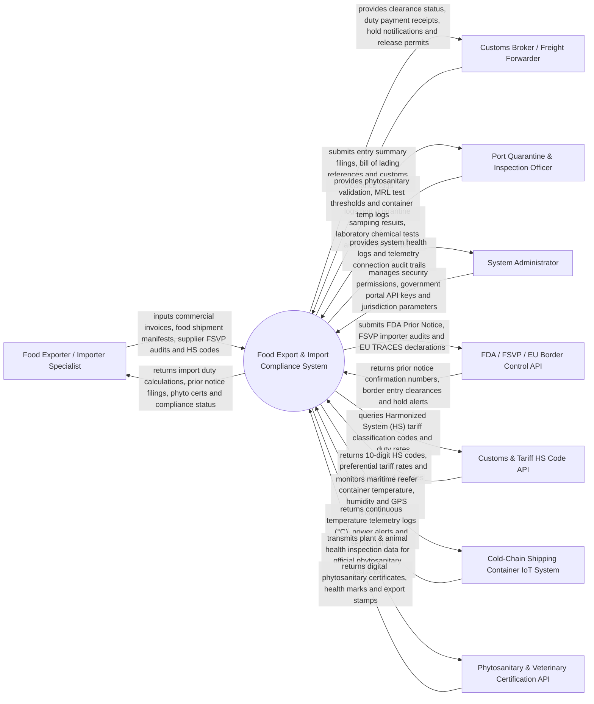

# Context Diagram — Food Export & Import Compliance System

## Mermaid Code

## Actor & Interaction Table | Bang Actor & Tuong tac

| # | Actor | Actor Type | Data Sent TO System | Data Received FROM System | Notes |
|---|-------|------------|---------------------|---------------------------|-------|
| 1 | Food Exporter / Importer Specialist | Primary | Commercial invoices, packing lists, FSVP supplier audits, batch lot IDs, origin declarations | Calculated customs duties, FDA prior notice confirmations, phytosanitary certs, compliance badges | Trade compliance manager overseeing international food import/export logistics. |
| 2 | Customs Broker / Freight Forwarder | Primary | Entry summary filings (CBP Form 7501), bill of lading (B/L) numbers, port arrival manifests | Customs clearance release tokens, duty settlement receipts, port hold notices | Licensed customs broker clearing food shipments through sea/air ports of entry. |
| 3 | Port Quarantine & Inspection Officer | Primary | Physical inspection logs, laboratory chemical MRL sample results, detention/refusal orders | Phytosanitary certificate validations, chemical residue thresholds, reefer temp logs | Government food safety inspector (USDA APHIS, FDA, EU Border Control) at port. |
| 4 | System Administrator | Primary | User credentials, security access roles, government API credentials, system configuration | System uptime logs, government API latency metrics, security audit trails | Manages IT infrastructure, API credentials for government trade portals, and security. |
| 5 | FDA / FSVP / EU Border Control API | Supporting | Prior notice confirmation numbers (PNC), FSVP importer registration verifications, TRACES NT tokens | FDA Prior Notice filings, FSVP foreign supplier hazard analyses, EU import declarations | Government regulatory trade portals (US FDA ACE, EU TRACES NT, Japan MAFF). |
| 6 | Customs & Tariff HS Code API | Supporting | 10-digit Harmonized Tariff Schedule (HTS) codes, MFN tariff rates, free trade agreement rules | Duty rate calculations, trade preference eligibility, anti-dumping duty schedules | World Customs Organization (WCO) & national customs tariff database engines. |
| 7 | Cold-Chain Container IoT System | Supporting | Maritime reefer container GPS coordinates, internal temp logs (°C), humidity % readings | Temperature threshold breach warnings, sensor telemetry acknowledgments | Satellite/cellular IoT telemetry hardware installed on refrigerated shipping containers. |
| 8 | Phytosanitary & Veterinary API | Supporting | Digital phytosanitary certificates, electronic ePhyto XML seals, veterinary health marks | International plant/animal health clearance certificates, export stamps | Government agricultural agencies (USDA APHIS, EU IPPC ePhyto hub) issuing health certs. |

## System Boundary Description | Mo ta Pham vi He thong

The **Food Export & Import Compliance System** manages international food trade compliance, Foreign Supplier Verification Program (FSVP) hazard audits, Harmonized System (HS) tariff classification, FDA Prior Notice / EU TRACES filings, phytosanitary/veterinary health documentation, Maximum Residue Limit (MRL) chemical testing verification, maritime reefer cold-chain telemetry tracking, customs duty calculation, and port quarantine detention clearance. Inside its boundary, the system handles food lot batch traceability, foreign supplier hazard analysis verification, 10-digit HTS code mapping, Free Trade Agreement (FTA) Certificate of Origin validation, automated FDA Prior Notice submission, cold-chain temperature breach logging, customs duty/excise tax computation, and quarantine refusal management.

The system boundary excludes physical sailing of cargo ships, physical laboratory chemical spectrometry analysis, physical port crane loading, and raw credit card processing.
