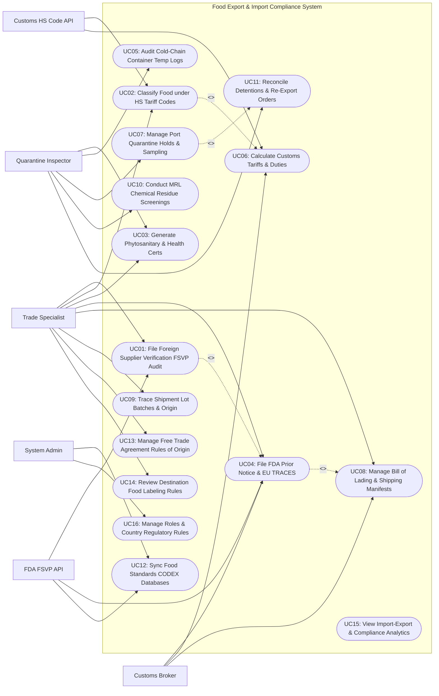

# Use Case Diagram — Food Export & Import Compliance System

## Mermaid Code

## Actor Table | Bang Actor

| # | Actor | Actor Type | Role Description | Related Use Cases |
|---|-------|------------|------------------|-------------------|
| 1 | FDA FSVP API | Secondary System | US FDA Automated Commercial Environment (ACE) system processing FSVP audits and Prior Notice filings. | UC01, UC04, UC12 |
| 2 | Customs HS Code API | Secondary System | World Customs Organization tariff classification engine providing 10-digit HTS codes and duty rates. | UC02, UC06 |
| 3 | Trade Specialist | Primary | Food import/export manager filing supplier audits, classifying products under HTS codes, and generating health certs. | UC01, UC02, UC03, UC04, UC08, UC09, UC13, UC14 |
| 4 | Customs Broker | Primary | Licensed customs broker filing Customs Entry Summaries (CBP Form 7501), paying tariffs, and releasing shipments. | UC04, UC06, UC08 |
| 5 | Quarantine Inspector | Primary | Port food safety officer inspecting plant/animal health, monitoring reefer container temps, and managing detentions. | UC03, UC05, UC07, UC10, UC11 |
| 6 | System Administrator | Primary | Technical manager configuring regulatory jurisdiction rulesets, government portal API keys, security roles, and audit logs. | UC12, UC16 |

## Use Case Table | Bang Use Case

| # | UC ID | Use Case Name | Primary Actor | Secondary Actor | Description | Priority |
|---|-------|---------------|---------------|-----------------|-------------|----------|
| 1 | UC01 | File Foreign Supplier Verification FSVP Audit | Trade Specialist | FDA FSVP API | Files mandatory FDA FSVP hazard analyses and annual verification audits for foreign food manufacturing facilities. | High |
| 2 | UC02 | Classify Food under HS Tariff Codes | Trade Specialist | Customs HS Code API | Classifies food products under the 10-digit Harmonized Tariff Schedule (HTS), binding chapters 01-24 to product SKUs. | High |
| 3 | UC03 | Generate Phytosanitary & Health Certs | Trade Specialist | Quarantine Inspector | Generates official ePhyto plant health certificates and veterinary sanitary export seals for international shipment clearance. | High |
| 4 | UC04 | File FDA Prior Notice & EU TRACES | Trade Specialist | Customs Broker | Submits mandatory electronic FDA Prior Notice confirmations and EU TRACES NT import declarations prior to shipment port arrival. | High |
| 5 | UC05 | Audit Cold-Chain Container Temp Logs | Quarantine Inspector | None | Monitors satellite IoT telemetry from refrigerated maritime containers (reefers) to verify 2°C-4°C temperature maintenance during ocean transit. | High |
| 6 | UC06 | Calculate Customs Tariffs & Duties | Customs Broker | Customs HS Code API | Calculates import customs tariffs, harbor maintenance fees (HMF), merchandise processing fees (MPF), and preferential FTA rates. | High |
| 7 | UC07 | Manage Port Quarantine Holds & Sampling | Quarantine Inspector | None | Tracks port customs holds, physical agriculture inspections, and laboratory sample extractions for high-risk food shipments. | High |
| 8 | UC08 | Manage Bill of Lading & Shipping Manifests | Trade Specialist | Customs Broker | Binds Master Bill of Lading (MBL), House Bill of Lading (HBL), Commercial Invoices, and Packing Lists into a unified shipping folder. | High |
| 9 | UC09 | Trace Shipment Lot Batches & Origin | Trade Specialist | None | Traces export food shipments down to individual farm harvest lot batch numbers, manufacturing dates, and grower origin facilities. | High |
| 10 | UC10 | Conduct MRL Chemical Residue Screenings | Quarantine Inspector | None | Evaluates chemical laboratory test results against Maximum Residue Limits (MRL) for pesticides, heavy metals, and veterinary drugs. | High |
| 11 | UC11 | Reconcile Detentions & Re-Export Orders | Quarantine Inspector | None | Manages regulatory customs detentions, FDA Import Alerts (Red List), re-export manifests, or supervised port destruction orders. | High |
| 12 | UC12 | Sync Food Standards CODEX Databases | System Admin | FDA FSVP API | Synchronizes international food safety standards (CODEX Alimentarius, US FDA FSMA, EU Food Law) to maintain active compliance rules. | High |
| 13 | UC13 | Manage Free Trade Agreement Rules of Origin | Trade Specialist | None | Validates regional value content (RVC) percentages and issues Certificates of Origin for tariff exemptions under USMCA, EVFTA, or CPTPP. | Medium |
| 14 | UC14 | Review Destination Food Labeling Rules | Trade Specialist | None | Audits product packaging labels against destination country regulations (Language translation, metric net weight, local allergen laws). | Medium |
| 15 | UC15 | View Import-Export & Compliance Analytics | Trade Specialist | None | Displays analytical dashboards on total trade shipment volume (TEUs/Tons), customs clearance speed, duty expenditures, and audit pass rates. | High |
| 16 | UC16 | Manage Roles & Country Regulatory Rules | System Admin | None | Configures user security access roles, country regulatory rulesets, government portal API keys, and system compliance audit logs. | High |

## Use Case Specification | Dac ta Use Case

---

### UC01 — File Foreign Supplier Verification FSVP Audit

| Field | Detail |
|-------|--------|
| **UC ID** | UC01 |
| **Use Case Name** | File Foreign Supplier Verification FSVP Audit |
| **Actor(s)** | Primary: Trade Specialist   Secondary: FDA FSVP API |
| **Description** | Conducts and records mandatory US FDA Foreign Supplier Verification Program (FSVP) hazard analyses, verifying foreign food manufacturing facility safety compliance (HACCP/PCQI), audit history, and issuing FSVP importer verification clearance. |
| **Precondition** | 1. Foreign food manufacturer profile is registered in system.   2. Importer of Record holds active FDA FSVP Importer DUNS / FEI number. |
| **Main Flow** | 1. Trade Specialist opens "FSVP Supplier Verification Module" for foreign seafood supplier: `Pacific Ocean Seafoods Ltd (Vietnam)`.   2. Specialist reviews Hazard Analysis & Critical Control Point (HACCP) documentation uploaded by supplier:      - Biological Hazards: *Vibrio, Salmonella, Histamine*      - Chemical Hazards: *Chloramphenicol, Heavy Metals*      - Physical Hazards: *Metal Fragments*.   3. Specialist inputs Annual On-Site Audit Record: Audit conducted by GFSI-certified auditor (SQF Level 3 Certificate #SQF-9022); Audit Date: April 12, 2026; Grade: **EXCELLENT / 98%**.   4. Specialist inputs FDA Facility Registration Number (FEI #1928374) and DUNS Number (`98-765-4321`).   5. System sends verification query to FDA FSVP API (UC12).   6. FDA API confirms supplier status: `FDA FEI Active | No Import Alert (Red List) Entries | Last FDA Inspection Status: VAI (Voluntary Action Indicated)`.   7. System evaluates FSVP Importer Determination Rule (21 CFR 1.500): `FSVP COMPLIANCE APPROVED`.   8. System issues FSVP Clearance Token (`#FSVP-APPROVED-2026-9022`), binds token to supplier profile, and enables import shipment creation for this facility (UC04). |
| **Alternative Flow** | **AF1** — Modified FSVP for small foreign supplier:   1. Foreign supplier qualifies as a Very Small Foreign Supplier (< $1M annual sales).   2. System applies Modified FSVP verification workflow requiring annual written compliance attestation instead of on-site audit. |
| **Exception Flow** | **EX1** — Foreign supplier listed on FDA Import Alert Red List:   1. FDA API indicates supplier is listed on Import Alert #16-124 (Detention Without Physical Examination for Unapproved Antibiotics).   2. System flags **CRITICAL FSVP BLOCK: Supplier on FDA Red List**, revokes FSVP clearance, and blocks shipment filing (UC04). |
| **Postcondition** | Foreign supplier hazard analysis and on-site audit are verified, FDA FSVP clearance token is issued, and import filings are enabled. |
| **Business Rule** | **BR1**: US Food Importers MUST maintain a verified FSVP hazard analysis and annual audit file for EVERY foreign food supplier per 21 CFR 1.500.   **BR2**: Shipments originating from foreign suppliers without an active, approved FSVP clearance token MUST be blocked from customs entry filing. |

---

### UC02 — Classify Food under HS Tariff Codes

| Field | Detail |
|-------|--------|
| **UC ID** | UC02 |
| **Use Case Name** | Classify Food under HS Tariff Codes |
| **Actor(s)** | Primary: Trade Specialist   Secondary: Customs HS Code API |
| **Description** | Classifies imported or exported food products under the official 10-digit Harmonized Tariff Schedule (HTS) of the destination country, determining applicable MFN tariff rates, quota limits, and trade agreement preference eligibility. |
| **Precondition** | 1. Product technical specification and processing details (e.g., Frozen Cooked Shrimp) are provided.   2. Destination country customs tariff database is active. |
| **Main Flow** | 1. Trade Specialist opens "HS Tariff Classification Engine" for new product import SKU: `Frozen Peeled & Tail-On Cooked Black Tiger Shrimp`.   2. Specialist searches tariff hierarchy via Customs HS Code API:      - Chapter 03: *Fish and Crustaceans, Molluscs and Other Aquatic Invertebrates*      - Heading 0306: *Crustaceans, whether in shell or not, cooked by steaming or by boiling in water...*      - Subheading 0306.17: *Other Shrimps and Prawns: Frozen*      - US National Statistical Suffix: `0306.17.00.40 (Peeled, Frozen, Cooked Shrimps)`.   3. System verifies 10-digit HTS Code: `0306.17.00.40`.   4. System queries tariff rate schedules for Country of Origin = Vietnam:      - Most Favored Nation (MFN) Duty Rate: **FREE (0.0%)**      - Merchandise Processing Fee (MPF): 0.3464% ad valorem      - Harbor Maintenance Fee (HMF): 0.125% ad valorem      - Special Trade Sanction / Section 301 Tariff: None.   5. System binds HTS Code `0306.17.00.40` to Product SKU #SKU-SHRIMP-01.   6. System saves classification file, attaching General Rules of Interpretation (GRI) rationale note for customs audit defense. |
| **Alternative Flow** | **AF1** — Free Trade Agreement (FTA) preferential rate application:   1. Product is Organic Avocado imported from Mexico under USMCA.   2. System applies USMCA Duty Preference Code "S", reducing tariff to 0.0% upon verification of Certificate of Origin (UC13). |
| **Exception Flow** | **EX1** — Tariff rate quota (TRQ) exceeded:   1. Product is imported Raw Sugar under HTS 1701.14.1000.   2. System detects TRQ in-quota limit is 100% filled, applying higher over-quota tariff rate (33.87 cents/kg). |
| **Postcondition** | Product is classified under 10-digit HTS code, duty rates and fees are determined, and classification record is bound to SKU. |
| **Business Rule** | **BR1**: Food products MUST be classified under the exact 10-digit HTS code of the importing country to ensure lawful duty payment.   **BR2**: Classification determinations MUST include documented General Rules of Interpretation (GRI) justification to withstand customs audits. |

---

### UC03 — Generate Phytosanitary & Health Certs

| Field | Detail |
|-------|--------|
| **UC ID** | UC03 |
| **Use Case Name** | Generate Phytosanitary & Health Certs |
| **Actor(s)** | Primary: Trade Specialist, Quarantine Inspector   Secondary: None |
| **Description** | Generates official electronic Phytosanitary Certificates (for plant food exports) or Veterinary Health Certificates (for animal product exports), transmitting digital ePhyto XML seals to importing country quarantine authorities. |
| **Precondition** | 1. Export food shipment lot batch data (UC09) is verified.   2. Pre-export agricultural inspection is completed with zero quarantine pests detected. |
| **Main Flow** | 1. Trade Specialist opens "Phytosanitary & Health Certificate Portal" for agricultural export shipment: `20 Metric Tons Fresh Hass Avocados to Japan`.   2. Specialist inputs Export Shipment Details: Exporter Name, Consignee Name (Tokyo Fresh Market Inc), Port of Loading (Los Angeles), Port of Discharge (Yokohama), Conveyance (Vessel: MV Ocean Star).   3. Specialist attaches Pre-Export Inspection Report executed by USDA APHIS Inspector:      - Inspection Result: `Free from Medfly (Ceratitis capitata) and Avocado Scab`      - Cold Treatment Log: `14 Days at 1.1°C (Disinfestation Protocol Completed)`.   4. System formats International Plant Protection Convention (IPPC) ePhyto Standard XML Data Payload.   5. Authorized Quarantine Inspector reviews inspection evidence, applies digital cryptographic X.509 signature seal, and clicks "Issue Phytosanitary Certificate".   6. System generates Official Phytosanitary Certificate Number: `#US-APHIS-PHYTO-2026-9022`.   7. System transmits digital ePhyto XML payload directly to Japan MAFF Quarantine Portal via IPPC ePhyto Hub API.   8. System outputs high-resolution PDF certificate featuring official government seal, QR verification code, and security watermark for shipping documents (UC08). |
| **Alternative Flow** | **AF1** — Veterinary Health Certificate for meat/dairy exports:   1. Shipment contains Frozen US Prime Beef exported to EU.   2. System generates EU Official Veterinary Certificate, verifying USDA FSIS Inspection Stamp #EST-382 and non-hormone treated cattle (NHTC) certification. |
| **Exception Flow** | **EX1** — Quarantine pest detected during pre-export audit:   1. Inspector detects live Mediterranean Fruit Fly larvae in sample.   2. System blocks certificate generation, issues **QUARANTINE REJECTION NOTICE**, and orders lot quarantine treatment. |
| **Postcondition** | Official Phytosanitary or Health Certificate is digitally signed, ePhyto XML payload is transmitted to destination country, and PDF is issued. |
| **Business Rule** | **BR1**: Phytosanitary certificates CANNOT be issued without verified pre-export agricultural inspection reports confirming freedom from quarantine pests.   **BR2**: Electronic ePhyto certificates MUST be transmitted via encrypted IPPC hub protocols to prevent fraudulent health certificate forging. |

---

### UC04 — File FDA Prior Notice & EU TRACES

| Field | Detail |
|-------|--------|
| **UC ID** | UC04 |
| **Use Case Name** | File FDA Prior Notice & EU TRACES |
| **Actor(s)** | Primary: Trade Specialist, Customs Broker   Secondary: FDA FSVP API |
| **Description** | Submits mandatory electronic FDA Prior Notice of Imported Food filings (via US Customs ACE Portal) or EU TRACES NT Common Health Entry Documents (CHED) prior to shipment port arrival, receiving prior notice confirmation tokens. |
| **Precondition** | 1. Commercial Invoice, Bill of Lading, and HTS codes (UC02/UC08) are complete.   2. Foreign supplier FSVP verification (UC01) is active. |
| **Main Flow** | 1. Trade Specialist opens "Border Prior Notice Filing Module" for ocean shipment arriving at Port of Long Beach in 5 days.   2. System compiles required FDA Prior Notice Data Elements (per Bioterrorism Act of 2002):      - Article of Food: Frozen Cooked Black Tiger Shrimp (HTS 0306.17.00.40)      - Quantity: 1,200 Master Cartons (Net Weight: 14,400 kg)      - Manufacturer / Producer: Pacific Ocean Seafoods Ltd (FDA FEI #1928374)      - FSVP Importer of Record: Pacific Coast Trading Co. (DUNS #98-765-4321) (UC01)      - Shipper & Country of Harvest: Vietnam      - Anticipated Port of Arrival: Port of Long Beach (Port Code 2709)      - Anticipated Arrival Date/Time: July 27, 2026 at 08:00 AM      - Carrier & Bill of Lading: Maersk Line | MBL #MAEU90228812.   3. Specialist clicks "Submit FDA Prior Notice Filing".   4. System transmits Prior Notice XML payload to US Customs ACE Portal via FDA FSVP API.   5. FDA ACE System validates data elements, verifies foreign facility registration, and clears submission within 4.2 seconds.   6. FDA API returns **Prior Notice Confirmation Number (PNC)**: `#PNC-2026-07-90228812`.   7. System appends PNC code to Customs Entry Summary (CBP Form 7501) and dispatches confirmation barcode sheet to Customs Broker (UC08). |
| **Alternative Flow** | **AF1** — EU TRACES NT CHED-P filing for European imports:   1. Shipment is entering EU via Port of Rotterdam.   2. System files Common Health Entry Document for Products (CHED-P) on EU TRACES NT portal, receiving CHED reference number. |
| **Exception Flow** | **EX1** — Late Prior Notice submission (Port arrival time rule breach):   1. Filing attempted 4 hours prior to ocean vessel arrival (FDA requires min 8 hours advance notice for ocean freight).   2. System flags red warning **FDA TIMING VIOLATION: Ocean freight requires >= 8 hours Prior Notice before arrival**, prompting urgent broker intervention. |
| **Postcondition** | FDA Prior Notice or EU TRACES filing is accepted by government API, PNC confirmation code is generated, and customs entry is cleared. |
| **Business Rule** | **BR1**: FDA Prior Notice MUST be submitted and accepted before arrival: min 8 hours prior for ocean, 4 hours for air, 2 hours for road freight.   **BR2**: Food imported without a valid FDA Prior Notice Confirmation Number (PNC) is subject to mandatory refusal of admission and port hold. |

---

### UC06 — Calculate Customs Tariffs & Duties

| Field | Detail |
|-------|--------|
| **UC ID** | UC06 |
| **Use Case Name** | Calculate Customs Tariffs & Duties |
| **Actor(s)** | Primary: Customs Broker   Secondary: Customs HS Code API |
| **Description** | Calculates total import customs duties, ad valorem tariffs, harbor maintenance fees, merchandise processing fees, excise taxes, and trade preference savings prior to customs entry summary filing. |
| **Precondition** | 1. Shipment invoice values, HTS classification codes (UC02), and Country of Origin are entered.   2. Official currency exchange rates are updated. |
| **Main Flow** | 1. Customs Broker opens "Customs Duty & Tax Calculator" for import entry: `1,200 Cartons Frozen Seafood from Vietnam`.   2. Broker enters Commercial Invoice Total Value: `$120,000.00 USD (FOB Origin Port)`.   3. Broker adds International Freight & Marine Insurance Costs: `Freight: $4,500.00 USD | Insurance: $500.00 USD -> Total CIF Value = $125,000.00 USD`.   4. System queries Customs HS Code API for HTS Code `0306.17.00.40` ad valorem rates:      - Base MFN Customs Duty (0.0%): `$0.00`      - Merchandise Processing Fee (MPF) (0.3464% of FOB Value $120,000.00; Min $31.67 / Max $614.35): `$415.68`      - Harbor Maintenance Fee (HMF) (0.125% of CIF Value $125,000.00): `$156.25`      - Total Estimated Customs Fees & Taxes: `$571.93 USD`.   5. System checks for applicable countervailing or anti-dumping duties (ADD):      - ADD Inquiry: `Vietnamese Frozen Warmwater Shrimp -> Subject to ADD Rate of 2.84%`      - Anti-Dumping Duty Amount: `$120,000.00 * 2.84% = $3,408.00 USD`.   6. System computes Total Customs Payable Amount: `$571.93 Fees + $3,408.00 ADD = $3,979.93 USD`.   7. Broker reviews itemized duty ledger, approves tax calculations, and embeds duty payable payload into CBP Form 7501 Customs Entry Summary. |
| **Alternative Flow** | **AF1** — Wine & Spirits alcohol excise tax calculation:   1. Shipment is 500 cases of French Wine (HTS 2204.21.50).   2. System calculates Federal Alcohol Excise Tax ($1.07 / gallon for wine under 16% ABV) under CBMA tax rate provisions. |
| **Exception Flow** | **EX1** — Currency exchange rate fluctuation error:   1. Invoice is billed in Euros (€100,000.00).   2. System queries US Customs official weekly exchange rate API, converting Euros to USD before duty calculation. |
| **Postcondition** | Import customs duties, MPF/HMF fees, anti-dumping duties, and excise taxes are itemized and embedded into customs entry summary. |
| **Business Rule** | **BR1**: Customs duty calculations MUST incorporate ad valorem tariffs, specific unit duties, MPF/HMF fees, and applicable anti-dumping duty orders.   **BR2**: Valuation for duty assessment MUST conform to WTO Customs Valuation Agreement rules (CIF or FOB value depending on importing nation). |
