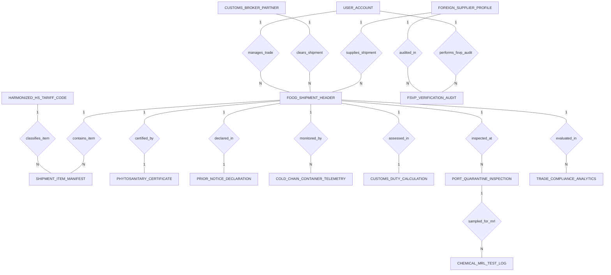

# Conceptual ERD — Food Export & Import Compliance System

## Mermaid Code

## Entity Description Table | Bang mo ta Entity

| # | Entity Name | Vietnamese Name | Description | Key Attributes | Main Relationships |
|---|-------------|-----------------|-------------|----------------|-------------------|
| 1 | FOOD_SHIPMENT_HEADER | Lô hang xuat nhap khau master | Master international food shipment header, supplier ID, broker ID, reference #, Bill of Lading (MBL), export/import country codes, ETA date, and status. | shipment_id, supplier_id, broker_id, shipment_reference_no, master_bill_of_lading, import_country_code, shipment_status | Belongs to FOREIGN_SUPPLIER_PROFILE, CUSTOMS_BROKER_PARTNER; One-to-Many with SHIPMENT_ITEM_MANIFEST, COLD_CHAIN_CONTAINER_TELEMETRY, PORT_QUARANTINE_INSPECTION, TRADE_COMPLIANCE_ANALYTICS; One-to-One with PHYTOSANITARY_CERTIFICATE, PRIOR_NOTICE_DECLARATION, CUSTOMS_DUTY_CALCULATION |
| 2 | FOREIGN_SUPPLIER_PROFILE | Ho so nha cung cap nuoc ngoai | Foreign food manufacturing supplier profile, FDA FEI #, DUNS #, facility name, country, FSVP cleared status, and audit expiry date. | supplier_id, fda_fei_number, duns_number, facility_name, facility_country, is_fsvp_cleared, fsvp_audit_expiry_date | One-to-Many with FSVP_VERIFICATION_AUDIT, FOOD_SHIPMENT_HEADER |
| 3 | HARMONIZED_HS_TARIFF_CODE | Ma thue quan HS 10 so | World Customs Organization 10-digit Harmonized Tariff Schedule (HTS) code, product description, MFN duty %, MPF fee %, and prior notice requirement flag. | hs_id, hs_code_10digit, product_description, mfn_duty_rate_pct, mpf_fee_rate_pct, requires_prior_notice | One-to-Many with SHIPMENT_ITEM_MANIFEST |
| 4 | SHIPMENT_ITEM_MANIFEST | Chi tiet mat hang trong container | Line item in a shipment manifest specifying HTS code ID, lot batch number, product name, net weight kg, and FOB commercial invoice value $. | item_id, shipment_id, hs_id, lot_batch_number, product_name, net_weight_kg, invoice_value_fob_usd | Belongs to FOOD_SHIPMENT_HEADER, HARMONIZED_HS_TARIFF_CODE |
| 5 | FSVP_VERIFICATION_AUDIT | Nhat ky kiem dinh FSVP | FDA Foreign Supplier Verification Program (FSVP) hazard audit record, supplier ID, auditor ID, audit date, HACCP score, audit result, and clearance token. | audit_id, supplier_id, inspector_user_id, audit_date, haccp_audit_score, audit_result_status, fsvp_clearance_token | Belongs to FOREIGN_SUPPLIER_PROFILE, USER_ACCOUNT |
| 6 | PHYTOSANITARY_CERTIFICATE | Giay chung nhan kiem dịch thuc vat | Official ePhyto plant or animal health export certificate record, cert number, issuing authority, inspection date, ePhyto signed boolean, and digital seal. | cert_id, shipment_id, cert_number, issuing_authority, inspection_date, is_eppo_signed, digital_seal_hash | One-to-One with FOOD_SHIPMENT_HEADER |
| 7 | PRIOR_NOTICE_DECLARATION | Khai bao báo truóc FDA Prior Notice | FDA Prior Notice of Imported Food declaration, shipment ID, FDA PNC confirmation number, filing timestamp, scheduled arrival time, and status. | notice_id, shipment_id, fda_pnc_number, filing_timestamp, port_arrival_scheduled, prior_notice_status | One-to-One with FOOD_SHIPMENT_HEADER |
| 8 | COLD_CHAIN_CONTAINER_TELEMETRY | Nhat ky nhiet do container chuoi lanh | Maritime refrigerated shipping container (reefer) IoT telemetry log recording container #, internal temp °C, humidity %, temperature breach boolean, and timestamp. | telemetry_id, shipment_id, reefer_container_no, internal_temp_celsius, humidity_rh_pct, is_temp_breached, logged_at | Belongs to FOOD_SHIPMENT_HEADER |
| 9 | CUSTOMS_DUTY_CALCULATION | Tinh thue va phi hai quan | Customs import duty calculation record, total CIF value $, customs duty payable $, MPF fee $, anti-dumping duty $, and payment status. | duty_id, shipment_id, total_cif_value_usd, customs_duty_payable, mpf_fee_payable, anti_dumping_duty_payable, payment_status | One-to-One with FOOD_SHIPMENT_HEADER |
| 10 | PORT_QUARANTINE_INSPECTION | Kiem tra kiem dich tai cang | Port quarantine inspection log recorded by agriculture officers, port name, inspection date, quarantine hold status, and physical sample taken boolean. | inspection_id, shipment_id, port_name, inspection_date, quarantine_hold_status, physical_sample_taken | Belongs to FOOD_SHIPMENT_HEADER; One-to-Many with CHEMICAL_MRL_TEST_LOG |
| 11 | CHEMICAL_MRL_TEST_LOG | Nhat ky xet nghiem du luong hoa chat | Laboratory chemical Maximum Residue Limit (MRL) test log, inspection ID, chemical substance name, measured MRL ppm, legal limit ppm, and pass boolean. | test_id, inspection_id, chemical_substance_name, measured_mrl_ppm, legal_mrl_limit_ppm, is_mrl_passed | Belongs to PORT_QUARANTINE_INSPECTION |
| 12 | CUSTOMS_BROKER_PARTNER | Doi tac dai ly hai quan | Licensed customs broker partner profile, license number, company name, contact email, and active status. | broker_id, broker_license_no, company_name, contact_email, is_active | One-to-Many with FOOD_SHIPMENT_HEADER |
| 13 | USER_ACCOUNT | Tai khoan he thong | Core security authentication account holding credentials, password hashes, and user role definitions. | user_id, username, password_hash, role_name | One-to-Many with FSVP_VERIFICATION_AUDIT, FOOD_SHIPMENT_HEADER |
| 14 | TRADE_COMPLIANCE_ANALYTICS | Thong ke hieu qua thuong mai | Executive daily analytics tracking total import/export TEU volume, total customs duties paid $, compliance holds count, and audit pass rate %. | analytics_id, metric_date, total_import_export_teus, total_duties_paid_usd, compliance_holds_count, audit_pass_rate_pct | Evaluates FOOD_SHIPMENT_HEADER |

## Relationship Description | Mo ta Quan he

| # | From Entity | Cardinality | To Entity | Relationship Label | Business Explanation |
|---|-------------|-------------|-----------|-------------------|----------------------|
| 1 | USER_ACCOUNT | One-to-Many | FSVP_VERIFICATION_AUDIT | performs_fsvp_audit | Chuyen gia thuc hien kiem dinh ho so Foreign Supplier Verification Program (FSVP). |
| 2 | FOREIGN_SUPPLIER_PROFILE | One-to-Many | FSVP_VERIFICATION_AUDIT | audited_in | Nha cung cap nuoc ngoai duoc danh gia HACCP va kiem dinh an toan thuc pham. |
| 3 | FOREIGN_SUPPLIER_PROFILE | One-to-Many | FOOD_SHIPMENT_HEADER | supplies_shipment | Nha cung cap nuoc ngoai la nguoi xuat hang trong lo hang master. |
| 4 | CUSTOMS_BROKER_PARTNER | One-to-Many | FOOD_SHIPMENT_HEADER | clears_shipment | Dai ly hai quan thuc hien thu tuc thong quan lo hang. |
| 5 | FOOD_SHIPMENT_HEADER | One-to-Many | SHIPMENT_ITEM_MANIFEST | contains_item | Lo hang master chua nhieu dong chi tiet danh muc mat hang trong container. |
| 6 | HARMONIZED_HS_TARIFF_CODE | One-to-Many | SHIPMENT_ITEM_MANIFEST | classifies_item | Ma thue quan HS 10 so phan loai mat hang de tinh thue hai quan. |
| 7 | FOOD_SHIPMENT_HEADER | One-to-One | PHYTOSANITARY_CERTIFICATE | certified_by | Lo hang duoc cap giay chung nhan kiem dich thuc vat ePhyto ky so. |
| 8 | FOOD_SHIPMENT_HEADER | One-to-One | PRIOR_NOTICE_DECLARATION | declared_in | Lo hang thuc pham duoc khai bao truoc FDA Prior Notice hoac EU TRACES. |
| 9 | FOOD_SHIPMENT_HEADER | One-to-Many | COLD_CHAIN_CONTAINER_TELEMETRY | monitored_by | Container chuoi lanh duoc theo doi nhat ky nhiet do va do am IoT lien tuc. |
| 10 | FOOD_SHIPMENT_HEADER | One-to-One | CUSTOMS_DUTY_CALCULATION | assessed_in | Lo hang duoc tinh thue nhap khau, phi MPF/HMF va thue chong phá gia (ADD). |
| 11 | FOOD_SHIPMENT_HEADER | One-to-Many | PORT_QUARANTINE_INSPECTION | inspected_at | Lo hang duoc kiem tra kiem dich dong thuc vat va lay mau tai cang nhap. |
| 12 | PORT_QUARANTINE_INSPECTION | One-to-Many | CHEMICAL_MRL_TEST_LOG | sampled_for_mrl | Mau kiem dich duoc xet nghiem du luong hoa chat bang MRL ppm. |
| 13 | USER_ACCOUNT | One-to-Many | FOOD_SHIPMENT_HEADER | manages_trade | Chuyen vien quan ly ho so va tien trinh xuat nhap khau. |
| 14 | FOOD_SHIPMENT_HEADER | One-to-Many | TRADE_COMPLIANCE_ANALYTICS | evaluated_in | Cac lo hang duoc thong ke va danh gia chi so thong quan va chi phi thue quan. |
